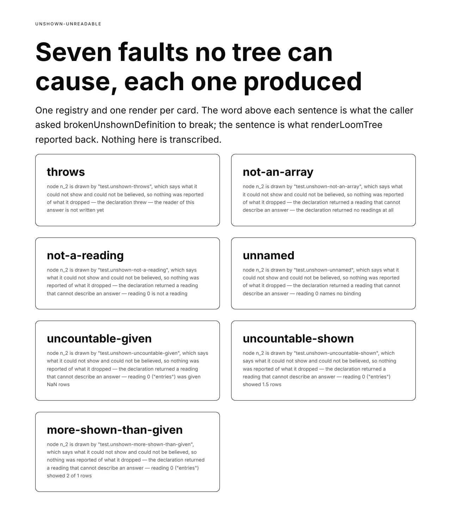

# The fault no tree can cause

**Routine:** `Loom daily build` · **Date:** 2026-10-10 · **Section:** §1
(process), §3 (the render seam) · **Branch:**
`framework-63-the-fault-no-tree-can-cause`



## The migration is done, and this run says so because the brief still asks

The one-application migration is the unit this routine's brief puts above
everything else, and it **already landed, before this run**. Checked rather
than assumed, on `main` at `39c6ef3`:

| what 0067 asked for | state |
| --- | --- |
| `apps/loom` with four route groups | `(marketing)`, `(docs)`, `(lessons)`, `(portal)` — plus `(demo)` and `(preview)` |
| `apps/portal` and `apps/docs` retired | neither directory exists; `apps/` holds `loom` alone |
| sign-in at the `(portal)` boundary | `apps/loom/proxy.ts`, matcher `["/portal", "/portal/:path*"]`, signature verified rather than the cookie's presence |
| one deployment | one `apps/loom/vercel.json`, `pnpm-workspace.yaml` naming `apps/*` and finding one package |
| `docs/deployment.md` updated | rewritten around *"one deployment, four surfaces"*; its only mention of `apps/portal` is a note telling you to repoint a Vercel project created before 19 August |

**Nothing in this run touched any of it**, and the tree is not half-migrated.
The three routines waiting on the shape can start.

I cannot name the pull request that did it: this session's clone is shallow at
fifty commits, and within that horizon the route groups first appear in #520 on
5 October, which may be the move or may be the horizon. The state above is what
matters to the lanes waiting and it was read off the tree.

## What was completed

`@jam-overture/loom/testing` publishes `brokenUnshownDefinition(breakage)` — one
primitive definition whose declaration of what it could not show fails in
whichever of seven ways the caller names, and which is correct in every other
respect.

This closes a finding `Loom docs` filed this morning, and their sentence is the
problem:

> `unshown-unreadable` … is the only one of the twenty-four that neither a tree
> nor a composition root can cause: 0206 put the declaration inside the
> component, so only a component can break it.

That is 0206 working as intended, and it leaves a hole in the testing door. The
other twenty-three codes can be produced by writing a tree or declining to wire
a seam. This one needs a broken component, and there is no broken component —
all five library primitives that declare `unshown` compute the figure from the
answer they were handed, which is the whole point of declaring the function the
component already calls. `undecoratedPrimitive` breaks the §4 decoration
contract, not a declaration.

So every lane that wanted the diagnostic wrote its own. **Three have**, which
is what made this a seam rather than a convenience: `src/render/unshown.test.ts`
has a private `declaring()` helper, `Loom docs` wrote `bench.broken-reporter`
and a section of a page explaining why one row's component had to be invented,
and two more lanes have asked a version of the question in `FINDINGS.md`.

**The picture above is the whole claim.** Seven cards; the word on each is the
only thing a caller writes, and the sentence under it is
`describeRenderDiagnostic` called on a diagnostic that came back from a real
`renderLoomTree` over a real tree with a real source answering a real binding.
One registry and one render per card. Nothing on that sheet is typed into the
specimen file — it could not be, because before this branch no caller could
produce any of it.

## Seven, where the filing asked for one

The filing asked for *a primitive that breaks the declaration it made*.
`UnshownFault` has two arms, `threw` and `impossible`, and the obvious reading
is two. What shipped names seven, one per refusal `readUnshown` actually makes,
and the six under `impossible` are the reason.

`impossible` is the same word for a declaration that returned a number and one
that said it showed thirteen of twelve rows. Those are different mistakes to
recognise in your own code, and only one of them is the mistake a component
author will meet: a declaration that *throws* is caught by the first test
anybody runs. A declaration that quietly reports *two of one* ships. The
parameter costs a table of seven one-line functions and buys the half that gets
shipped.

They are named for **what the author's code did** — `not-an-array`, `unnamed`,
`more-shown-than-given` — rather than for the sentence the runtime writes about
it. The caller is choosing what to break, not what to read, and a name like
`showed-2-of-1` would be a published fixture quoting a message this package may
reword.

## Decisions that were not specified, and why

**It went in `definitions.ts`, not `primitives.ts`.** The filing said *beside
`undecoratedPrimitive`*, which is in `primitives.ts`. But `unshown` is a
declaration, a bare `LoomPrimitive` has nowhere to carry one, and that file's
own first comment says `primitives.ts` is the same components **without**
declarations. The entry point is where a caller meets them side by side, which
is what *beside* meant.

**Its props are declared open, where `loom.card` next door is strict.** A bag
the schema refuses omits the node and its subtree, which takes the declaration
with it — so a strict empty schema lets any unrelated prop hand a lane an empty
diagnostic list in place of the fault it asked for. A stand-in that can be
silenced by a prop is one that will be. This is the single place the fixture
prefers forgiveness to realism, and a test holds it.

**It declares no `reads`, and the absence is load-bearing.** A declared name the
caller did not answer under adds `data-unread` to the render, so the list a lane
asserts would depend on which name it happened to answer. Silent unless declared
is the bargain `reads` already makes, and taking it is what makes the real
promise hold: **one render, one diagnostic, and it is the one that was asked
for**, whatever the caller does.

**The type carries the breakage** — `test.unshown-throws` and so on — so all
seven register in one registry and render in one tree. A lane showing the fault
once per shape needs one of each rather than seven of each, which is the whole
difference between this and the component each lane wrote for itself. The
specimen above is that property being used.

**Broken in the declaration and in nothing else.** It spreads `loom.editable`,
places what it is handed, declares its props and draws an element; the §4 audit
reports it decorated, probeable and dropping no slot, and a test asserts all
three. A fixture with two faults in it cannot isolate either, and a lane whose
registry audit went red because it registered this would learn something false
about its own registry.

**`UnshownBreakage` is read off the list rather than declared beside it**, and
the declaration table is keyed on the type, so a member without a declaration —
or a declaration without a member — is a typecheck error rather than a gap.

## What this does *not* prove, stated as weaker

The list can fall behind the runtime and **nothing here catches that**. A
refusal path added to `readUnshown` with no member added to the list leaves this
door one fault short, silently. There is no construction that fixes it from the
testing side: the refusals are seven `err(…)` sites inside a function, not a
table something can iterate.

What holds instead is three weaker things, and the record and the module's doc
comment both say so in these terms: every member is refused, no two members
produce the same fault, and each one's detail is **pinned to the exact sentence
the runtime writes** — so a message that moves goes red here and somebody reads
the list.

## Records

- Added **0254** — *The testing door publishes one primitive broken in whichever
  way the caller names, and the fault is named for what the author did.*
  `Accepted`. Nothing superseded.

`0245` is claimed by #548 and `0252` is held for #566, both open and unmerged;
`0253` landed this morning. `0254` was the next free number on `main` and on
both open branches when this was written. `pnpm decisions:index` regenerated.

## Findings

**Closed:** the 10 October entry *the one render diagnostic only a component can
cause has no published way to cause it* (`Loom docs` → `Loom daily build`,
`src/testing/primitives.ts`). The status names this branch and the record, says
where it actually went and why, and flags the six extra breakages as the one
thing shipped that was not asked for.

**Filed:** one entry for `Loom docs`, on their `catalogue.ts` and the *What a
render reports* page. Two things are theirs to decide and neither is urgent:
whether to adopt the export in place of their eleven lines (which would stop the
page's one invented component being invented), and whether the six faults they
could not previously produce are worth showing. My view, offered rather than
acted on, is that the twenty-four codes are that page's spine and splitting one
of them seven ways would bend it. The entry also warns about the `reads`
difference, which is the one way adopting it naively would add a `data-unread`
to their row.

**Filed, second:** one entry for `Loom portal`, on their `vocabulary.ts`. **This
one is about my own lane's other branch.** #566 has been merge-blocked since
16:03 UTC on three strings of `(portal)`'s customer-facing copy — #563's
`WRITE_CHECKS_PLAIN` is keyed on `WriteCheck`, #566 adds a third member
(`regions`), and the merged tree is red at the typechecker with no value
anywhere to read off. The run that hit it was right to stop: it is a product
sentence, not a recomputed count, and writing surface copy is outside this
lane's brief. It asked the maintainer and has had no answer in five hours, so
the entry puts the same question where its actual owner reads it — with #566's
proposed wording carried over and explicitly marked as a starting point rather
than a recommendation, because the voice is theirs. **The branch is now waiting
on either of two people instead of exactly one.** I did not touch #566 or that
file.

## Cross-lane edits, declared

One file, generated, forced by a check:
`apps/loom/app/(docs)/_lib/api/reference.generated.json`, regenerated with
`pnpm --filter @loom/app docs:api`. The diff is exactly three new names on the
`/testing` door — `brokenUnshownDefinition`, `UNSHOWN_BREAKAGES` and
`UnshownBreakage` — and the package-name count moving 1447 → 1450 on each entry
point's `standing`. Nothing else in `(docs)/` touched; **their
`bench.broken-reporter` is left exactly as it is**, because it is theirs and the
entry asks rather than edits.

Nothing else outside `src/testing/`, `decisions/`, `reports/` and `FINDINGS.md`
was touched.

## One refactor inside the file, declared because it is not mine to hide

`definitions.ts` had its host component body inline in `declared()`. It is now
`hostComponent(label, tag)`, used by both `declared()` and the new stand-in, so
that the fixture written to break a declaration is well-behaved in exactly the
way the four beside it are rather than in a second hand-written approximation of
it. `displayName` is byte-identical for the existing four (`declared(loom.page)`
and so on) and no test moved.

## Test numbers

`pnpm install && pnpm verify` green, from a clean `dist/`, status written to a
file and read in a separate command.

```
Test Files  202 passed (202)      Tests  4549 passed (4549)    # root
Test Files  421 passed (421)      Tests  7812 passed (7812)    # @loom/app
1113 findings, 0 malformed
132 prerendered pages, 1755 text junctions, 0 run together
EXIT=0
```

12,361 tests across 623 files.

The new tests are 12, all in `src/testing/definitions.test.ts`: seven from an
`it.each` over every breakage asserting the whole diagnostic, and five more for
the distinctness of the faults, both fault kinds appearing, all seven
registering together on their own nodes, the §4 audit being clean, the open-prop
decision, and the sentence a log reader gets.

Nothing skipped, nothing weakened, no test deleted.

## Two things I did not do, and why

**The six extra breakages are not applied to `src/render/unshown.test.ts`.**
Its private `declaring()` takes an arbitrary declaration and is strictly more
general than seven named ones. That file tests the walk, and a walk's test that
could only break its declaration in ways the fixtures door blesses would be
testing the fixtures.

**`bench.broken-reporter` is not replaced.** It is `(docs)`' file and the
finding asks rather than edits.

## Open questions

**Every one of those seven sentences spends its first 130 characters the same
way.** *"node n_2 is drawn by X, which says what it could not show and could
not be believed, so nothing was reported of what it dropped — "* is the preamble
on all of them, and the part that differs is the clause after the second dash.
It is correct and it is the same shape of observation `Loom docs` filed this
morning about the unresolved-theme sentence being 284 characters, of which 172
are a list. I noticed it producing the picture rather than measuring for it, and
I have not acted on it: two sentences in a union of twenty-four is not yet a
finding about the union, and the theme entry is the one that already has a
measurement behind it. Worth watching for a third.

**The other finding owned by me is still open and is a judgement call I have not
made.** `Loom docs`' entry on `describeThemeError` naming every registered
palette — cap the list, name the nearest few by edit distance, or decide a log
line is allowed to be long. Three defensible answers with the status quo among
them. I did not take it this run because it changes a customer-visible sentence
that a page of theirs prints and a committed reference pins, which makes it a
larger unit than it looks, and because the finding explicitly says nothing is
broken and nothing is blocked. It is first in the queue next run unless a
maintainer comment outranks it.

**`undecoratedPrimitive` and this are now two deliberately-broken fixtures in
one door.** A third is the point at which they want a shared shape rather than
three bespoke ones. Not yet.
