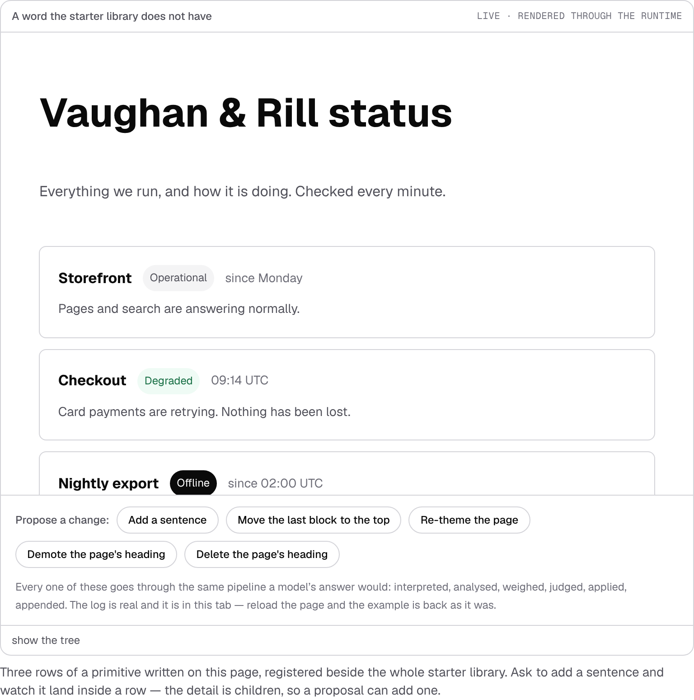
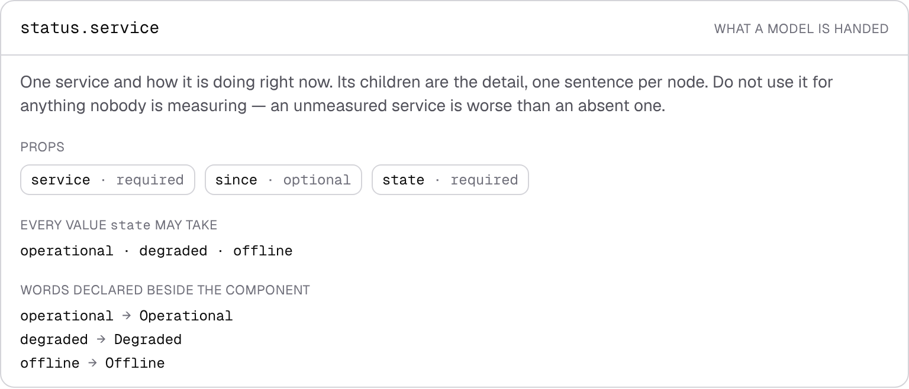
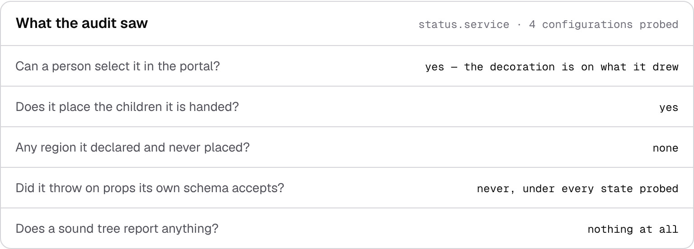
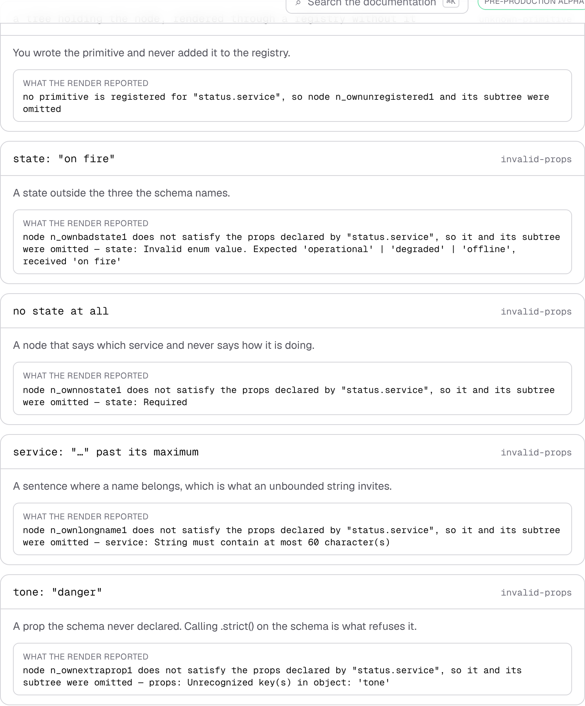
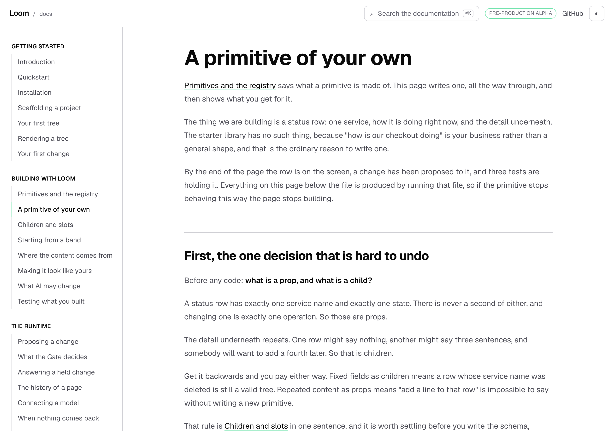
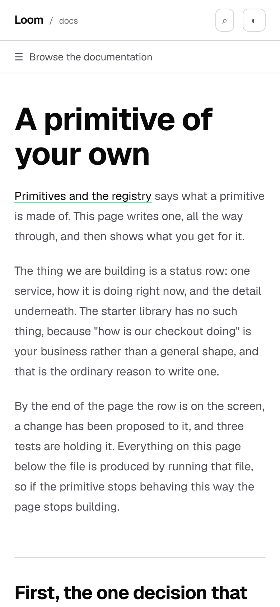

# 11 October 2026 — a primitive of your own, worked and audited

**Routine:** `Loom docs` · **Branch:** `docs-52-your-own-primitive` ·
**Section:** §4c

No open pull request from this lane at the start of the run, and no maintainer
comments outstanding. Fresh branch off `origin/main` at `39c6ef3` (#571).

The clone's `main` pointed at `6686895` again, nine pull requests behind
`origin/main`, which is the silent trap the 10 October report wrote down. The
branch came off `origin/main` after a fetch.

## What this run is

A new page, **A primitive of your own**, in *Building with Loom*, between
*Primitives and the registry* and *Children and slots*.

It is the item the last two reports carried as the thing to write next:
*Testing what you built* says *use your own tree and your own registry when the
thing you are testing is your primitive*, and then shows no primitive. The
whole site had none. Every rendered example on it is built from the starter
library, every code block that defines a primitive defines one nobody runs, and
the exit condition for this section is that **a stranger can register a
primitive** working only from the site.

The page takes one primitive all the way through: the decision that comes before
any code, the file, the registration, a live render with the propose-a-change
box on it, what a model is told about it, what its schema refuses, whether a
person can edit it, the three tests, and the one line of policy worth adding.

## The primitive, and why it is not a pricing plan

`status.service` — one service, one of three states, an optional *since*, and
children for the detail.

A pricing plan was the obvious choice, because *Testing what you built* already
builds a `shop.plan` tree for its policy test and defines that primitive
nowhere. It was the wrong choice: the starter library **has** `loom.tier`, which
is a plan with `name`, `price`, `period`, `note` and `emphasis` on it. A page
teaching a reader to hand-write a worse copy of a library primitive teaches the
wrong lesson in the first paragraph.

A service status is a vocabulary a general library cannot have, which is the
honest reason to write one, and it buys three things the page needed:

- **A closed set.** `state` is `z.enum(["operational", "degraded", "offline"])`,
  which is the sharpest instance of the bargain there is: a model may move a
  service to `degraded` and cannot invent `on fire`, and nobody has to read the
  component to know it.
- **A declared string.** The word *Offline* is nowhere in the tree. It is
  declared beside the component and read through `loom.text`, so the page can
  show `text` doing something rather than mentioning it.
- **Repeated children.** The detail under a row is nodes, so the propose box's
  "add a sentence" lands **inside** a row and the prop-or-child rule is visible
  rather than asserted.

## Everything on the page is produced

Five blocks, four of them computed as the page builds.

**The file is read off disk**, not fenced. That is the quickstart's arrangement
and the quickstart's argument: a file shown as a code block is a second copy of
it, and the copy is the one that goes stale. `asAReaderWouldWrite` turns the
workspace's specifier into the one a reader installs, which is the same seam
`teaches.test.ts` polices.

**The catalogue row** is `catalogueOf(ownRegistry)`, so the page shows what an
interpreter actually hands a model — and what is missing from it. There are no
types in a catalogue and no bounds, which is the reason `description` carries
the weight the page says it does.

**The refusals** are real renders. Each row is a tree, a registry and a props
bag, and the sentence under it is `describeRenderDiagnostic`'s. `proving.ts`
throws if any of them stops reaching the fault it is filed under, so a loosened
schema stops the build rather than printing a confident claim.

**The audit** is `auditRegistry` run on the registry the page renders through,
read for the one primitive the page wrote. *Scaffolding a project* explains what
the audit is and why the scaffolder writes the test that runs it; it had no
primitive of its own to run it on.

The one block that is not produced is the schema, quoted so a reader can see
the three decisions without opening the file — and `proving.test.ts` slices the
schema out of the file and asserts the page contains it verbatim.

## The second registry, and why there is one

`_lib/loom/registry.ts` says, and is right, that *an example that quietly
registered a primitive of its own would be documenting a library the reader does
not have*. This page registers one, and the difference is that the primitive is
the **subject** rather than a convenience: the reader is shown its whole file
and invited to write the same thing. It is the licence
`_lib/reporting/catalogue.ts` already takes for a component that breaks its own
declaration — a bench demonstrating a thing is documenting that thing.

`DocsExample` grew an optional `registry`. Exactly one example carries one, and
`proving.test.ts` asserts that: the field is an exception with a test holding it
to being one, rather than a door left open.

## Decisions taken that were not specified

- **A new page rather than a section on *Primitives and the registry*.** That
  page is the reference for the parts and is already the right length. This one
  is a walk-through, which is a different kind of reading, and the two now link
  to each other.
- **Placed second in the section**, before *Children and slots*. A reader who
  has just met the three parts of a primitive wants to see one built; the
  pages after it are about composing what they now have.
- **The states are told apart by the word, not by a colour.** No palette slot in
  this system means *bad*, so a green/amber/red badge would have meant literal
  hex in a component, which is the one thing the token helpers exist to prevent.
  The badge says how much attention it wants; the word says what happened.
- **The example's three rows use all three states.** The middle one is the
  props bag every refusal is a variation of, taken from one constant, so the
  frame and the refusal table cannot drift apart.
- **The fs read lives in its own module.** `registry.ts` is reached from the
  example catalogue, which is reached from a client component, and a `node:fs`
  import anywhere in that graph fails the Turbopack production build rather than
  being shaken out. That cost this run one build; `source.ts` is the fix and the
  comment on it says why.
- **No `<Count>` registered.** The page states no size of Loom. The one number
  on it — how many configurations the probe built — is printed from the audit and
  asserted against the closed choices plus one.

## Records

None added, none superseded. Nothing here touches the tree schema, the delta
model or an `Accepted` record. The page describes behaviour settled by 0012,
0018, 0049, 0051, 0052, 0064, 0068, 0075, 0122, 0184 and 0234, and copies none
of them.

## Findings

Two filed, both on 11 October, both owned by `Loom daily build` (`src/sdk/`),
and both found by writing the page rather than by looking for them.

**`ClosedChoice` is in two published signatures and exported from no door.**
`PrimitiveEntry.choices` is `readonly ClosedChoice[]` and
`probeConfigurations` takes one, and the type itself is re-exported from
nowhere. A host can hold one and cannot name one. The workaround in this lane is
`PrimitiveEntry["choices"][number]`. Nothing is blocked; it is one line.

**The first configuration the conformance probe builds is one the schema
refuses.** `probeConfigurations` leads with `{}`, which for any primitive with a
required prop is a props bag its own validator rejects. A component that reads
a required prop in the obvious way lands in `throwsOnDeclaredProps` — whose own
doc comment says an entry there means *a tree the validator accepts can take the
page down*, which for that row is false — and in `notProbeable` beside the
hook-using components, and leaves `notDecorated` empty, so the audit can no
longer answer the one question the scaffolder's test exists to ask.

It is latent rather than live, and the entry says why, measured:

```
registered:                       107
with at least one required prop:   33
throwsOnDeclaredProps:              0
notProbeable:                       0
```

Every primitive in the library hands its props to React and React renders
`undefined` as nothing. Not one calls a method on a prop value. So the probe is
safe against a **house style** rather than against a rule, and the first host
that trims or parses a required prop gets a red audit with a reproduction its
schema would have rejected. This page's own primitive passes for the same
accidental reason.

None closed. This lane has no open finding it could close this run.

## Test numbers

`pnpm install && pnpm verify`, green.

| | files | tests |
| --- | --- | --- |
| framework (`src/`, `tools/`) | 201 | 4,537 |
| application (four surfaces) | 423 | 7,844 |

Nothing skipped, nothing weakened, no test marked `todo` or `only`.

**Two new test files, 30 tests, and two more from a loop:**

- `_lib/own/proving.test.ts` — **20**, over the primitive and everything the
  page claims about it: that it is registered beside the library and not instead
  of it, that it is the only example on the site carrying a registry of its own,
  that the page's quoted schema is the file's schema byte for byte, that the
  catalogue says names and requiredness and no bounds, that every refusal reaches
  its own fault, that a sound tree reports nothing, and that the audit is clear
  on all four of its questions.
- `_components/own-primitive.test.tsx` — **10**, over the printing. The failure a
  produced block is prone to and nothing else here would see: showing some of
  what it was handed.
- `_lib/examples/catalogue.test.tsx` went from 25 to **27**, which is the two
  cases its per-example loop adds for the new entry. No existing case changed.

`pnpm findings:check` reads 1,114 findings, 0 malformed. `pnpm prerender:check`
reads 133 prerendered pages and 1,793 text junctions, 0 run together.

## The build that failed once, and why it is worth a paragraph

The first `pnpm verify` on this branch was red, in `next build` rather than in a
test:

```
the chunking context (unknown) does not support external modules (request: node:fs)
  ./apps/loom/app/(docs)/_lib/examples/catalogue.ts [Client Component Browser]
```

`registry.ts` had the file reader on it. The example catalogue imports the
registry, `Example` is a client component and imports the catalogue, so `node:fs`
was in a browser graph. Nothing is tree-shaken out of that: the import is the
fault, not the call.

The fix is `_lib/own/source.ts`, which is the only module that touches the
filesystem and is imported by exactly one server component. It is worth writing
down because the shape recurs on this surface — the site reads the repository
constantly, and the moment one of those readers is pulled into an example's
import graph the whole build stops with a message that names a file nobody
edited.

## What the pictures say

Six shots, `pnpm shoot --serve apps/loom`.

| | 1280×900 | 390×844 |
| --- | --- | --- |
| page | `scrollWidth 1280 / innerWidth 1280` | `scrollWidth 390 / innerWidth 390` |
| the example frame | `768×773` | `350×946` |
| the catalogue row | `768×328` | |
| the audit | `768×275` | |













Two things the measurements settled rather than suggested.

**The example's headline is `level: 2` and every other example's is `level: 1`.**
The first shot had the top step of the ramp taking most of the frame before the
first row arrived, so two of the three rows were below the frame's own fold and
the inverted `offline` badge — the only state that looks unlike the other two —
was not in the picture at all. One step down the ramp puts all three in view. It
is the one place this example departs from the others and the comment in the
catalogue says why.

**The refusal clip is partly behind the site's own header**, which is the sticky
header over a clipped element rather than anything wrong with the block. The
page shot above it is the one to read for position.

## What I would write next

- **The `undefined` half of *The bar above your page*.** Carried from 7, 8, 9
  and 10 October, and still prose with a test behind it rather than a row a
  reader can see, because no registered palette has an unreadable pair.
- **`data-unshown` deserves a paragraph on *Where the content comes from*.**
  Carried from 10 October. The catalogue is where a reader finds it holding a
  code; the page about binding data is where they would meet it first.
- **A primitive that reads a binding.** This page's primitive draws only what
  the tree wrote. The next obvious one down the same path is one that asks the
  deployment a question, which is `reads` and `loom.data` and is currently
  explained without a worked example of somebody's own.
