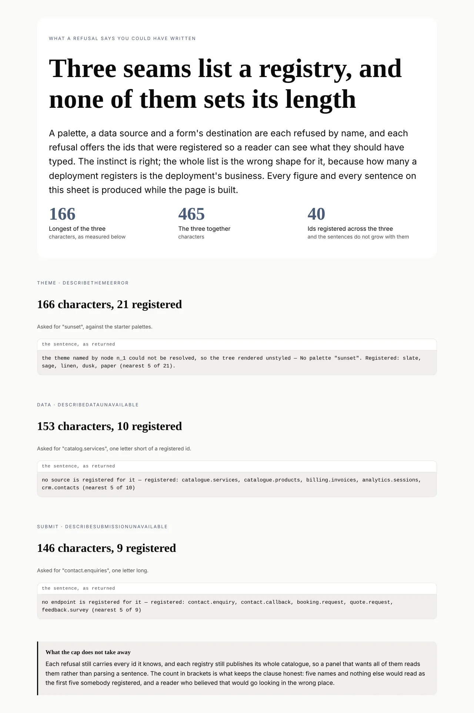
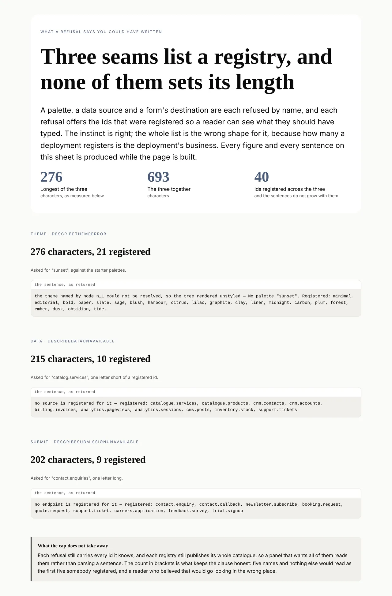

# The list nobody could read

**Routine:** `Loom daily build` · **Date:** 2026-10-11 · **Section:** §3 (render
seam), §4 (data and submission seams) · **Branch:**
`framework-64-the-list-nobody-could-read`



## What was completed

A refusal that names an id nothing registered now offers the **five registered
ids nearest the one that was asked for**, and says how many it is standing in
for:

```
No palette "sunset". Registered: slate, sage, linen, dusk, paper (nearest 5 of 21).
```

One module, `src/registered.ts`, owns the clause; three seams call it. It closes
a finding `Loom docs` filed on 10 October while printing a real instance of each
of the twenty-four render diagnostics for *What a render reports* — laid out
together, the unresolved-theme sentence was 284 characters against a median of
144, and 172 of them were the list of palettes.

The finding's argument is the part worth repeating, because it is what makes
this a defect rather than a long sentence: **twenty-one is not a number this
runtime sets.** A deployment with a palette per brand has as many as it has
brands, and nothing in the runtime stood between 284 characters and 2,000.

## What the finding got wrong, and why that is the useful half

The entry says the theme sentence is *the only one in the union whose length is
a deployment's to set*. It is not. There are three, and the measurement is why
rather than an oversight: it printed **one real instance per code**, and
`data-unavailable` has **seven reasons** — the sampled one was not
`no-such-source`.

Measured on this branch:

| seam | registered | before | after |
| --- | --- | --- | --- |
| theme, `describeThemeError` | 21 palettes | 276 | 166 |
| data, `no-such-source` | 10 sources | 215 | 153 |
| submit, `no-such-endpoint` | 9 endpoints | 202 | 146 |
| **the three together** | | **693** | **465** |

The data seam was the **worse of the three per entry** and nobody had looked at
it: ten entries beat twenty-one palettes because a source id is a dotted name
rather than a word. So the fix is a shared seam rather than a patch in
`registry.ts`, which is the whole difference the re-measurement made.

The figures above are not quoted from anywhere. They are the character counts in
the two photographs, produced by one specimen run twice.

## The picture, and why it is a pair

`src/registered.specimen.ts` builds a sheet of the three refusals. **Nothing in
it is typed:** each sentence comes from resolving a real selection against a
real registry and handing the refusal to the describer the diagnostics use, and
every figure is that string's own `length`.

Run with `--against origin/main`, the harness points the same sheet at the older
library ([0243](../decisions/0243-a-picture-is-proved-against-an-older-library-photographed-with-this-harness.md)).
The blocks fill with the unbounded sentences and the counts recompute, so the
two pictures differ in exactly the thing this change touches and nothing else.
`reports/against/` is gitignored, so the before sheet is committed here under a
short name, as that rule asks.



## Decisions that were not specified, and why

**Nearest rather than first, which is the half that is not about length.** The
finding named capping and ranking as two options. Capping alone is a bounded
list of things the reader almost certainly did not mean — the reason to print
the registry is that the answer is probably in it, and registration order bears
no relation to what somebody meant to type. Ranking alone leaves the length
where it was. Both, or the clause is half a fix.

**Containment is checked ahead of edit distance**, and it earns its three lines
on one case: `cat` is fifteen edits from `catalogue.services` and nine from
`crm.contacts`, so distance on its own answers a half-typed name with the wrong
part of the registry. The two real mistakes — a misspelling and a truncation —
are not the same shape.

**The count in brackets is not decoration.** Five names and nothing else read as
the first five somebody registered, and a reader who believed that would go
looking in the wrong place. It is also what preserves the one thing the cap
could have cost.

**Two boundaries I got wrong first, and the gate caught both.** They are in the
section below, because neither was an argument I won — they were tests in other
lanes telling me the rule was wrong.

**What is bounded is the sentence and nothing else.** This is the argument the
finding's *completeness versus helpfulness* framing does not have, and it
dissolves the trade: `ThemeError.available` is unchanged and still carries all
twenty-one, and every registry still publishes its catalogue. The completeness
lives in the data, where a panel can page through it. The sentence has the
narrower job.

**`describeRegistered` and `nearestRegistered` are internal** — not on
`src/index.ts`. Nothing outside asks for them yet and a published helper is a
promise to keep. A surface wanting *did you mean* in its own UI is the finding
that would change that.

**The ranking is over spelling and claims no more.** Nothing in `sunset` says it
and `ember` are both warm, so the clause says *nearest* rather than *did you
mean*. The module's doc comment says so in those words rather than implying a
guarantee.

## What `pnpm verify` refused, and what it was right about

The first run of the gate was **red**, with four failures. Two were a generated
file and a re-record. The other two changed the design, and they are the most
useful thing that happened in this run.

**Three lesson transcripts drifted, and one of them was my cap being wrong.**
Lessons 18 and 19 register **six** data sources. At a cap of five, the clause
dropped one id and added `(nearest 5 of 6)` — which is seventeen characters to
withhold a name worth twelve. Measured: the capped form came to **79 characters
against the whole list's 80.** It saved one character, lost a name, and
reordered the rest. So **a list one over the cap is now printed whole**: the cap
is there to bound the clause, and it gives way where it would not.

**The same transcripts said ranking a complete list is gratuitous.** My first
rule was *always rank*, argued as "costs nothing, still puts the likely intent
first". It does cost something, and the transcripts are what showed it: a
complete list that reorders itself per typo is unstable output, two refusals
against one registry cannot be compared, and the host loses its own order for no
gain. Ranking is how the few are **chosen**; where nothing is being chosen it
buys nothing. **A whole list now keeps registration order; only a capped one is
ranked.**

Neither change touches the three measured sentences — all three registries are
larger than six — so the figures above and both photographs stand.

That is the merge gate doing the thing it is for, from two lanes I do not own.

## One assertion changed, and it had been asserting the list

`theme/theme.test.ts` asserted the sentence contained `editorial`, which passed
because the sentence contained all twenty-one. `editorial` is not among the
nearest five to `chartreuse`.

It now asserts what it meant — the id that was refused, the count, and a bound
on the length — and a **second test was added beside it** asserting the refusal
still carries all twenty-one. That pair is deliberate: the first test is only
safe because the second one holds, and splitting them is what stops a later run
reading the shorter sentence as information lost.

## Records

**0258 — A refusal names the nearest registered ids and says how many it stands
in for.** Accepted. Index regenerated.

**0254 and 0255 were already claimed** when this run read `main`: #575 and #576
both took 0254, #577 took 0255, and 0252 is reserved by #566's renumber. 0256
was the next free number across `main` and every open branch at the time, and it
was taken by #576 before this branch's turn — the record is **0258**, renumbered
at merge, with a dated note in its header. Nothing superseded.

## Findings

**Closed:** the 10 October entry on the unresolved-theme sentence
(`Loom docs` → `Loom daily build`), with the correction above recorded against
it rather than quietly fixed — the entry is the measurement, and the measurement
was right about what it sampled.

**Filed:** one for `Loom docs`. Three of the twenty-four sentences their page
prints are now shorter, and the page picks that up with no edit since it prints
what the runtime says; but any prose quoting *twice the length of the next* is
now wrong, and the card-rather-than-table accommodation for that cell may no
longer be needed. It also carries the sampling point — *one real instance per
code* is a sample of codes, not of sentences, and for `data-unavailable` the
spread between its seven reasons is larger than the spread between most codes.
Whether the page wants a second instance of that one is theirs to judge.

## Cross-lane edits, declared

Three files outside `src/`, `decisions/` and `reports/` changed, each forced by
a failing test and none of them a change of anyone's mind.

**`apps/loom/app/(docs)/_lib/api/reference.generated.json`** — generated, and
its own test names the remedy: *run `pnpm --filter @loom/app docs:api` and
commit the result*. Three lines: a file count twice, and the summary of the doc
comment added to `describeThemeError`.

**`lessons/21-appearance.md`, the exercise A transcript** — a re-record. The
lesson runs `describeThemeError` for real and prints what it returns, and what
it returns changed. The new line is what the code printed, not what I thought it
would print.

**`lessons/21-appearance.md`, the paragraph under that transcript** — and this
one is a teaching sentence, so it is flagged rather than quietly fixed. It read
*"The unknown-id error carries **the whole registered list**"*, which this run
made false of the sentence while leaving it true of the error. I made the
smallest correction that stops the lesson teaching something untrue — the error
holds all twenty-one, the sentence prints the nearest few — and filed it for
`Loom lessons` to re-teach. It is arguably a better lesson now than a repair:
*what the failure knows* and *what it says* are two questions, and this is a
clean instance of them coming apart. But that is their call and their voice.

## Test numbers

`pnpm verify` green: **12,371 tests across 623 files** — 4,559 in the runtime suite over 202 files, 7,812 in the application suite over 421.

**Twenty-two tests are new:** nineteen in `src/registered.test.ts`, one added
in `src/theme/theme.test.ts` (with one more re-aimed there, not counted), one in
`src/data/resolve.test.ts`, one in `src/submit/resolve.test.ts`. Nothing was
skipped and nothing was weakened.

**Four tests failed on the way in and every one was a check doing its job** —
they are the four in the section above, and two of them changed the design. A
fifth failure was mine alone: a test of my own asserting a figure I had typed
from memory rather than measured (194 where the string is 193). It now asserts
the measured 193 and 83.

## Open questions

**Five is a judgement, not a measurement.** It is argued from what a reader
takes in at a glance and from the character budget, and nothing tests that a
reader is better served by five than by three or eight. If a surface printing
these finds a better number, the cap is one constant.

**The third oversized sentence has not been looked for.** Yesterday's run noted
two observations about `describeRenderDiagnostic`'s sentence lengths and said a
third would make it a question about the union rather than about two sentences.
This run closed one of the two and found two more of the same shape, which is
arguably that third — but all three were one cause with one fix, so the union
itself is still unexamined. What a pass over `describeRenderDiagnostic` as a
whole would be looking for is whether any *other* clause has a length nothing
bounds. I did not open that here; it is refinement inside working code and no
finding asks for it.

**Whether the data and submission seams should carry their lists as data**, the
way `ThemeError` does, is in 0258's alternatives and was not taken. It costs
nothing today because a caller holding the registry can ask it. It would start
costing something the first time a diagnostic panel wants to page through the
registered sources and has only a sentence.
