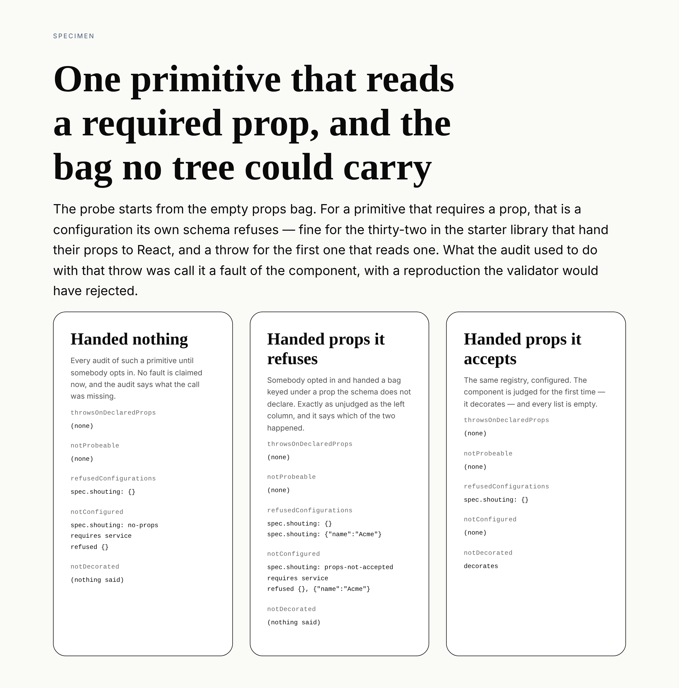

# The props no tree carries

**Routine:** `Loom daily build` · **Date:** 2026-10-11 · **Section:** §4 (the
SDK and the harness) · **Branch:** `framework-67-the-props-no-tree-carries`



## What was completed

`auditRegistry` used to call a throw a fault of the component without asking
whether the props it threw on were props the component would ever be handed.
Now it asks, and the answer comes from the one thing that can give it: the
primitive's own validator, which is already on the registration.

Two findings `Loom docs` filed this morning, both in `src/sdk/`, both found
writing *A primitive of your own*. Both are closed.

## The defect, reproduced

The probe builds its configurations from the schema (0075): the default one,
then each closed choice's values one at a time.

```ts
export const probeConfigurations = (choices) => [
  {},
  ...choices.flatMap(({ name, options }) => options.map((option) => ({ [name]: option }))),
]
```

**`{}` is not a configuration built from the schema.** For a primitive with a
required prop it is a bag that primitive's own validator refuses, and no tree
the Gate accepts can produce it. Reproduced on this branch before changing
anything, with a one-line component that reads its required prop:

```
configurations the probe builds:  [{}]
throwsOnDeclaredProps:            spec.shouting — {} (Cannot read properties of
                                  undefined (reading 'toUpperCase'))
                                  everyConfiguration: true
notProbeable:                     spec.shouting
notDecorated:                     (empty)
validate({}):                     invalid — service: Required
```

Three things wrong with that, and the third is the expensive one. The row claims
a fault in a list whose own doc comment reads *"a tree the validator accepts can
take the page down"* — false here, since the validator would have refused this
tree. It lands in `notProbeable` beside the class and hook-using components that
are legitimately unjudgeable (0012), which is the one list a host cannot assert
empty. And `notDecorated` is empty because nothing was ever successfully called,
so the audit cannot say whether the primitive is editable — the single question
the scaffolder's generated test exists to answer.

## Why nothing here was red, measured

| | |
| --- | --- |
| registered in the starter library | 107 |
| with at least one required prop | 33 |
| whose default configuration their own schema refuses | 33 |
| **every** configuration the probe builds refused | 32 |
| of those, with every required prop closed (so derivable) | 1 |
| `throwsOnDeclaredProps` | 0 |
| `notProbeable` | 0 |

Every one of the thirty-three hands its props to React, and React renders a
missing prop as nothing. **Not one calls a method on a prop value.** So the
probe was safe against a house style rather than against a rule, and the first
host primitive to trim, uppercase, split or parse a required prop is a red audit
with a reproduction its schema would have rejected.

## What shipped ([0267](../decisions/0267-the-probe-reports-every-configuration-and-the-audit-judges-only-the-ones-the-schema-accepts.md))

**The probe reports every configuration it tried; the audit decides which of
them a claim may be made about.**

1. **A throw is a fault only under props the schema accepts.**
   `throwsOnDeclaredProps` filters its failures through `primitive.validate`, so
   its stated sentence is true of every row it holds.
2. **`notConfigured` is a new list** for a primitive the probe could reach in no
   accepted configuration. It carries the required prop names, the refusals in
   the validator's own words, and which of two causes applies — `no-props` or
   `props-not-accepted`, told apart for the reason 0253 tells
   `names-not-answered` from `no-answers`: a host told to empty the list can
   hand over a bag that is refused too.
3. **`RegistryAuditOptions.props`** lets a host supply bags, beside `answers`.
   Each is varied by every closed choice in turn, so a supplied bag gets the
   treatment 0075 asks for; a duplicate of the empty bag is dropped, so handing
   over what the probe already had changes nothing at all.
4. **`PrimitiveAudit.refusedConfigurations`** carries the bags the schema
   refused, which is the honest measure of what a verdict rests on.
5. **The generated `loom init` test asserts `notConfigured` empty**, with the
   remedy in its doc comment, because the reader this was found for meets that
   file before they meet the record.
6. **`ClosedChoice` is exported from `@jam-overture/loom/sdk`** — the second
   finding, one line. It is in two published signatures and was exported from no
   door, so a host could hold one, pass one and read one and not write the type
   of a function that takes one.

## The decision inside the decision

**Refused configurations are still probed.** What a non-throwing probe observes
is *reach* — some configuration decorated, some configuration placed this region
— and a bag the schema refuses that places a region is still evidence the
component reads it. A throw is the opposite kind of claim: it says the component
is broken, and for that the configuration has to be one a tree could carry. So
the two are judged differently rather than filtered together.

That asymmetry is what keeps this change behaviour-preserving. Dropping refused
configurations from the probe outright would have left the audit unable to say
anything about **thirty-two of the hundred and seven** starter primitives:
`leaves` would empty, `notDecorated` would go quiet, and `decorationFromAudit`
would be reading a lookup built from nothing.

## Unspecified decisions, and why

- **The finding offered three remedies and the first does not work.** Building
  the default bag from the schema is underivable for thirty-two of the
  thirty-three without inventing a string or a number, and an invented value
  makes everything downstream a function of the guess — the trade `ProbeAnswers`
  already refused for answers (0185). Measured rather than assumed: exactly one
  starter primitive has all its required props closed.
- **The supplied bag goes on the audit call, not the registration.** A
  `probeProps` field beside the schema would read better, and it would change
  the published definition shape for every primitive to serve the ones that need
  it — and a deployment auditing somebody else's library cannot edit the
  registration. Recorded as an alternative, not taken.
- **The starter library is not handed props here.** It is thirty-three bags in
  `src/primitives/`, which is `Loom primitives`' directory. Filed for them.

## Records

- **0267** — *The probe reports every configuration it tried, and the audit
  calls a fault only what the schema accepts.* Accepted. Nothing superseded.
  `0258` is the highest on `main` and on every open branch (#583, #584 and #585
  all carry it; #566 holds `0250`, #548 `0249`), so `0267` is the next free
  number everywhere.

## Findings

**Closed, both owned by this lane and filed by `Loom docs` on 11 October:**

- *the first configuration the conformance probe builds is one the schema
  refuses* — closed by this branch, by remedies 3 and 2 together and explicitly
  not 1.
- *`ClosedChoice` is in two published signatures and exported from no door* —
  closed. The docs lane's `PrimitiveEntry["choices"][number]` workaround can go
  whenever that lane next touches `proving.ts`; nothing forces it.

**Filed, for `Loom primitives`:** *thirty-two of the hundred and seven are
judged entirely under props bags their own schemas refuse, and the library could
hand the probe one each.* Not a defect and no list to empty — 0267 decided those
reach claims stand. It is the question of whether the library should supply its
own probe props now that there is somewhere to put them, with the cost stated:
a table of thirty-three entries that has to stay true as schemas change.

## Open questions

- **Whether the library supplies its own bags** is the finding above, and it is
  the one thing that would turn thirty-three audits from claims about a
  component under a bag nothing could send it into claims about the component.
- **Whether `RegistryAudit` growing a field matters to anyone.** The package is
  `0.1.0` and every caller in this repository is updated; a host destructuring
  it exhaustively sees one more key. The broader question — what this package's
  compatibility promise is — is still the one #566 raised and nothing states.

## Test numbers

`pnpm verify` **green from a clean `dist/`**, over the final tree:

| suite | files | tests |
| --- | --- | --- |
| framework (`vitest run`) | 205 | **4,655** |
| application (`@loom/app`) | 425 | **7,960** |
| | | **12,615** |

`pnpm findings:check` reports 1,136 findings, 0 malformed. `pnpm prerender:check`
reports 133 prerendered pages, 1,800 text junctions, 0 run together.

Two things failed on the way and both were drift this change caused, not
defects: the generated API reference (`pnpm --filter @loom/app docs:api`,
regenerated and committed — it gained `ClosedChoice`, `RefusedConfiguration`,
`UnconfiguredReason`, `UnconfiguredPrimitive` and `probeConfigurationsFrom`),
and one measured count in `(docs)`' own `extract.test.ts` — the root door and
the sdk door now share **9** names rather than 8, because `ClosedChoice` is
published from both. That digit is the only edit this branch makes outside
`src/`, `tools/`, `decisions/` and `reports/` apart from the regenerated
reference, and it is a recomputed number rather than a sentence in another
lane's voice.

Nothing was skipped and no test was weakened.
