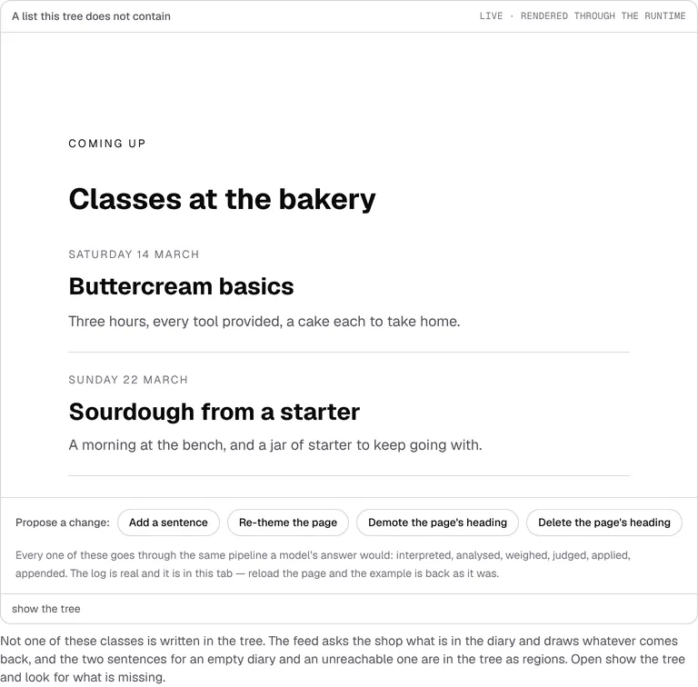
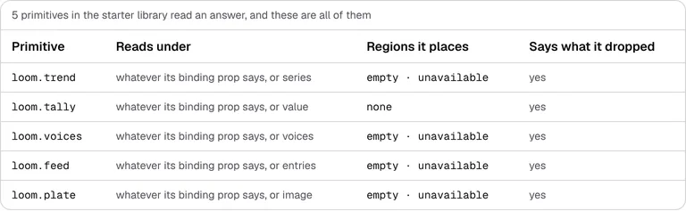
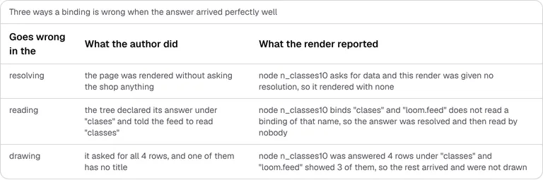
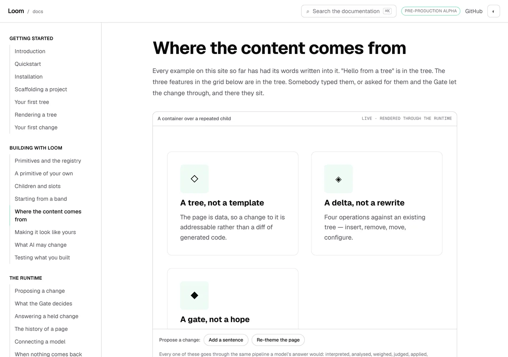
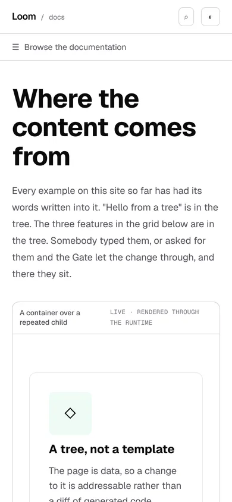
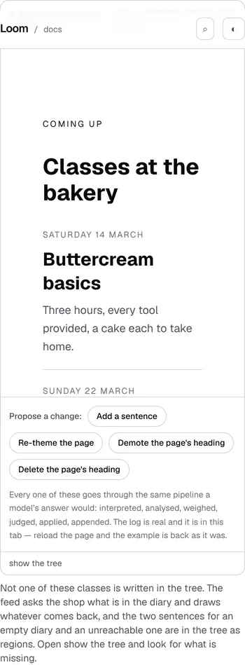

# 12 October 2026 — reading the answer, and the sentence that had been false for weeks

**Routine:** `Loom docs` · **Branch:** `docs-53-reading-the-answer` ·
**Section:** §4c

No open pull request from this lane at the start of the run. No maintainer
comment outstanding on any open pull request of this lane's — there were none.
Fresh branch off `origin/main` at `ed0c7e0` (#602).

The clone's `main` pointed nine commits behind `origin/main` again, which is the
trap the 10 and 11 October reports both wrote down. Fetched and reset before
branching.

## The maintainer's instruction about the docs, answered above this lane

`Loom portal` filed an entry on 12 October saying the docs half of the
maintainer's *"hooked up to the portal under my account/login"* had not arrived,
and left the scoping decision to `Loom docs`.

**It was already answered, and not by me.** `docs/portal.md`, rewritten on `main`
in #602 the same day, lists *"Governing the documentation. It is MDX; 0259
refuses prose as a tree."* under **Not in scope**. The finding is closed with
that pointer rather than with an opinion of mine.

The suggestion at the foot of that entry — the docs' *chrome* as a stored tree
with MDX rendered into a slot — stays not taken, and the reason is in the
closing note: the portal's scope line is about governing documentation, and
putting only the navigation and the bands under it would buy a seam, a second
place a docs page's shell can be changed from, and governance of nothing a
reader reads.

## What this run is

The second half of *Where the content comes from*, which until today described
the thing a reader actually has to build and showed none of it.

The page was good on **asking**: what a binding is, who registers a source, when
the asking happens, what comes back, and seven ways a question goes unanswered —
all of it produced from a real seam. On **reading** it had one unrendered code
block and a warning callout, and the callout said this:

> the starter library has no primitive that reads `loom.data`: the ruling that
> created this seam said the authoring half — a primitive declaring which
> binding names it reads — was the next thing to build, and it has not been
> built yet.

Both halves were false. `reads` exists on `definePrimitive`, is on
`RegisteredPrimitive`, and is already in what `catalogueOf` hands a model.
**Five** primitives in the starter library read an answer — `loom.feed`,
`loom.plate`, `loom.tally`, `loom.trend` and `loom.voices` — four of them place
`empty` and `unavailable` regions, and all five declare `unshown`.

So the run is: make the reading half real, and correct the page with produced
evidence rather than with a new sentence.

## What is on the page now

**A live example of a bound primitive**, which is the thing §4c asks for and the
page did not have: a bakery's page whose classes band is a real `loom.feed`
bound to a real registered source, resolved through the real seam, rendered
through the runtime, with the propose-a-change box beside it. Not one class, date
or description is in the tree — *show the tree* is where that lands, and the
prose points at it.

**A table of every primitive in the library that reads an answer**, read off
`docsRegistry.primitives`, with what each reads, the regions it places, and
whether it says what it dropped. The sentence above it renders a registered
count rather than typing one.

**Three faults, caused.** `data-unresolved`, `data-unread` and `data-unshown`,
each from a real render of a real tree against a real resolution, each printed in
`describeRenderDiagnostic`'s own words. They are the same page three times with
one thing different, and they are the three stages a binding passes through:
somebody has to resolve it, something has to read it, something has to draw it.

**Three sections of prose on the author's side**, in the order a reader meets
them: which name a primitive reads and why declaring it matters, what a reader
sees when there is nothing or nothing arrived, and why a primitive has to say
what it could not draw.

**The hand-written primitive, finished.** The code block that was there declared
no `reads`, no regions and no `unshown` — because none of those existed when it
was written. It now declares all three, shares one reading function between the
declaration and the component so the count and the page cannot disagree, and is
typechecked as part of this page's compiled program like every other fence on the
site.

## The bakery's diary, and the row with no name

The new source is `catalogue.classes` on the shop fixture the page already had.
Four rows, and **one of them has no title** — the shop never named the April
class and nothing stopped them.

That row is the whole argument of the third declaration, and it is the reason the
source is shaped the way it is: **the source's schema accepts it and
`loom.feed`'s refuses it.** A `title` column that accepts an empty string is the
ordinary state of somebody's database; a row with no title leaves a feed nothing
to put on a page. Both schemas are right, neither can be relaxed to suit the
other, and the gap between them is exactly what `data-unshown` reports.

`limit` decides whether the unnamed row is asked for, so the live example (which
asks for the named ones) renders with nothing the runtime could not honour, and
the fault row (which asks for all of them) is the same tree and the same source
with one number changed. Nothing stages the condition.

## Decisions taken that were not specified

- **`loom.feed` rather than a primitive written for the page.** *A primitive of
  your own* already walks somebody's own primitive end to end. What this page
  was missing is the opposite lesson: that the first list you draw from your own
  data is already in the box. A second hand-written primitive would have taught
  the harder path as if it were the only one.
- **The example resolves on a server and renders in a browser.** That is the
  arrangement the page itself recommends two sections earlier, so the example is
  the recipe rather than a special case. It cost a module, and the cost is filed
  (below).
- **The faults are a produced table, not three more live frames.**
  `catalogue.test.tsx` refuses a single render diagnostic on every example, and
  that rule is the strongest instrument on this site. A frame deliberately
  rendering a fault would have meant weakening it. The faults go where faults
  already go on this surface — a table produced by causing them.
- **`unshown-unreadable` is named in prose and not produced.** It is the one
  diagnostic in the union a tree cannot cause and a deployment cannot cause: it
  needs a component whose declaration throws, and no primitive in the library
  has one. Writing a broken primitive to photograph its breakage would have been
  the page staging its own evidence. Said rather than faked.
- **The count is registered rather than written.** `binding-readers` joins
  `SITE_COUNTS`, with a second opinion in `counts.test.ts` read off the built
  registry rather than off the definitions `counts.ts` filters — so the two
  objects have to agree. Writing *five* in the prose would have been the same
  mistake as the callout this run deleted, one size smaller.
- **The example's two regions are filled in the tree.** The `empty` and
  `unavailable` sentences are authored nodes rather than left to the primitive's
  declared fallbacks, because that is the difference the page is making: a
  sentence in the tree can be proposed, weighed and translated, and a sentence
  in a component can only be deployed. Neither draws while the answer has rows
  in it, and a test holds both halves of that.

## Records

None added, none superseded. Nothing here touches the tree schema, the delta
model or an `Accepted` record. The page describes behaviour settled by 0051,
0058, 0060, 0122, 0163, 0175, 0181, 0184 and 0206, and copies none of them.

## Findings

**Two filed.**

**A resolution is two closures, so the answers cannot be sent to the browser
that renders them** — owned by `Loom daily build` (`src/data/`).
`resolveDataPlan` returns `{ lookup, problemsFor }`, and a function cannot cross
from a server component to a client one. `buildDataResolution(plan, answers)` is
public and is exactly the far-side function, and **nothing public produces the
map it takes**: `resolveDataPlan` builds that map internally and folds it away,
and the per-request step with the ceiling on it is private. So both halves of a
serialisable seam are in the package with no way to get from one to the other.

This lane wrote `_lib/data/carry.ts`, which is sound and tested — it reads a real
resolution out through its own accessors and answers `NO_DATA` for a node nobody
carried, so a tree whose answers did not travel still earns its
`data-unresolved`. The part that should not be a caller's is *which nodes to ask
about*: a resolution cannot be enumerated, so the carrier derives node ids from
both `plan.bindings` and `plan.problems` — and reaching for `bindings` alone,
which is the obvious thing to reach for, silently drops every misdeclared node's
problem. That took one red test to find. The recommendation is one field:
`resolveDataPlan` also returning what it asked.

**A sentence saying something does not exist yet is the one claim on this site
no test can hold** — owned by `Loom docs`, instance fixed here.

Every instrument on this surface checks a claim that something **is** so: an
example that stops rendering is a red test, a count is printed from the registry,
a fence is typechecked, a diagnostic sentence is the runtime's. A sentence saying
something **is not** so has nothing to be checked against — the registry cannot
be asked whether it lacks a thing a page never named — so it goes stale in total
silence, and it goes stale exactly when the framework succeeds.

The counts sweep would not have caught this one either: it refuses ten and up,
because a single digit turns up as a heading level and a prop, and the stale
sentence here said *no* and then would have said *five*.

The remedy is cheap and is named: **pair the sentence with the measurement that
says so.** The callout should have shipped beside `expect(libraryReaders()).toEqual([])`,
which would have gone red the day the first bound primitive was registered. The
sweep for the ones already on the site is small today, which is the best moment
to do it.

**One closed.** The 12 October `Loom portal` entry about the docs and the portal,
closed by pointing at `docs/portal.md` rather than by a decision of this lane's.

## Test numbers

`pnpm install && pnpm verify`, green.

| | files | tests |
| --- | --- | --- |
| framework (`src/`, `tools/`) | 207 | 4,677 |
| application (four surfaces) | 432 | 8,175 |

Nothing skipped, nothing weakened, no test marked `todo` or `only`.

**Three new test files, 39 tests, and four more from files that already
existed:**

- `_lib/data/reading.test.ts` — **17**, over the library's readers and
  everything this page claims about them: that the count is not nought, that it
  is the registry's own answer rather than a list kept beside it, that each
  reader places both regions or neither, that the example's tree declares its
  answer under the one name the feed is told to read, that it draws every row it
  was answered with nothing the runtime could not honour, that the words of the
  list are on the page and in no part of the tree, and that each of the three
  faults reaches exactly one diagnostic and the one it is filed under.
- `_lib/data/carry.test.ts` — **8**, over the courier. Chiefly that it is a
  courier: every bound node answers exactly what the resolution it was read from
  answered, it survives being turned into JSON and back, it renders the same page
  with the same diagnostics on the far side, and a tree whose answers did not
  travel still earns its `data-unresolved` rather than rendering clean.
- `_components/reading-the-answer.test.tsx` — **14**, over the printing: the
  failure a produced block is prone to and nothing else here would see, which is
  showing some of what it was handed.
- `_lib/examples/catalogue.test.tsx` went from 27 to **30** — the two cases its
  per-example loop adds for the new entry, plus one holding the new field to
  being an exception: exactly one example on the site asks its deployment
  anything.
- `_lib/content.test.ts` went from 9 to **10**, for the pairing a published page
  would otherwise get wrong in silence: the example that asks for data must be
  named by `<BoundExample>`, because plain `<Example>` renders it with no
  resolution, draws an empty list and puts a diagnostic strip under it.
- `_lib/counts.test.ts` stayed at 18 and gained three assertions: the new count's
  second opinion, its stated size, and its spelling.

`pnpm findings:check` reads 1,151 findings, 0 malformed. `pnpm prerender:check`
reads 133 prerendered pages and 1,805 text junctions, 0 run together.

## The gate went red twice, both times usefully

**`compiled.test.ts`, on the second run.** Every code fence on a page is
extracted into one typechecked program with `// page.mdx:NNN` against each
block, and two late prose edits moved those lines. The remedy is
`pnpm --filter @loom/app docs:fences` and the test is doing exactly its job — but
it is worth writing down for the next run on this surface, because the edit that
broke it changed no code at all.

**The example's own frame, before any test.** The first photograph of it had the
section heading and one class filling the frame, with the second class below the
frame's own fold — a feed with one row in it, which is the least convincing
picture of a feed available. The heading is `level: 3` and the feed is
`density: "tight"`, one step down from every other example here, and the comment
in `reading.ts` says why.

## What the pictures say

Six shots, `pnpm shoot --serve apps/loom`.

| | 1280×900 | 390×844 |
| --- | --- | --- |
| page | `scrollWidth 1280 / innerWidth 1280` | `scrollWidth 390 / innerWidth 390` |
| the example frame | `768×755` | |

Two things the pictures settled rather than suggested.

**The faults table prints node ids and primitive names**, because
`describeRenderDiagnostic` does — *node n\_classes10 was answered 4 rows under
"classes" and "loom.feed" showed 3 of them*. That is the sentence an author
reads in their own logs, and showing it as it is beats a tidier paraphrase that
would be this lane's writing rather than the runtime's.

**The phone shot of the example frame is partly behind the site's sticky
header**, which is the clip of an element under fixed chrome rather than anything
wrong with the page. The full-page phone shot is the one to read for position.
It is the same note the 11 October report made, and it is the second time, so
whoever next wants an element clipped on a phone should expect it.

## What I would write next

- **The `undefined` half of *The bar above your page*.** Carried from 7, 8, 9,
  10 and 11 October, and still prose with a test behind it rather than a row a
  reader can see, because no registered palette has an unreadable pair.
- **The sweep the second finding asks for.** Every remaining sentence on this
  site that says a thing does not exist, given the measurement that says so.
  There are only a handful today, which is the whole argument for doing it now.
- **`loom.tally` and `loom.trend` deserve their own worked example**, on
  *Where the content comes from* or beside it. This page now shows a list read
  from a source; the number and the series are the two shapes a dashboard is made
  of, and `loom.trend` is the only reader in the library declaring a fourth
  sentence nothing on the site has explained.
