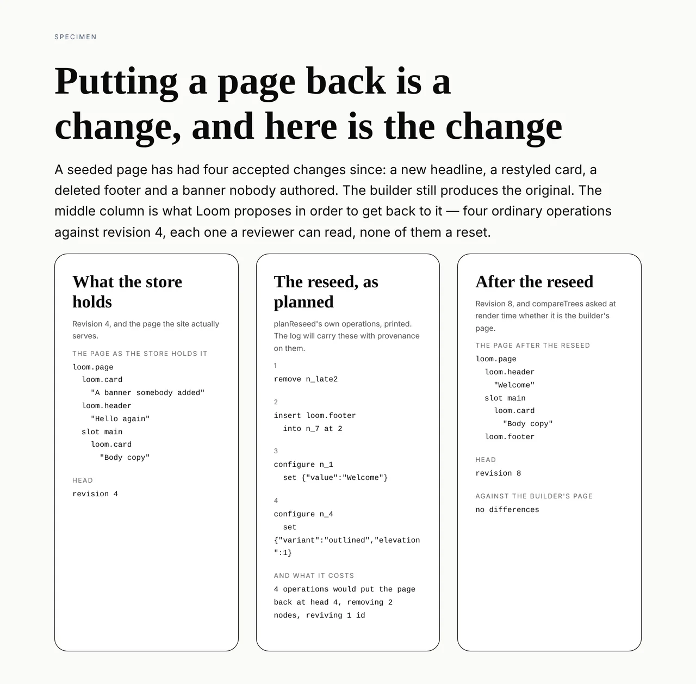

# The page put back

**Routine:** `Loom framework` · **Date:** 2026-10-12 · **Section:** §2 (the
store), §6 (the log) · **Branch:** `framework-68-the-page-put-back`

## What was completed

A stored page can be carried back to the tree its builder produces now, and the
way it gets there is a proposal rather than a reset.

`planReseed(stored, authored)` in `src/store/reseed.ts` takes the head of a page
in the store and a fresh build of it, and produces the operations that would turn
the first into the second — together with what the change costs. Something else
proposes them: they become a delta against a known base revision, the Gate weighs
them, and the log ends up carrying *this page was put back on this date* with
provenance on it, instead of the history simply ending.

**`TreeStore` is still `create`, `head`, `revisions`, `list` and `append`.** No
delete, no reseed method, nothing that writes a tree without being proposed.
That is the decision, recorded as
[0268](../decisions/0268-a-page-is-put-back-by-proposing-the-change-that-puts-it-back-and-a-store-never-deletes.md),
and it is the shape `Loom portal` asked for when it filed this — the entry went
out of its way not to ask for `delete(treeId)`, and was right: *the row is gone*
is a worse answer than *the row says it was replaced*.

The picture above is the whole claim. Nothing in any of its three columns is
typed into the specimen: the left outline is a seeded page plus four accepted
changes, the middle is `planReseed`'s own operations printed, and the right is
the left with those operations applied, with `compareTrees` asked at render time
whether what came out is the builder's page.

## Why the finding was filed on the right day

0259 made this site's three pages rows in the store on 11 October, and seeding is
deliberately create-if-absent — a page that exists has a history and a deploy
that re-seeded over the top would throw it away on every release. `Loom portal`
filed the consequence the next morning, in the module where somebody reaching for
the undo would be standing:

> Once a page is in the store, editing its builder stops changing the site, and
> there is no supported way to undo that. … A deployment in that position has two
> options and neither is the product: append its way back to the shape it wants,
> or open a SQL client.

That is a framework gap reported by a real consumer the day it became real, which
is what the findings ledger is for.

## The two things the build turned up

**The four operations are enough, and exactly enough.** A reseed looks like it
wants the whole-tree replacement 0009 deliberately refused, and it does not — but
the reason is narrower than it first appears. `configure` is one operation across
three node kinds, and `configurationOf` exposes a text node's `value` and a
slot's `name` as settable keys. So a builder whose headline changed produces a
text node with the **same id** and a new value, and the reseed is one
`configure` under that id rather than an id 0038 refuses to hand back. Take that
away and the likeliest reseed there is would have been inexpressible.

What the operations cannot reach is a node's `kind` and an element's primitive
`type` — what a node *is*. A page differing by one of those is reported
`unexpressible`, naming the nodes, and never reseeded into something near it.
`NODE_FACETS` is new in `src/tree/compare.ts` so that pair is checked against the
whole facet list where it is written: a sixth facet stops `reseed.test.ts`
compiling until somebody says which kind it is.

**The plan has to check itself, and the check has to be load-bearing.** The first
draft refused `kind` and `type` up front and then compared the result to the
authored tree as a safety net. Deleting that comparison broke no test, which is
the definition of dead code — so the pre-check now covers only `kind`, which is
the case where attempting the repair reports the wrong thing (the two kinds
expose different configuration keys, so the patch names a key the node has not
got and the answer comes back as a sentence about a patch rather than about a
node). A changed `type` needs no help: nothing in any pass touches a primitive,
so the difference is still standing at the end and the comparison names it
exactly. Both guards now fail a test when removed.

## Unspecified decisions, and why they went this way

**A plan, not a method.** `planReseed` is `planRevert`'s sibling and shares its
manners: it computes, it reports obstacles, it decides nothing. A revert undoes
one entry in the log; a reseed carries the whole page to a tree somebody else
built. Putting it on `TreeStore` would have made it a second path that changes a
tree, and every argument for the Gate is an argument against that.

**Two passes rather than a minimal diff.** The plan claims every child to its
authored parent, then orders each container, then sets configurations. The first
draft ordered as it went, which emitted a move to make room for a node that was
about to leave — two operations where one was needed. Splitting the pass fixed
it: the three-operation plan in the test became two, and the two-operation one
became one. Neither pass is provably minimal; both are provably correct, which is
the better half of that trade when a wrong plan writes a wrong page.

**`revives` and `retires` are carried, not judged.** `retires` is what the reseed
writes over, `revives` the ids the authored page wants that the stored one no
longer holds. Both are properties in `discards`' sense (0035). Whether a revived
id is a node *restored* or an address *recycled* is a question only the log can
answer, and `idReturnsIn` already answers it — so the plan carries the fact and
the Gate decides what it is worth.

## Records

- **Added:** [0268](../decisions/0268-a-page-is-put-back-by-proposing-the-change-that-puts-it-back-and-a-store-never-deletes.md)
  — *A page is put back by proposing the change that puts it back, and a store
  never deletes.* `0261` is the highest on `main`; `#598` adds none and the two
  records open branches add both claim `0259`, which is a clash between those two
  and not with this.
- **Superseded:** none. 0009's refusal of a whole-tree replacement, 0016's
  refusal to let `compareTrees` be a recipe and 0038's refusal to recycle an id
  are the three this is built on rather than around.

## Findings

- **Closed:** *12 October — `TreeStore` can create a page and can never drop one,
  so the site's pages are stored one way* (`Loom portal` → `Loom framework`).
- **Filed:** none. The one thing left behind is a stale sentence in
  `(marketing)`'s `stored.ts` — *"there is no way back from that today"* — which
  is that lane's to reword and is noted in the closing rather than filed as a
  second entry.

## Open questions

**An exact reseed or none, and the thing it leaves on the table.** A reseed today
is exact or refused, and refusal is the right answer because the alternative is a
decision about identity. If the authored page wants an id the log cannot hand
back as the same node, the only way to serve it is to re-identify — a page that
*looks* like the authored one, with fresh ids where the old ones could not
return. It is cheap to build and expensive to mean: reader counts are keyed on
node ids, so a re-identified page starts every part's readership at zero and
attribution loses the thread at the same moment. Named in 0268, recommended
against on a schedule, and worth a run only when somebody has actually been told
an exact reseed was refused and still wants the page back.

**Nobody calls this yet.** The plan is a framework capability with no caller: the
portal is where a person would reach for it, and that screen is `Loom portal`'s.
Deliberate — building the screen as well would have been this lane building a
surface — but it does mean the first real use will be the first real test of the
report's wording.

## Test numbers

`pnpm verify` green from a clean `dist/`.

| | |
| --- | --- |
| framework test files | 207 passed, 0 failed |
| framework tests | 4,692 passed, 0 failed |
| application tests | 8,132 passed, 0 failed (429 files) |
| prerendered pages | 133, with 0 unserved |
| new tests in this branch | 26 (`src/store/reseed.test.ts`) |

Nothing was skipped and nothing failed.

**The suite was mutation-checked.** Six changes to `reseed.ts` — dropping the
claiming pass, dropping `unset` from the configuration patch, inserting a subtree
whole when it holds a live node, removing the topmost-only rule from removals,
removing the final comparison, and removing the `kind` pre-check — each turn it
red. The fifth is the one that mattered: it passed on the first draft, which is
how the dead safety net was found.
