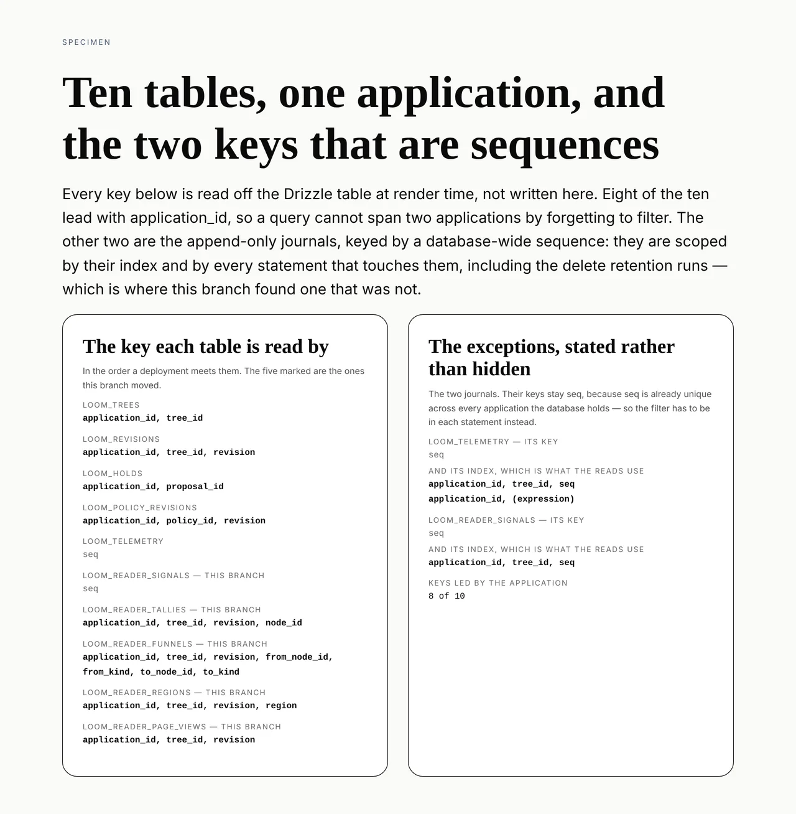

# The readers inside one application

**Routine:** `Loom framework` · **Date:** 2026-10-12 · **Section:** §5 (signals),
§6 (telemetry), §3 (portal) · **Branch:**
`framework-69-the-readers-inside-one-application`



## What was completed

**Every table Loom stores under an application is now scoped by one.** The five
reader-signal tables were the last that were not: `loom_reader_signals`,
`loom_reader_tallies`, `loom_reader_funnels`, `loom_reader_regions` and
`loom_reader_page_views` each carry `application_id`, lead their key and their
index with it, and are reached through a handle that resolves the application at
construction. A handle for one application cannot see, add to, or delete another
application's rows.

That was the last thing standing between `Loom portal` and a screen that creates
a second application. The finding it closes said so in the order it had to
happen:

> the portal must not offer a second project until these seven are scoped. A
> screen that lets somebody create one, over a signal ledger that cannot tell two
> apart, would be mixing two customers' readers on the first day, and the mixing
> is not recoverable from the rows afterwards.

**It is now safe to build that screen.**

## The bug this turned up, which is the part worth reading

Counting the tables for the picture is what found it. Eight of the ten lead their
key with `application_id`; two do not, because they are append-only journals keyed
by a `bigserial`. Having just written a filter into the reader buffer's `forget`
for exactly that reason, I went to look at the other journal.

`src/telemetry/postgres.ts` had the fault the buffer was being guarded against.
`postgresTelemetryJournal` takes a scope and builds a `mine()` filter that every
read goes through — and `forget` was the one statement in the file that did not
use it:

```ts
await db.delete(loomTelemetry).where(lt(loomTelemetry.seq, before))
```

`seq` counts across every application in the database. So retention run on behalf
of one application was deleting **every** application's telemetry below the same
sequence number, and a deleted telemetry row is not recoverable from anything
else. The test that now covers it fails without the fix with
`{ removed: 4, mine: 0 }` where it should read `{ removed: 0, mine: 4 }` — one
application's retention took all four of the other's records.

**Nothing had reached it**, because nothing constructs a second handle yet. It
landed with the application dimension (0269) and would have become reachable on
the same day the portal offered a second application — which is the day this work
exists to make safe. That is the whole argument for doing this before the screen
rather than after it, made by accident.

## Decisions I took that were not specified

**The audience dimension did not land with the application.** This is the one
real decision in the change and it goes against standing advice.
[0263](../decisions/0263-a-page-is-a-base-tree-and-the-deltas-an-audience-earns.md)
clause 5 says a signal must name the audience it was collected under, its
consequences say *both dimensions should land in one migration rather than two*,
and a note in `scoped.test.ts` held these five tables back on that basis. I
shipped the application alone.

The reason is that 0263 is **`Proposed`**. It is not ratified, nothing serves a
variant, and the column would carry no value. Waiting for one migration is not a
choice between one migration and two — it is a choice between two migrations and
a lane blocked for as long as a record sits unratified, which is a length nobody
here can predict because ratifying it is the maintainer's. The cost accepted is
five `ALTER TABLE` statements later, on a pattern this change has now proved.
Recorded as
[0270](../decisions/0270-the-reader-tables-take-the-application-now-and-the-audience-when-it-is-ratified.md).
0263 is **not** superseded and clause 5 still stands; what moved is when its half
arrives.

**The buffer's key did not widen.** `loom_reader_signals` is keyed on `seq`, a
`bigserial` already unique across every application the database holds, so leading
its key with the application would have been a wider key enforcing nothing new.
Its *index* widens instead, because the index is what the reads use — and its
`forget` needed the filter most of all, for the reason the telemetry section
above gives.

**Three factories, each a public function that resolves the application and a
private one that has it.** It keeps `application` a plain `ApplicationId`
everywhere it is read rather than an optional unwrapped at each use, and it left
the bodies where they were, so the diff shows the lines that name a column and
nothing else.

## What the tests prove, and how I know they prove it

Nine assertions were added to `src/application/scoped.test.ts`, which is now the
one file that says what application scoping means across all ten tables. They run
against PGlite rather than the memory stores, because an in-memory store is
isolated by having its own map and proves nothing about a `WHERE` clause.

**Every one was checked by removing what it tests.**

| what was removed | result |
| --- | --- |
| the application filter from the reader reads and `forget` | all 8 reader assertions fail |
| the `application_id` from `loom_reader_tallies`' primary key | the write fails outright — the upsert's conflict target no longer matches a unique index |
| `mine()` from telemetry's `forget` | `{ removed: 4, mine: 0 }` instead of `{ removed: 0, mine: 4 }` |

The middle row is worth stating precisely, because it is not the failure I
expected. Narrowing the key does not silently merge two applications' counts: it
breaks the statement, because the schema and the conflict target have to agree.
Both halves of the change are load bearing, and neither can be removed quietly.

## Test numbers

`pnpm install && pnpm verify` — **green**, exit 0.

| suite | files | tests |
| --- | --- | --- |
| framework (`src/`, `tools/`) | 217 | 4,865 |
| application (`apps/loom`) | 436 | 8,322 |

Nine of those are new, all in `src/application/scoped.test.ts`: eight across the
five reader tables and one on telemetry's `forget`. `pnpm findings:check` reads
1,169 findings, 0 malformed. Nothing was skipped and no test was weakened.

**The first verify was red and this is what it caught.** The three factories
taking a second parameter moves the runtime's published surface, so
`app/(docs)/_lib/api/extract.test.ts` failed on the generated API reference
being stale — the test names its own fix, and `pnpm --filter @loom/app docs:api`
is run and committed as the second commit on this branch. The only lines that
changed are the three signatures and the three summaries now that those
functions have doc comments. Worth recording because the first run reported
`exit 0` through a `tail` pipeline that had swallowed the real code, which is a
way to believe a red tree is green.

## Records

- **Added:** [0270](../decisions/0270-the-reader-tables-take-the-application-now-and-the-audience-when-it-is-ratified.md),
  *The reader tables take the application now and the audience when it is
  ratified*.
- **Superseded:** none. 0263 stays `Proposed` and stays whole.

## Findings

- **Closed:** *the project scope reaches trees and revisions; holds, the policy
  log, signals and telemetry are still deployment-wide*, filed by `Loom portal`
  on 12 October.

Two corrections went into the closure, both in the filer's favour. The entry was
written against 0260 and says `project_id` / `prj_default`; 0269 superseded that
the same day and the column is `application_id` / `app_default`. And its own count
was off by one — the prose says seven tables remain where the table below it lists
eight, and the true total is ten rather than nine. The reading that mattered, the
one about ordering, was right.

## Open questions

1. **0263 is the live one.** Ratify or refuse it and the reader tables' second
   migration either gets written or never has to be. It is the maintainer's, and
   nothing here depends on the answer today.
2. **`postgres-holds.ts` and `telemetry/postgres.ts` still name a local variable
   `project` while it holds an `ApplicationId`** — rename drift left by 0269,
   which counted 280 references. It is cosmetic, it is in this lane, and I left
   it rather than widen a migration PR with a rename nobody asked for.
3. **Whether anything else trusts a `bigserial` to be per-application.** Two
   journals were keyed that way and one of them had an unscoped statement. I
   checked both and there are only two, but the class is worth remembering the
   next time a table takes a surrogate key.
