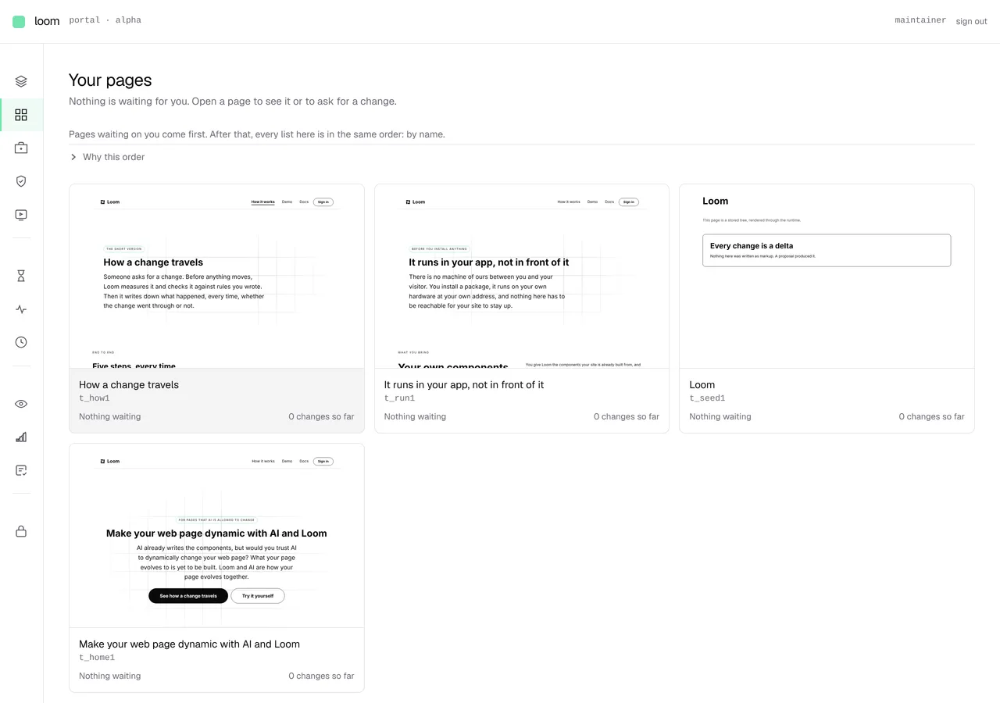

# 2026-10-12 — the pages this app stores, and the empty shelf a photograph found

**Build order section:** §5 — Loom Portal. Condition 1 of
[0259](../decisions/0259-a-surface-the-portal-governs-renders-from-the-store-and-a-page-built-at-render-time-is-not-one.md):
*the surface renders from the store.*

**Branch:** `marketing-01-the-pages-this-app-stores` (→ `main`), cut from `main`
at `18620618`.

**Answers** the maintainer's instruction of 12 October: *"Our loom marketing
page and docs page are already built in the Loom framework, so these should be
hooked up to the portal under my account/login."* The marketing half is here.
The docs half is filed, with the reason, and is summarised at the bottom.

---

## What changed

This site's three pages were built from code on every request and thrown away.
`homePageTree(context)` returned a real `LoomTree` with no row behind it — no
revision, no log, no inverse, nothing for a proposal to be held against, and
nothing for the portal to list. A page like that is not governed by anything;
it is a function call that happens to produce the right shape.

Now the builders are a **seed** and the store is what gets served. The three
pages are rows in the app's store, the portal lists them, and a change appended
to one of them is a change a stranger is served.

---

## The part that was not small

0259 filed condition 1 as the small one. It was not, and the reason is worth
writing down because it is a property of trees rather than of this site.

**A stored page cannot name the host it is served from or the palette the
reader asked for.** Both were arguments to every builder, and `home.ts` alone
baked them into twelve places: the root's theme variables and every link in the
chrome. A stored tree carrying `https://loom.example` is wrong on every other
host, and a stored tree carrying `theme=minimal` is a different row per palette
— three copies of a page whose revision histories immediately diverge.

So the stored page names neither, and both are put back on the way out:

| | before | after |
| --- | --- | --- |
| links | `${origin}/how-it-works` | `/how-it-works` |
| palette | baked into the root by the builder | `asRequested(tree, { theme })` at render |
| who decides | the builder, from the request | the request, over the stored row |

`asRequested` is the whole of that layer. It sets the root's theme variables and
appends the palette to this site's own links — and **only** to those. Three
things it deliberately does not touch, each of which it got wrong first:

- a link that already names a palette, which is the footer's switcher saying
  *this one means bold*. Overwriting those turns the switcher into three links
  to the page you are already on.
- `/docs`, `/demo`, `/portal`, `/lessons` — paths on this deployment that pass
  any `startsWith("/")` test and have never heard of this site's palettes.
- anything below the root beyond an `href`. An earlier version marked the
  reader's current palette with `current: true`, which is a prop below the
  root, and `pages.test.ts` refused it: 0049 says a re-theme changes only the
  root. The mark was a nicety invented in passing and the invariant is a
  decision somebody recorded.

The palette above is not in the row. It is the request's, applied to a page
stored without one. The third palette and a phone width are alongside this
report as `...-editorial-wide.png` and `...-how-it-works-bold-phone.png`.

---

## The bug no test could have had an opinion about

Everything above passed. 1,386 tests in this route group, a green build, 204
prerendered pages, and the site served correctly out of the store in three
palettes. Then the portal was photographed — sign in, open *Your pages* — and
it held **one page**: the demonstration tree this lane has always seeded. The
site's three were not there, which is precisely the thing the maintainer said
on 12 October: *"I don't see the marketing site on the portal yet."*

Visiting the front door once and reloading the same screen put all three on it.
That is the whole diagnosis.

Nothing was broken. Seeding ran on the first request to a marketing page, which
is correct and is not sufficient — because a maintainer who deploys, signs in
and opens *Your pages* has not visited the public site yet. The shelf is empty
for exactly as long as nobody has been to the front door, and an empty shelf
reads as *this is not hooked up*, not as *nobody has visited yet*.

**This is a bug about the order a person does things in, and no type and no
unit test has an opinion about that.** It was found by looking at the screen.

The fix is one place: every portal screen already awaits `ensureSeeded`, so
that now seeds both — this lane's demonstration page and the site's three.
`(marketing)` keeps its own call. Whichever surface is reached first seeds the
store and the other finds it done; both halves are create-if-absent, so the
cost is one refused write per process.

The photograph above is a fresh server with nobody having opened the public
site: sign in, and the pages are already there.

---

## What is actually asserted

The 1,386 tests that already existed assert that the page is still the page.
They passed before this change and after it, and **not one of them would notice
if the store read were deleted tomorrow** — which is the point of them and the
reason three new files exist:

| file | what fails if it is removed |
| --- | --- |
| `stored.test.ts` | a change in the store is a change on the page; seeding never overwrites; an unreadable store serves the authored page |
| `requested.test.ts` | the palette lands on the root and on this site's links, and nowhere else |
| `(portal)/_lib/store.test.ts` | the site is on the shelf before anybody has visited the site |

Each was checked by breaking the thing it is about and watching it go red,
rather than by watching it pass.

The decisive one is `is a change somebody made in the store`. An append is how
every change to a page arrives — a portal edit, a proposal somebody accepted,
an adaptation the Gate allowed — so one append standing in for all three is the
whole mechanism. Until today there was no way to write that test, because there
was nothing to write to.

All three site routes build as `ƒ`, server-rendered per request. A change
accepted in the portal is on the page at the next request, with no redeploy.

---

## Two deliberate removals, both needing the maintainer's eye

The maintainer's instruction was *"Take that message out of the site altogether
whether tracking them or not."* It was being made in **two** places, and both
are gone:

1. the footer's counting note, on every page.
2. the second paragraph of *What this page counts* on `/what-you-run`, which
   said in one of two versions whether this deployment is counting.

**The second is an extension of the instruction to a place it did not name**,
and is flagged here for that reason. The reason it goes with the first is that
storing the page makes it worse than it was: a sentence about the deployment's
current setting is written once at seed time and becomes false the first time
somebody changes it — and *nobody reading this page has been counted* is the
worse of the two to be wrong about.

What stays on `/what-you-run` is the disclosure itself, which is true of any
deployment: *this site counts which parts of a page people reach... it does not
know who you are.* Followed by the part that is now the honest version of the
removed sentence: *whether it is switched on is a setting of whoever is serving
it.*

If that reading is wrong, the band to look at is *What this page counts*.

---

## Filed, not fixed

- **`TreeStore` has no delete.** Once a page is in the store, editing its
  builder stops changing the site, and there is no supported way back. Filed
  for `Loom framework`, with a suggested shape — a *reseed* append that records
  the restoration rather than ending the history.
- **The docs cannot be hooked up the way the marketing site was.** They are MDX
  compiled to React; there is no tree, so there is nothing for the portal to
  list or a delta to name. 0259's refusal covers it: prose is not governed by
  rewriting it as a tree. What *could* work is storing the docs' chrome with the
  MDX rendered into a slot — a `Loom docs` call, filed for that lane.
