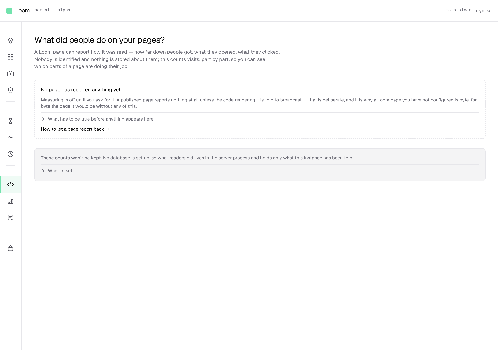
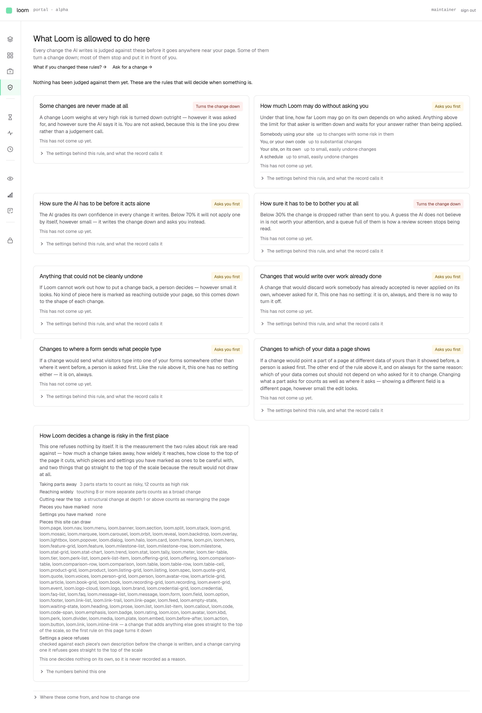

# 2026-10-12 — what is actually on these screens, measured

**Not a change report.** The maintainer asked for a plan to overhaul the portal
and said *"don't just take my word… feel free to audit the look of the portal in
its entirety."* This is that audit, done by signing in and photographing all
fourteen screens against a store with four real pages in it, and the plan that
follows from it.

One change ships with it: **the demo link is gone from the portal.** It needed no
plan and had been asked for repeatedly.

---

## The measurement that says it fastest

Every screen, signed in, 1280px wide, full page:

| screen | height | reading |
| --- | ---: | --- |
| `/portal/app` — Your app | **13,298px** | one screen, scrolled fifteen times |
| `/portal/pieces` | **10,426px** | 107 cards, no search |
| `/portal/pages/t_home1` | **5,594px** | 189 parts, flat, fully expanded |
| `/portal/rules` | 1,892px | nine prose cards, nothing editable |
| `/portal` — front door | 1,790px | |
| `/portal/pages` | 1,028px | the one screen that is the right size |
| `/portal/activity` | 900px | **empty** |
| `/portal/checkup` | 900px | **empty** |
| `/portal/history` | 900px | **empty** |
| `/portal/pages/t_home1/versions` | 900px | **empty** |
| `/portal/readers` | 900px | **empty** |
| `/portal/rules/what-if` | 900px | **empty** |
| `/portal/sign-ins` | 900px | **empty** |
| `/portal/trust` | 900px | **empty** |

900px is the viewport. Those eight screens have nothing below the fold at all.

**So the portal is eight empty screens, three that cannot be scrolled to the
bottom, and three that are the right size.** That is the whole of it, and it is
not a styling problem.

---

## What each one is actually for, and the verdict

| screen | what it does today | verdict |
| --- | --- | --- |
| **Your app** | names the one app, then prints every primitive and the whole policy inline | **delete** — it is 0220's screen, and 0220 is what the maintainer has just refused |
| **Pages** | thumbnails of stored trees, ordered by what needs you | **keep**, scope it to a project |
| **Page detail** | preview + 189-row outline + 7 tabs | **rebuild** — see below |
| **Pieces** | 107 cards of prose | **rebuild** as a searchable table |
| **Rules** | nine cards *describing* settings, none editable | **rebuild**, starting from what-if |
| **What-if** | the configuration view, reached by a link from Rules | **promote** to be the Rules screen |
| **Front door** | "What Loom has been doing" | **rebuild** as a project overview |
| **Activity / History** | the journal, two ways | **merge** into Logs |
| **Readers** | the signals screen | **rebuild** — this is the product |
| **Trust / Checkup** | calibration and audit | **fold** into one Audit page you run |
| **Sign-ins** | failed sign-ins to this portal | **keep**, move under settings |
| **Demo** | a link off to the marketing demo | **gone, in this change** |

---

## Four things the photographs found that no test could

**1. The rail has no words on it.** Twelve icons, no labels, no grouping
headings — the groups exist in the data and render as bare separator lines. A
person cannot tell `Readers` from `Trust` from `Checkup` without clicking all
three. This is the first thing anybody meets and it is unreadable.

**2. `Nothing picked yet` is 11,000 pixels below the thing you click.** On the
page inspector the preview pane is pinned at the top right; the outline runs
189 rows down the left; and the panel that tells you what you selected is
*under the outline*. Clicking a part in the preview changes a panel five
screens away, and because that panel is a small dashed box when nothing is
picked and a tall one when something is, the whole column jumps. That is the
content jump — it is a layout bug, not an animation one.

**3. The screen the product is for is empty and apologising.** `Readers` is
where signals are meant to land. It renders a dashed box that says no page has
reported anything, and a grey box that says the counts would not be kept
anyway. No table, no chart, no filter, no detail pane.

**4. `Rules` is a document about a config file you cannot edit.** Nine cards
state the thresholds in prose — *"3 parts starts to count as risky, 12 counts
as high risk"* — with no control beside any of them, and one card dumps all 107
primitive type names as a paragraph.

---

## The portal is a document, not a tool — and that is a written policy

The maintainer, on the Supabase screenshots: *"Not wordy, everything intuitive
and where it needs to be. Just a master class of functional UI which we should
aim for."*

Here is the gap, counted. Prose is words inside a `
` on the screen's own
file; controls are every `input`, `select`, `textarea` and `button` in it:

| screen | prose words | controls |
| --- | ---: | ---: |
| front door | 493 | 0 |
| Trust | 403 | 0 |
| What-if | 361 | 0 |
| Readers | 322 | 0 |
| Rules | 299 | 0 |
| Pages | 270 | 0 |
| Checkup | 249 | 0 |
| Pieces | 177 | 0 |
| Your app | 125 | 0 |

**In the whole portal — 35,438 lines — there are 32 interactive controls, in
six files.** Fourteen inputs, seventeen buttons, one textarea. The Rules
screen, whose entire subject is settings, contains none of them: it describes
the thresholds in sentences and offers no way to move one.

**This is not drift. It is a convention, written down and enforced.**
`_lib/vocabulary.ts` carries the brief, and FINDINGS cites it three times:

> **Plain language is the default. The technical record is one click away.
> Nothing is ever removed.**

That is a good rule for a marketing page and for documentation, and it is the
wrong rule for a working tool. *Nothing is ever removed* is what produces a
13,298px screen; *plain language is the default* is what produces 493 words on
a front door that could be six numbers and a table. Every screen above obeys
it faithfully.

**So the convention has to change with the portal, or the next routine will
write the prose back.** The replacement, scoped to `(portal)` only and leaving
`(marketing)` and `(docs)` as they are:

> **A portal screen shows state, not explanation.** The default unit is a row,
> a number or a control — never a paragraph. Explanation lives next to the
> control it is about, behind a label or an info affordance, and never in body
> copy. A screen that cannot be understood without a paragraph is the wrong
> screen.

---

## The thing underneath all of it

**The portal is a faithful rendering of a data model the maintainer has just
rejected.**

[0220](../decisions/0220-an-app-is-a-registry-a-policy-and-a-store-and-loom-has-one-of-each.md)
(`Proposed`, 1 October) says an app is a registry, a policy and a store, and
Loom has exactly one of each per deployment. It was written *because* the
maintainer asked, on 1 October, to see **"which apps I have registered with
Loom"** — and the honest answer then was that there is no such thing. Every
screen above is built on that answer. `Your app`, singular, is its monument.

On 12 October the maintainer said: *"The whole portal is geared toward one
app…when I can have many."* That is a refusal of 0220, and 0220 already says
what a refusal costs, in its own words:

> If it is **refused** — that is, if the maintainer wants several — the work is
> §1's and starts at the store's signatures, not at a screen.

It also enumerates the bill, which is still accurate: an identifier above the
tree; the hold store, journal and signal ledger following it; a registry per
app; and authorisation gaining a scope, so that 0027's *"the actor comes from
the session"* acquires its second half — **the scope comes from the route.**

**No amount of redesign reaches this.** A workspace with projects in it cannot
be drawn on a schema where `TreeId` is unique within a store and nothing above
a tree groups anything.

---

## The second thing underneath it, which nobody has raised

**`/api/reader-signals` has no authentication.**

It is the only write endpoint a stranger may use. It is gated by one
environment variable, `LOOM_SIGNAL_INTAKE=on`, and nothing else — no key, no
origin check, no project. That has been safe because the only pages posting to
it are pages of the same deployment.

The maintainer's stated primary purpose for the portal is *"to register / hook
up their application to the portal and begin processing signals from their web
pages"* — a customer's app, over the network. The moment that is true, this
endpoint needs a project-scoped ingest key, an origin allowlist, and a project
to file the signals under. **This is the single highest-value piece of work in
the whole overhaul**, because it is the one the stated purpose rests on, and it
does not exist in any form.

---

## One question that has to be answered, and why it does not block the start

**Does the portal run on Loom's machine, or on the customer's?**

The Supabase model the maintainer pointed at is a hosted control plane:
projects live in regions, you get a connection string, your app talks to it
over the network.

That collides with what the marketing site says, in the band stored as
`t_run1`: *"There is no machine of ours between you and your visitor"* and
*"nothing here has to be reachable for your site to stay up."* If signals go to
a Loom-operated service, both sentences become false and the site has to change
with the product.

**It does not block anything, and that is the useful part.** The data model is
identical either way: projects become first-class, everything is scoped by
project, and ingest takes a project-scoped key. Whether that process is ours or
theirs is a deployment question, not a schema one — Supabase itself is both. So
the first two steps below can start before this is settled, and the answer is
needed by the third.

---

## The plan

Each step ends with something that can be looked at.

### 0 · Two records · *needs sign-off before any code*

**0260 — a project is the unit Loom stores, governs and measures under.**
Refuses 0220, supersedes it, and rewrites `docs/portal.md`, which is the
approved plan the current portal was built to and which assumes one app
throughout.

**0261 — a portal screen shows state, not explanation.** Scopes the plain
language brief to `(marketing)` and `(docs)` and replaces it inside
`(portal)`, as above. Without this the prose grows back, because it is
currently the rule.

### 1 · Project identity, through the schema · *invisible, and everything waits on it*

`project_id` on `loom_trees`, `loom_revisions`, `loom_holds`,
`loom_policy_revisions` and all five signal tables. Store, hold and signal
signatures take a project. `TreeId` becomes unique within a project. A
migration for the rows that already exist — there are four, and three of them
are the live marketing site.

This is `src/`, which the portal routine is barred from touching. **This step
needs explicit permission or another lane.**

### 2 · Workspace, projects, and a shell that reads · *visible*

Accounts replacing the environment-variable roster. A workspace landing page
listing projects, with create and delete. A project switcher in the top bar.
A **labelled** left rail with a second rail for the selected section — which is
the maintainer's first complaint and also the fix for the seven tabs on the
page inspector.

### 3 · Registration and credentials · *the stated primary purpose*

Create a project and get its id, an ingest key and a copy-paste snippet.
`/api/reader-signals` learns to authenticate that key, check the origin, and
file signals under the project. A health panel on the project overview: is this
project receiving, when was the last signal, how many were rejected and why.

### 4 · Logs and signals · *the screen the product is for*

A filterable table with a timeline above it and a detail pane on the right,
which is the fourth Supabase screenshot. Errors and reader analytics in one
place, with charts that are worth looking at. `Activity`, `History` and
`Readers` all fold into it.

### 5 · Policy, from the configuration side

What-if becomes the Rules screen. Each rule is a control with its current value,
and the prose that is the whole screen today moves behind an info affordance
beside the setting it explains.

### 6 · The page inspector, rebuilt

A collapsed outline with search instead of 189 open rows. The inspector pane
fixed beside the preview rather than below the outline, with its space
reserved, which removes the jump. `Pieces` becomes a searchable, grouped table.

---

## What I would do first

Steps 0 and 2 can run together, and the fastest way to unblock the maintainer
is to build **the new shell as a navigable prototype with invented data** —
workspace, projects, project overview, labelled rail, sub-rail — before any of
the schema moves. It costs a day, it is clickable, and it turns *"I can't make
heads or tails of what I should be looking at, and therefore can't give you any
real direction"* into a thing that can be reacted to in five minutes.

Then the schema, then ingest, then logs.
