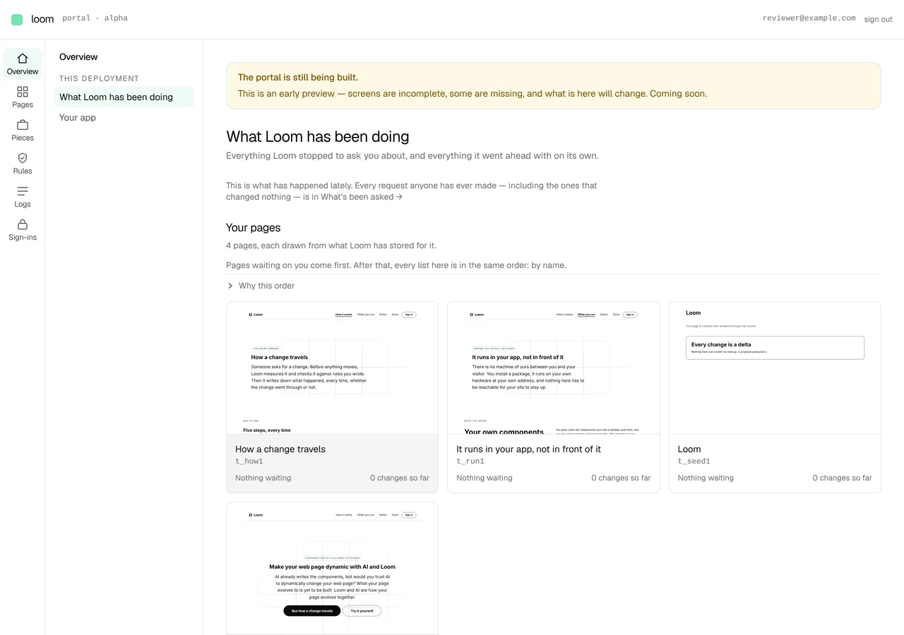
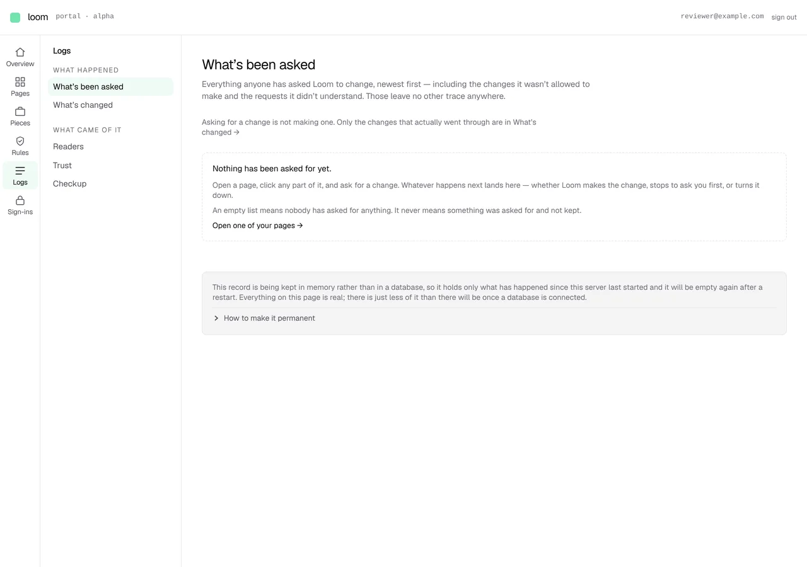
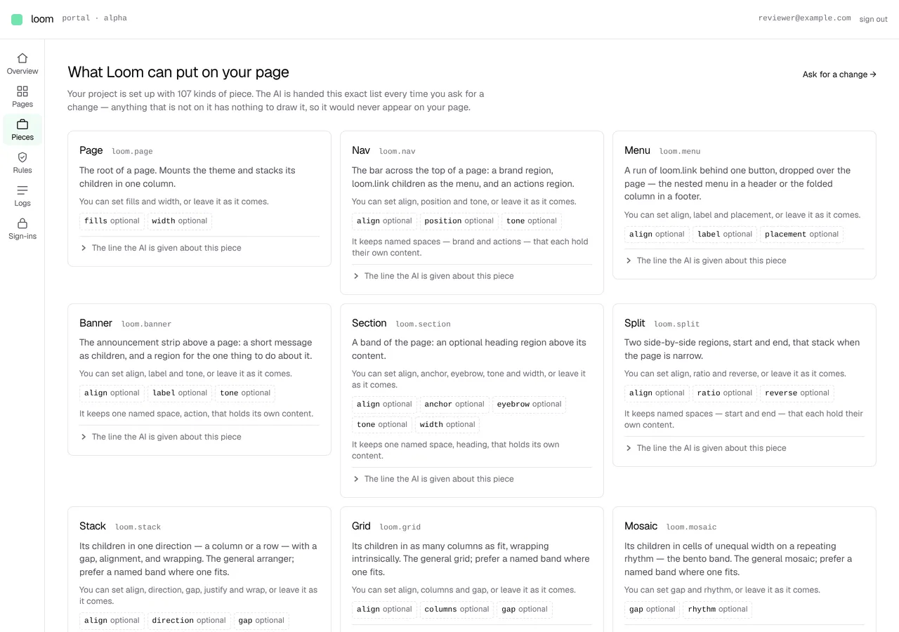
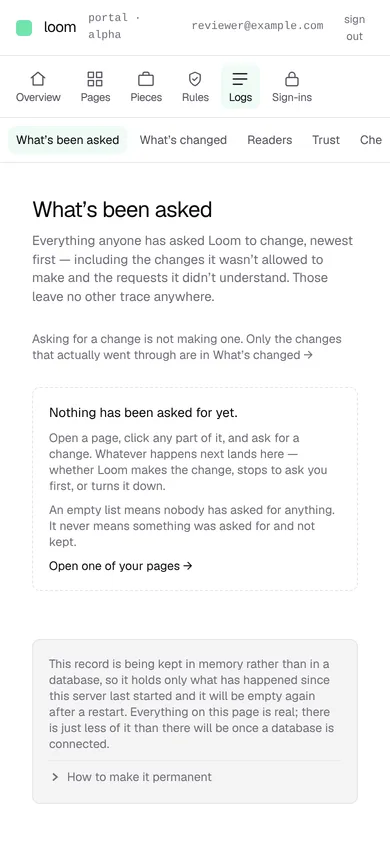
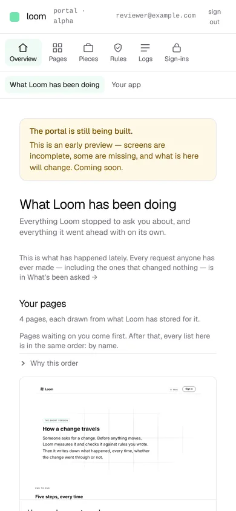
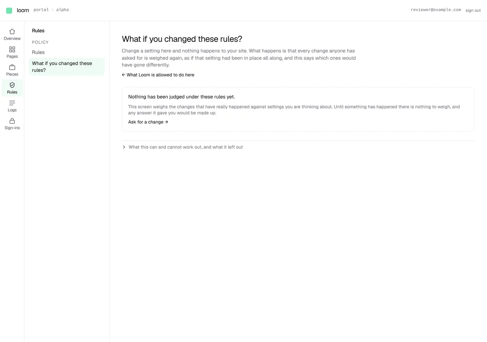

# 2026-10-12 — the rail has words on it

**Section §5.** The first of the four things this morning's audit photographed
and no test could have found, built: the portal's navigation, in two levels,
with its words on the screen before anybody does anything.

> **The rail has no words on it.** Twelve icons, no labels, no grouping
> headings — the groups exist in the data and render as bare separator lines. A
> person cannot tell `Readers` from `Trust` from `Checkup` without clicking all
> three. This is the first thing anybody meets and it is unreadable.
>
> — `2026-10-12-portal-the-audit-before-the-overhaul.md`

It is also the maintainer's own first complaint — *"I can't even make heads or
tails of what I should be looking at, and therefore can't give you any real
direction"* — and the one he wrote the remedy for: *"There should be a second
left rail that can act as a submenu, and the tabs in the second level of Pages
should be populated there."*

---

## What shipped



Six sections down the left with their names under the glyphs, and the section
you are in opened beside them. The information architecture is the prototype's,
built at `/portal/preview` this morning and photographed there, pointed at the
screens that actually exist rather than at invented ones.

| section | second rail |
| --- | --- |
| **Overview** | *This deployment* — What Loom has been doing · Your app |
| **Pages** | — one screen |
| **Pieces** | — one screen |
| **Rules** | *Policy* — Rules · What if you changed these rules? |
| **Logs** | *What happened* — What's been asked · What's changed · *What came of it* — Readers · Trust · Checkup |
| **Sign-ins** | — one screen |



**The grouping is the argument, not decoration.** *What happened* holds the two
screens that are nearly opposites and were adjacent, unexplained, in a flat
list of twelve: every request including the ones that changed nothing, and only
the changes that went through. *What came of it* holds the three that are
evidence rather than record. A reader who meets `Readers`, `Trust` and
`Checkup` as three bare glyphs has to click all three; a reader who meets them
under a heading has a reason to click one.

### Measured, by the harness, on the built application

```
2026-10-12-portal-rail-overview-wide  1280x900@2x  scrollWidth 1280 / innerWidth 1280
    [data-rail="sections"]  x 0 y 56  64x844
    [data-rail="screens"]   x 64 y 56  224x844
    #page                   x 288 y 56  992x1760
2026-10-12-portal-rail-pieces-wide  1280x900@2x  scrollWidth 1280 / innerWidth 1280
    [data-rail="sections"]  x 0 y 56  64x844
    [data-rail="screens"]   no match
    #page                   x 64 y 56  1216x10567
```



**`no match` is the claim worth reading.** `Pieces` is one screen, so it has no
second rail, and the page is 1216px wide instead of 992 — the 224 pixels come
back rather than being reserved. That is what makes a row the right shape here:
the old rail was `fixed`, so the page carried a `pl-14` that had to match a
width written in another file, and a second rail would have made that two
numbers in two files that have to agree and be wrong on every screen where the
second rail is absent. In a row there is no number at all.

---

## The one behaviour this deletes

The rail it replaces was 56px of icons that widened to 275px on `hover` **and**
`focus-within`. The second of those needed a mechanism to undo it: a link keeps
focus after it is clicked, so the rail stayed open after the pointer had left —
*"super annoying to have to click again to close it"* — and on a touch screen,
where there is no pointer to leave, it covered a third of the display until
something else was tapped. The fix was `event.detail === 0`, which is how a
click from the keyboard is told from a click from a finger, so that one could
keep the focus and the other could give it back.

**All of it existed to make hidden labels reachable.** The labels are not
hidden, so there is nothing to reveal, nothing to close, and no reason for a
rail to know what kind of press opened it. `sidebar.tsx`, `sidebar-nav.tsx` and
`nav-items.tsx` come out — 653 lines, including the two tests that guarded a
reveal.

**The test those replace is the lesson.** `sidebar-nav.test.tsx` asserted that
every label carried `group-hover:opacity-100` *and* `group-focus-within:opacity-100`.
It passed on every run for six weeks while the screen it guarded was unreadable,
because it was a test of the reveal rather than of the words. `rails.test.tsx`
asserts the opposite shape: `getByRole("link", { name })` for every section, and
then that the rendered markup contains no `opacity-0`, no `group-hover:` and no
`group-focus-within:` at all.

---

## The phone, which the old rail had no answer for



```
2026-10-12-portal-rail-logs-phone  390x844@2x touch  scrollWidth 390 / innerWidth 390
    [data-rail="sections"]  x 0 y 56  390x62
    [data-rail="screens"]   x 0 y 118  390x45
    #page                   x 0 y 163  390x681
```



64px beside 224px leaves 102 of a 390px screen for the screen, so below `md`
both rails lie down above the page and scroll sideways: 107px of chrome, and
the page keeps the full width. `scrollWidth 390 / innerWidth 390` is the whole
claim that nothing overflows.

It is photographed as a phone and not as a narrow window (0236), which matters
here more than usual: the rail this replaces revealed its labels on `hover`, and
a device reporting `hover: none` never gets them. **On a touch screen the old
rail had no labels at all, ever.** That was true for six weeks and no
photograph in this repository showed it, because every phone shot taken before
6 October was taken by a browser with a mouse.

---

## What a reader is told, and what they are not



```
    [data-rail="screens"] a[aria-current="page"]  x 76 y 152  199x47
    [data-rail="sections"] a[aria-current]        x 4 y 209  56x45
```

Two marks and they say different things. The screen you are reading carries
`aria-current="page"`; the section holding it carries `aria-current="true"`. A
reader three levels inside `Pages` is in that section without `/portal/pages`
being the page in front of them, and a rail claiming otherwise would contradict
the heading they are looking at.

**On a path no section claims — the sign-in page, the prototype — nothing is
lit.** A rail that highlights the wrong place is worse than one that highlights
none.

---

## Decisions taken that were not specified

**The section labels are new; no screen was renamed.** A section is a new
thing, so `Overview`, `Pages`, `Pieces`, `Rules`, `Logs` and `Sign-ins` are
names this change invents. Every *screen* in the second rail keeps the name it
already had — read from `_lib/screen-names.ts` where it has a declared one, and
otherwise the short form of its own heading it has carried all along. The
discipline is the lane's own and it is the reason `Readers`, `Trust` and
`Checkup` did not become questions here: **a name moves on the run that
rewrites its screen, never before it**, and this run rewrites none of them.

**`Logs`, which was a banned word until this morning.** 0261 took it off the
list on the grounds that the portal's reader is a developer rather than a
layperson, and it is the maintainer's own word for the screen. That landed
before this branch; this is its first use in the navigation.

**`Your app` is still reachable, under Overview.** The audit's verdict on it is
*delete* — it is 0220's screen and 0220 is what the maintainer has refused —
but deleting a screen is a different change from arranging the ones that exist.
Leaving it out of the rail while leaving it served would make it a screen with
no way in, which is worse than either.

**A section with one screen draws no second rail.** `Pages`, `Pieces` and
`Sign-ins` have none. Inventing a submenu of one to keep the layout symmetrical
is the same mistake as a portal geared to one app, and `sections.test.ts` fails
on it.

---

## Tests

`pnpm verify` green end to end: **4,806** framework tests (212 files), **8,333** app tests (436 files), 1,167 findings 0 malformed, 133 prerendered pages, 1,811 text junctions 0 run together, 1,801 visuals at 126.1MB with none over budget. Exit 0.

The shell's own: **33 tests in 3 files**, of which 20 are new in
`sections.test.ts` and 9 in `rails.test.tsx`. What they hold:

| | |
| --- | --- |
| every destination, at either level, resolves to a `page.tsx` that exists | carried from `nav-items.test.ts` — three of four items pointed at 404s on a deployed portal once |
| **every top-level screen the filesystem holds is in the rail** | new, and the check the one-level rail could not ask |
| no submenu of one; no empty group; no two entries in one rail alike | |
| a section leads into its own submenu rather than past it | |
| the rail says nothing in the runtime's vocabulary | and see the finding below |
| longest match, segment-bounded, and `/portal` claiming only itself | 8 cases, including `/portal/pagesetter` |
| the labels are in the DOM with nothing to reveal first | the regression this whole file exists for |

Nothing skipped, nothing weakened. `pnpm verify` is run from a clean install on
a container that has never run `pnpm package:primitives`, which the 12 October
finding says is the state the gate has to pass in.

---

## Findings

**Filed:** *the plain-language sweep reads this lane's `.tsx` files, and the
first words anybody meets are now in a `.ts` one.* `every-screen.test.ts` keeps
only `.tsx`, and the rail's labels are correctly data rather than markup.
`sections.test.ts` closes it where it was opened by asserting `runtimeWordsIn`
over every label and group name; the class stays open, because widening the
sweep needs an exemption mechanism for the two `_lib` modules that carry the
runtime's vocabulary as subject, and an exemption list invented in the same run
as the rule it exempts from does not last a week. Owned by this lane.

**Closed:** none.

---

## What this tells a developer that the repository cannot — answered honestly

**Nothing new, and that is the right answer for this change.**

The three facts only Loom has — which proposals were refused and by which rule,
where the AI's confidence has proven wrong, what an inverse would undo — were
all already on screens in this portal. They were behind twelve identical
glyphs. This change does not add a fact; it makes those three reachable in one
press from anywhere, under headings that say which is which, and it is the one
step in the audit's plan that every later step stands on. The audit said so in
its own words before any of this was built: *the fastest way to unblock the
maintainer is the new shell, before any of the schema moves.*

**The next unit is where the rail starts saying something.** A count beside
`Overview` — how many changes are waiting on you — is a fact no repository, log
or `git log` holds, and it is what makes a person open this daily rather than
when they remember to. It is not in this change for one reason worth writing
down: the number is a list of every page and a hold read per page, which is the
front door's entire data-gather, and putting it in the root layout runs that on
every screen in the portal. It wants a cheap count at the store, which is a
framework ask and is the shape of the finding the next run will file.

---

## Open questions

**Nothing blocking.** Two worth a line:

- **`Sign-ins` is a section of its own, and should not stay one.** The audit
  says *keep, move under settings*, and the prototype has it under `Settings`
  beside `Credentials` and `Members`. Neither of those screens exists, so a
  `Settings` section today would be a submenu of one with two greyed-out
  entries — the `soon` rows the prototype is allowed and the portal is not. It
  becomes `Settings` on the run that builds the first credential screen.
- **The page inspector's seven tabs are still tabs.** They are what the second
  rail was asked for, and they cannot move into it yet: the sub-rail is built
  from static section data and those seven screens belong to *one tree*, so the
  rail would have to take a contribution from the screen below it. That is the
  inspector's own rebuild (the audit's step 6), not this one.

---

## A duplication this leaves standing, deliberately

`/portal/preview` still brings its own chrome, and it is now a second copy of
this one — its paths carry a project (`/portal/preview/<project>/…`) and these
do not, so there is nothing to share until a project is a real thing. The
layout stands aside for that subtree through `PATH_HEADER`, exactly as it did
before, and both go when the project shell lands and there is one chrome again.
Worth stating rather than leaving for a reviewer to find: it is temporary in
the same way the prototype is.
