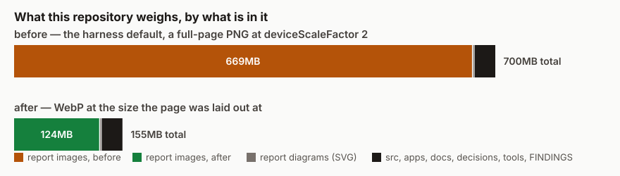

# What the repository weighs

**Date:** 2026-10-12
**Section:** §1 (process)
**Branch:** `reports-weigh-less`



## What was asked

To rethink `reports/`: clean up what needs it, and find a way to store reports
going forward that does not blow up the size of the repository.

## What was done

`reports/` went from **669MB to 124MB**, and nothing was deleted.

Every raster under `reports/` is now WebP stored at the size the page was
actually laid out at — the capture divided by its `deviceScaleFactor` — and the
citation in every report that pointed at the old name moved with it.
`pnpm reports:check` runs inside `pnpm verify` and refuses a visual that is not
`.webp` or `.svg`, or that weighs over 1.2MB. `pnpm reports:shrink` is the one
command that satisfies it, and both screenshot entry points now print a line
telling you to run it. [0264](../decisions/0264-a-report-s-visual-is-stored-at-the-size-the-page-was-laid-out-at.md)
records the rule.

## The measurements

Taken before anything was changed:

| | |
|---|---|
| `reports/`, PNG | 1662 files, **669MB** (mean 409KB, median 283KB) |
| `reports/`, SVG | 114 files, 0.7MB |
| Everything else tracked | **30.3MB** |
| `size-pack` | 669MB |
| Distinct PNG blobs in all reachable history | 1752, of which **1662 are live in `HEAD`** |

That last row is the one that decided the shape of this change, so it is worth
stating plainly: **the weight is the current snapshot, not history.** 95% of the
pack is files that are in the tree right now. An ordinary commit can therefore
reach all of it, and **no history rewrite is needed** — which matters here beyond
the usual cost of one, because the records in `decisions/` cite commit SHAs as
evidence and a rewrite would falsify them. That trade is not taken and is not
recommended.

The format, not the scale, is where the saving is. On a sample spanning four
eras:

| | ratio |
|---|---|
| PNG at half the dimensions | 1.4× smaller |
| WebP at full dimensions | 2.3× smaller (and impossible above 16383px — three shots here are taller) |
| **WebP at half the dimensions** | **5.3× smaller** |

## After

**What a depth-1 clone transfers — which is what Vercel and CI fetch — goes from
603.0MB to 136.7MB.** Measured by packing each ref's commit and tree with no
history:

```
origin/main    603.0 MB
HEAD           136.7 MB
```

The whole tree at `HEAD` is 162.4MB against `origin/main`'s 703.0MB.

```
1776 visuals in reports/, 125.1MB, none over 1.1MB, 386 cited by no file
```

```
stored 1662 of 1662 visuals as .webp at 1/2 the captured scale
  665.0MB -> 124.3MB  (5.3x smaller, 540.7MB saved)
  mean 77KB a visual
  citations rewritten in 368 files
```

None of the 1662 was refused, and none came back larger.

## The decision not to delete anything, which I got wrong first

The obvious cleanup was to delete the images nothing cites. 387 visuals here are
cited by no file in the repository, 173MB of them, and the first draft of
`reports:check` called that a fault — whose fix is `rm`.

Checking before running it is the only reason that did not happen. Of the 387:

- **273 are named after a report that exists.**
  `2026-07-31-day-20-telemetry-journal.svg` sits beside
  `2026-07-31-day-20-telemetry-journal.md`. It is that report's own diagram; the
  report simply never wrote the image line for it. That is **139MB of evidence**
  one command away from being deleted.
- **The remaining 114 each share a date with between seven and sixteen reports**,
  any of which could be theirs.
- **81 visuals are byte-identical to another**, 25MB of apparent duplication.
  They are the `-before` and the `-embed-unchanged` halves of pairs, and
  `docs/routines.md` says in as many words that *the shots coming back
  byte-identical is what makes the third one evidence*. Git stores one copy of
  an identical blob regardless, so they were never weight at all.

So a citation is not something a check can infer, and it did not need to be: the
weight was never in the count. `reports:check` prints the uncited number and
leaves the files alone. The 273 unlinked diagrams are a real defect — a report
whose visual the reader never sees — and are filed rather than fixed here.

The re-encode preserves the byte-identical property, which I checked rather than
assumed: the two `2026-10-10-demo-window-arrival-phone` shots were identical
before and are identical after.

## Decisions taken that were not specified

- **Nothing is deleted**, for the reasons above.
- **No history rewrite**, because the weight is in `HEAD` and the records cite
  SHAs.
- **The encoder is resolved at call time and is not a dependency**, following
  [0116](../decisions/0116-a-screenshot-is-taken-by-the-repository-and-playwright-is-never-a-dependency.md)'s
  rule for Playwright. `reports:check` only calls `stat`, so `pnpm verify` needs
  no platform binary; only `reports:shrink` needs `sharp`, and it finds the copy
  Next.js already left in the pnpm store.
- **The harness still writes PNG.** Teaching the driver in
  `tools/specimen/playwright.ts` what an image format is would make it the second
  thing that file knows, and teaching one entry point and not the other is the
  drift 0116 exists to prevent. The specimen path also compares digests across a
  git ref, which is not a thing to change without exercising it, and exercising
  it needs a build, Playwright and a ref checkout. Both entry points print the
  reminder; `verify` is the enforcement.
- **A shallow clone gets the whole saving immediately** — 603.0MB to 136.7MB,
  measured — which is what CI and Vercel take. A full `git clone` still carries
  the old PNGs in history and will until someone decides a rewrite is worth
  falsifying the SHA citations for. That trade is not taken here.

  The first version of this measurement was wrong and is worth recording: packing
  each ref with `--revs` made the *new* branch look 120MB **larger**, because
  that walks all history and this branch's history contains both the PNGs and the
  WebPs. The number above packs the commit and its tree with `--no-walk`, which
  is the question a shallow clone actually asks.

## Two things the check got wrong before it was right

Both were caught by running it rather than by reading it, and both are the kind
that pass silently:

1. **It surveyed only tracked files.** `git ls-files` does not list a file
   written a moment ago and not yet added — which is exactly the state a run is
   in when it has just taken its screenshots and is about to call `verify` green.
   It now passes `--cached --others --exclude-standard`. Before the fix it
   reported 114 visuals and 0.7MB with 1662 WebP files sitting on disk.
2. **It had only ever been seen to pass.** A 3.1MB PNG was planted in `reports/`
   to confirm it exits 1 and names both faults, then removed.

## Tests

`pnpm verify` — see the gate output in the pull request. `tools/reports/`'s own
suite is **15 tests, all passing**, covering the format rule, the budget at and
over its edge, both faults reported for one file, the uncited count, and the
stored-size arithmetic including the 16383px clamp applied proportionally rather
than by cropping. One of them failed first: an aspect-ratio assertion tighter
than `Math.floor` can be, which is now asserted as within the pixel flooring
costs.

Nothing was skipped.

## Findings filed

- 273 reports hold a visual named after them that the report never links to.
- The NFT over-trace warning that `.vercelignore` works around is still
  unaddressed; the exclusion is about what belongs in a bundle and stands either
  way, but its comment claimed 677MB and now says 136MB.

## Open questions

- **Is the extra command acceptable?** If `pnpm reports:shrink` after shooting
  proves annoying, converting inside both entry points is the follow-up.
- **The 1.2MB budget has 15% headroom** over the largest stored visual
  (1014KB, a 10426px-tall full-page portal audit shot). A longer page than any
  photographed so far would trip it. That seems like the right thing to be told.
