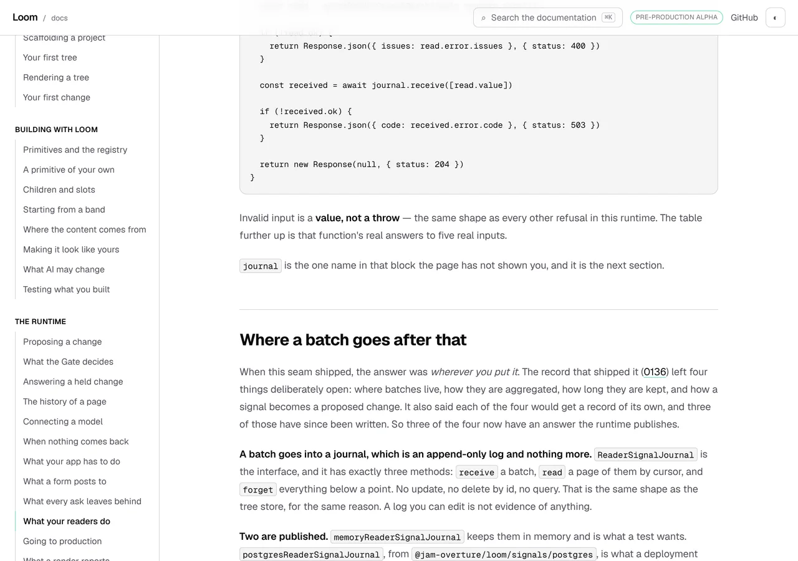
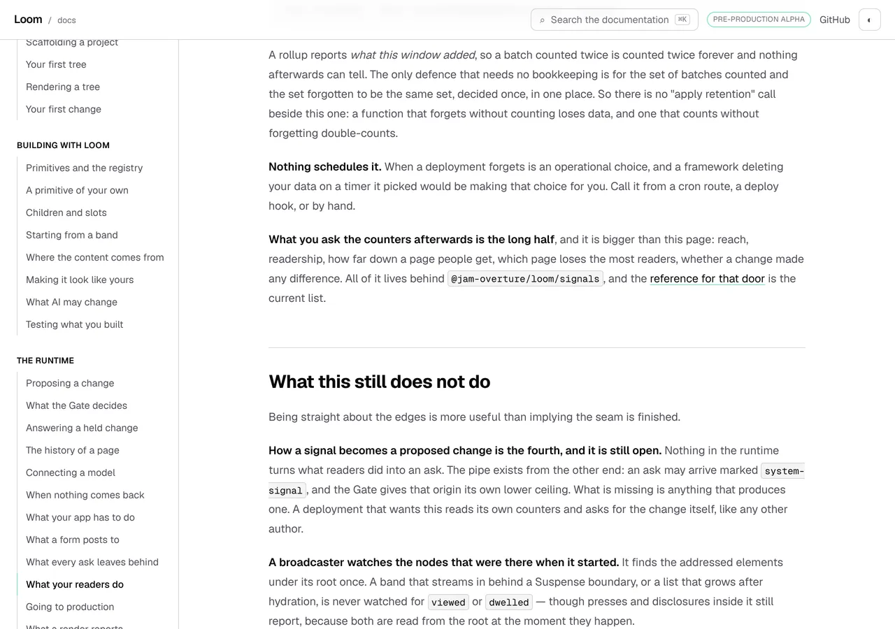
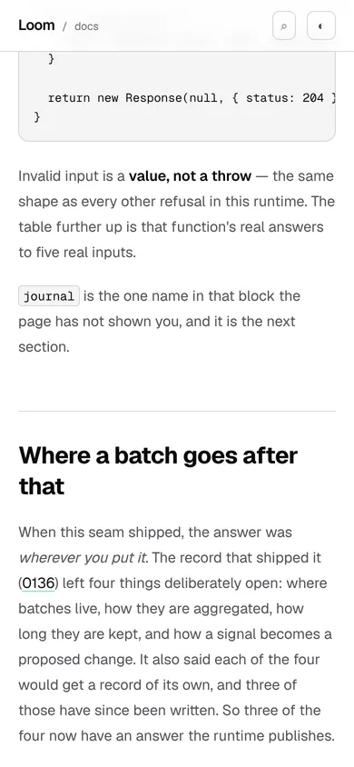
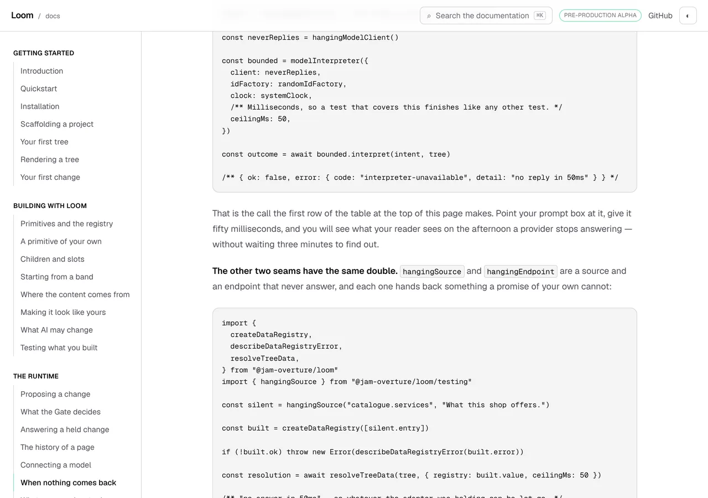
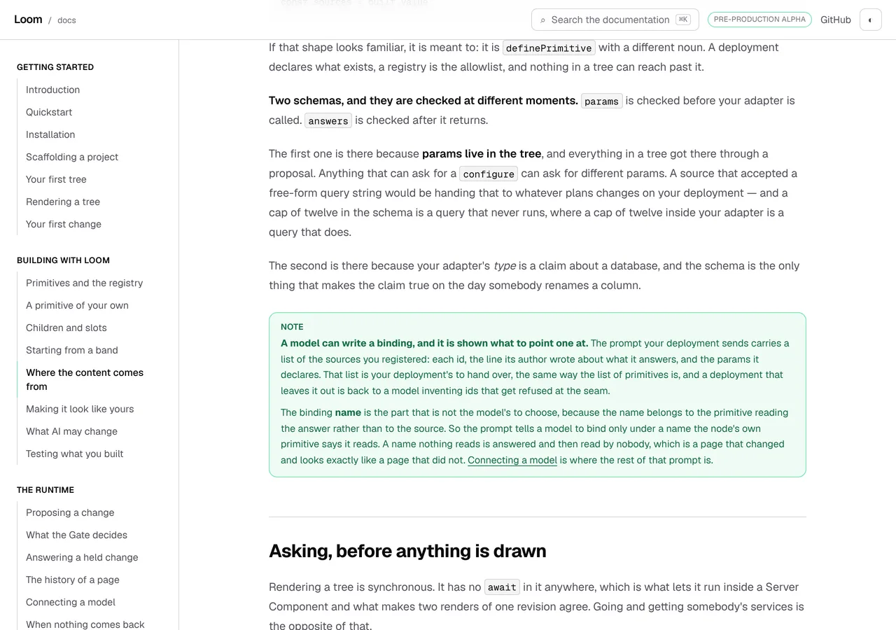
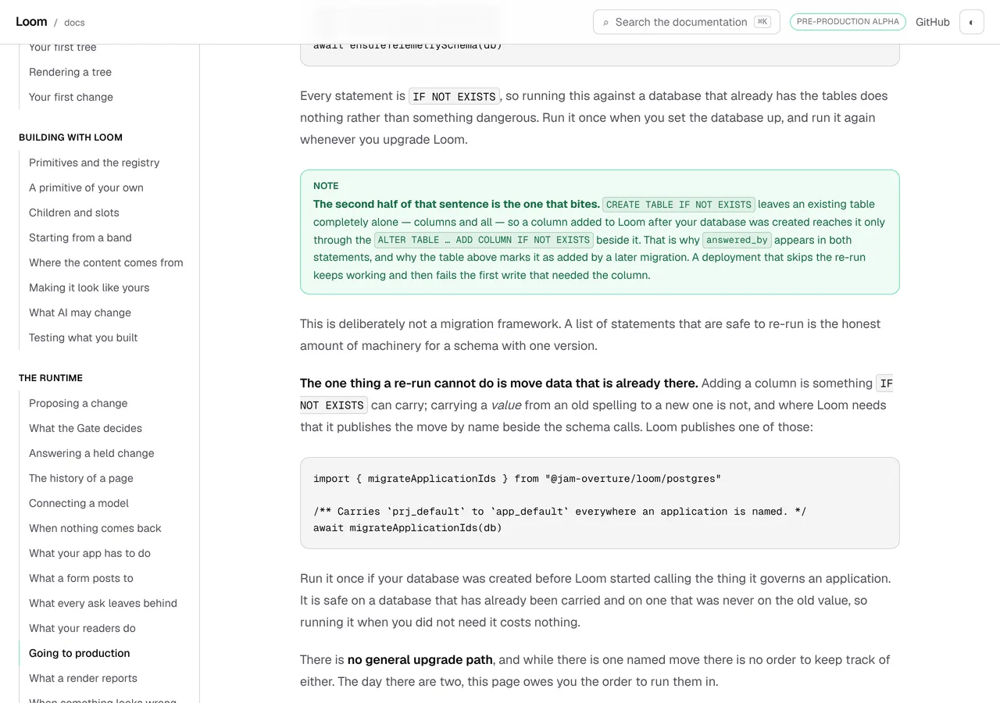

# 13 October 2026 — the measurement behind a "not yet", and four sentences that had stopped being true

**Routine:** `Loom docs` · **Branch:** `docs-54-the-measurement-behind-a-not-yet` ·
**Section:** §4c

No open pull request from this lane at the start of the run, and no maintainer
comment outstanding on any open pull request of this lane's — there were none.
Fresh branch off `origin/main` at `4d68e33` (#621). The clone's `main` was level
with `origin/main` this time; fetched and reset before branching anyway, which is
the habit the 10, 11 and 12 October reports each wrote down.

## What this run is

The sweep the 12 October report nominated and the 12 October finding asked for,
in its own words: **a sentence saying something does not exist yet is the one
claim on this site no test can hold.**

Every other instrument here checks that something **is** so, and each one works
because the thing it is about can contradict it. An example that stops rendering
is a red test. A count is printed off the registry. A code fence is compiled. A
diagnostic sentence is the runtime's own. A sentence saying something **is not**
so has nothing to be checked against, because a registry cannot be asked whether
it lacks a thing the page never named — so it goes stale in silence, and it goes
stale exactly when the framework succeeds.

Yesterday's run found one of those and fixed it. This one builds the instrument
and points it at the site.

## Four were already false, and three had been for weeks

| the page said | false since |
| --- | --- |
| *"Nothing stores or interprets these"* — reader signals, with all four of 0136's open questions still open | **13 September**, when `docs/signals.md` lifted the deferral |
| *"There is no published equivalent for a source or an endpoint yet"* | **29 September**, when `hangingSource` and `hangingEndpoint` shipped |
| *"A model is shown the primitives your deployment registered and the themes it can name — and not the sources"* | **19 September**, when 0172 put `dataCatalogue` in the prompt |
| *"There is one version of this schema and no upgrade path yet"* | since `migrateApplicationIds` was published |

Each of the four is now corrected against produced evidence rather than with a
new sentence. Three things about them are worth more than the corrections.

### A test was holding one of the lies in place

`_lib/signals/claims.test.ts` carried this:

```ts
it("says nothing stores or interprets signals yet", () => {
  expect(flowed).toContain("Nothing stores or interprets these")
})
```

with a comment saying that a run which quietly dropped the limitation would be
*"the documentation drifting towards optimism, which is the direction that costs
a reader most"*.

The reasoning is right. The instrument is the wrong way round. It pins the
**prose**, so it enforced pessimism for a month after the pessimism stopped
being true, while `@jam-overture/loom/signals` grew to three hundred and
fourteen published names behind the page's back.

That is `theming-claims.test.ts`' own lesson one level up. Its header already
says that *"being pinned to an accurate number is what made a correct runtime
change into a broken build"*. This is the same mistake with the sign flipped:
**being pinned to an accurate absence made a correct runtime change into a
silently false page.** Pinning a sentence holds the sentence. Only measuring
the thing holds the truth.

### A closed finding does not walk back to the sentence that filed it

The bindings callout on *Where the content comes from* ended with one word:
*"Filed."* The finding it pointed at was this lane's own, filed on 12 September
while writing that page, and it was closed on 19 September by
[0172](../decisions/0172-what-a-deployment-offers-a-model-is-one-value.md) — the
record that put `dataCatalogue`, `submissionCatalogue` and `frameCatalogue` into
the prompt, and whose context section quotes this lane's filing by name.

So the page asked for something, got it within a week, and went on telling
readers it had not for twenty-four days. A finding closes in `FINDINGS.md`, and
nothing walks back from there to the sentence that filed it. **A page that says
"Filed." is making a dated claim with a known expiry and no alarm on it**, which
is the sharpest case for `absences.ts` of the four.

### The private copy is what made one of them feel true

`hangingSource` and `hangingEndpoint` were published on 29 September, by a
framework run whose report is titled *the two doubles that were not there*, and
that run's own notes record that this lane had hand-written copies of both and
left the choice of adopting them to this lane.

For the fortnight after, *When nothing comes back* told readers there was no
published double for a source or an endpoint — **because the lane writing the
sentence had working copies of its own and therefore no reason to go and look.**
The duplication was never the real cost. The stale claim was, and the
duplication is what made it feel true.

So the choice filed on 29 September is taken here: `silentSource` in
`_lib/data/shop.ts` is now `hangingSource` under its old name,
`_lib/ceiling/page.ts`' inline endpoint is `hangingEndpoint`, and the page shows
a reader the import inside a block that compiles.

## What is on the site now

**`_lib/absences.ts`** — every claim this site makes about something Loom does
not have, each beside a measurement read off the real thing. Three entries
today, where there would have been seven before the corrections: the two
packages being pre-1.0, nothing turning a reader signal into a proposed change,
and the store schema having one named migration and no general path. Each
carries what it claims in a sentence, where the measurement reads, and
`whenItLands` — one line saying what the page owes a reader the day the claim
goes red.

**The sweep**, which refuses a dated sentence nobody has accounted for. Every
sentence of prose on a written page carrying one of fifteen dated words has to
be in one of two lists: `SITE_ABSENCES` with a measurement, or
`NOT_DATED_CLAIMS` with one line saying why it is not a claim about Loom.
Twenty-seven sentences match today, down from thirty-three before the
corrections. Three of them make a registered claim; twenty-four are grouped
under eleven reasons.

**Two of the three registered claims carry no dated word at all**, which is the
honest shape of this and is written into the module. The sentence the 12 October
finding was filed about — *"the starter library has no primitive that reads
`loom.data`"* — had no marker in it either, so this sweep would have let it
through. Registering the claim is the habit; the sweep is only the net under it.

**Where a batch goes after that**, a new section on *What your readers do*
replacing the paragraph that said nothing does. Three of 0136's four deferred
questions have been answered by records since, so the page now says what the
answers are: a journal with three methods and no way to edit it, the two
published implementations, and `collectReaderSignals` — counting a window and
forgetting it in one call, which is also the answer to how long batches are
kept, and why there is no retention call beside it.

**The published doubles, shown rather than described.** *When nothing comes
back* has a compiled block importing `hangingSource`, and the paragraph under it
makes the argument the hand-written version cannot: writing a source that never
answers takes one line, and writing one that can tell you what the runtime's
abort said takes a second object listening to the signal — which is the half
that decides whether an afternoon like this costs you a database.

**One named migration on *Going to production***, with `migrateApplicationIds`
in a compiled block and the sentence about `IF NOT EXISTS` not moving data that
is already there. The page had never mentioned it, so a reader following the page
through a Loom upgrade re-ran the ensure calls and silently kept rows under the
old application id.

**The bindings callout on *Where the content comes from*, corrected.** The
prompt carries the registered sources, and the part that is still true is
sharper than what the callout used to claim: the binding *name* belongs to the
primitive reading the answer, so a model is told to bind only under a name the
node's own primitive says it reads.

## Decisions taken that were not specified

- **A registry with a measurement, not a ban on the word.** The first shape
  tried was a sweep that simply refused dated words in prose. It is the wrong
  instrument for the same reason `theming-claims.test.ts` stopped pinning
  figures: a rule a writer satisfies by deleting a word buys nothing, and the
  honest sentences here — the pre-1.0 callout above all — are worth keeping.
- **The exceptions list is grouped by reason rather than listed.** Twenty-four
  fragments under eleven reasons, because the reasons repeat and they are what a
  writer needs. *"The page saying where a reader has got to in the sequence"*
  covers five sentences and teaches more than five lines would.
- **Fragments, not sentences.** Each list holds a short fragment centred on the
  dated word, so improving the prose around a claim is free and changing the
  claim costs an edit in `absences.ts`. A test that pinned whole sentences would
  teach the next writer to stop improving them, which the voice section of
  `routines.md` names directly.
- **`today` is in the marker set and `so far` is too**, at the cost of nine
  entries in the exceptions list between them, because between them they caught
  two of the four stale claims. `currently`, `at present`, `as things stand` and
  `for the time being` match nothing on the site and are in the set anyway, so
  the first one somebody writes is flagged rather than missed.
- **The sweep reads prose and not components.** A sentence a component renders
  is reached by rendering, which is `_lib/signals/claims.test.ts`' instrument
  rather than this one. Stated rather than guarded, with the gap filed.
- **Three of the four claims leave the registry rather than staying in it with a
  passing measurement.** A claim that has landed is not an absence with a
  footnote; it is prose that has to be rewritten. The history is in
  `absences.ts`' own header, where a reader meets the argument for the file.
- **The signals storage section links to the generated reference rather than
  describing three hundred names.** `@jam-overture/loom/signals` publishes the
  reach, the readership, the progress and the funnel readings, and the written
  page's job is to say that they exist and where they are. A written page
  enumerating them would be the hand-maintained reference §4c refuses.

## Records

None added, none superseded. Nothing here touches the tree schema, the delta
model or an `Accepted` record. The corrections describe behaviour already
settled by 0058, 0136, 0140, 0147, 0158 and 0181, and copy none of them.

## Findings

**One closed.** *A sentence saying something does not exist yet is the one claim
on this site no test can hold* — 12 October, this lane's. `_lib/absences.ts` is
the remedy it named.

**One closed in the half left to this lane.** *`hangingModelClient` is published
and its two siblings are not* — 14 September, closed for the framework on 29
September, with `(docs)`' two copies left for this lane to decide on. Adopted.

**Two filed.**

**A sentence saying something does not exist now ships beside the measurement
that says so, and four of them were already false** — owned by this lane, closed
as the remedy and refiled as what the sweep found, because the count is the
argument. It carries what the instrument cannot reach: prose on written pages
only, no doc comments (**two were stale**, in `_lib/signals/page.ts` and the
fence context beside it, both corrected here and neither catchable), and no
dated claim written without a dated word — which is the sentence the 12 October
entry was filed about, and which this sweep would have let through.

**The site's own produced prompt has no sources block** — owned by this lane,
deliberately deferred. Establishing that the prompt really does carry the
registered sources meant reading `interpretation/prompt.ts`, which renders each
id, its description and its declared params. `_lib/prompt/request.ts` builds the
prompt block on *Connecting a model* without a `dataCatalogue`, so the prompt a
reader sees on this site has no sources in it — the one place the correction
could have been shown rather than told, now that the bindings page links there.
Three lines and a produced block that grows; not done here because it changes
what `prompt/claims.test.ts` measures and this run's unit is the instrument.

## Test numbers

`pnpm install && pnpm verify`, **green**.

| | files | tests |
| --- | --- | --- |
| framework (`src/`, `tools/`) | 217 | 4,856 |
| application (five surfaces) | 442 | 8,448 |

Nothing skipped, nothing weakened, no test marked `todo` or `only`. Read from
`verify.exit` rather than from the terminal's last line, per *Reading the merge
gate*.

**One new test file, 68 tests, and one existing file that lost an assertion:**

- `_lib/absences.test.ts` — **68**, in four groups. Each registered claim
  against the thing that would contradict it, read off the published doors and
  the published manifest rather than off any page. Each claim's fragment still
  being on the page it names, so a guard cannot outlive its sentence. Each
  non-claim fragment still being written somewhere, so a reason cannot outlive
  the sentence it excuses. The sweep itself, once per page, plus three over the
  sweep's own behaviour — that a compiled fence is left alone, that a heading
  stays apart from the paragraph under it, and that an empty sweep fails rather
  than passing silently.
- `_lib/signals/claims.test.ts` went from 23 to **22**. The assertion removed is
  the one that was holding the false sentence in place; what replaced it is a
  comment saying so, because the lesson is worth more here than the line was.

The version the installation page types is also held against the manifest now.
It sits in `absences.test.ts` rather than in `packages.test.ts` because it is
the other half of one sentence — *"Both packages are on npm at `0.1.0`, and
neither is stable yet"* makes two claims, and the number had been read off
nothing at all.

`pnpm findings:check` reads 1,174 findings, 0 malformed. `pnpm prerender:check`
reads 133 prerendered pages and 1,832 text junctions, 0 run together.
`pnpm reports:check` reads 1,807 visuals, none over 1.1MB.

## The preview

Deployed and green:
<https://loom-git-docs-54-the-measure-144789-jpizzolato36-6341s-projects.vercel.app>

The four corrected pages:

- [/docs/the-runtime/what-your-readers-do](https://loom-git-docs-54-the-measure-144789-jpizzolato36-6341s-projects.vercel.app/docs/the-runtime/what-your-readers-do)
- [/docs/the-runtime/when-nothing-comes-back](https://loom-git-docs-54-the-measure-144789-jpizzolato36-6341s-projects.vercel.app/docs/the-runtime/when-nothing-comes-back)
- [/docs/building-with-loom/where-content-comes-from](https://loom-git-docs-54-the-measure-144789-jpizzolato36-6341s-projects.vercel.app/docs/building-with-loom/where-content-comes-from)
- [/docs/the-runtime/going-to-production](https://loom-git-docs-54-the-measure-144789-jpizzolato36-6341s-projects.vercel.app/docs/the-runtime/going-to-production)

Not fetched from this container: `*.vercel.app` is denied by the environment's
egress policy, which is the note the 10 October report made and is still true.
The shots below were taken against `pnpm shoot --serve apps/loom` on the same
build the deployment was made from.

## What the pictures say

Six shots, `pnpm shoot --serve apps/loom`, stored with `pnpm reports:shrink`
(2.5MB of PNG to 0.5MB of WebP).

| | 1280×900 | 390×844 |
| --- | --- | --- |
| *What your readers do* | `scrollWidth 1280 / innerWidth 1280` | `scrollWidth 390 / innerWidth 390` |
| the three other corrected pages | `scrollWidth 1280 / innerWidth 1280` | |













**The first photograph of the doubles block was cut off at the right edge**, and
that is worth writing down because nothing failed. The import line was 99
characters and a fence does not wrap: the reader gets a horizontal scrollbar on
the one block whose argument is *use this instead of writing your own*. The
fences on that page were already carrying a 100-character line and a
92-character comment, so the site has the problem and this run only noticed it.
The new block is under 90 now. **A fence's own width is unmeasured on this
site** — `pnpm shoot` measures the page against the viewport and a code block
scrolls inside it, so the page reports `scrollWidth 1280` and says nothing. Not
filed as a finding because it is one measurement in `reports:check`'s manner and
this lane's to add, and it goes in *what I would write next* instead.

## The gate went red once, usefully, and it was this run's own instrument

The sweep refused two sentences **I had just written**: *"A deployment that
wants this today reads its own counters"* and *"There is one of those today"*.
Both were dated writing that did not need to be dated, and both were rewritten
rather than registered as exceptions — which is the behaviour to want from this
thing on the day somebody introduces the fifth stale claim.

Nothing else went red. The fences needed regenerating twice
(`pnpm --filter @loom/app docs:fences`), both times because prose edits moved
the `// page.mdx:NNN` lines and no code changed — which is the note yesterday's
report made and is now the second time, so it is worth treating as routine
rather than as a surprise.

## What I would write next

- **A width check for code fences**, measured off the page. It is the one thing
  this run found that nothing on the site can see, and the recipe is
  `reports:check`'s: measure the fence, print the number, fail over a limit.
- **The sources block in the site's own produced prompt**, which is the finding
  above and is now the one place *Where the content comes from* points at and
  does not show.
- **The `undefined` half of *The bar above your page***. Carried from 7, 8, 9,
  10, 11 and 12 October, and still prose with a test behind it rather than a row
  a reader can see, because no registered palette has an unreadable pair.
- **`loom.tally` and `loom.trend` deserve their own worked example.** Carried
  from yesterday. *Where the content comes from* now shows a list read from a
  source; the number and the series are the two shapes a dashboard is made of.
