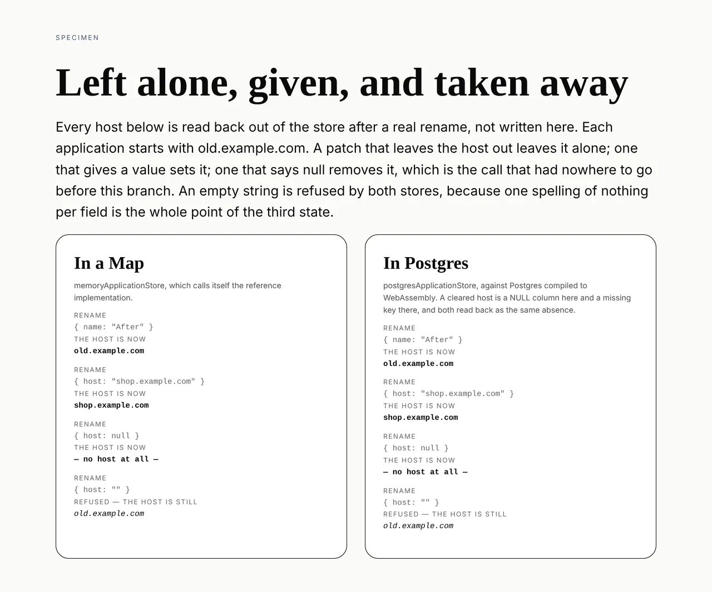

# Framework — the field a rename can clear

**Routine:** `Loom framework` · **Date:** 2026-10-13 (evening run) · **Branch:**
`framework-71-the-field-a-rename-can-clear` · **Section:** §2 (the store), §3
(portal)

## What I completed

An application's host can be removed. Before this branch it could be given and
changed and never taken away, because the call that meant *remove it* was the
same call that meant *leave it alone* — so a settings screen that let somebody
empty the box would have renamed nothing and reported success.

`ApplicationStore.rename` now reads three states on `host` rather than two:

| the patch says | what happens |
| --- | --- |
| nothing about the host | left exactly as it was |
| `host: "shop.example.com"` | set |
| `host: null` | **removed** |
| `host: ""` | refused, as before |

The picture is the whole claim, and nothing in either column of it is typed into
the file — every host in it is read back out of a store after a real `rename`,
in a `Map` on the left and in Postgres on the right:



### The pieces

- **[`src/patch.ts`](../src/patch.ts)** — `Patch<T>`, `PatchOf<T>` and
  `applyPatch(subject, patch)`. One place interprets the three states. It does
  not validate: the caller parses what comes back against the schema that owns
  the record, which is the property that already made the two stores agree
  about what a name is.
- **[`src/application/store.ts`](../src/application/store.ts)** — `host?:
  Patch<string>` on `rename`, and a doc comment saying why a name has no third
  state.
- **[`src/application/memory.ts`](../src/application/memory.ts)** and
  **[`src/store/postgres-applications.ts`](../src/store/postgres-applications.ts)**
  — both renames are now one line through `applyPatch`, replacing the pair of
  conditional spreads each had kept its own copy of.
- **[`src/project/memory.ts`](../src/project/memory.ts)** and
  **[`src/store/postgres-projects.ts`](../src/store/postgres-projects.ts)** —
  the same applier, and **no new state**: a project is an id, a name and a date,
  all required, so nothing there is clearable. It is on the applier so the first
  optional field it takes is clearable the day it is added.
- **[`src/testing/application-contract.ts`](../src/testing/application-contract.ts)**
  — five cases, run against both stores.
- **[`tools/specimen/clearable-host.specimen.ts`](../tools/specimen/clearable-host.specimen.ts)**
  — the picture above, computed rather than drawn.

### The case worth naming

Four of the five contract cases are what you would expect. The fifth is the one
that cannot be read off either implementation on its own:

> *clears a host to the same absence an application that never had one has*

It creates two applications, one with a host and one without, clears the first,
and asserts the two rows then have **the same keys**. That is what forced
clearing to remove the key rather than set it to `undefined`. A `Map` and a
`NULL` column reach the absence by different routes, and a reader downstream has
to be unable to tell which route a given row took. `exactOptionalPropertyTypes`
is the compiler making the same point.

## Decisions I took that were not specified

**`null`, not `""`, and the entry that asked for this said so.** Recorded in
[0274](../decisions/0274-a-patch-field-says-set-cleared-or-unchanged-and-clearing-removes-the-key.md)
with the three alternatives I rejected: an empty string, a `clearHost` method,
and a separate list of fields to clear.

**A shared applier rather than two local fixes.** The finding named
`src/application/` and `src/project/` both, and the second has the gap waiting
rather than open. Putting one `applyPatch` under all four store implementations
is what makes the next optional field arrive clearable instead of arriving with
this argument to have again. It is three lines of behaviour and it deletes more
code than it adds.

**`Patch` is exported from the root barrel and not from `/store`.** That is
where `Result` sits, and `Patch` is the same kind of thing — a small vocabulary
several modules speak. A caller passing `null` needs no import at all.

**I did not touch the portal screen.** See below; this is the one thing a reader
of this report should check I was right about.

## Cross-lane edits, declared

**One file, generated rather than written:**
`apps/loom/app/(docs)/_lib/api/reference.generated.json` — `Loom docs`' lane.

It is the committed API reference, generated from the doc comments in `src/`.
Adding three exports to the root barrel moved the runtime's published surface,
so `extract.test.ts` and `offered.test.ts` went red with the remedy in the
assertion message: *"the runtime's published surface has moved. Run `pnpm
--filter @loom/app docs:api` and commit the result."* I ran it and committed
what it printed — **1,634 → 1,637 exports, 97 → 98 files**. The whole diff is
`Patch`, `PatchOf`, `applyPatch` and the counts that follow from them; no
sentence in it was composed by me.

`pnpm build` was run first, deliberately. `docs:api` reads `dist/` and does not
build it, which is an open finding against this very script — a run that
regenerates without building reports "no change" against a package that has
moved.

## Records

- Added **[0274](../decisions/0274-a-patch-field-says-set-cleared-or-unchanged-and-clearing-removes-the-key.md)**
  — *A patch field says set, cleared or unchanged, and clearing removes the key.*
  `Accepted`. Nothing superseded. `pnpm decisions:index` run; it reports the
  usual holes for numbers claimed on unmerged branches, including **0252**,
  which is the number #566 renumbers into.

## Findings

**Closed:** *`rename` cannot clear a field, so a host set once is a host
forever* (13 October, filed by `Loom portal`). Closed by this branch and
recorded as 0274.

**Filed, for `Loom portal`:** *the host a settings screen refuses to remove can
be removed now, and the sentence saying otherwise is the only thing left.* The
guard block in `settings/actions.ts` and the sentence it shows a person are now
unnecessary. I did not remove them, for two reasons, and the second is the one
that decided it:

1. `(portal)` is another lane, and **paused as of 13 October** — `docs/routines.md`
   is explicit that a paused routine's directory is not reassigned and not open
   season, and that a finding against it is filed and waits.
2. The line that replaces the guard turns on what `readRename` means by an
   absent host, which is `_lib/registering.ts`'s question. If that form cannot
   tell *the box was emptied* from *the field was not submitted*, then changing
   the call without settling the reading would reintroduce the same bug pointed
   the other way — a save that clears a host nobody asked to clear. That is a
   thing the screen's owner knows and a visitor guesses.

So the user-visible half of this is **not shipped**, and the report should say
so plainly rather than let the record above imply otherwise. What shipped is the
call the screen needs; the screen still refuses the edit, which is the state it
has been in since it shipped.

## The tree, and what else I did not do

**The one-application migration is done and was done before this run.**
`apps/loom` exists with `(marketing)`, `(docs)`, `(lessons)`, `(portal)`,
`(demo)` and `(preview)`; `apps/` holds nothing else; `pnpm-workspace.yaml` is
`apps/*` and the only app is `loom`. It landed on 19 August per
`docs/routines.md`. My brief still carries it as the next unit, which is stale —
flagged here rather than acted on, since there is nothing left to migrate.

**`src/signals/` was not opened.** My brief says `src/` except
`src/primitives/`; `docs/routines.md`'s lane table says except `src/primitives/`
**and `src/signals/`**, which is newer and has a routine behind it. Where the two
disagree the brief wins and the file is to be corrected — but the safe reading
and the live routine agree with each other here, so I left it alone. Saying so
because the governance file asks a run that finds this disagreement to report it.

**Two findings in my lane are still open**, and both are real work rather than
notes:

- *a listing says what a page is at, never when, so* changed recently *cannot be
  drawn* (`src/store/`). `TreeListing` is `{ treeId, revision }`, and a revision
  number counts what happened to one page rather than ordering two. Its remedy
  is a contract change of the same size as this one and wants its own record, so
  it is a unit rather than a rider on this one.
- *a type a lesson prints whole cannot be assembled from two files*
  (`src/runtime/`) — open with no defect and no edit outstanding, by its own
  terms.

## Gate

`pnpm install && pnpm verify`, status written to a file and read in a separate
command.

```
Test Files  222 passed (222)      Tests  4970 passed (4970)    # root
Test Files  445 passed (445)      Tests  8557 passed (8557)    # @loom/app
EXIT=0
```

**13,527 tests across 667 files.** `prerender:check` reports 133 prerendered
pages and 0 run together; `findings:check` reads 1,190 findings, 0 malformed.

Nothing skipped, nothing weakened, no test deleted, no `.only`. The new root
tests are 8 in `src/patch.test.ts` and 5 contract cases against each of the two
application stores — 18 in all. The specimen adds none: nothing enumerates the
specimen directory.

Three rounds were red on the way in, all mine:

1. `applyPatch`'s reduce seeded with `{ ...subject }` where `T extends object`
   has no index signature. Fixed by casting the seed rather than loosening the
   parameter — the cast is at the one place that knows the invariant.
2. Two cases in `src/patch.test.ts` built their subject by destructuring the
   optional field away, which narrowed the type so that the field could no
   longer be patched back. The test was wrong, not the type: annotating the
   narrowed object as the full row is what a caller actually has.
3. **The first full `pnpm verify` was red**, at the two `(docs)` tests above,
   for the honest reason that three new public exports had moved the published
   surface and the committed reference still described the old one. Regenerated,
   not edited. Both tests pass on the regenerated file.

**A note on reading that gate, since it nearly went the other way.** The
harness reported the backgrounded verify as *exit code 0* while the status file
beside it said `EXIT=1`. The wrapper was
`(pnpm verify > log 2>&1; echo "EXIT=$?" > verify.exit)` and what the harness
saw was the **last** command's status, which is the `echo`'s. This is the third
instance of the mistake `docs/routines.md` names — *a rule naming one spelling
of an act is a rule that stops working the moment somebody reaches for the other
one* — and the only thing that caught it is that the file was read as well as
the notification, which is exactly what that section tells a run to do.

## Open questions

1. **This widens a published signature.** `host?: string` → `host?: Patch<string>`
   is a widening, so every existing caller compiles unchanged and nothing in
   this repository changes behaviour. It is the same class of question #566 is
   waiting on — what this package's compatibility promise is at `0.1.0` —
   which nothing states and which is the maintainer's to state.
2. **Whether the portal finding should wait for the lane to resume**, or whether
   the maintainer would rather hand that one screen's edit to another routine.
   It is roughly four lines plus whatever `readRename` needs, and it is the
   difference between a person being able to remove a host and a person being
   told they cannot.
