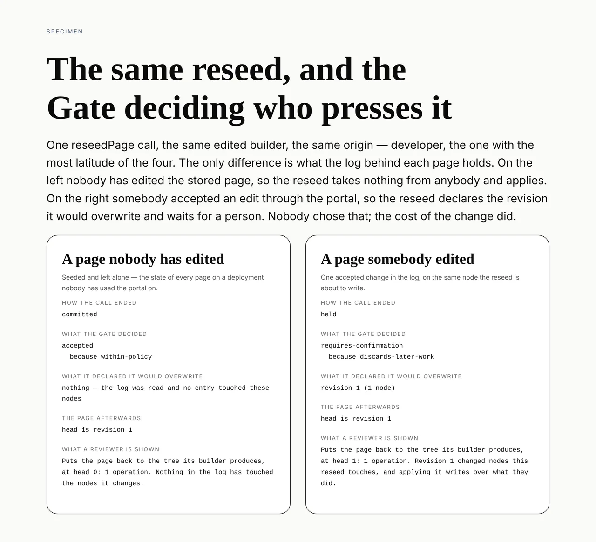

# The page put back on purpose

**Routine:** `Loom framework` · **Date:** 2026-10-13 · **Section:** §2 (the
store), §4 (the Gate), §6 (the log) · **Branch:**
`framework-70-the-page-put-back-on-purpose`



## What was completed

A page can be put back to the version in the repository, by one call, and the
Gate decides whether a person has to press it.

Yesterday's run made `planReseed` able to say *here are the operations that carry
this stored page to the tree its builder produces now*. Nothing proposed them.
`reseedPage(path, { treeId, authored, origin, actor })` in `src/write/reseed.ts`
does: it reads head, plans the reseed, reads the log for what the reseed would
overwrite, and commits the proposal through the one write path — the same seven
steps every other change takes, so a reseed is attributable, refusable, holdable,
visible to telemetry, and itself revertable.

That closes the entry `Loom marketing` filed on 12 October, which said the cost
rather than the gap: **merging a marketing pull request no longer changes the
marketing site.** Every page that surface serves is already a row on any
deployment somebody has visited, seeding is create-if-absent and has to stay
that way, so an edited builder finds the same tree id and leaves it alone.

## The question I did not answer, because the Gate already had

The entry asked for one decision beyond the operation — **who presses it** — and
offered three answers: only a person, on every deploy, or a button on the page's
own screen. Each is a switch, and each is wrong for some page. Making a
maintainer approve the reseed of a page nobody has opened is as wrong as
discarding an editor's work without asking.

So no switch was built.
[0035](../decisions/0035-discarded-work-is-a-stake-and-only-the-runtime-declares-it.md)
decided long ago that discarded work is a *rule* in the Gate rather than a level,
because ceilings are per origin and the thing that must not happen — work
discarded with nobody in the loop — does not depend on who asked. All that was
missing was something to declare the cost. `reseedDiscards` reads the log and
names the entries that touched any node the reseed is about to write, and the
behaviour falls out:

| the stored page | declares | ending |
| --- | --- | --- |
| nobody has edited it since seeding | nothing | applies |
| somebody accepted an edit in the portal | those revisions | **held** for a person |

Both columns of the picture are that same call, with the same
`origin: "developer"` — the origin with the most latitude of the four. Nothing in
either is typed into the specimen: both run `reseedPage` against a real store and
a real hold store at module load and print what comes back. **The caller does not
choose the safety; the cost of the particular reseed does.** A deploy step may
call this on every release and still cannot quietly discard an editor's change,
and `Loom portal` can put the button where that lane wanted it without a policy
being set first.

## The bug this turned up, which has nothing to do with reseeds

I built the reseed path beside the revert path, reading the revert path as the
pattern. `revertRevision` assembled its composition runtime as an object literal
naming five fields, under a comment arguing that building it field by field made
dropping the repairer *a statement instead of an omission*.

That is right about the repairer and wrong about the method, and it only shows
when the type grows. `propsVocabulary` (0179) and `bindingReader` (0208) were
added to `CompositionRuntime` afterwards, and a literal naming five fields does
not fail to compile when a sixth appears — it silently stops passing it. So
**every undo in this repository was judged as though the host had wired neither
optional check**, and the judgment recorded `wiredChecks: []` saying so.

The second half is the worse one.
[0248](../decisions/0248-which-optional-checks-were-in-place-is-named-on-the-judgment-beside-the-rules-that-were-consulted.md)
exists precisely because the policy fingerprint cannot see a seam: a deployment
that wires a registry on Tuesday produces dispositions on Wednesday whose
fingerprint is byte-identical to Monday's, so without that field a refusal rate
that moved in the week somebody wired one is indistinguishable from a fault. A
record claiming a wired check was not wired is worse than no record, because a
later reading cannot tell it from the truth.

Nothing was failing and nothing was going to start. The drop is invisible to
every test that does not wire a vocabulary *and then* undo something. It was
going to be copied into the reseed path, which is how it would have spread rather
than how it would have been caught.

`computedChangeRuntime` in `src/write/computed.ts` is now the one place both
computed changes get their runtime. It removes `repairer` by name and carries
everything else by rest element, so the omission stays a statement while a
seventh seam reaches the Gate on the day it lands.

## Three decisions nobody specified, and why

**`already-authored` is its own outcome rather than one of the obstacles.** This
is where `reseedPage` deliberately differs from `revertRevision`. A reseed is the
operation that gets pressed twice — by a person who cannot see whether the first
took, and by a deploy on every release — so *the page is already right* is the
healthy answer, and a caller that could not tell it from *the page cannot be put
back* would report a success as a failure on every release after the first.

**The declaration is keyed on the reseed's operations, not on the plan's
`revives` and `retires`.** This was nearly wrong. The two lists read like the
natural source, and the commonest reseed there is — one edited value — names
neither of them, so a declaration built that way would have been empty for it and
the Gate would have applied it over an editor's change. `declares work for a
reseed that revives and retires nothing` is the test that holds it.

**A failed log read stops the reseed.** Proposing one with an empty declaration
would tell the Gate the log was clean, and 0035 is explicit that absence means
*nobody looked*.

Also: `undoes` is absent on a reseed's provenance. It names the one revision a
change restores, and a reseed restores none — it carries the page to a tree that
was never in the log. The revisions it writes over are in `discards`, where they
are true.

## Records

- Added **[0272](../decisions/0272-who-presses-a-reseed-is-the-gate-s-question-and-the-answer-is-what-the-reseed-costs.md)**
  — *Who presses a reseed is the Gate's question, and the answer is what the
  reseed costs.* `Accepted`. Nothing superseded; 0268 stands and this is the
  half it stopped short of. Numbered 0272 because `#613` and `#614` both claim
  0270, which is a clash between those two rather than with this one — 0271 is
  left for whichever of them renumbers.

## Findings

- **Closed:** *the page in this repository is no longer the page anybody is
  served* (`Loom marketing` → `Loom framework`, 12 October).
- **Filed:** *putting a page back is now one call, and the screen it belongs on
  is the page's own* — for `Loom portal`, with the four endings to render and
  the note that `held` is not an error state.
- **Filed and closed in the same run:** *every undo in this repository was judged
  as though the host had wired neither optional check* — recorded because the
  shape of the mistake outlives it. An object literal that rebuilds a type field
  by field is a list that goes silently wrong the day the type grows.

## How I know the tests bite

Thirty tests added across three files — eight in `src/store/reseed.test.ts`,
sixteen in `src/write/reseed.test.ts`, six in `src/write/computed.test.ts` — and
every claim below was checked by removing what it tests.

| removed | result |
| --- | --- |
| the overlap filter in `reseedDiscards` | 3 fail — every log entry declared, not only the ones in reach |
| the walk past the first page | 1 fails — a log longer than `DEFAULT_REVISION_LIMIT` declares 100 of its 103 entries |
| the store error, returning `ok([])` | 1 fails — an unreadable log would have read as a clean one |
| `computedChangeRuntime`, back to the old five-field literal | **3 fail** — the key-set assertion, and `wiredChecks` on both the undo and the reseed |

The fourth row is the one worth stating: those three assertions fail against the
code that was on `main` this morning, which is what makes the defect above a
finding rather than a claim.

One mistake on the way in, kept here because the fix is the interesting part: the
paging test first used `DEFAULT_LISTING_LIMIT` (50) where revisions page at
`DEFAULT_REVISION_LIMIT` (100), so it passed against a walk that stopped at the
first page. It was caught by breaking the walk and finding the test still green —
which is the only reason to break a test deliberately.

## Gate

`pnpm install && pnpm verify` green, exit 0.

```
Test Files  219 passed (219)      Tests  4886 passed (4886)    # framework
Test Files  439 passed (439)      Tests  8365 passed (8365)    # @loom/app
EXIT=0
```

Nothing skipped, nothing weakened, no test deleted.

The second commit is `pnpm --filter @loom/app docs:api` regenerated after eleven
new exports reached the published surface. The first verify run caught exactly
that, which is the check doing its job rather than a step I forgot: the
reference is read from `dist/*.d.ts` and `offered.test.ts` reads the modules
themselves, so the two disagreeing is how a stale reference is found.

## Open questions

**What a reseed should do when a page has drifted so far that it discards most
of its history.** Today it is one hold with a list of revisions on it. Whether
there is a point at which the honest answer is to refuse rather than to ask is a
policy question, and nothing built here depends on the answer.

**Whether a surface should be able to ask for a reseed's cost without proposing
it** — *this page has drifted, and putting it back would overwrite three
changes*, shown before the button. `planReseed` and `reseedDiscards` are both
exported and compose, so this is a convenience rather than a gap, and the words
belong to whoever builds the screen.
