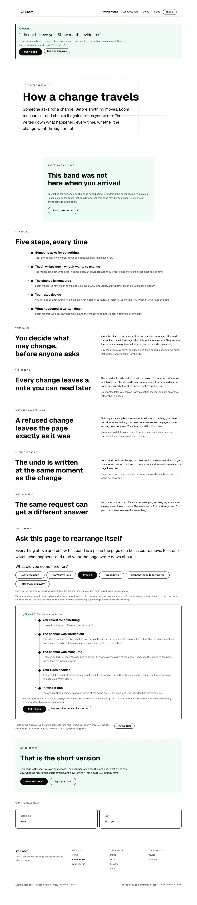
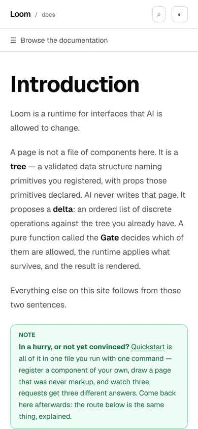

# 2026-10-13 — the page that ran four changes to show one, and the phone nobody can fix from here

**Build order section:** §4d — the marketing site.

**Branch:** `marketing-03-the-page-that-ran-four-changes-to-show-one` (→ `main`),
cut from `origin/main` at `1b66070`.

**No maintainer comment was outstanding.** This lane had no open pull request at
the start of the run. The comments on #601 are this lane's own and `Loom
merge`'s, and the instruction of 12 October about hooking the site up to the
portal was answered by #596 and #601 before this run started.

**Nothing a reader can see has changed.** The page this run touched is
byte-identical to the one on `main`, and that is checked below rather than
claimed. What changed is what the server does to produce it, and what this lane
now knows about the site on a phone.

---

## What changed

`/how-it-works` ran the whole composition sequence **four times for every
asked request and rendered one of them.**

| run | what it was for | read by |
| --- | --- | --- |
| 1 | `paperTrailFor`'s own ask | nobody |
| 2 | `paperTrailFor`'s refusal contrast | nobody |
| 3 | `askRunFor`'s probe pass | pass 4 |
| 4 | `askRunFor`'s staged pass | the page |

Runs 3 and 4 are deliberate and documented: a change is judged against the page
it is handed, the panel reporting the change is part of that page, so the first
pass finds out what happens and the second runs against the page with that
answer already in it. That stays.

Runs 1 and 2 are gone. The band that printed their output was rewritten away on
**26 September**; `render.ts` went on resolving a `PaperTrail` for every asked
request for a fortnight after, and handed it to a builder that reads no such
field. Measured at **28ms** a request, on a page that is server-rendered on
demand.

| | before | after |
| --- | --- | --- |
| sequence runs per asked request | 4 | 2 |
| discarded work | 28ms | none |
| `_lib/adapt/paper-trail.ts` | 319 lines | gone |
| `_lib/adapt/paper-trail.test.ts` | 20 tests of a module nothing called | gone |
| `MechanismContext` | `PageContext` + a field nobody reads | `PageContext` |



---

## The proof that nothing moved

`/how-it-works` photographed at 1280, full page, on this branch's build and on
the build of `main` taken before the first edit of the run:

```
05f8745e120d29a160f7c84522c47d14  before (main)
05f8745e120d29a160f7c84522c47d14  after  (this branch)
```

Byte-identical. All 1,401 tests in this route group pass without one of them
being edited.

---

## Why it survived a fortnight, which is the part worth keeping

**Both comments covering it said it was deliberate.** `render.ts`:

> *"The paper trail it already printed is still printed, now of the same page it
> is on rather than of the front door."*

And the field's own docblock:

> *"The field stays because `pageTreeFor` resolves it for the front door's
> notice, which links here carrying an `ask`."*

The front door's context has never had the field. A wrong explanation reads
exactly like a right one, and it is better camouflage than no explanation would
have been: a run reading those files found a paragraph saying somebody had
thought about this, and moved on. This lane did that at least twice.

**No instrument here could see it.** The type checker is content with an
optional field nobody reads. The route group's tests assert what the page
contains, and the page was correct. A screenshot of a correct page is a
screenshot of a correct page. Everything was green the whole time.

### The test, and the draft of it that was green on its own subject

`pages/handed.test.ts` holds the general invariant: **a context field is a
promise that some page reads it.** The field list is
`Record<keyof Required<MechanismContext>, true>`, so a field added to the
context and left out of the list is a build error rather than an unchecked
field. The sweep looks for the field across the page builders, `chrome.ts` and
`requested.ts`.

**The first draft passed against the exact bug it was written for.** It searched
for the field's *name*, and a field's declaration lives in one of the files
being swept, so `readonly trail?: PaperTrail` counted as a reader of `trail`. It
was caught by putting the field back and watching the test stay green — not by
watching it pass once the field was gone. The fix is that a read is `.field`, a
property access, which is what a read looks like in every shape this surface
uses and is not what a declaration looks like. Both tests were then re-checked
by reintroducing the field and watching them go red, and reverted.

A test that is green on the thing it is about is worse than no test, because it
is also an argument that somebody checked.

---

## The phone, measured, and not fixed

The run started by photographing the three pages rather than by reading them,
and the front door on a phone is below this surface's bar.


At 390×844, all three palettes:

| | minimal | editorial | bold |
| --- | --- | --- | --- |
| the `h1` box | 254 × 247 | 254 × 197 | 250 × 197 |
| the first call to action | **286 past the fold** | **182 past** | **196 past** |

The first screen of this site on a phone is a bar, an eyebrow wrapped to two
lines, and part of a headline. The same page at 1280 puts both buttons at y 694,
well above the fold.

**The 254 is the useful number.** The headline gets a 254-pixel column in a
390-pixel viewport, which is 68 pixels of gutter a side, or 35% of the screen.
That is `loom.page`'s `paddingInline: space(4)` plus `loom.hero`'s `space(6)`,
both fixed lengths, holding a headline set at the pack's top step — 72px on two
packs, 88px on `bold-sans`, also fixed.

### The comparison that makes it the framework's

Same build, same browser, same 390 pixels:

| page | how its chrome is built | the `h1` |
| --- | --- | --- |
| `/docs` | hand-written React | x 20, **350 wide**, 48 tall |
| `/lessons` | hand-written React | x 20, **350 wide**, 49 tall |
| `/demo`, its own bar | hand-written React | x 20, **350 wide**, 73 tall |
| `/demo`, the Loom tree in it | composed primitives | x 64, 262 wide, 197 tall |
| this site's three pages | composed primitives | x 68, 254 wide, 148–247 tall |



Every surface written by hand gives a phone a 20-pixel gutter and a headline
sized for the screen. Every page composed from registered primitives gives it 64
to 68 pixels of gutter and a desktop headline. This site is the one surface
built entirely in Loom, so it gets it on every page, and it is the front door.

### Why this lane built nothing for it

`--loom-scale-1…8` and `--loom-spacing-1…8` are emitted as pixels in
`src/theme/apply.ts` from the font pack's ramp, and **a `LoomTree` has no
viewport**. There is no prop, no theme selection and no node that means *smaller
on a phone*. This surface's own stylesheet cannot do it either:
`(marketing)/globals.css` is forbidden from declaring type, spacing or any
`--loom-*`, with `globals.test.ts` holding the rule, because a second source of
truth is what the re-theme guarantee (0049) cannot have. That rule is right and
the finding does not ask for an exception to it.

The arithmetic says composition cannot nearly reach it either, and it is in the
finding so nobody spends a run on the attempt: the hero needs to lose about
**290 pixels** to clear the fold, and the two levers this lane owns are worth
about **75** between them, at the cost of the grid behind the band on every
screen.

Filed for `Loom daily build` and `Loom primitives`, with three shapes named —
a fluid ramp, a second ramp per pack, or the padding alone — and no opinion
from here about which is right. The shot list that produced every number is
committed beside this report, so re-measuring after a fix is one command.

---

## Real numbers

`pnpm install && pnpm verify`, exit code read out of a file written as the last
thing on its line:

```
Test Files  217 passed (217)      Tests  4856 passed (4856)    # framework
Test Files  439 passed (439)      Tests  8347 passed (8347)    # @loom/app
Test Files   50 passed  (50)      Tests  1401 passed (1401)    # app/(marketing)
1172 findings, 0 malformed
1812 visuals in reports/, 127.0MB, none over 1.1MB
133 prerendered pages, 1815 text junctions, 0 run together
EXIT=0
```

Nothing skipped, nothing weakened, no test deleted to get there. The 20 tests
that went with `paper-trail.test.ts` tested a module that nothing called; two
new ones in `pages/handed.test.ts` replace them and were each checked by
breaking the thing they are about.

---

## Findings

**Filed**

- **A page built in Loom is the only kind on this deployment that does not fit a
  phone.** The measurements above, for `Loom daily build` and `Loom primitives`.
- **The band was deleted on 26 September and the work behind it ran until
  today.** Closed for this lane by this branch, filed because the shape is
  available to every surface that hands a context to a builder, and three others
  do.

**Closed** — none that were open against this lane.

---

## Open questions

- **Whether a phone matters for this product**, which decides how urgent the
  finding is and is not this lane's call. The site reads correctly on a laptop
  today.
- **Whether the paper trail should come back as something a visitor reads.**
  It was the strongest evidence this site ever had — the runtime's own
  envelopes, from a real request against the published page — and it was removed
  as a raw panel on 26 September, which was the right call about *that* panel. It
  is deleted rather than left resolved-and-discarded; `git log` has all 319 lines
  on the day somebody wants them in a shape a stranger can read.
