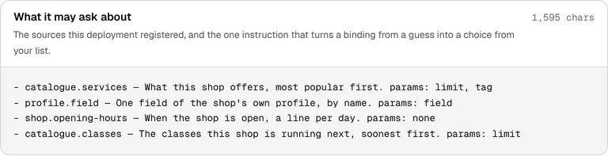
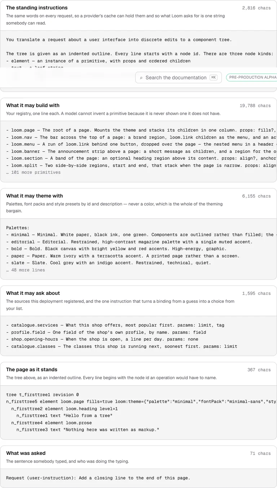
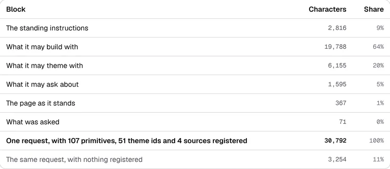
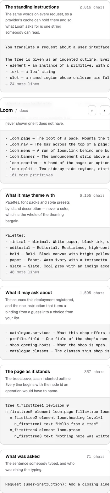

# 14 October 2026 — the block the site's own prompt left out

**Routine:** `Loom docs` · **Branch:** `docs-55-the-sources-its-own-prompt-left-out` ·
**Section:** §4c

No open pull request from this lane at the start of the run, and no maintainer
comment outstanding anywhere — there were none on any of the five open pull
requests, none of which is this lane's. Fresh branch off `origin/main` at
`0f7f29a` (#631).

## What this run is

The finding yesterday's run deferred on purpose, taken in the words it was filed
in: **the site's own produced prompt has no sources block.**

*Connecting a model* prints the request this deployment would send a model —
not a mock of one, the real blocks built by `buildUserMessage`'s own renderers.
Yesterday's run established, while correcting a stale sentence elsewhere, that
the runtime's prompt really does carry the sources a deployment registered.
This site's did not. `_lib/prompt/request.ts` called `measurePrompt` with a
primitive catalogue and a theme catalogue and nothing else, so the prompt a
reader saw here had primitives and themes in it and no data vocabulary at all.

Nothing was wrong, exactly — a prompt without one is a real prompt, and whether
a deployment wires a source registry is the host's business. What made it worth
a run is where the gap sat. *Where the content comes from* teaches bindings and
ends its callout with *"Connecting a model is where the rest of that prompt
is"*, and the page at the other end of that sentence was the one place a reader
could have **seen** the thing rather than been told it.

## What is on the site now

**A sixth block, built the same way as the other five.** `renderSourceCatalogue`
against `dataCatalogue(shopRegistry())` — the shop from *Where the content comes
from*, which is the only data vocabulary this site has. It is the same registry
that page resolves as it builds, rather than a second one written to make this
page look furnished. Nothing is resolved to print it: a catalogue is a
projection of what a registry declares, so no adapter is called and no answer is
fetched.

**The recipe hands over all three catalogues.** The `modelInterpreter` snippet
passed `catalogue` and `themeCatalogue`; it now passes `dataCatalogue(sources)`
as well, and the section above it is *Three of those arguments are the
interesting ones* rather than two. A reader who wires the two it used to show
gets a model that can build and theme and cannot ask anybody anything —
which is exactly the deployment this site was, while telling them otherwise.

**A fifth thing worth noticing**, and the one that needed the produced block to
be sayable at all:

> **What your deployment can be asked about is a list as well, and it is the
> shortest block with the longest instructions.**

The list is four lines and 327 characters. The block is 1,595. The rest is the
paragraph after it, and the reason is worth a reader's time: an id can be
checked against a list, and the other two ways a binding goes wrong cannot be —
params the source never declared, and a binding **name** no primitive on the
node reads, which is answered and then read by nobody. The shorter the list, the
more of the block is the explanation.

## Real numbers

| | before | after |
| --- | --- | --- |
| sources block | 0 | **1,595** |
| whole request | 29,197 | **30,792** |
| the reader's own question, as a share | 1.50% | **1.42%** |

The share is why one sentence of prose moved. The page said the reader's
question was *"about **two** per cent"* of the request, checked by a test that
accepted anything between half a per cent and three. So a request whose question
was really three per cent of it would have passed a test for a sentence it
contradicted. It now says **under two per cent**, and the bound in the sentence
is the bound in the test.

That is the same mistake this lane keeps finding in its own instruments, one
more turn of it: a number in prose is worth exactly as much as the comparison
behind it, and a band three times wider than the claim is not that comparison.

## Decisions taken that were not specified

- **The shop's registry, not a registry invented for this page.** The
  alternative was a tidy two-source vocabulary written to look good in a
  printout. One registry for the whole site is already this lane's rule for
  primitives and themes, and the reason holds here: a page showing a reader a
  data vocabulary the site does not actually have is the plausible-looking table
  this site keeps refusing to ship.
- **The count of sources stays out of the prose.** An early draft said *"those
  four lines"*. A typed count is the thing `_lib/counts.ts` exists to prevent,
  so the sentence says *"the lines in that block"* and the test holds the claim
  that the list is complete rather than that it is four long.
- **`sourceListCharacters` is published beside the measurement** rather than
  recomputed in the test. The ratio the new paragraph claims is the one thing
  about that block that could quietly stop being true, and a test that rendered
  its own copy of the catalogue to check it would be a second renderer to keep
  in step.
- **The fence context lends the page a `sources` registry.** `DataRegistry` is
  the runtime's, so it is imported rather than declared — the rule
  `context.test.ts` enforces, and the reason the compiled program typechecks
  against the real thing.

## Also: a command that answered about the wrong source

The second open finding owned by this lane, closed because this run would
otherwise have had to work around it. `docs:api` reads `dist/*.d.ts` — the right
source, because a published surface is what the build emits — and did not build
it first, so after a merge it printed *"wrote 17 entry points and 1599 exports"*
and changed nothing while the honest answer was 1634. `db:push`,
`telemetry:prune` and `signals:collect` all learned this on 12 October. It now
builds first, like them.

`docs:fences` is the open half of that finding and it is deliberately left
alone, with the reason written where the next person will look: it reads the
pages' own code blocks and writes TypeScript, so there is nothing in `dist/` for
it to be stale against. What needs the build is the `tsc` run that reads what it
wrote, and that is `verify`'s to do.

## Records

None added, none superseded. Nothing here touches the tree schema, the delta
model or an `Accepted` record. The behaviour shown was settled by
[0058](../decisions/0058-a-binding-is-a-question-the-tree-asks-answered-before-the-walk.md),
[0172](../decisions/0172-what-a-deployment-offers-a-model-is-one-value.md) and
[0181](../decisions/0181-a-primitive-declares-the-binding-names-it-reads-and-saying-nothing-is-not-saying-none.md); the
page shows it rather than restating it.

## Findings

**Two closed**, both this lane's own, both filed yesterday.

- *The site's own produced prompt has no sources block, so* Connecting a model
  *shows a reader less than the runtime sends* — the unit above.
- *`docs:api` reads `dist/` and does not build it* — closed for `docs:api`, with
  the question it left open about `docs:fences` answered in the negative and the
  reasoning recorded in `generate.ts`.

**One filed.** *The site registers one source registry and shows it on a page
about a different deployment* — the printed prompt says *"Data this deployment
can answer questions about"* and names the cake shop, which is true of the page
that resolves it and reads oddly on a page about this site. The honest fix is a
site-wide `docsSources` beside `docsRegistry` and `docsThemes`, which is a
restructuring of `_lib/data/shop.ts`' three scenario registries and not this
change's business.

## Test numbers

`pnpm install && pnpm verify` — **exit 0**.

- framework: **221 files, 4,977 tests passed**
- application: **325 files, 5,773 tests passed**
- `findings:check`: 1,191 findings, 0 malformed
- `reports:check`: 1,829 visuals, none over 1.1MB
- `prerender:check`: 133 prerendered pages, 1,837 text junctions, 0 run together

Nothing failed, nothing was skipped, and no test was weakened. **Three of those
tests are new and six more changed**, all in `_lib/prompt/`: that directory went
from 21 tests to 24.

The phone shot is the same six blocks at 390×844 with a coarse pointer:
`scrollWidth 390 / innerWidth 390`, so the longest line in the printout scrolls
inside its own block rather than widening the page.

The site's sticky bar sits across one block in that shot and in the wide one
above it, and that is the harness rather than the page: both are clipped to an
element taller than the viewport, so the bar is photographed where it was parked
when the crop was taken. The block-on-its-own shot at the top has no crop and no
bar.

## The preview

<https://loom-git-docs-55-the-sources-282d8c-jpizzolato36-6341s-projects.vercel.app>

The two pages this change touches, either end of one sentence:

- [/docs/the-runtime/connecting-a-model](https://loom-git-docs-55-the-sources-282d8c-jpizzolato36-6341s-projects.vercel.app/docs/the-runtime/connecting-a-model)
- [/docs/building-with-loom/where-content-comes-from](https://loom-git-docs-55-the-sources-282d8c-jpizzolato36-6341s-projects.vercel.app/docs/building-with-loom/where-content-comes-from)

Not fetched from this container: `*.vercel.app` is denied by the environment's
egress policy, which is the open finding of 12 October and still true. The shots
above were taken with `pnpm shoot` against `next start` on the build `pnpm
verify` produced, on this commit.
