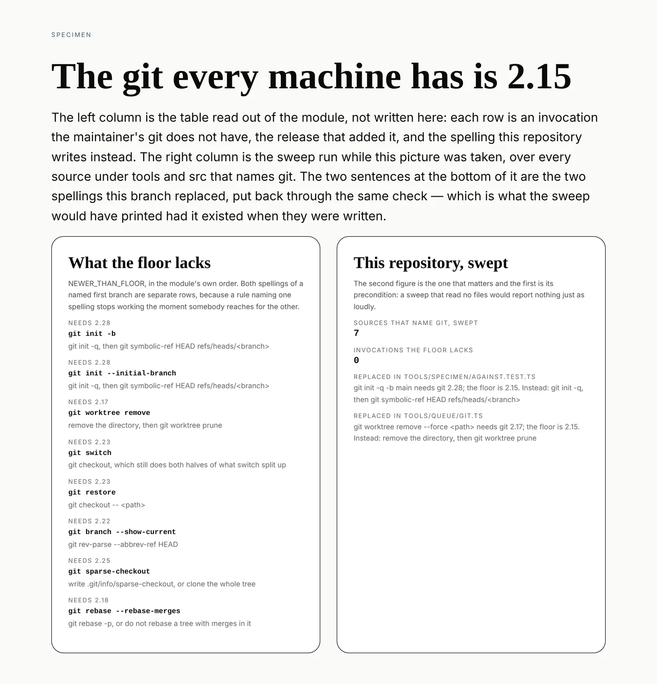

# Framework — the git every machine has

**Routine:** `Loom framework` · **Date:** 2026-10-14 (evening run) · **Branch:**
`framework-73-the-git-every-machine-has` · **Section:** the tooling under
`tools/`, and `docs/routines.md`

## What I completed

`pnpm verify` can pass on the maintainer's machine again, and the next
invocation that would stop it fails on the branch that writes it rather than on
his tree.

The finding was his own, filed on 11 October: `tools/specimen/against.test.ts`
built its scratch repository with `git init -q -b main`, `-b` arrived in git
2.28, his git is 2.15, and all six cases of *photographing the same sheet
against a revision* failed there — for nineteen days, on every change he tried
to merge by hand, with no way to tell that failure from a real one except
re-running the suite on `main` to compare.

**Closing it turned up a second live instance.** `tools/queue/git.ts` released
its detached worktree with `git worktree remove --force`, which needs git 2.17,
so `pnpm queue` was broken on 2.15 as well and nobody had reported it because no
routine runs it on a git that old.



The picture's right column is the claim. The second figure is nought and the
first is not, which is the only arrangement of those two figures worth
photographing: a sweep that read no files would report nothing just as loudly.
The two sentences under them are the spellings this branch replaced, put back
through the same check — what the sweep would have printed had it existed when
they were written.

### The pieces

- **[`tools/git/portability.ts`](../tools/git/portability.ts)** — `GIT_FLOOR` as
  a pair of numbers, and `NEWER_THAN_FLOOR`: eight invocations the floor lacks,
  each with the release that added it and the spelling to write instead.
  `unportable(argv)` matches a table entry against an argv rather than against
  source text — the first token must be the argv's own subcommand, read through
  a `-C` prefix, and the rest must follow it in order. So `["init", "-b"]`
  catches `["init", "-q", "-b", "main"]` and leaves `["checkout", "-b", "main"]`
  alone.
- **[`tools/git/portability.test.ts`](../tools/git/portability.test.ts)** —
  fifteen cases. Twelve are the matcher; one sweeps every source under `tools/`
  and `src/` that names git; one asserts that sweep is reading something, which
  is the other one's precondition; one holds the table to containing nothing the
  floor already has, so raising the floor retires rows instead of leaving them
  standing as rules about nobody's git.
- **[`tools/specimen/against.test.ts`](../tools/specimen/against.test.ts)** —
  `initAt(cwd, branch)`: `git init -q`, then
  `git symbolic-ref HEAD refs/heads/<branch>`. On a repository with no commits
  yet this repoints `HEAD` before there is anything for it to move, so the first
  commit creates the branch under the name asked for and the repository is what
  `-b` would have built. Two call sites.
- **[`tools/queue/git.ts`](../tools/queue/git.ts)** — `close` deletes the
  directory and then runs `git worktree prune`, which are the two halves
  `worktree remove` does. The deletion was already happening (the tree lives
  inside the temp directory this removes); what was missing without the prune is
  dropping the registration under `.git/worktrees`, and a repository that still
  believes in a tree that is gone refuses the next `worktree add` at the same
  base — which is the next run of the tool.
- **[`tools/queue/worktree.test.ts`](../tools/queue/worktree.test.ts)** — the
  first tests `worktreeAt` has ever had, against a real two-branch repository.
  One asserts a close leaves neither the directory nor the registration; the
  other takes the base twice in a row, which is the case the prune exists for
  and the one that would have failed had I deleted the directory and stopped.
- **[`docs/routines.md`](../docs/routines.md)** — *The git every machine has*,
  beside *Reading the merge gate*, because both are things a **run** does rather
  than things the repository contains. It states the floor, the three instances
  that arrived before anything checked, why a version-guarded skip is the wrong
  remedy, and the sweep's limit.

### The instrument, proved the only way it can be

I planted the original defect back and ran the sweep. It prints one failure and
names the file, the release and the replacement:

```
tools/specimen/against.test.ts: git init -q -b main needs git 2.28;
the floor is 2.15. Instead: git init -q, then git symbolic-ref HEAD refs/heads/<branch>
```

That is the whole reason the sweep is a source reading and not a version probe.
Asking the local git what it supports answers for the machine running the check,
which is the machine that does not have the problem.

## Decisions I made that nothing specified

**A floor stated as a table, not as a skip.** The finding had already refused
the skip and said why — *a test that silently does not run on the maintainer's
machine is how the next portability gap goes unnoticed for a month* — so what
was left to choose was where the knowledge lives. A probe of the installed git
would be the obvious thing and is useless here for the reason above. The table
answers for the floor from anywhere, including from a container running 2.43.

**Both spellings of one feature are separate rows.** `init -b` and
`init --initial-branch` are one git feature and two tokens. `docs/routines.md`
already records what happens otherwise, twice over, in the pipe-into-`tail`
entry and its successor one pipe to the right.

**No decision record.** The floor is a line in a file and a paragraph in
`docs/routines.md`; raising it is cheap and reversing it is cheaper. It defines
nothing about what Loom is, so it is a convention written where conventions for
runs are written, and not an `0280` nobody would have to read.

**The sweep reads literals, and says so.** An argv assembled from variables is
invisible to it. The alternative is a TypeScript parser for a check whose entire
job is to catch a string somebody typed. The limit is asserted in the test as
the property the sweep rests on — a non-literal token reads as `*`, and `*` is in
no row of the table — and it holds today because every git invocation in this
repository is written as literals.

**`prune` is repository-wide and `worktree remove` was not**, and that is the
one behaviour this branch changes rather than preserves. `git worktree prune`
drops every stale registration a repository has, not only the one the call being
replaced had made, and git offers no path filter for it. The queue tool runs
against a clone whose only other worktrees are the caller's own, a forgotten
worktree is recreated by `worktree add` rather than lost, and the alternative —
leaving the entry standing — accumulates one dead registration per run in
`worktree list`. It is written in the doc comment beside the call rather than
left for the next reader to work out.

**`git-floor.specimen.ts` writes its two replaced argvs as a string it splits**
rather than as lists of literals, so the picture of the check is not the one
place in the repository exempted from it.

## Records added or superseded

None. Nothing here touches the tree schema, the delta model, or any `Accepted`
record.

## Findings

**Closed:** *six specimen tests assume a git newer than the maintainer's, so
`pnpm verify` cannot pass on his machine* (11 October, filed by
`@jonathanbravecredit`). The entry carries the second instance found while
closing it, the failure text the planted defect reproduces, and what could not be
verified from here.

**Filed:** none. The second instance was in this lane's own files and is fixed
rather than filed.

## Open questions

1. **The reading I cannot take.** No container a routine runs in has a git older
   than 2.43, so *"`pnpm verify` is green on 2.15"* is not something this branch
   can measure. What it measures is that the new spellings predate 2.15 by years
   and that the repository's sources no longer name anything the table holds. The
   maintainer's own run is the reading.
2. **Whether 2.15 is the floor to hold.** It is his machine today. If that
   changes, the floor is one line in `portability.ts` and one paragraph in
   `docs/routines.md`, and five of the eight rows retire on their own — the
   table's own test asserts that retired rows do not linger.
3. **Three of the eight rows are speculative.** `sparse-checkout`, `restore` and
   `rebase --rebase-merges` are not invocations this repository has reached for;
   they are ones a tool in it plausibly would. They cost nothing while nobody
   writes them and they are the rows most likely to be wrong about what somebody
   actually wants instead.

## Test numbers

`pnpm install && pnpm verify`, measured on this branch:

| stage | result |
| --- | --- |
| `pnpm build` | clean |
| `pnpm typecheck` | clean |
| `pnpm test` (root) | **5,069 passed**, 226 files, 0 failed, 0 skipped |
| `pnpm --filter @loom/app verify` | **5,797 passed**, 327 files, 0 failed, 0 skipped |
| `pnpm findings:check` | clean |
| `pnpm reports:check` | clean |
| `pnpm prerender:check` | 133 pages, 1,839 junctions, 0 run together |

**10,866 tests across the two suites, nothing failing and nothing skipped.**
Seventeen of them are new: fifteen in `tools/git/portability.test.ts` and two in
`tools/queue/worktree.test.ts`.

One number in this report is lower than the morning run's and nothing regressed:
#633's report says 13,550, counting its stages differently. The two figures above
are each read off the line the suite printed, and both suites are named rather
than summed into one unattributable total.
