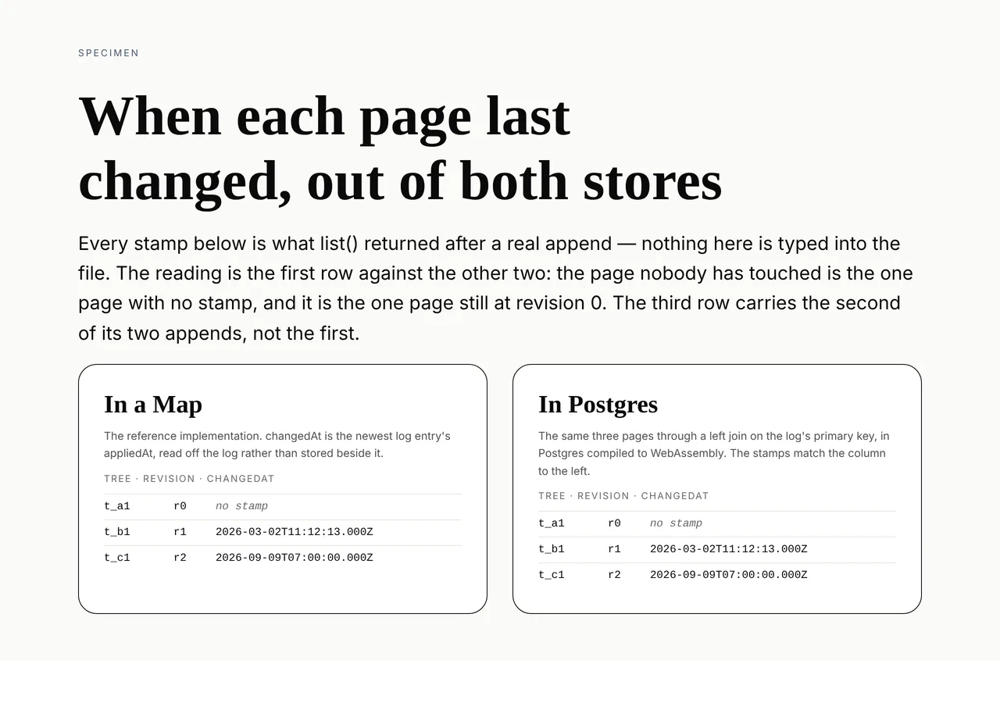

# When a page last changed

**Date:** 2026-10-14
**Section:** §5 (the store), §3 (portal)
**Branch:** `framework-72-when-a-page-last-changed`

A listing said what a page *is at* and never *when*, so the portal's **Changed
recently** could not be drawn. It can be drawn now for a deployment that fits in
one page of listings, and the rest is a proposal with the maintainer's name on
it rather than a thing I built.

Two pieces of work, and the first was not planned.

## 1. The open pull request was un-mergeable

#628 went `dirty` when fourteen commits landed on `main` behind it. Both
conflicts were generated files and both were regenerated by their own tooling
rather than merged by hand — `pnpm decisions:index`, and
`pnpm --filter @loom/app docs:api` after a build.

**Its record is renumbered 0274 → 0276.** #627 claimed 0274 four minutes before
#628 did and `main` has since taken 0275, so re-reading `main` put the next free
number at 0276. This is the clash the 11 October entry in `FINDINGS.md` is
about — *four record numbers were claimed twice in two days, and the check that
catches a clash cannot see one until the branches meet* — arriving on schedule.
0275's own text had already noted 0274 was "claimed by **two** open pull
requests", so the portal lane stepped over it; this is the other half.

Full account in that branch's own report, as an addendum. `pnpm verify` green on
the merge: **13,553 tests across 667 files, `EXIT=0`**.

## 2. The listing carries when the page last changed



**Nothing in either column of that picture is typed into the file.** Every stamp
is what `list()` returned after a real `append`, in a `Map` on the left and in
Postgres compiled to WebAssembly on the right. A store that started filling
`changedAt` from a creation time, or stopped omitting it on an untouched page,
would change the image.

The reading is the first row against the other two. `t_a1` is the page nobody
has touched: it is the one row with no stamp and the one row still at revision
0. `t_c1` carries the **second** of its two appends, not the first.

```ts
export type TreeListing = {
  readonly treeId: TreeId
  readonly revision: number
  /** The newest log entry's `appliedAt`; absent when `revision` is 0. */
  readonly changedAt?: string
}
```

### Where the value comes from, and where it deliberately does not

`changedAt` is the `appliedAt` of the newest entry in that tree's log — the
same clock `StoredRevision` already publishes, and the same value a caller
reading `revisions` would see.

**`loom_trees.updated_at` already exists and is deliberately not used.** It is
`DEFAULT now()`, the database's clock at the moment the row was written, not the
runtime's at the moment the change was applied. Those differ by write latency on
a good day and by whatever a retry did on a bad one. A listing whose stamp
disagrees with the log it claims to summarise is worse than a listing with no
stamp, because only the first one can be believed and acted on.

In Postgres it is a `leftJoin` on the whole of the log's primary key —
`(application_id, tree_id, revision)` — so it is a point lookup per listed tree
rather than a scan, folded into the query that was already running. **No DDL and
no migration**: the column it reads has been there since the log was written.
`leftJoin` and not `innerJoin`, because a tree at revision 0 has no entry at all
and an inner join would have dropped it from the listing — turning a missing
stamp into a missing page.

### The five contract cases

Run against both stores, which is what makes this a contract rather than two
implementations that happen to agree today.

| the case | what it pins |
| --- | --- |
| says nothing about a tree that has never been changed | the absence is a missing key |
| reports the stamp the append was given | not the time of the read |
| moves to the newest entry's stamp as the log grows | it is the newest, not the first |
| carries a stamp for exactly the trees whose revision is above zero | the biconditional a surface may rely on |
| agrees with the newest entry the log itself hands back | **the two reads of one fact cannot drift** |

The last is the one that cannot be read off either implementation on its own: it
compares the listing against what `revisions` returns rather than against a
literal this file typed in. The fourth is the one a store filling `changedAt`
with a creation time would fail, having passed the other four.

`appendOf` in the contract suite grew an optional `appliedAt`. Three of these
cases cannot be written at all while every append in the suite shares one stamp.

## Decisions I took that were not specified

**The stamp, yes; the order, not mine.** This is the whole shape of the run, and
it comes out of [0020](../decisions/0020-a-store-handle-is-the-scope-and-a-listing-is-a-page.md),
which is `Accepted` and which rejected recency ordering — not because recency is
the wrong thing to want, it says plainly it is "what a portal actually wants",
but because **there was nothing to sort on**. It then named its own way out:
"recency ordering is available later by adding a stamped field to the *store's*
entry — a store change, not a schema change — and would supersede this."

So the stamped field is the move that record authorises in terms, and it ships
as [0277](../decisions/0277-a-listing-carries-when-the-page-last-changed-and-the-absence-means-never.md),
`Accepted`. The *ordering* would supersede 0020 part 2, so it is
[0278](../decisions/0278-a-listing-ordered-by-recency-is-a-second-ordering-and-a-second-cursor.md),
**`Proposed`, ARCHITECTURAL, and not implemented**. 0020 is left as it stands and
is **not** marked superseded, which is what `docs/routines.md` asks for.

The honest wrinkle, stated in 0277 rather than buried: 0020 part 3 reads "a
listing is a summary — `treeId` and `revision` — not a tree", and the summary is
now three fields. I read the decision in that part as *a summary, not a
document*, and the enumeration as the summary of its day. If the maintainer
reads the enumeration as the decision, 0277 is the record to refuse — it is one
optional field and reversing it costs a line in each store.

**"Changed recently" is two features and the prototype does not say which.**
`_lib/page-filter.ts` lists it among *filters* while the name reads like a
*sort*. As a sort it is *every page, newest first* — a total reordering that
always returns something. As a filter it is *the pages touched in the last N
days* — keeps the id ordering, and honestly returns nothing on a quiet
deployment. They want different contracts. 0278 proposes the sort, because a
sort can answer the filter's question by reading its first page and a filter
cannot answer the sort's at all.

**Absent rather than present-and-null.** The same property
[0276](../decisions/0276-a-patch-field-says-set-cleared-or-unchanged-and-clearing-removes-the-key.md)
forced on a patch yesterday, for the same reason: a `Map` and a `NULL` column
reach an absence by different routes and nothing downstream should be able to
tell which route a row took. The specimen reads `"changedAt" in listing` rather
than comparing against `undefined`, so the picture would catch a store that got
this wrong.

**One schema, not two.** `appliedAtSchema` is now shared between the revision
read and the listing read in `postgres.ts`, so a listing cannot publish a string
the revision it came from would have refused.

## Records

- Added **[0277](../decisions/0277-a-listing-carries-when-the-page-last-changed-and-the-absence-means-never.md)**
  — *A listing carries when the page last changed, and an absent stamp means
  never.* `Accepted`. Four alternatives recorded as rejected: `updated_at`, a
  stamp in the tree document, stamping on `create` too, and returning the whole
  newest entry.
- Added **[0278](../decisions/0278-a-listing-ordered-by-recency-is-a-second-ordering-and-a-second-cursor.md)**
  — *A listing ordered by recency is a second ordering, and a second cursor.*
  **`Proposed` — ARCHITECTURAL, needs review.** Nothing in it is built.
- **Nothing superseded.** 0020 is untouched.

`pnpm decisions:index` run. It reports the usual holes for numbers claimed on
unmerged branches — **0274** (#627) and **0276** (#628) among them, which is this
run's own first half showing up in its second.

## Findings

**Half closed:** *a listing says what a page is at, never when, so "changed
recently" cannot be drawn* (13 October, filed by `Loom portal`). The fact ships;
the ordering is escalated. The entry stays **open** rather than closed, and says
why: until 0278 is answered, `?filter=changed` reading as no filter at all is
still the right behaviour for a deployment of unknown size.

**What `(portal)` can do with this today, and the line it must not cross.**
`MAX_LISTING_LIMIT` is 200, so a deployment whose pages fit in one listing page
can draw the entry honestly by sorting the page it holds. Past that it cannot:
sorting a page sorts that page and not the store, so the newest tree overall may
sit on a page the screen never asked for. That limit is stated on the type, not
only here.

**Noted for `(portal)`, not edited:** `_lib/page-filter.ts` opens with "`changed`
cannot be computed. `TreeListing` is `{ treeId, revision }` and nothing else",
and the second clause stopped being true today. The lane is paused and a paused
lane's directory is not open season, so it is recorded on the finding rather
than fixed from outside.

## Gate

`pnpm install && pnpm verify`, status written to a file and read in a separate
command — the remedy the 13 October report names for the gate that reported exit
0 while its own status file said `EXIT=1`.

```
GATE_PLACEHOLDER
```

### The round it went red, which is the interesting one

The first full run came back **`EXIT=1`, 2 failed of 4,987**, and both failures
were this repository's own documentation rules catching this branch rather than
anything about the store:

- **`decisions.test.ts` — "are cited by a number that resolves".** 0277 linked
  to **0276**, the record on the *other* open branch. It is a correct citation
  and an unresolvable one, because this branch is cut from `main` and 0276 is
  not on `main`. The cross-reference is now prose without a number: the property
  is named, the record is not cited until it lands. This is the record-number
  clash again, in its third costume this week.
- **`documentation.test.ts` — "never makes a decision-record number part of a
  published sentence".** An indented comment in `store-contract.ts` is published
  *whole*, not first-paragraph-only, and mine read "the half of 0020's rejected
  recency ordering that 0277 takes". Rewritten so the numbers sit in a
  parenthetical the generator lifts — `(0020, 0277)` — which is the form the
  maintainer's rule permits.

Both are checks working. Neither was weakened to pass, and no test was skipped
or deleted. Worth recording that the second one only fires on *indented*
comments: the same numbers in `store.ts` sit in later paragraphs of a
left-margin comment and are never published, so the rule is sharper than it
looks and a run that moves a comment inward can trip it without changing a word.

## Open questions

1. **0278 is the question.** Recency ordering supersedes an `Accepted` record, so
   it waits. The recommendation is in the record: the sort, not the filter; a
   composite cursor that carries its own order so one minted under the other is
   refused rather than silently resumed; and comparison on
   `applied_at::timestamptz` rather than on the text, because
   `z.string().datetime()` admits both `...00Z` and `...00.000Z` for the same
   instant and they sort in the wrong order as strings.
2. **Whether 0277's reading of 0020 part 3 is the right one** — the enumeration
   as the summary of its day, or as the decision. Refusing it costs a line in
   each store.
3. **The record-number clash is now a tax rather than an incident.** Two of the
   four open branches had to renumber this week, this run's first half included.
   The 11 October entry owns it and names the check that cannot see a clash until
   the branches meet; it is worth saying that the cost is being paid in full
   while it stays open.
