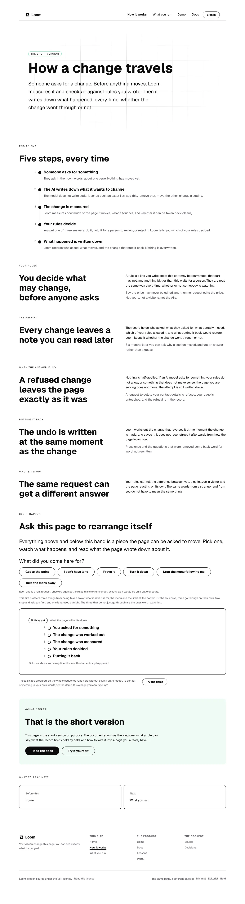

# 2026-10-14 — the seven pages this site still said it had

**Build order section:** §4d — the marketing site.

**Branch:** `marketing-04-the-pages-this-site-still-names` (→ `main`), cut from
`origin/main` at `90f2e8e`.

**No maintainer comment was outstanding.** This lane had no open pull request at
the start of the run; the five open ones belong to the framework, signals and
portal lanes.

**Nothing a reader can see has changed**, and that is the finding rather than a
caveat. Every address on this site is derived, so nothing reader-facing could go
wrong. What went wrong went wrong in the prose, which only the next run reads.

---

## What was found

On **26 September** the maintainer cut a ten-page marketing site to three. The
seven pages that went did not take their words with them — they were absorbed
into bands of the two that stayed:

| retired page | where its words are now |
| --- | --- |
| `/the-rules` | `/how-it-works`, *Your rules* |
| `/the-record` | `/how-it-works`, *The record* |
| `/when-it-goes-wrong` | `/how-it-works`, *When the answer is no* |
| `/putting-it-back` | `/how-it-works`, *Putting it back* |
| `/who-can-ask` | `/how-it-works`, *Who is asking* |
| `/your-components` | `/what-you-run`, *What you bring* |
| `/what-readers-do` | `/what-you-run`, *What this page counts* |

So every module that had a reason to mention one went on mentioning it. Swept
this morning, this route group named those seven **forty times across seventeen
files**, and **eleven of the forty were in the present tense** — a retired page
described as doing a job now.

The worst three:

| where | what it said |
| --- | --- |
| `readers/counting.ts` | *"`/what-readers-do` **has said** since 16 September that counting is off unless you turn it on"* |
| `chrome.ts` | *"`/how-it-works` **is** offered by `/the-rules`' own *Before this* card"* |
| `adapt/run.ts` | *"`/your-components` **has said** since 11 September that there are three things no request gets past"* |

The first is the one that matters most: a live promise about whether this
deployment counts the people reading it, credited to a page a visitor cannot
open. The promise itself is **true and still made** — *What this page counts* on
`/what-you-run` says it — so nothing was mis-sold to anybody. The module
explaining the privacy switch simply pointed at the wrong page for fifteen
weeks, and nothing in a build, a typecheck or a test reads a comment.

### Why it survived

**Because the half a reader meets is derived.** The bar, the footer's map, the
sitemap, `llms.txt` and the front door's four cards are built from `SITE_ROUTES`
and `PRODUCT_SURFACES` — so a retired page **cannot** become a dead link, a
crawled 404 or a missing entry in a map. That property is why the cut was safe
to make in one commit, and it is exactly why the prose could rot undisturbed
underneath it: the one thing this site holds nothing against is the part only
the next run reads.

### The finding of 7 October was this, filed one comment too narrowly

It named the fifty-line docblock above `SITE_ROUTES` that argued the reading
order of ten pages, and `marketing-66` rewrote it. **Twenty-five more lines of
the same cut's reasoning sat 750 lines further down the same file**, on
`readingNeighbors`, and were not touched because the finding was about a
different comment. Every claim in them was false:

| it said | by 14 October |
| --- | --- |
| *"measured across the ten page builders on `main`"* | three |
| *"the footer's map renders it as ten links in a column"* | three |
| *"`/putting-it-back` and `/what-readers-do` linked from no other page's body"* | neither page exists |
| *"`/how-it-works` ends without pointing anywhere"* | it is the middle of three; the pager has pointed it onward since the cut |

That last one is the instructive one. It was the most concrete sentence in the
block — a specific page, a specific failure, a reader stranded — and it is the
sentence the cut made false, on the same commit, in the opposite direction.

---

## What shipped

**`RETIRED_ROUTES` in `_lib/site.ts`** — the seven, each with the band that took
its words. Data rather than a sentence, so a test has something to check
against, and `absorbedBy` is what the next run should follow when it meets one
of these mentions: in all seven cases the argument being made is still true of
the band that took the words.

**`_lib/named.test.ts`** (204 lines) sweeps every comment in the route group —
both comment shapes, gutter stripped, lines joined, because a sentence here is
routinely four lines long — and holds three rules:

1. A site path named in prose is one this application serves, or one of the
   seven. (`/the-course`, a path invented for a thought experiment in
   `routes.ts`, was the only one that was neither.)
2. **A retired page may be named only in a sentence that also says `retired`.**
3. An entry in `RETIRED_ROUTES` that the prose has stopped naming is removed, so
   the list stays a record of a cut rather than a graveyard.

All forty mentions were then reworded to satisfy rule 2. The rewording is not
busywork: *"Replaces the retired `/the-rules`, which was 1,382 words"* tells a
run in four words what it otherwise had to open the site to discover.

### The blunt rule, and the subtle one that failed

The first draft of rule 2 looked for a **past-tense marker** in the sentence —
`was`, `were`, `until`, `retired`, `became` — on the reasoning that history is
fine and a live claim is not. It is the obviously better rule and it **passed
the single worst sentence in the sweep.** `readers/counting.ts` reads:

> *"`/what-readers-do` **has said** since 16 September that counting is off
> unless you turn it on, and **until** now that **was** a sentence about
> somebody else's deployment."*

Two markers, both attached to the *claim* rather than to the *page*. The one
mention in forty that credits a retired page with a live promise about a
reader's privacy is precisely the one a tense-sniffer waves through, because the
sentence that makes a false claim about a page is usually a sentence doing
something else as well.

So the word is **required rather than inferred**. It is not subtle and it cannot
be argued with. The cost is one reworded clause per mention; the benefit is that
the next page this site retires turns every sentence about it red until somebody
has written down that it is gone.

**Checked against the bug it is about**, per the lesson this lane wrote down on
13 October: the original `counting.ts` sentence was put back and the test went
red naming it, then reverted — not merely observed passing once the sentence was
already fixed.

---

## The proof that nothing moved

`/`, `/how-it-works` and `/what-you-run` photographed at 1280, full page, on the
build of `main` taken before the first edit of the run, and on this branch's
build. The shot list that produced them is committed beside this report, so
re-taking the pair is one command:

```
e9462b877054cc544b1582122b9bf2e0  /               before (main)
e9462b877054cc544b1582122b9bf2e0  /               after  (this branch)

05f8745e120d29a160f7c84522c47d14  /how-it-works    before (main)
05f8745e120d29a160f7c84522c47d14  /how-it-works    after  (this branch)

565c707906083a5c17ed37db0f3f331f  /what-you-run    before (main)
565c707906083a5c17ed37db0f3f331f  /what-you-run    after  (this branch)
```


`/how-it-works` is the page whose module carried five of the forty mentions, and
its `05f8745e…` is the same digest the 13 October report quoted — so this page
has not moved in the two runs since, through a change that deleted a module and
a change that rewrote fourteen docblocks.



---

## Real numbers

`pnpm install && pnpm verify`, exit code read out of a file written as the last
thing on its line:

```
Test Files  221 passed (221)      Tests  4977 passed (4977)    # framework
Test Files  446 passed (446)      Tests  8563 passed (8563)    # @loom/app
Test Files   51 passed  (51)      Tests  1409 passed (1409)    # app/(marketing)
1191 findings, 0 malformed
1825 visuals in reports/, 127.9MB, none over 1.1MB
133 prerendered pages, 1833 text junctions, 0 run together
EXIT=0
```

Nothing skipped, nothing weakened, no test deleted. `named.test.ts` adds five
tests to this route group; one of them is the sweep's own self-check, which
fails if the extraction stops finding prose at all — without it every other
assertion in the file passes for the wrong reason the day a directory is
renamed.

---

## Findings

**Filed** — one entry, closed for this route group and open for four others.
Any surface that retires a page keeps the reasoning that mentions it, because
the reasoning lives in the file that still does the job. `(docs)`, `(lessons)`,
`(demo)` and `(portal)` all have route tables that have moved; `(portal)` is
mid-cut as of #631, which is the cheapest moment it will ever have to add this.
The file is sixty lines and **the blunt rule is the part to copy rather than
improve.**

Not proposed as a shared tool, and the reason is in the entry: four lanes
importing one checker would make every lane's prose a dependency of a module
none of them owns.

**Closed** — the 7 October entry's class, though not that entry: it was filed
against one comment, that comment was rewritten on `marketing-66`, and it is
correctly closed. This run closed the thing it was an instance of.

---

## Open questions

- **Whether a run should be allowed to delete a mention rather than reword it.**
  Forty mentions were reworded here and a handful were arguments about an
  adjacency between two pages that are both gone — the 7 October finding's own
  judgement was that those are *"not history worth keeping in the file the next
  run reads"*. This run kept them all, because deciding which paragraphs of
  somebody else's reasoning are worth keeping is a larger call than the one it
  was making. It is cheap to revisit now that the list exists.
- **Nothing blocking on positioning.** No copy a visitor reads was touched.
