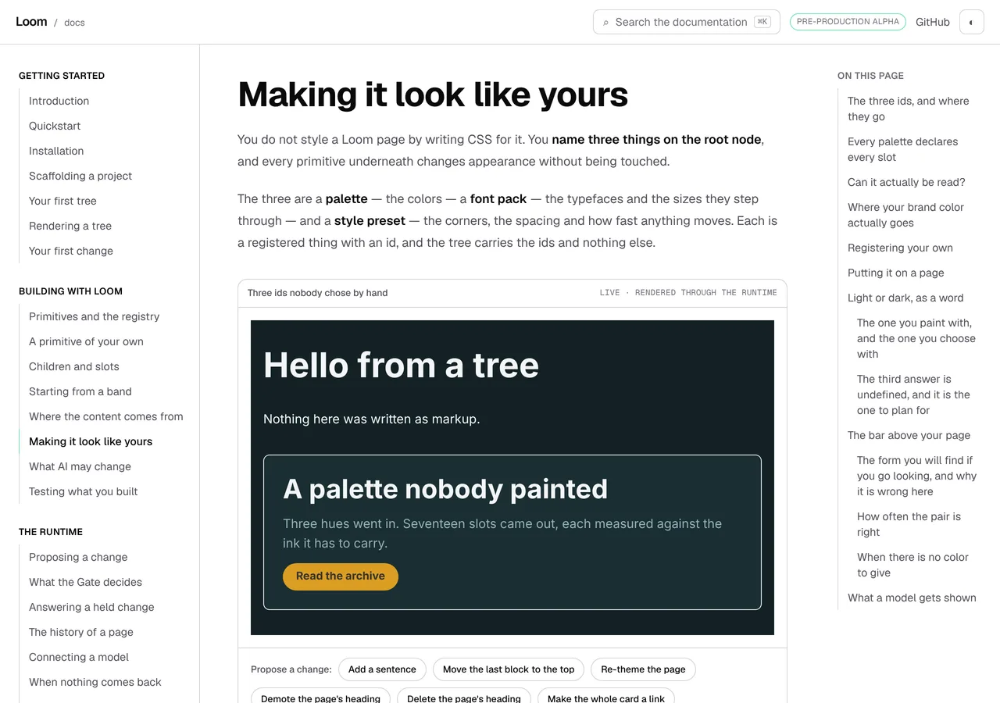
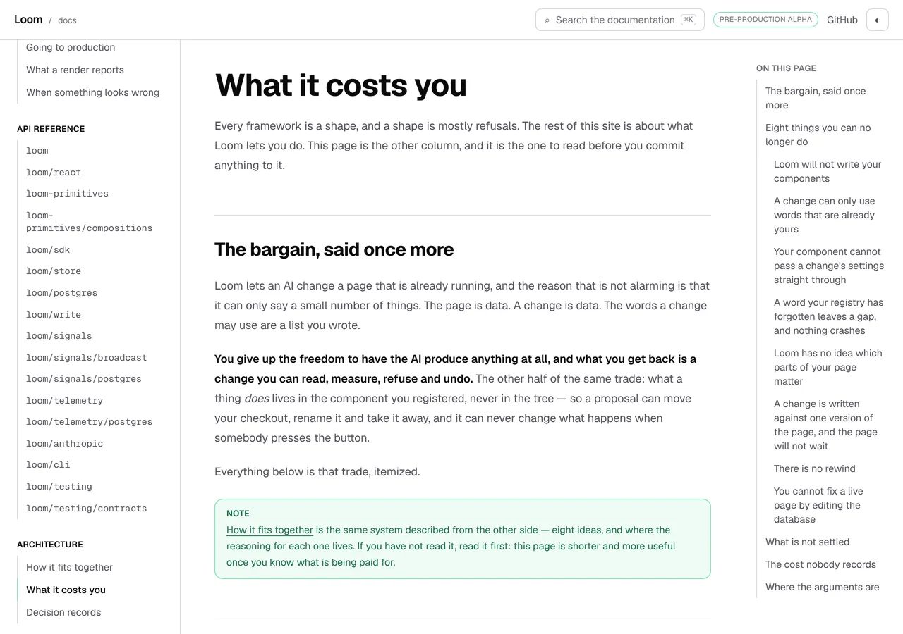
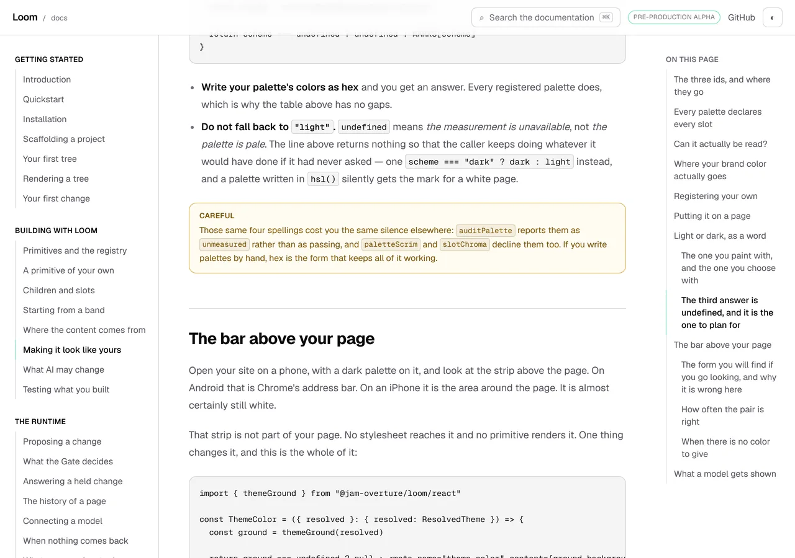
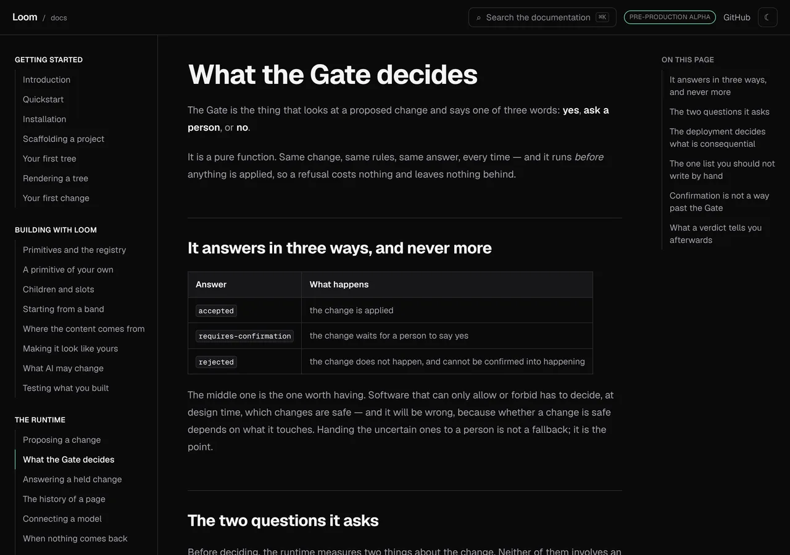
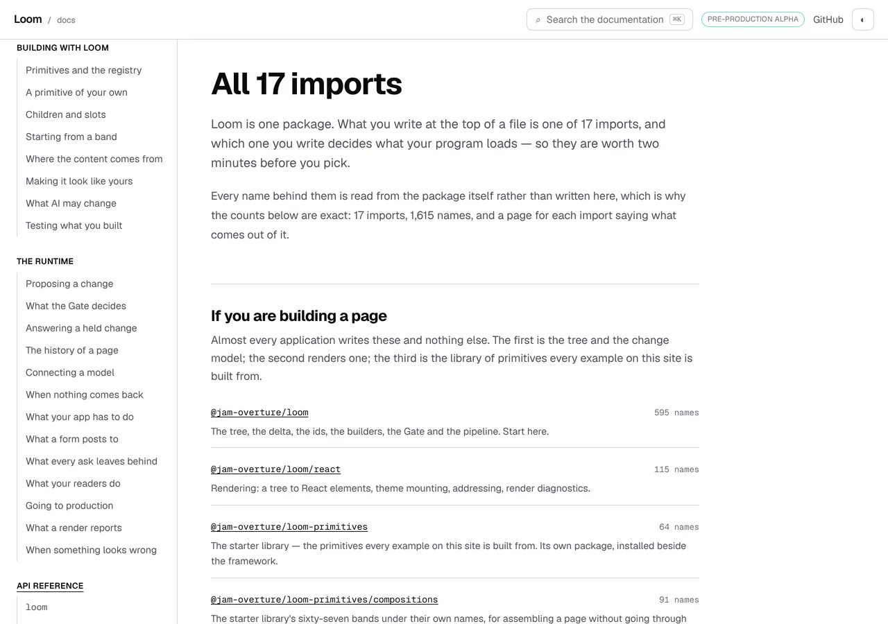
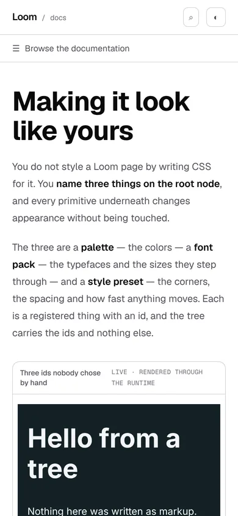

# 15 October 2026 — what is in the page

**Routine:** `Loom docs` · **Branch:** `docs-56-what-is-in-the-page` ·
**Section:** §4c

No open pull request from this lane at the start of the run, and no maintainer
comment outstanding on any of the six open pull requests, none of which is this
lane's. Fresh branch off `origin/main` at `0c0126f` (#638).

## What this run is

The rail on the left says which **page** you are on. Nothing said what was
**in** it.

*Making it look like yours* has fourteen headings and an article 24,944 pixels
tall. *A primitive of your own* has thirteen. *Where the content comes from* has
thirteen. A reader who wanted the part about fonts scrolled until they found it,
and a reader who arrived from search in the middle of a page had no way to see
what they had landed in the middle of.

The seventeen **generated** reference pages have had a contents list since
August — `api-reference.tsx`' `Contents`, two columns wide because it holds
sixty module names. The thirty-one **written** pages had none. That is the gap,
and it is the one the brief's model has closed on every page it serves.



## What is on the site now

**A second rail, on every written page, at 1280 and above.** It lists the
page's own `h2` and `h3` headings, indents the ones inside a section, and marks
the section the reader is in — `aria-current="location"` first so a screen
reader is told, a tint and a rule second, which is the left rail's own
convention for the same job.

**The rows are read off the page in the browser**, not compiled from the
markdown. That is the one design decision in here worth the paragraph, and
there is a picture that makes the argument on its own.



*What it costs you* has **five** `##` lines in `page.mdx`. The rail shows
**thirteen** rows. The other eight are the eight costs that
`<ArchitectureCosts />` renders out of the decision records as the page builds —
which is to say they are the eight things the page is *about*. A contents list
built from the page's source would have listed the five and left out the
subject, and nothing in this repository would have reported it. *How it fits
together* is the same shape with eight ideas.

Reading the document instead makes the list complete by construction: a row
exists for exactly the headings that are on the page, because the headings on
the page are where the rows came from. Nothing is declared, so nothing can fall
out of step. It costs one thing, stated rather than discovered: **the rail is
not in the server's HTML**, it appears when the page's script runs. That is the
right trade for navigation furniture and would be the wrong one for a sentence
somebody came to read. The pager and the left rail are already client
components for the same reason, and no content is in here.

**What counts as a section is `h2` or `h3` with an `id`**, which is `mdx.ts`'
own sentence — *a heading is a place you can be sent to* — applied to a
document rather than to a page's source. A row linking to a heading with no `id`
would scroll a reader nowhere, so there is no such row.



**Which row is marked, in one sentence a person could repeat:** the last section
whose heading has gone past the reading line — and at the bottom of the page,
the last section there is.

The second clause is not a nicety. The final section of a page is usually short,
so on a tall window its heading never reaches the line at all: without it,
*Where to go next* is a row that can never light up, on every page, and it is
the row a reader is most often actually in. Nothing is marked while the reader
is still in the page's opening, because the opening is in no section — that is
deliberately not rounded up to the first row, since the first row is somewhere
they have not got to yet.

**The reading line is 120 pixels and the number is chosen against something.**
`globals.css` gives every prose heading `scroll-margin-top: 5rem`, so a press of
a row lands that heading 80 pixels down the window, clear of the header. The
line has to be below that point or the section a reader just asked for arrives
unmarked. `on-this-page.test.ts` reads the 5rem **out of the stylesheet** and
holds the two together, which is `prose-barrier.ts`' method applied to the one
declaration this mark depends on. A run that changes the header's height and the
scroll margin with it will be told here rather than by a reader pressing a row
and watching the wrong one light up.



It is drawn in the tokens the rest of the chrome is drawn in — `--ink`,
`--ink-muted`, `--edge`, `--accent-ring` — so there is no second palette to keep
in step and the dark picture above needed nothing written for it.

## The column is reserved, and the reference pages are why



The rail renders nothing on a generated page: those pages put the heading's `id`
on the `<section>` around it rather than on the heading, so nothing matches.
That is the correct outcome — they carry their own contents list, shaped for
sixty names rather than a dozen sections — and the gap is filed, because it is
also why the search index cannot cut a reference page up by heading.

The **layout** reserves the column anyway, and the measurement is the reason:

| | `article.prose` |
| --- | --- |
| a written page, with a rail | **x 304, 704 wide** |
| a reference page, with none | **x 304, 704 wide** |

Letting the column collapse would put the prose in a different place on a
reference page than on a written one, and would slide it sideways on a written
page the moment the rail arrived. An empty column of furniture costs a reader
nothing; prose that shifts under them costs them their place.

## Decisions taken that were not specified

- **Read the document, not the markdown.** The alternative was `readPageHeadings`,
  which the search index already uses and which would have been two lines. The
  *Architecture* pages are what decided it, and the thirteen-against-five
  measurement above is the whole argument. The declared alternative — a map of
  which component contributes which headings, spliced in at its position in the
  source — is a second thing to keep true, which is the kind of thing this site
  keeps refusing to ship.
- **`xl` and above, not `lg`.** At 1280 the rail takes 224 pixels off the
  measure of the prose, which goes from 768 to 704. At `lg` there is not enough
  width for three columns without taking it below a good measure. The phone and
  tablet case is filed rather than half-built.
- **No scroll-spy library and no `IntersectionObserver`.** The judgement is a
  pure function of each heading's top and one number, which is testable with
  real figures and readable without knowing what a threshold array does.
  `in-view.ts` reached the same arrangement for the left rail's scroller.
- **`aria-current="location"` rather than `"page"`.** The left rail already
  marks a page. Two rails both saying `"page"` on one screen would be two
  answers to one question; `location` is the token for a position *within* the
  current page, and it is what distinguishes them for a screen reader as well
  as for `chrome.ts`' own selector.
- **The rail names itself `On this page`**, which is what the reference's
  contents list has been called since August, and carries `data-search="off"`
  for the reason that one does: a page's own contents is navigation, and every
  heading in it is already in the index as the heading it links to.

## Also: the picture that could not be taken

The shot that was going to show a **press** of a row could not be taken, and the
reason is the harness rather than the rail.

`pinNavigation` prevents the default on every click inside an `a[href]`, so that
a three-step shot cannot silently photograph a different page. A same-page
fragment is not a different page — it sets `location.hash` and scrolls — but it
is an `a[href]`, so it is refused with everything else. Two attempts came back
with the page exactly where it started:

```
nav[aria-label='On this page'] [aria-current='location']  no match
h2#the-bar-above-your-page  x 304 y 14155  704x67  ← 13322 past the fold
```

The same shot written with `scrollTo` reaches the state and is the *marked*
picture above, so nothing was blocked. Filed for `Loom daily build` with the
remedy named: compare the link's resolved URL against the current one ignoring
the hash, and let a pure fragment change through.

## Records

None added, none superseded. Nothing here touches the tree schema, the delta
model or an `Accepted` record. It is chrome — the exception 0067 names, beside
the sidebar, the search box and the pager — and it composes no primitives
because it is furniture rather than content.

## Findings

**Four filed, none closed.**

- *A shot cannot photograph a press of a contents row* — `Loom daily build`, the
  section above.
- *The contents rail is a desktop rail* — this lane's, the stated limit of what
  shipped, with the remedy's shape named.
- *The reference pages carry the heading's id on the `<section>` around it* —
  this lane's, the half of today's rail that could not be built. It is the same
  fact `search/generated.ts` already records for a different consumer.
- *`nextjs.org` is in the allowlist twice and the gateway refuses it* — the
  maintainer's. The brief says to WebFetch the structural reference and
  `routines.md` lists the host as allowed; `.claude/settings.json` carries it
  under both mechanisms, and the gateway answers `403` to `CONNECT`. **Nothing
  was blocked** — this unit was built from the brief's own list of what that
  site has, from the contents list this site already ships on its generated
  pages, and from the conventions in this route group — so this report makes no
  claim about what nextjs.org does today.

## Test numbers

`pnpm install && pnpm verify` — **exit 0**, read out of a file written as the
last thing on its line.

- framework: **224 files, 5,052 tests passed**
- application: **329 files, 5,829 tests passed**
- `findings:check`: 1,202 findings, 0 malformed
- `reports:check`: 1,838 visuals, none over 1.1MB
- `prerender:check`: 133 prerendered pages, 1,839 text junctions, 0 run
  together; 3 metadata conventions, 0 unserved

Nothing failed, nothing was skipped, and no test was weakened. **Thirty-two of
those tests are new**: twenty-one in `_lib/on-this-page.test.ts` over what
counts as a section, which row is marked, where the bottom of a page is and the
reading line against the stylesheet, and eleven in
`_components/on-this-page.test.tsx` over the rail itself — including the one
that holds the design decision, a heading a component rendered that the page's
own source does not contain.

**A note on reading the gate, since this run hit the thing the rule is about.**
The session's own notification for the first verify said *exit code 0*; the file
said `EXIT=1`, and the file was right — two tests in
`architecture.test.tsx` had timed out at 5,000ms under a second suite this run
had started in parallel. `docs/routines.md`' *Reading the merge gate* is about
exactly this, one spelling further on: the status of
`(cmd > log; echo "EXIT=$?" > file)` is the subshell's, which is the `echo`'s.
The number above is from a clean run with nothing beside it, read out of the
file.



The phone shot is the same page at 390×844 with a coarse pointer:
`scrollWidth 390 / innerWidth 390`, and the rail measures `0x0` because it is
not there. That is the finding above rather than a defect, and it is in the
report as a measurement rather than as a claim.

## The preview

https://loom-git-docs-56-what-is-in-d5d28b-jpizzolato36-6341s-projects.vercel.app

The two pages the pictures above are of:

- [/docs/building-with-loom/theming](https://loom-git-docs-56-what-is-in-d5d28b-jpizzolato36-6341s-projects.vercel.app/docs/building-with-loom/theming)
- [/docs/architecture/what-it-costs-you](https://loom-git-docs-56-what-is-in-d5d28b-jpizzolato36-6341s-projects.vercel.app/docs/architecture/what-it-costs-you)

Not fetched from this container: `*.vercel.app` is denied by the environment's
egress policy, which is the open finding of 12 October and still true. The shots
above were taken with `pnpm shoot --serve apps/loom` against the build
`pnpm verify` produced, on this commit.
