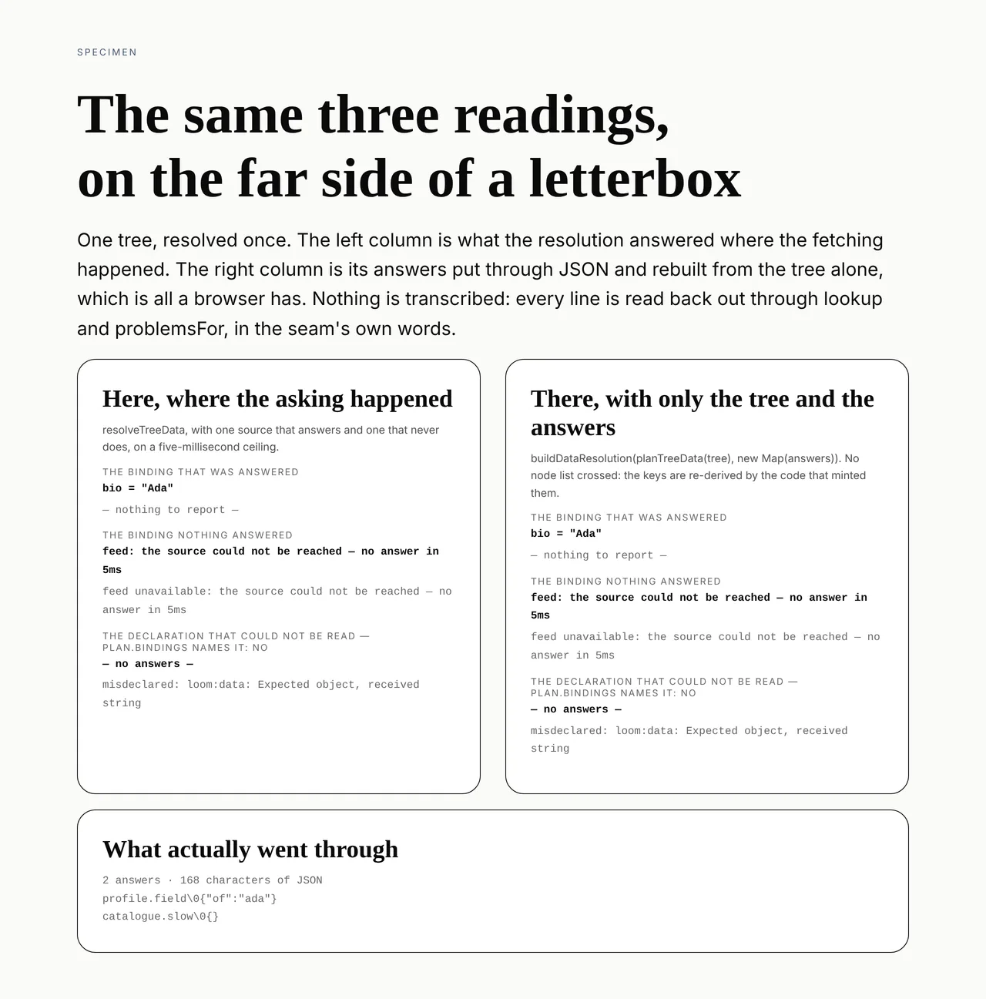

# The answers that can be sent

**Routine:** `Loom framework` · **Date:** 2026-10-15 · **Section:** §4 (the
binding seam) · **Branch:** `framework-74-the-answers-that-can-be-sent`



## What was completed

**A host that fetches in one place and renders in another can now rebuild the
readings it would have had, out of the package rather than out of a file it
wrote itself.** `resolveDataPlan` and `resolveTreeData` return `ResolvedData`,
which extends `DataResolution` with one field:

```ts
export interface ResolvedData extends DataResolution {
  readonly answers: DataAnswers   // readonly (readonly [RequestKey, DataAnswer])[]
}
```

The round trip is the tree and the answers, and nothing else:

```ts
const { answers } = await resolveTreeData(tree, { registry })            // where IO happens
const data = buildDataResolution(planTreeData(tree), new Map(answers))  // where the walk happens
```

This closes `Loom docs`' 12 October finding. A `DataResolution` is two
closures, a closure cannot cross from a server component to a client one, and
both halves of a serialisable seam already existed in the package with no way
between them: `buildDataResolution(plan, answers)` was exported and **nothing
public produced the map it takes**. `askOne`, the per-request step the ceiling
(0140) hangs off, is private, so a host could not assemble that map without
reimplementing the ceiling.

## The part worth reading: the guess, and why it is gone rather than easier

The documentation site wrote the workaround — `app/(docs)/_lib/data/carry.ts`,
thirty lines, tested, and carrying real readings. Its filing was precise about
which five lines were the problem: **which nodes to ask about.**

```ts
[...plan.bindings.map((b) => b.nodeId), ...plan.problems.map((p) => p.nodeId)]
```

Both lists, because a node whose `loom:data` could not be read **at all** lands
in `plan.problems` and never in `plan.bindings`. The filing records that this
took one red test to discover, and that a caller reaching for `bindings` alone —
the obvious thing to reach for — gets a carrier that silently drops every
misdeclared node's problem. The symptom is a page that renders without a
diagnostic it earned.

The fix is not a better node list. **It is that nodes are not what travels.**
Answers are keyed by request, planning is already a pure function of the tree
(0058), and the far side re-derives the keys with the same code that minted
them. There is no list to get wrong because there is no list.

The third row of the picture is that claim, measured: the label is computed, not
typed, and it reads `plan.bindings names it: no`, beside a rebuilt resolution
that still carries the node's `misdeclared` problem.

## Decisions I took that were not specified

**The field, not the shape the filing recommended.** The recommendation was
`resolveDataPlan` returning `{ resolution, answers }`. I refused it, and the
reason is the filer's own interest: that breaks **every** caller of
`resolveDataPlan` and `resolveTreeData` to serve the few that want the answers,
and `resolveTreeData` has about twenty call sites — the renderer, the specimens,
`tools/specimen/element.ts`, and the compiled teaching fences this very site
publishes. Extending the interface gives the identical field and migrates
nobody: `ResolvedData` is assignable to `DataResolution`, so a caller that only
renders reads nothing new. Shapes (2) and (3) from the filing are recorded as
rejected with their reasons in [0281](../decisions/0281-the-answers-a-resolution-was-built-from-are-published-as-data-and-the-far-side-re-plans.md).

**`resolveTreeData` widened too, not only `resolveDataPlan`.** The filing named
the lower-level entry point. The one-step helper is the one a host actually
calls, and the far side re-plans from the tree it is already rendering, so
withholding the field there would have meant writing `planTreeData` twice on the
near side for no reason. It costs nothing, since the widening is non-breaking in
both places.

**Pairs, not a `ReadonlyMap`.** `DataAnswers` is an array of pairs. The only
reason to publish these is that they travel, and `JSON.stringify` turns a `Map`
into `{}` and says nothing about it. A host that serialised one would send an
empty object, rebuild a resolution that answers nothing, and get a page of
`data-unresolved` diagnostics with **no hint that the answers were lost in
transit rather than never fetched** — which is the exact confusion 0281's
context section says this seam exists to prevent. `new Map(answers)` on the far
side is two words and is the one place the shape converts.

**`DataAnswer` is named.** `Result<JsonValue, DataUnavailable>` is now something
a loader has to write into its own return type, and a caller should not have to
spell out a structure for something the seam already has a word for.
`buildDataResolution`'s parameter was retyped to use it; it is the same type and
no caller moved.

**I did not touch `carry.ts`.** It is `Loom docs`' file, the old path still
works, and nothing forced a cross-lane edit. Filed back to that lane instead,
with what deletes and the one behaviour change to know about before they swap it
(below).

## What the tests prove, and how I know they prove it

Seven cases in `src/data/resolve.test.ts`, under *the answers a resolution was
built from*. The headline one compares a rebuilt resolution against a **live**
one at every node in the tree, through both accessors, rather than against
literals — so a field that started being filled from somewhere else would fail
it without anybody editing the test.

**Every case was checked by breaking what it tests.** Two mutations, both on
`resolveDataPlan`:

| what was broken | result |
| --- | --- |
| the answers folded away again (`answers: NO_ANSWERS`) | **4 of 7 fail** — the key listing, the round trip, the NUL byte, and the unavailable reading |
| only the answers that succeeded are carried (`.filter(([, a]) => a.ok)`) | **4 fail**, including `expected 'not-resolved' to be 'unavailable'` |

The second failure is the one worth quoting, because it is the whole argument
for carrying failures: a dropped failure does not come back as a missing answer,
it comes back as **the wrong diagnostic**. `not-resolved` tells a reader the
caller resolved a different plan; `unavailable` tells them a source did not
answer. One of those is actionable and the other sends somebody to look at the
wrong file.

Three of the seven are insensitive to both mutations, by design: they pin the
plan-side behaviour and the absence cases, which neither mutation touches.

The NUL byte is asserted rather than assumed. A request key is a source id, a
`\0`, and canonical params — legal in a JSON string and exactly the kind of
character a seam loses quietly. A seam that lost it would still produce two
matching columns of `not-resolved`, so the picture prints the keys beside the
readings and not instead of them.

## Test numbers

`pnpm install && pnpm verify` — **green**, exit 0. Status written to a file and
read in a separate command, for the reason the 12 October report gives about
believing a red tree is green through a pipe.

| suite | files | tests |
| --- | --- | --- |
| framework (`src/`, `tools/`) | 224 | 5,059 |
| application (`apps/loom`) | 327 | 5,797 |

10,856 in 551 files. **Seven are new**, all in `src/data/resolve.test.ts`.
`pnpm findings:check` reads 1,199 findings, 0 malformed. Prerender: 133 pages,
1,838 junctions, 0 run together. **Nothing failed, nothing was skipped, and no
test was weakened** — the two skip-shaped lines in the log are test *names*
containing the word, in the hold store.

The published surface moved by exactly three names — `DataAnswer`,
`DataAnswers`, `ResolvedData` — plus the three signatures that now spell them.
`pnpm --filter @loom/app docs:api` was run after a build and what it printed is
committed.

## Also done this run: #633 was un-mergeable

Fourteen commits had landed behind it. The one conflict was
`decisions/README.md`, which is generated: resolved by taking every row and
regenerating the index, which agreed with the hand-merge. `pnpm verify` green on
the merged head at 224/5,062 and 327/5,802, and pushed. **Nothing else about
that PR changed** — it is still parked on the maintainer for 0278, which is
`Proposed — ARCHITECTURAL` and not mine to land.

## Records

- **Added:** [0281](../decisions/0281-the-answers-a-resolution-was-built-from-are-published-as-data-and-the-far-side-re-plans.md),
  *The answers a resolution was built from are published as data, and the far
  side re-plans*. `Accepted`.
- **Superseded:** none. Nothing here contradicts 0058 or 0140; 0058 is the
  reason the far side can re-plan at all, and 0140 is the reason `askOne` stays
  private.

`pnpm decisions:index` run. It reports 0280 as claimed on a branch that has not
merged, which is #640, and 0277/0278 likewise, which is #633.

## Findings

- **Closed:** *a resolution is two closures, so the answers cannot be sent to
  the browser that renders them, and nothing public can hand them over*, filed
  by `Loom docs` on 12 October.
- **Filed:** *the carrier that forced 0281 can now lose its node derivation, and
  the five lines it called a guess*, for `Loom docs`.

One correction went into the closure, and it is to the owner line rather than to
the reading. The entry is filed against `Loom daily build`, and `src/data/` is
this lane — `src/` except `src/primitives/`. Nothing was blocked by it, since
the work is the same either way, but it sat three days in a queue whose owner
could not act on it. **The reading itself was right in every particular**,
including the one about `plan.bindings`, which is now a test.

## Open questions

1. **Whether a repointed binding should be detectable rather than only
   reported.** Re-planning a tree whose binding changed between the fetch and
   the walk produces a key the answers do not hold, and the walk says
   `data-unresolved` — correct, and preserved deliberately, since the answer in
   hand is the answer to a question that tree no longer asks. But a host cannot
   currently tell *that* case from "the caller resolved a different plan
   entirely", and on the documentation site the propose-a-change box makes the
   first one ordinary rather than exceptional. Nothing is blocked; it is the
   next thing that lane will feel.
2. **Nothing in the answers is filtered, and 0281 says so on purpose.** They are
   a `JsonValue` and a reason, as safe to send as the page they were fetched
   for, which is the host's judgement because the host chose the sources. If
   that should ever not be true, it is a decision about what a source may
   return, not a filter at this seam — a seam that quietly dropped fields would
   make `ready` mean something different on each side of the boundary.
3. **The specimen harness needs `playwright-core` from outside the repository**,
   which 0116 settles and which cost this run two commands to discover. It is
   working as designed; noting it only because every fresh session meets it, and
   the tool's own error message is what resolved it — which is the behaviour to
   keep.
