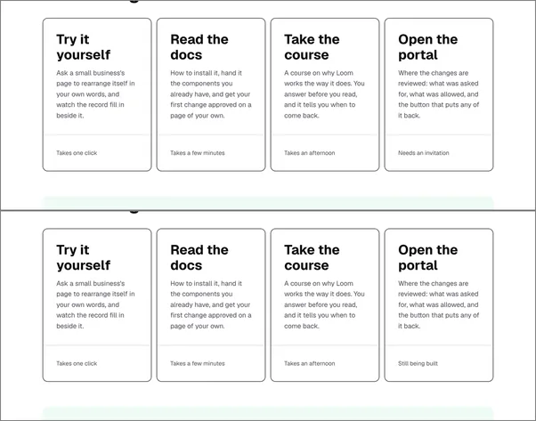
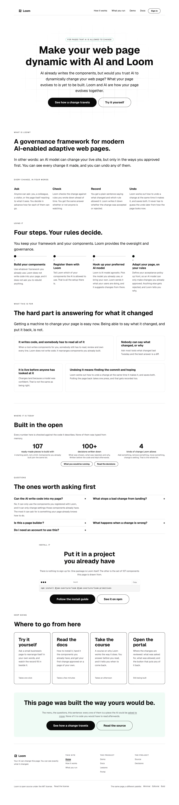
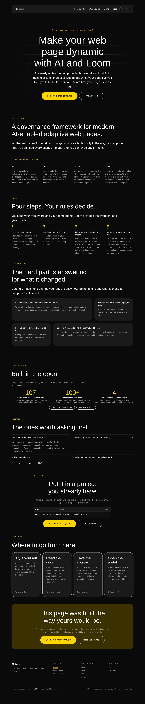

# 2026-10-15 — the door that is still being built

**Build order section:** §4d — the marketing site.

**Branch:** `marketing-05-the-door-that-is-still-being-built` (→ `main`), cut
from `origin/main` at `0c0126f`.

**No maintainer comment was outstanding.** This lane had no open pull request at
the start of the run; the five open ones belong to the framework and signals
lanes.

**Three words a visitor reads changed.** Everything else in this diff is the
check that keeps them true and the prose that had stopped being.

---

## What was found

I photographed every destination this site offers before choosing work, because
the brief makes the path into the rest of the product this lane's job and I had
not seen the far end of any of those links. Three of the four are finished. The
fourth is not, and nothing on this site said so.

| what the front door's card said | what the page it opens says |
| --- | --- |
| *Open the portal* — "Where the changes are reviewed: what was asked for, what was allowed, and the button that puts any of it back." **Needs an invitation** | **"The portal is still being built.** This is an early preview — screens are incomplete, some are missing, and what is here will change." |

The portal is offered four ways from this route group — the bar's *Sign in* on
every page, the front door's band of four cards, the footer's map, and the
questions band's answer about the door. **None of the four said it was
unfinished**, so it stood beside the demo, the documentation and the course as
though the four were the same kind of thing.

### The half that was already written, in the other lane

`(portal)/_components/under-construction.tsx` has carried that banner since
28 September, at the maintainer's direct instruction. Its own note names the
half it could not fix:

> *"The portal is reachable from the marketing site's menu and its footer — a
> stranger who follows Portal from the front door arrives at a working screen
> and has no way to know that most of what it will be is not built yet."*

That is a sentence about this route group, written in another one, three weeks
ago. The lane that owns the door told the truth about it. The lane that **sends
people there** never heard. It is the lane-boundary failure the split is
supposed to produce — a finding filed in the right place would have crossed it,
and a comment in a component cannot.

### Why *Needs an invitation* was the wrong three words, which is not the same as being false

It is a fair description of the finished portal, and the reasoning behind it is
good: the run that wrote it on 10 September was fixing *Costs you an account*,
which told a reader an account was a thing they could go and get. An invitation
is what a door somebody else opens actually asks for.

What it does is answer a question this reader does not get to ask yet. On the
one line where four destinations are compared — *Takes one click · Takes a few
minutes · Takes an afternoon · Needs an invitation* — it reads as the fourth
option's price, so a visitor prices the portal at "find someone to invite me"
and spends the click discovering the real answer is "there is not much there
yet". The invitation is true about next year and the wrong thing to say today.

---

## What shipped

**`notYet` on `SurfaceFacts`** — one optional sentence saying what is not built
yet behind a link, set on `PORTAL` alone.

**The portal's `cost` is now `Still being built`.** The invitation survives in
`door`, which is where somebody asking *can I get in* reads it, and which the
questions band renders.

**`PORTAL.notYet` is appended to the questions band's answer about the door**,
conditionally rather than typed into the string, so it cannot outlive the thing
it describes.

**`_lib/unfinished.test.ts`** (5 tests) holds the rule.

### Why this is sayable when `GuardedSurface` says the door is not

That type's note settles that this lane may not claim a door **opens**: whether
sign-in is configured belongs to the deployment, `(marketing)` does not import
`(portal)`'s auth config, and nothing here can see it. That is still true and
this change does not go near it — it is also why the preview's *"This portal
isn't set up yet"* is not something this site may mention.

**Whether a surface has been finished is a different fact.** It is a property of
this version of Loom rather than of the machine serving it, it is true wherever
the application is deployed, and the lane that owns the surface has already
committed it to the repository as a component. So the test reads it off the
repository — `(portal)` swept for `data-under-construction` — rather than
importing anything, inferring it from a screenshot, or retyping it.

### Both directions, which is the whole of why it is worth a file

A caveat is worth having only while it is true, and a caveat nobody removes is
how a site ends up apologising for something it fixed a year ago. So the two
assertions are a pair, and the failure names the field and the file:

```
/portal still carries data-under-construction in (portal), so site.ts owes it a notYet
/portal no longer carries data-under-construction, so delete notYet on it in site.ts
```

When `Loom portal` finishes and deletes its banner, this lane's build tells its
next run to drop the caveat. The marketing site's claim about another lane's
surface stops being something somebody has to remember.

It is the shape `named.test.ts` settled on for retired pages the day before,
applied to the other direction of the same problem — there, a page that is gone
and still named; here, a surface that is unfinished and not said to be.

### Checked against the bug it is about, not merely observed passing

Per the lesson this lane wrote down on 13 October, each rule was made to go red
against the thing it exists to catch, then restored:

| what I put back | what went red |
| --- | --- |
| `notYet` deleted | *"/portal still carries `data-under-construction` in (portal), so site.ts owes it a notYet"* |
| `cost: "Needs an invitation"` | *"expected 'needs an invitation' to contain 'built'"* — the live bug, caught |
| the marker reworded, standing in for the banner coming down | the self-check **and** the second direction, *"so delete notYet on it in site.ts"* |

**The self-check is load-bearing and is the one worth keeping.** Every other
assertion is of the form *the repository says X, so the copy must say Y*. The
day the sweep stops finding anything — a group renamed, the marker reworded,
the file moved — all of them pass, because nothing is unfinished and nothing
claims to be. The suite would go green by going blind.

**One thing the first draft got wrong.** The assertion that the sentence reaches
the page walked text nodes and failed, which was the useful failure of the run:
a `loom.faq` carries its question and its answer as **props**, so the questions
band renders about four hundred words that no text node in that tree holds.
Walking children alone, the assertion reads a front door with no answers on it —
and would have passed the day the band was deleted. `saidOn` reads string props
as well.

---

## The proof

The front door at 1280, full page, on `main`'s build before any edit of the run
and on this branch's build. The shot list is committed beside this report.



The harness measured the band rather than leaving it to the eye:

```
text=Still being built (2 of 2)  x 952 y 4803  195x22
text=Needs an invitation         no match
text=Takes one click             x 133 y 4803  195x22
```

Same `y`, same `195x22` box as the first of the four. **The four costs still
land on one line**, which is the property the 30 September run rebuilt this band
to get and the one a longer phrase here would have cost. `(1 of 2)` is the same
sentence inside the questions band's answer, which is where the longer version
is.



Photographed under `bold` as well as the house palette, and on a phone. No
hard-coded colour was added; nothing here names one.



---

## Real numbers

`pnpm install && pnpm verify`, exit code read out of a file written as the last
thing on its line:

```
Test Files  224 passed (224)      Tests  5052 passed (5052)    # framework
Test Files  328 passed (328)      Tests  5802 passed (5802)    # @loom/app
Test Files   52 passed  (52)      Tests  1414 passed (1414)    # app/(marketing)
1198 findings, 0 malformed
1832 visuals in reports/, 128.8MB, none over 1.1MB
133 prerendered pages, 1839 text junctions, 0 run together
EXIT=0
```

Nothing skipped, nothing weakened, no test deleted. This run adds one test file
and five tests to the route group, which is the whole of the difference from the
51 files and 1409 tests the 14 October report recorded.

**A note on the `@loom/app` total**, because it is lower than the 446 files and
8563 tests that report quoted and I did not cause it: the portal cut landed in
between, and `main` at `0c0126f` is *"Name the project when you register, and
stop sending people to deleted screens"*. Deleted screens take their tests with
them. I measured `main` green at that commit before editing anything.

### One thing that cost me fifteen minutes and was my own doing

The first build came back red with `newProjectId` missing from
`dist/store/index.js`, which looked like a broken `main`. It was not. I had cut
the branch from a stale `origin/main`, started the build, and then fetched and
reset the tree **while `tsc` was running** — so the declaration files were
compiled from the older source and `next build` typechecked the newer. A clean
`rm -rf dist apps/loom/.next` and rebuild was green.

Worth writing down because the harness reported that build as **exit code 0**.
It was the trap `docs/routines.md` names: the status of
`pnpm build > log 2>&1; echo "EXIT=$?" > file` is the `echo`'s. The file said
`EXIT=1` and the file was right. The rule works, and it only works if the file
is what you read.

---

## Findings

**Filed** — one entry, closed for this route group, with a row for
`Loom portal`: delete the banner in the same change that finishes the surface,
and this lane's build will tell its next run to drop the caveat. Nothing is owed
before that. The entry also records `data-under-construction` as a cross-lane
contract of one string, since that is now the thing the two lanes share.

**Closed** — nothing else. No open finding owned by this lane needed code.

---

## Open questions

- **Whether the bar should still say *Sign in* while the portal is unfinished.**
  It is the only filled control in the header, on every page, and it is the one
  placement that cannot carry a sentence. My recommendation is to leave it:
  the card and the questions band now say what is behind it, and taking the way
  in off the bar would work against the 18 August decision that access to the
  portal is through the marketing site. It is a one-word change (`inMenu`, and
  the bar's action) if you would rather it went.
- **Whether the marketing site should admit this at all.** Saying a surface is
  unfinished on a public front door is close to positioning, which is yours. I
  shipped it because you had already made the call behind the door on
  28 September and the stranger who meets that banner is the one this site sent;
  the alternative is a visitor who finds out by clicking. If you would rather it
  did not, delete `notYet` and the test will tell you the other two places to
  look.
- **The wording is a placeholder if you want it to be.** *Still being built* and
  *"Most of it is still being built, so there is not much behind the door yet"*
  are plain and avoid *coming soon*, which tells a reader nothing. They are
  mine, not yours, and they are the two strings to change.
