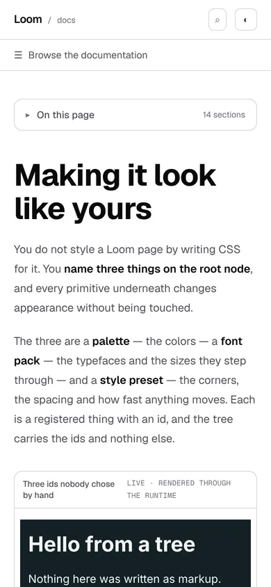
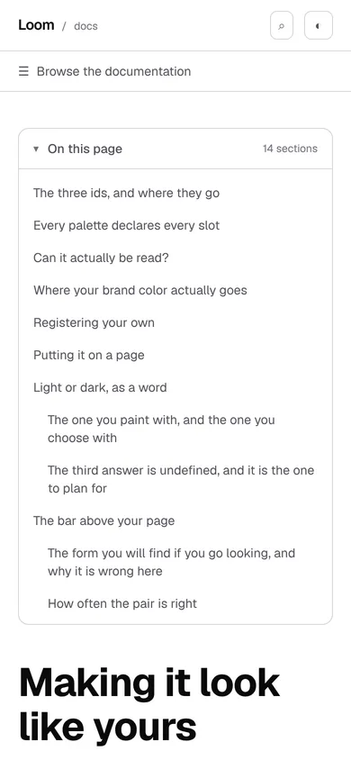
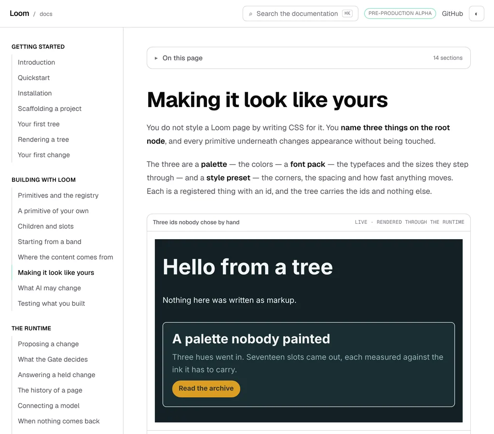
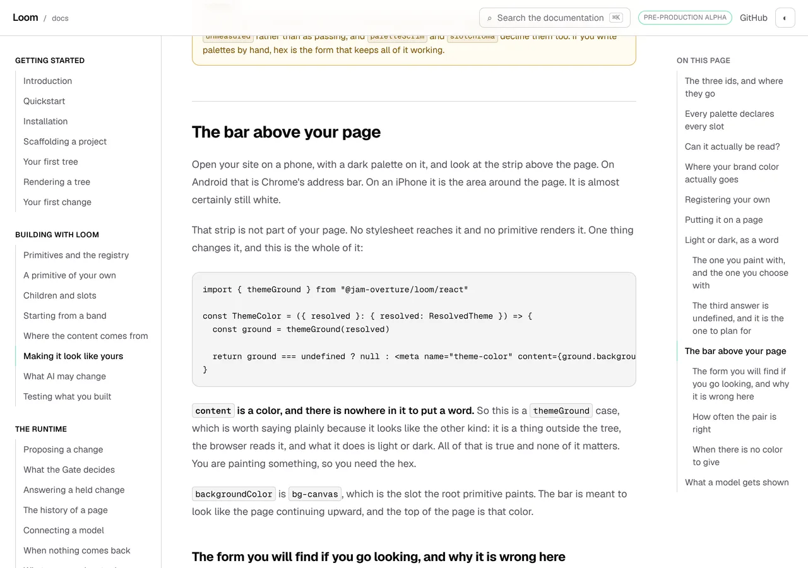
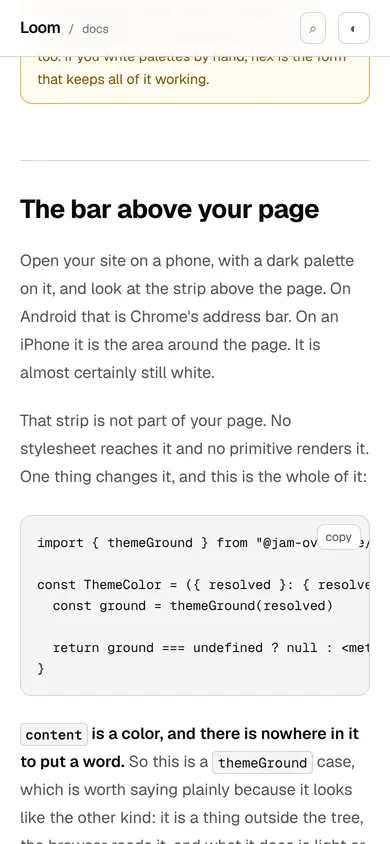
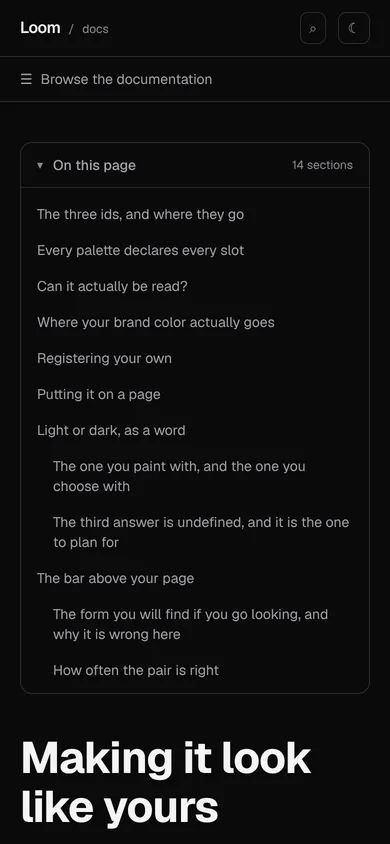
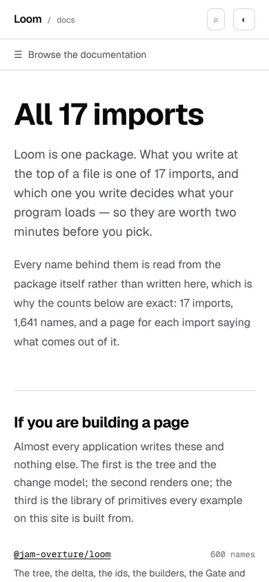

# 16 October 2026 — the contents a phone can open

**Routine:** `Loom docs` · **Branch:** `docs-57-the-contents-a-phone-can-open` ·
**Section:** §4c

No open pull request from this lane at the start of the run. Three were open —
#654, #649, #647 — none of them this lane's, and no maintainer comment
outstanding on any of them. Fresh branch off `origin/main` at `5b6c333` (#655).

## What this run is

Yesterday's rail lists a page's sections beside the prose at 1280 and above.
Below 1280 there is no room beside the prose, so there was no list at all, and
the report that shipped the rail said so and filed it:

> A phone reader of *Making it look like yours* gets 24,944 pixels of article
> and no way to see that it has fourteen sections in it, which is the reader
> this rail would help most.

That is closed here: the same rows, from the same walk, in the shape a narrow
screen can hold.

**And then the harness found something bigger.** A press of a contents row
became photographable this morning (0286, #653), so for the first time
something in this repository measured where a press actually lands a heading.
It lands at 160 pixels, not 80, and the rail's reading line was 120 — which
means pressing a row on the rail has been marking **the section above the one
the reader asked for**, on every page, since yesterday. That is the second half
of this unit and the more important one.

## What is on the site now

**A closed line above the article, at every width below 1280.** It says *On this
page* and how many sections there are, and it opens into them.





The rows are the rail's rows: the same walk of the rendered page, the same rule
for what counts as a section, the same ids. `use-page-sections.ts` is that walk,
lifted out of the rail so there is **one reading of the page under both
presentations** rather than two that could learn different rules about headings
on different days. It is `in-view.ts`' shape for the same reason.

**Closed to start with, because a reader came for the prose.** Fourteen links
between the title and the first paragraph are fourteen links in the way of the
thing they came for. Closed, the only thing the line can offer is a reason to
press it, which is the count — *14 sections* says the page has parts and roughly
how many. Without it the line is a label with nothing in it, and a reader has to
open it to find out whether it was worth opening.

**What is open is a page, not a flag**, which is `mobile-nav.tsx`' argument
applied to the second panel in the same layout. Both are mounted by the
documentation layout and survive every navigation inside it, so a boolean set on
one page would still be set on the next one. The state is which page it was
opened on, so every navigation closes it, including the ones that have not been
invented yet.

### Three readers, not one

| | contents | measured |
| --- | --- | --- |
| 390×844, a phone | the line | `x 20 y 142  350x46` |
| 1024×900, a laptop | the line | `x 304 y 97  672x46` |
| 1280×900 | the rail, unchanged | rail `x 1056 y 57  224x756`, line `0x0` |

The line is shown wherever the rail is not — `xl:hidden` against the rail's
`xl:block`, one decision written twice and both lines in `docs/layout.tsx` so
that moving the breakpoint moves both. The laptop under 1280 is the reader
nobody was counting: yesterday's finding said *phone*, and a 1024-wide window
has a left rail, no contents rail, and until today no contents at all.



The 1280 shot is the regression guard: `article.prose x 304 704 wide`, which is
the number yesterday's report recorded, and the line measures `0x0`.


## The defect the harness found

Yesterday's report ended with a picture it could not take:

> `pinNavigation` prevents the default on every click inside an `a[href]`, so
> that a three-step shot cannot silently photograph a different page. A
> same-page fragment is not a different page … Filed for `Loom daily build`
> with the remedy named.

That finding was met this morning. So this run pressed a row, and the harness
printed the one number nothing had ever looked at:

```
2026-10-16-…-phone-pressed  390x844@2x touch  scrollWidth 390 / innerWidth 390
    h2#the-bar-above-your-page  x 20 y 160  350x67
```

**160, and the reading line was 120.** Two declarations decide where an in-page
press lands and they add up: `globals.css` gives `html` a
`scroll-padding-top: 5rem`, which insets the top of the scrollport for every
in-page scroll, and it gives every prose heading a `scroll-margin-top: 5rem`,
which grows the box the browser scrolls to. 80 plus 80.

The rule for the mark is *the last section whose heading has gone past the
reading line*. A heading that lands at 160 has **not** passed a line at 120, so
the section the reader just asked for arrives unmarked and the mark stays on the
one above it.

**The test written to prevent this is the thing that let it through**, and its
own words say what it was for:

> A run that changes the header's height, and the heading's scroll margin with
> it, moves where a pressed row lands — and if the reading line does not move
> too, the symptom is that pressing a row marks the section *above* the one you
> asked for. Nothing else in this repository would notice.

It read `scroll-margin-top` out of the stylesheet, asserted there was exactly
one of them, and compared the line against 80. It never read
`scroll-padding-top`, so it was comparing the line against one of the two
numbers that make the landing — and 120 is above 80 and below 160, which is
precisely the window in which the test passes and the feature is wrong.

**Both halves are fixed here.** `READING_LINE_PX` is 184, which is 160 with 24
pixels of slack for a browser's rounding and a smooth scroll that stops a
fraction short. The guard now reads **both** declarations, sums them, and holds
each to exactly one rule — so a third declaration of either property fails on
the branch that writes it rather than being quietly averaged in.

And it is photographed, which is the part that was not possible yesterday. The
same press on the rail, after the fix:

```
…-wide-pressed  1280x900@2x  scrollWidth 1280 / innerWidth 1280
    h2#the-bar-above-your-page                             x 304 y 160  704x67
    nav[…] [aria-current='location']                       x 1072 y 540  184x32
    nav[…] a[href='#the-bar-above-your-page']              x 1072 y 540  184x32
```

**The marked row and the row that was pressed are the same box.** That is the
whole assertion, and it is the one the old number could not have satisfied: the
heading still lands at 160, and 160 is now above the line rather than below it.



## No row is marked in the narrow list, and that is also a measurement

A mark was built for the disclosure and taken back out before it shipped.

For a row to be marked, some `h2` has to be in the top 184 pixels of the screen.
For a reader to press the line, the line has to be on the screen. The line sits
above the page's title, so those two cannot both be true, and the gap is not
narrow: at the top of *Making it look like yours* the line is at `y 142` and the
first heading is at `y 881`, already 95 pixels **below the fold** of an
844-pixel screen. By the time that heading has come up to 184, the line is 573
pixels above the top of the window.

So a mark here is a row that could never light up, which is the same defect
`sectionBeingRead`'s second clause exists to prevent on the rail. It is taken
out rather than shipped, and a test holds the absence so the next run does not
rebuild it.

## A press leaves the list open, and the reason is the same arithmetic

Closing on press is the obvious behaviour and it is wrong here. The list is in
the document **above** the article, so closing it removes its own height from
above the reader at the moment the browser is scrolling them to a heading. Open,
the panel measures `350x552`; closed, `350x46`. A press that closed it would
drop the destination 506 pixels, which on a 844-pixel phone is most of the
screen and would put the section the reader asked for above the top of the
window.

Open, nothing moves and the heading lands where the stylesheet says it does —
`y 160`, which is the measurement above. What it costs is a panel still open if
the reader scrolls back to the top; what it buys is the press landing where it
said it would.



The line itself is `y -20605` in that shot, which is the harness saying the list
is 20,605 pixels above the window. That number is also the finding below.



Drawn in the tokens the rest of the chrome is drawn in — `--ink`, `--ink-muted`,
`--ink-faint`, `--edge` — and in the box `callout.tsx` already uses
(`rounded-lg border px-4 py-3 text-sm`), so there is no second palette and
nothing was written for the dark picture.

## Decisions taken that were not specified

- **Above the article rather than beside the mobile menu.** The finding
  suggested it would be decided better beside `mobile-nav.tsx`, and the reason
  it was not is a width: the menu bar is `lg:hidden`, so a disclosure inside it
  would leave the 1024-to-1279 reader with no contents at all. Above the article
  at `xl:hidden` covers all three readers and needs no page edited, because the
  layout already renders the article's wrapper.
- **Bounded at 60% of the screen, with its own scroller.** Open, the list wants
  596 pixels and gets 506. `mobile-nav.tsx` measured what an unbounded panel
  costs — 1,712 pixels of links laid into the document — and this is the same
  answer for a shorter list.
- **One walk, in `_components/use-page-sections.ts`.** The alternative was each
  presentation reading the page itself. The DOM reads stay out of `_lib`, which
  is DOM-free and is where the judgements are tested as pure functions of lists;
  `use-framed.ts` is the precedent for a hook in a components directory.
- **184 rather than 176.** 176 clears 160 by the 16 pixels the existing slack
  test asks for, and 160 is a figure a smooth scroll approaches rather than
  reaches. 24 pixels is a third of a line of prose and costs nothing.
- **The reference pages get no line**, which is the same outcome as the rail and
  for the same reason: their ids are on the `<section>` around the heading, so
  nothing matches. Measured at 390 wide: `no match`, and the prose starts at
  `y 142` with no band above it.



## Records

None added, none superseded. Nothing here touches the tree schema, the delta
model or an `Accepted` record. It is chrome — the exception 0067 names, beside
the sidebar, the search box and the pager — so it composes no primitives,
because it is furniture rather than content.

## Findings

**Three filed, one closed.**

Closed: *the contents rail is a desktop rail* (15 October), by this unit.

- *Both of a phone's navigations sit at the top of the document* — this lane's,
  the stated limit of what shipped. A reader two thirds of the way down a
  24,944-pixel page scrolls to the top to reach either list, because the line is
  out of the viewport within 188 pixels of scroll. `mobile-nav.tsx` has the same
  property, which is why it is one finding; the remedy is one bar that stays
  with the reader and holds both questions, and it is a unit of its own.
- *The line appears when the page's script runs, so the prose moves down 86
  pixels after the first paint* — this lane's, measured and shipped as it is.
  The rail has no such shift because the layout reserves its column; a line in
  the document has no column to reserve. Three remedies named, with the
  recommendation being to teach the layout which pages have nothing to list
  (the search index already knows) and only then reserve the height.
- *The contents list is now two elements with one accessible name* — this
  lane's, a hazard an instrument meets rather than a reader. Only one is ever
  displayed, which is the property that matters; both are in the DOM at every
  width, so a shot-list selector naming the list by its label matches two and
  gets the hidden one first. Today's list scopes with `#article`, which is free
  and not discoverable, which is what the entry is for.

## Test numbers

`pnpm install && pnpm verify` — **exit 0**, read out of a file written as the
last thing on its line, on a run with nothing beside it.

- framework: **229 files, 5,185 tests passed**
- application: **335 files, 5,917 tests passed**
- `findings:check`: 1,221 findings as the gate read them, 0 malformed (three more are appended below)
- `reports:check`: 1,861 visuals, none over 1.1MB
- `prerender:check`: 133 prerendered pages, 1,840 text junctions, 0 run
  together; 3 metadata conventions, 0 unserved

Nothing failed, nothing was skipped, and no test was weakened. **Eighteen tests
are new or changed**: fourteen in `_components/page-contents.test.tsx` over the
closed line, the count and its plural, what opens, what closes it, the pages
that get no line and the absence of a mark; three in `_lib/on-this-page.test.ts`
over the count's words; and the reading-line guard is rewritten to read both
declarations, with a fourth case asserting the sum is 160.

**A note on reading the gate.** The first run of `pnpm verify` on this branch
was green, and then the pressed-row measurement turned up the reading-line
defect, so the branch was changed and the gate run again from scratch. The
number above is the second run. Both were read out of the file rather than off
the session's own notification, which is `docs/routines.md`' rule and the reason
it exists.

## The preview

https://loom-git-docs-57-the-content-0851ba-jpizzolato36-6341s-projects.vercel.app

The two pages the pictures above are of:

- [/docs/building-with-loom/theming](https://loom-git-docs-57-the-content-0851ba-jpizzolato36-6341s-projects.vercel.app/docs/building-with-loom/theming)
- [/docs/api-reference](https://loom-git-docs-57-the-content-0851ba-jpizzolato36-6341s-projects.vercel.app/docs/api-reference)

**Taken from the `vercel[bot]` comment after opening the pull request, not
composed from the branch name**, which is the remedy the 16 October finding
*the composed preview URL, fifth instance* asks every lane to follow. It earns
its sentence here: the hash segment is `0851ba`, the branch segment truncates at
`docs-57-the-content`, and a guess would have had neither.

Not fetched from this container: `*.vercel.app` is denied by the environment's
egress policy, which is the open finding of 12 October and still true. Every
picture above was taken with `pnpm shoot --serve apps/loom` against the build
`pnpm verify` produced on this commit — `built 2026-10-16T14:00:51.270Z` for the
first six, and the rebuild for the pressed pair.
