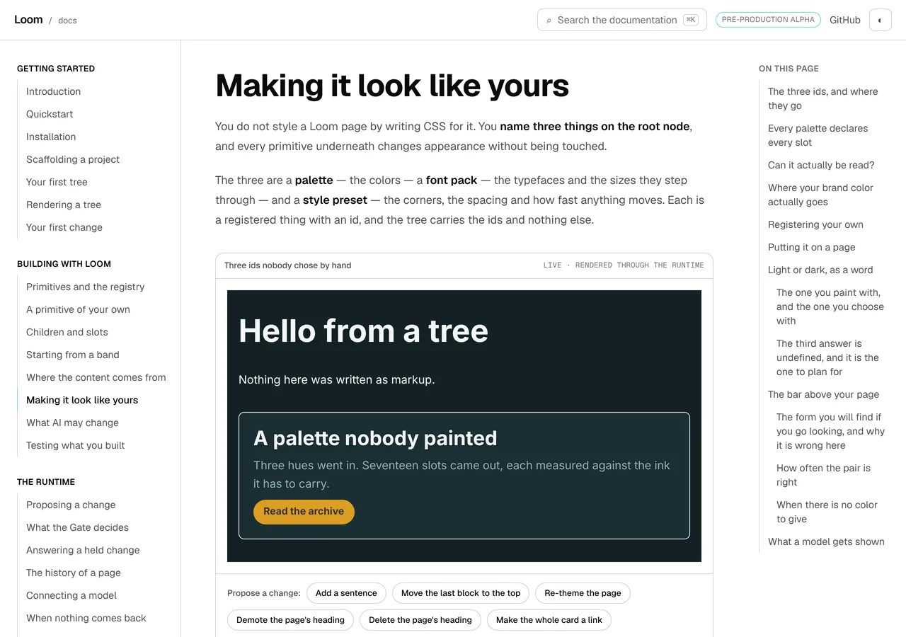
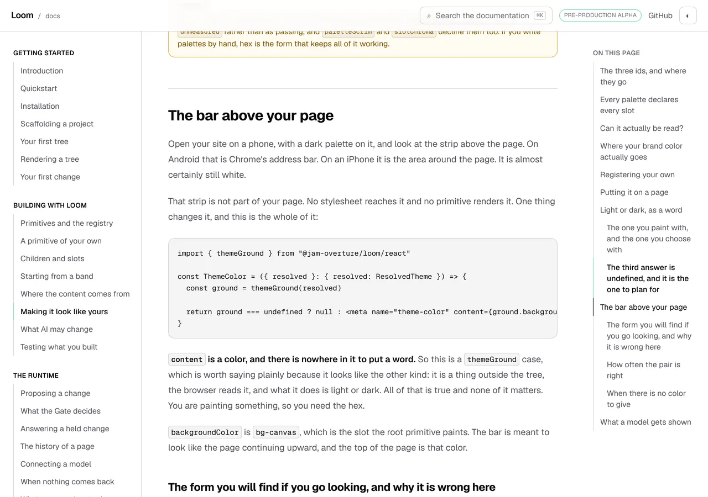

# The press that does not leave the page

**Date:** 2026-10-16 · **Routine:** `Loom framework` (`Loom daily build`) ·
**Section:** §1 (process — the screenshot harness) ·
**Branch:** `framework-75-the-press-that-does-not-leave-the-page`

## What was completed

A `do` list no longer refuses a press that stays on the page, and a press it
*does* refuse now says so beside the shot.

Until today the pin prevented the default on **every** click landing inside an
`a[href]`. [0159](../decisions/0159-an-instrument-may-reach-a-state-and-may-never-assert-one.md)
gives the reason in one sentence — *"a click on a real `a[href]` navigates, so
step two would run on a different page and the picture would silently be of
somewhere else"* — and the implementation was broader than the reason. A
same-page fragment does not navigate: `<a href="#the-bar-above-your-page">` sets
`location.hash` and scrolls, and step two runs on the same page in the state the
press produced.

So the pin now compares `new URL(href, location.href)` against `location.href`
on origin, path and query — *the same address ignoring the hash* — and lets a
pure fragment change through. Everything the pin was written for is kept: a
press that would leave is still refused, the listener is still capture-phase,
and it still calls `preventDefault` rather than `stopPropagation` so the page's
own delegated listeners see the click. An `href` that will not resolve is
refused, which is the safe reading of a thing nothing can classify.

Beside it, the half [the 5 October finding](../FINDINGS.md) called *smaller and
free*: `act` hands back the address of every press the pin refused, a shot
carries the `before`'s and its own in that order, and `describeShot` prints one
line per refusal under the same indent as every other reading.

## The picture

The state `Loom docs` could not photograph yesterday, taken twice at `wide` on
`/docs/building-with-loom/theming` — once on arrival and once after pressing the
contents row for *The bar above your page*.

| arrived | the row pressed |
| --- | --- |
|  |  |

The two readings are the evidence, and the left-hand one is the reading that
lane quoted when it filed the finding:

```
2026-10-16-framework-contents-row-arrived-wide  1280x900@2x  scrollWidth 1280 / innerWidth 1280
    nav[aria-label='On this page'] [aria-current='location']  no match
    h2#the-bar-above-your-page  x 304 y 14136  704x67  ← 13303 past the fold
2026-10-16-framework-contents-row-pressed-wide  1280x900@2x  scrollWidth 1280 / innerWidth 1280
    nav[aria-label='On this page'] [aria-current='location']  x 1072 y 468  184x72
    h2#the-bar-above-your-page  x 304 y 160  704x67
```

The heading went from 13,303 pixels past the fold to `y 160`, parked under the
header, and the rail's mark exists where there was `no match`. The control shot
reproduces the old reading to within the 19 pixels the page has grown since: the
press is the only variable.

The other half, on the same page, pressing the pager instead — a link that does
leave:

```
2026-10-16-framework-press-refused-wide  1280x900@2x  scrollWidth 1280 / innerWidth 1280
    pinned  http://127.0.0.1:42879/docs/building-with-loom/what-ai-may-change  ← press refused, it leaves the page
    a[rel=next]  x 662 y 455  346x70
```

That shot is not kept — the picture is of a docs page and the **line** is the
artefact. It is the line two runs needed and did not have.

## Decisions taken that were not specified

**The comparison is origin, path and query, not origin and path.** The same path
asked a different way is a different page and the server decides that, not the
harness: `?x=2` is a navigation whatever the document does with it.

**An unresolvable `href` is refused.** The finding did not name the case. The
property being kept is that a press never changes the subject of a shot, and an
address nothing can parse is not evidence that it would not.

**The refusals are read once after the last step, not after each press.** A
reading per press would buy the step's own selector at the cost of a round trip
on every click in the repository, and the address identifies the link.

**The pin moved to `tools/specimen/pin.ts`, alone.** This is a testing decision.
Both functions are serialised with `Function.prototype.toString` and run in a
page, so the string that ships is the artefact and the module Vitest compiles is
not it — the trap `start-state.ts` was rewritten around. The test that can see
the difference compiles the module with esbuild and `keepNames` and asks *that*
module its questions, which it can only do for a module with no imports to
resolve. `playwright.ts` has four. It has a cost, below.

**`ShotResult.pinned` is required and `DescribableShot.pinned` is optional**, so
the hand-built shape lesson 32 passes `describeShot` does not have to learn a
field to keep printing the line it prints today.

**What was deliberately not built:** `{ "goTo": … }`, the step that *means* to
navigate. It is the other half of the 5 October finding, it is
`ARCHITECTURAL — needs review` for the reason that finding gives — 0159 would
want a line — and a `Proposed` record cannot travel in the same pull request as
a change that should merge, because `Loom merge` skips any branch carrying one.
That is the same split #647 is sitting in.

## Records

**Added
[0286](../decisions/0286-a-pinned-press-is-one-that-leaves-the-document-and-the-harness-says-which-presses-it-refused.md)**
— *A pinned press is one that leaves the document, and the harness says which
presses it refused.* `Accepted`.

It **refines 0159's pin clause and does not supersede it**, and the judgement is
worth stating because the escalation rule turns on it: 0159's stated reason is
that step two would run on a different page, which a fragment press does not
cause, so this is that record's own reason applied where its implementation was
broader. The filing lane reached the same conclusion in writing — *"it does not
require reopening the pin"*, *"it keeps every property the pin was written for"*.
If the maintainer reads a narrowed consequence as a contradiction, this should
have been `Proposed` and is his to turn back.

Nothing superseded. `pnpm decisions:index` regenerated.

## Findings

**Closed:** *a shot cannot photograph a press of a contents row, because the
harness refuses every link and a fragment is not a navigation* (15 October,
filed by `Loom docs`) — taken as the entry wrote it.

**Half closed:** *a `do` list pins the page against anchor clicks…* (5 October,
filed by `Loom docs`). The *smaller and free* half is done. The entry stays open
for `{ "goTo": … }` and its status now says so.

**Filed:** *lesson 32's census lost its fourth row, and four paragraphs under it
are about that row*, for `Loom lessons` — below.

## The cross-lane edit, and why

`lessons/32-layout.md`, three lines of one fence. Exercise G prints every
top-level const in `playwright.ts` that is handed to the page; `pinNavigation`
moved out of that file, so it prints three rows where it printed four, and
`pnpm verify` went red naming the lesson.

The fence's own `moves:` mark asks for exactly what was done — *"re-run the
exercise and paste in what it prints now. Then say so on the pull request"* —
and this is that sentence. The numbers were produced by re-running the
exercise's own program against this tree, not edited by hand: `11 → 10`,
`4 → 3`, and the `pinNavigation` row gone. One more word, in the *Try it*
instruction two hundred lines above — *"the lines to predict hardest are the
**four** that say what each function handed to the page takes"* — which
`claims.test.ts` holds to the fence and which is now `three`. That check is the
reason this correction is mechanical rather than a judgement: it named the
sentence, the count and the remedy.

**The mark also predicted the cost and it landed.** Four paragraphs under that
fence are prose about the row that disappeared, and one sentence of the lesson's
thesis is now false as written — *"a function that fetches its own subject
cannot be run anywhere but a page"*, which `pin.test.ts` falsifies by handing a
`JSDOM` to the **process** instead of to the function. No check reads prose, so
it is filed for `Loom lessons` with the three places named rather than fixed
from outside the lane. It is a better observation than the sentence it breaks
and it is that lane's to make.

## Test numbers

`pnpm verify` **green**, the gate read from a file written as the last thing on
its own line.

| | |
| --- | --- |
| root suite (`src/` and `tools/`) | **5,185 passed**, 0 failed, 229 files |
| `tools/specimen` within it | **212 passed** (was 192) |
| `tools/specimen/pin.test.ts` | **15 passed**, new |
| `apps/loom` suite | **5,879 passed**, 0 failed, 333 files |
| findings sweep | 1,218 findings, 0 malformed |
| reports sweep | 1,857 visuals, none over 1.1MB |

Two reds on the way, both in `apps/loom` and both the lesson fence below rather
than this change: `transcripts.test.ts` on the three moved lines, then
`claims.test.ts` on the number word in the sentence above them. Both named the
file, the line and the remedy, and both are green.

**The new tests fail against the predicate that shipped yesterday.** Restoring
the old body — refuse every anchor press — turns 5 of the 15 red, which is the
check that they are a guard rather than a description: *lets a press of a
same-page fragment through*, *lets a press through when the target is inside the
anchor*, *lets the same address with a fragment on it through*, *lets an empty
fragment and a bare href through*, and *records every refused press in the
order they were made*.

Two of the 15 are about the artefact rather than the behaviour: no `__name`
wrapper survives into either function the page runs, and both bodies write and
read the exported `PINNED_PRESSES` name. The first is the trap that cost
`start-state.ts` a rewrite, now held for the pin as well.

Nothing was skipped and nothing was weakened. One devDependency added,
`@types/jsdom`, because the test builds a `JSDOM` as a value — the module was
already a devDependency and only its types were missing.

## Open questions

1. **`{ "goTo": … }`** — the 5 October finding's open half, and the thing a lane
   photographing a journey across a navigation still cannot do. It needs a line
   in 0159 and therefore a ruling.
2. **Does a narrowed consequence of an `Accepted` record need `Proposed`?** This
   branch says no and says why. #647's third question is the same shape from the
   other end, and one answer would settle both.
3. **Two pictures in this repository are of a reader scrolling where their lane
   wanted a reader pressing.** Both are retakeable now and neither is this
   lane's.
