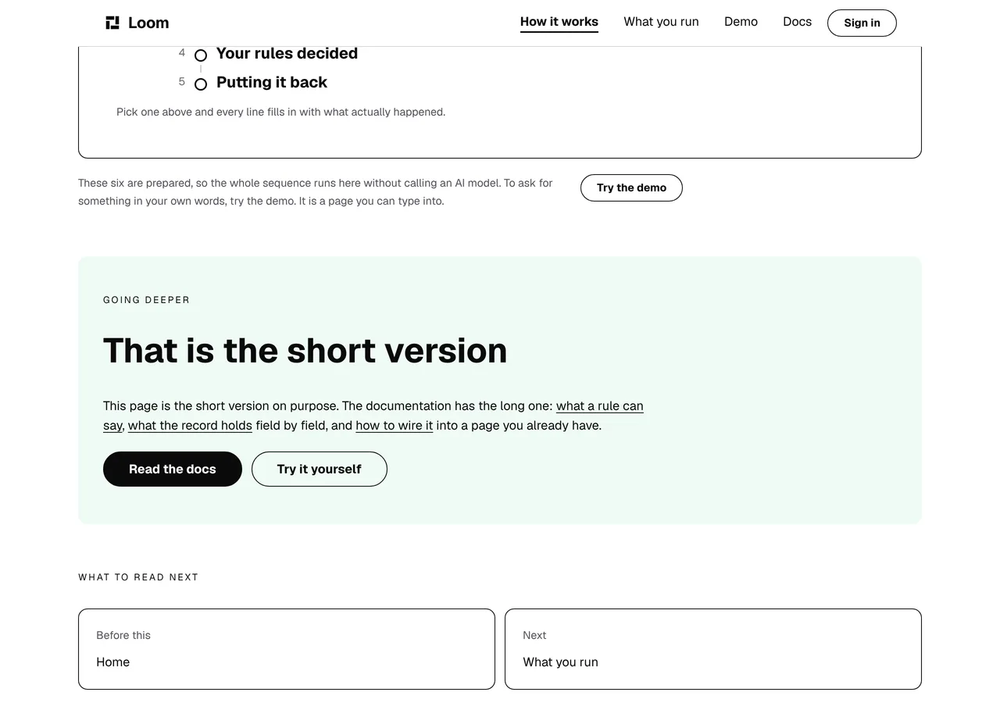
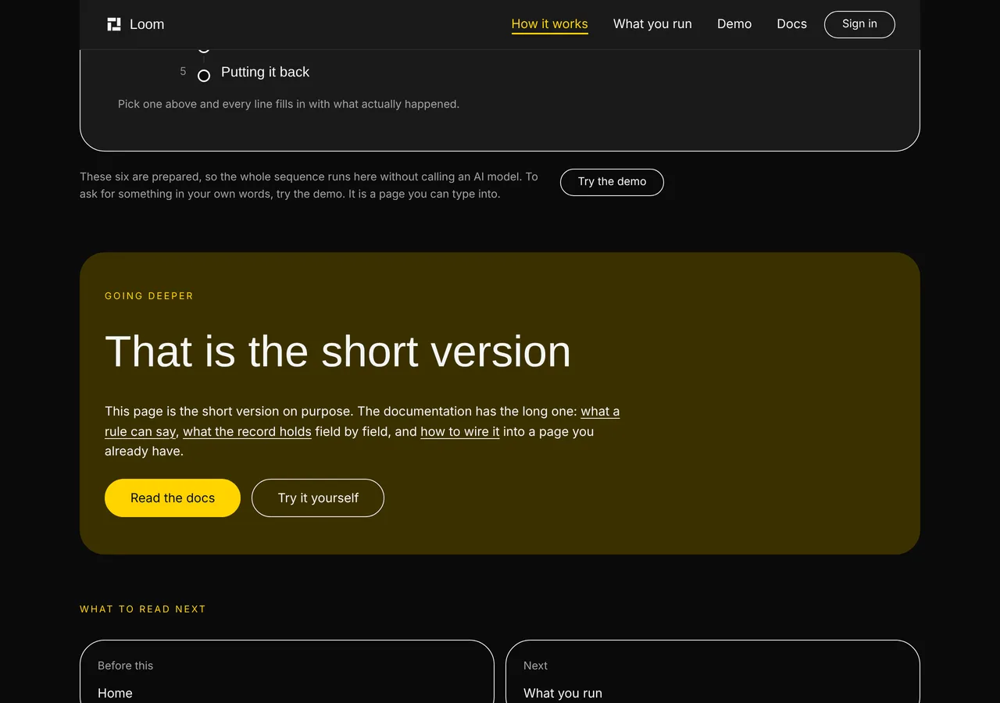
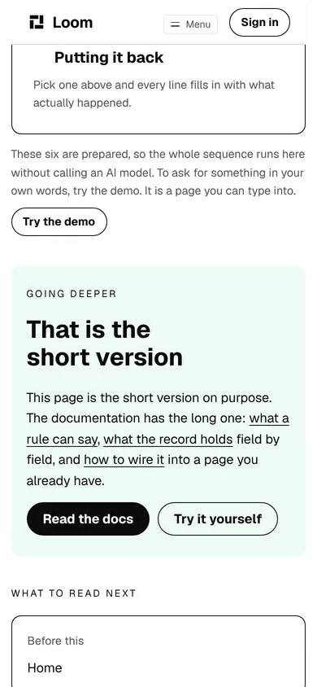
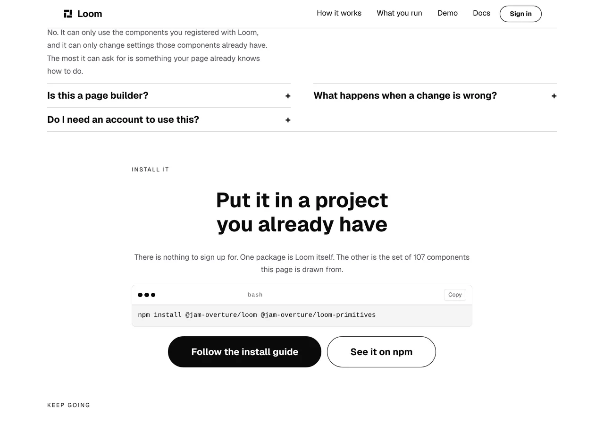

# 2026-10-16 — the install guide the button missed

**Build order section:** §4d — the marketing site.

**Branch:** `marketing-06-the-install-guide-the-button-missed` (→ `main`), cut
from `origin/main` at `825d3cb`.

**No maintainer comment was outstanding.** This lane had no open pull request at
the start of the run; the four open ones belong to the framework and signals
lanes.

**One button went to the wrong page and three clauses became three links.**
Everything else in this diff is the check that stops the next one going wrong
quietly.

---

## What was found

The brief makes the path out of this site and into the rest of the product this
lane's job rather than an afterthought, so I followed the links. Four controls
on this site point into the documentation:

| where | what it says | where it went |
| --- | --- | --- |
| `/` install band | **Follow the install guide** | `/docs` |
| `/` band of four cards | Read the docs | `/docs` |
| `/how-it-works` closing band | Read the docs | `/docs` |
| `/what-you-run` closing band | Read the docs | `/docs` |

**`/docs` is not a page.** By the documentation lane's own decision it is a
redirect — *"a second front door written in MDX would be a second place to keep
the same sentences true"* — so it opens the first page of the documentation in
reading order, which is **Introduction**. *Installation* is the third page after
it.

So a reader on the front door who had just been shown

```
npm install @jam-overture/loom @jam-overture/loom-primitives
```

and pressed the button offering the longer version of it landed on a page about
what Loom is, and had to find their way to the command from there. Nothing was
broken and nothing was red: the link worked, the page it opened is a good page,
and it was not the page the button named.

The same shape, one page over. `/how-it-works` has ended on this paragraph since
26 September:

> *"This page is the short version on purpose. The documentation has the long
> one: what a rule can say, what the record holds field by field, and how to
> wire it into a page you already have."*

Three specific pages' worth of documentation, named in a sentence, under a
single button to the front of all of it. Each of the three is a real page. A
reader who wanted the third one got the first page of a documentation site that
has thirty-one written pages in it.

### Why there was nothing to catch either of them

This lane filed exactly that on **4 October**, as a stated limit rather than a
defect:

> *"A link to `/docs#something` is checked for nothing… Both are true today and
> both were checked by a person. Nothing would say so if either stopped being."*

What it did not say, because nobody had followed the link, is that one of the two
claims it named **was already costing a reader a click.**

---

## What shipped

**`_lib/docs-pages.ts`** — the documentation pages this site names, as data.
Four of them, each carrying its path, the heading a reader lands on, and the
phrases the page must still contain for this site's promise about it to be true.

**The install control goes to the page with the command on it.** `/docs` is
still offered twice on the front door — the card in the band of four, and the
footer's map — so nothing was taken away from a reader who would rather start at
the beginning.

**The three clauses on `/how-it-works` are the way to the three pages**, as
inline links inside the sentence. **Not one word of the copy changed.** The
clauses were already the phrases a reader would press; they are pressable now.
*Read the docs* stays under the paragraph, because the sentence names the
documentation and `naming.test.ts` requires the band that names a page to offer
the way there.

**`_lib/docs-pages.test.ts`** (20 tests) holds four rules, and the third is the
one with teeth.

1. **A page this site names is an address this application serves.**
2. **It is headed the way this site says it is.**
3. **No link on this site goes into the documentation at an address that is not
   on the list.** Without this one the other three check a list rather than the
   site, and the next run to type a path into a band gets no check at all —
   which is the state the site was in this morning.
4. **The page still carries what this site sent the reader for.**

### Read off the repository, not imported

The 4 October finding asked for a surface to publish the list of things it
promises to carry. **That is still the better shape and it is still `Loom docs`'
to build.** What this does instead is the route the 15 October run took for the
portal's under-construction banner: a documentation page is an MDX file with its
own heading at the top of it, so both things this site promises about those
pages are in that file. Nothing in `(marketing)` imports `(docs)`, renders it,
or asserts over its chrome.

**The remedy for a red build here is in this lane and the failure says so.** If
a documentation run rewrites one of the quoted sentences, the honest answers are
to point the link somewhere else or to reword the promise, and both of those are
in `(marketing)`:

```
/docs/the-runtime/what-every-ask-leaves-behind no longer says "what it remembers",
so either point the link elsewhere or reword the promise
```

Nothing in this route group may edit `(docs)` to get green.

### The two normalizations, and why they are load-bearing rather than defensive

A quoted phrase is matched against the page's source with the emphasis markers
dropped and the whitespace collapsed. That looks like belt-and-braces and it is
not: the documentation's prose is hard-wrapped at about eighty columns, and one
of the five phrases is quoted out of the middle of a bold run.

Measured by taking each normalization out:

| taken out | what went red |
| --- | --- |
| collapsing the line breaks | **3 of 5** phrases — every one longer than four words |
| stripping the emphasis markers | **2 of 5** |

A check written without them would have passed only the short claims and would
have looked exactly like one that worked.

---

## Checked against the bug it is about, not merely observed passing

Per the lesson this lane wrote down on 13 October, every rule was made to go red
against the thing it exists to catch, then restored.

| what I put back | what went red |
| --- | --- |
| the install control pointed at `/docs` | *the control that offers the install guide → goes to the page with the command on it* — **the live bug, caught** |
| a declared path nothing serves | *is an address this application serves*, and three more |
| a heading the page does not have | *is headed the way this site says it is* |
| a phrase the page no longer carries | *still carries "what it forgets"* |
| a deep link into `(docs)` that is on no entry | *lands on a page this site has written down* |
| the three inline links taken off the page | *found the deep links this run put on the site* |
| the extraction pointed at a directory that does not exist | *was read, so the checks below are looking at something*, ×4 |

**One thing the falsification corrected, and the docblock was rewritten rather
than kept.** The self-check's first draft claimed that a broken extraction would
make the heading and phrase rules *pass* on an empty string, which is the shape
`unfinished.test.ts` is about. Pointed at a directory that does not exist, this
file goes red eight ways instead — neither a heading nor a quoted phrase is
found in nothing. What the self-check actually buys is the **reason**: without
it, those eight failures all read as though the documentation lane had rewritten
four pages, which sends the next run to read somebody else's route group when
the thing that moved is this file.

---

## Two other lanes' files, and neither is this lane's

Both are inside `(marketing)`, so the lane boundary holds, but both are checks
this run did not write and had to widen.

- **`_lib/pages/pages.test.ts`** held *every internal link is a page of this
  site or a surface's front door*. There is a third kind now — a named page
  inside another route group — so the rule has a third arm, which is a **list
  and deliberately not a prefix**: `/docs/anything-at-all` would pass a prefix
  test and 404.
- **`_lib/balance.test.ts`** refuses to classify a container it has not seen,
  which is the right way round. A paragraph with more than one pressable phrase
  in it is new to this site, so `loom.prose` joins the containers that are not a
  row of equal cells — the children are words in one line of text, they wrap
  wherever the measure ends, and asking three clauses of one sentence to be the
  same length is the opposite of the rule that file holds.

---

## The proof

Both bands on this branch's build, photographed with the band scrolled into
view rather than full-page, because what changed is three phrases inside one
paragraph and a full-page shot of a 4,700px page shows them four pixels tall.
The shot list is committed beside this report.



The harness measured the three rather than leaving them to the eye:

```
a[href="/docs/building-with-loom/what-ai-may-change"]        x 132 y 509  692x47
a[href="/docs/the-runtime/what-every-ask-leaves-behind"]     x 164 y 534  159x21
a[href="/docs/the-runtime/what-your-app-has-to-do"]          x 455 y 534   99x21
a[href="/docs"] (2 of 3)                                     x 132 y 578  178x45
```

The first box is `692x47` and the other two are one line each, which is the
first link wrapping across the line break after *what a rule can* — ordinary in
prose and the reason the three were not built as a row of controls. The fourth
line is *Read the docs*, still under the paragraph at `y 578`.



No hard-coded color was added and nothing here names one: the links take the
paragraph's own color and are underlined at rest, which is what
`loom.inline-link` exists for.



And the control this run was about, on the front door:



```
a[href="/docs/getting-started/installation"]  x 356 y 712  325x66
```

---

## Real numbers

`pnpm install && pnpm verify`, exit code read out of a file written as the last
thing on its line:

```
Test Files  228 passed (228)      Tests  5165 passed (5165)    # framework
Test Files  334 passed (334)      Tests  5899 passed (5899)    # @loom/app
Test Files   53 passed  (53)      Tests  1434 passed (1434)    # app/(marketing)
1218 findings, 0 malformed
1859 visuals in reports/, 130.9MB, none over 1.1MB
133 prerendered pages, 1840 text junctions, 0 run together; 3 metadata conventions, 0 unserved
EXIT=0
```

Nothing skipped, nothing weakened, no test deleted. The route group was 52
files and 1,414 tests on 15 October; this run adds one test file and 20 tests,
and the other 19 arrived with the portal caveat the day before.

**The gate was run twice and the second one is the one quoted.** The first
finished green and I then edited two docblocks in `docs-pages.ts` — a measured
number and a correction the falsification had forced. Comments cannot change
behavior, which is exactly the kind of reasoning the 15 October run's fifteen
lost minutes were about, so the tree that is committed is the tree the numbers
came from rather than one two comments away from it.

---

## Findings

**Filed** — one entry, which closes the `/docs` half of the 4 October finding
and leaves its `/demo` half open with the question stated. The 4 October entry's
own status now points at this one.

**The row for `Loom docs`:** nothing is owed. Four of their pages are quoted by
name and a phrase out of each is asserted against their source, so rewriting one
of those sentences turns this red in their run — and **the remedy is in this
lane, which the failure message says.** If they would rather publish the list
their own finding asked for, this file is four constants and a sweep and should
be deleted the day they do.

---

## Open questions

- **Whether the front door's command and the install guide's should match.**
  The band prints `npm install @jam-overture/loom @jam-overture/loom-primitives`
  and the page it now opens prints
  `pnpm add @jam-overture/loom @jam-overture/loom-primitives react react-dom`.
  Neither is wrong — the documentation is writing for somebody starting from
  nothing and this band's whole heading is *put it in a project you already
  have*, which already has React — but a reader who copies one and then reads
  the other has to work that out. I did not change either, because which
  package manager this project's front door speaks is a positioning-adjacent
  call and the extra packages are the documentation lane's. My recommendation is
  to leave them and say nothing; the alternative is one sentence under the
  command.
- **Whether a claim about another surface's *behaviour* is one this lane may
  hold.** `/what-you-run` says of the demo *"It is a page you can type into"*,
  which is the other half of the 4 October finding and is not a claim about
  words on a page. Checking it means this lane asserting that `(demo)` renders
  a text input, which is nearer to testing another lane's work than quoting its
  prose is. My recommendation is that this is the first claim that genuinely
  needs the publishing shape that finding asked for, from `Loom docs` and
  `Loom demo` both.
- **Nothing here is positioning and no copy was invented.** The only words that
  changed on the site are an `href`. The sentence on `/how-it-works` is the one
  that has been there since 26 September.
