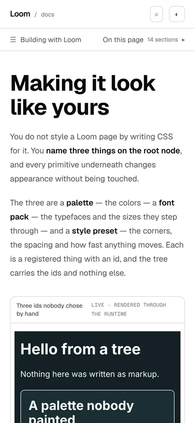
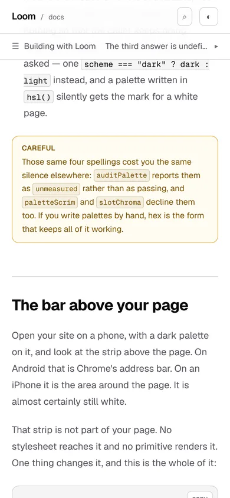
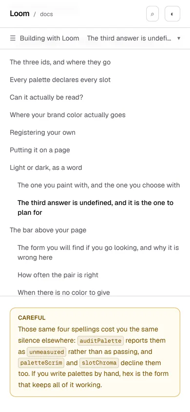
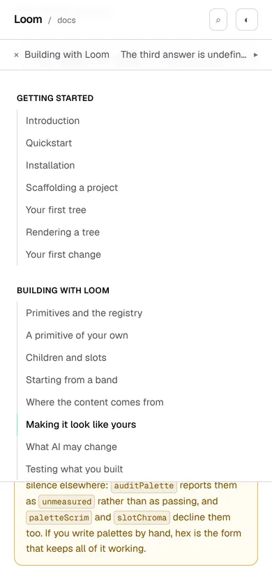
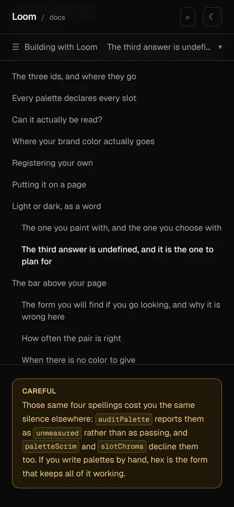
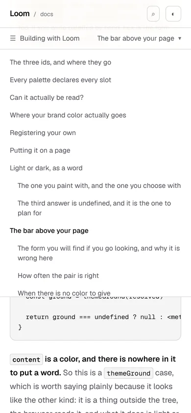
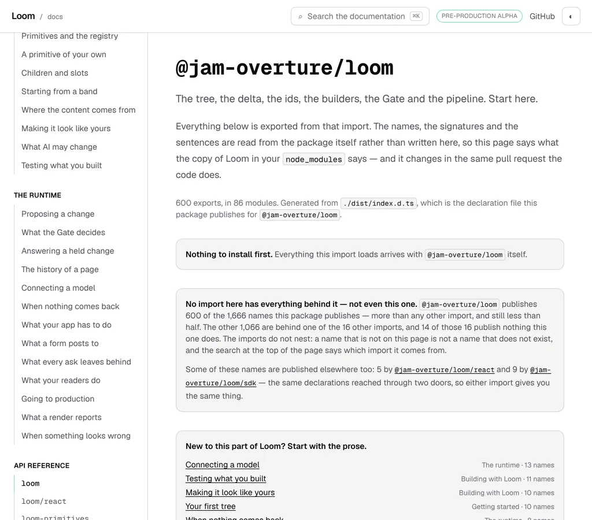

# 17 October 2026 — the bar that stays with the reader

**Routine:** `Loom docs` · **Branch:** `docs-58-the-bar-that-stays-with-the-reader` ·
**Section:** §4c

No open pull request from this lane at the start of the run. Five were open —
#662, #661, #660, #659, #647 — none of them this lane's, and no maintainer
comment outstanding on any of them. #660 touches `docs/deployment.md` at the
repository root rather than the `(docs)` route group, so nothing here collides
with it. Fresh branch off `origin/main` at `c446b12` (#658).

## What this run is

Yesterday's unit gave a narrow screen the contents of the page it is on, and
ended by filing the thing it could not do:

> A reader two thirds of the way down a 24,944-pixel page has to scroll to the
> top of the document to reach the list. `mobile-nav.tsx` has exactly the same
> property … **The remedy is one bar that stays with the reader and holds both
> questions.**

That is this. Both of a phone's navigations are now one bar under the header
that does not scroll away, and because the bar is chrome the layout can reserve,
the 86-pixel shift filed beside that entry is gone too. Two findings closed, two
filed.

## What is on the site now

**One bar, under the header, at every width below 1280.** It holds the two
questions a reference site has to keep answering, and it answers both of them
without being pressed.



On the left is the section of the site you are in. On the right is the section
of the **page** you are in, which changes as you scroll. Pressing either opens
it.

That second label is the whole reason the bar is worth a row of a phone's
height. A bar that permanently said *Browse the documentation* and *On this
page* would spend the one persistent row on two nouns; this spends it on where
the reader actually is, twice:



```
…-phone-scrolled  390x844@2x touch  scrollWidth 390 / innerWidth 390
    #article > div:first-child                      x 0 y 56  390x45
    button[aria-label='Browse the documentation']   x 20 y 56  143x44
    button[aria-label='On this page']               x 179 y 56  191x44
    h2#the-bar-above-your-page                      x 20 y 468  350x67
```

The bar is at `y 56` with the page scrolled thousands of pixels, which is the
measurement the whole unit is about: yesterday the same list was at `y -20605`.

### What each one opens




Both are bounded scrollers rather than stretches of document — `390x506 holding
560` for the contents and `390x591 holding 1808` for the rail — which is the
measurement `mobile-nav.tsx` established and the reason the rail can scroll
itself to the page you are on (`[aria-current='page'] x 24 y 593`, inside the
panel) instead of dumping you 938 pixels below the fold.

**Only one can be open.** The state is *which panel, on which page*, so opening
one closes the other by construction rather than by an effect that has to
remember to, and every navigation closes both — which is the property
`mobile-nav.tsx` was built around, because this is mounted by the layout and
survives a route change.



Drawn in the tokens the rest of the chrome is drawn in. The one thing written
for the picture is that **a panel is opaque where the closed bar is
translucent**: the bar borrows the header's `bg-surface-page/85` and blur, and
the first version let the prose show through forty-five links. That was visible
in a screenshot and in nothing else.

## A press of a row now lands where it did, and the mark is on it



```
…-phone-pressed  390x844@2x touch  scrollWidth 390 / innerWidth 390
    #article > div:first-child                      x 0 y 56  390x551
    h2#the-bar-above-your-page                      x 20 y 160  350x67
    button[aria-label='On this page']               x 199 y 56  171x44
    nav[aria-label='On this page'] [aria-current]   x 20 y 453  350x36
```

**`y 160`** is the number yesterday's run measured for the first time, and it is
unchanged here — which it had to be, because the reading line that decides which
row is marked is chosen against it. The closed label now reads *The bar above
your page*, the marked row is the row that was pressed, and the panel is left
open because closing it would take its own height out from above the reader
mid-scroll.

### The mark exists here at all, and that is new

`page-contents.tsx` built one and took it out again, with a measurement for a
reason: the line sat above the page's title, so *a reader who could see it was a
reader with no heading anywhere near the top of the window*, and the mark could
never light up. Being sticky is exactly what changes that. The bar and the
reading line are on screen together at every scroll position, so the rule the
rail uses means the same thing here — and it is the **same hook**, lifted out of
`on-this-page.tsx` into `use-page-sections.ts` beside the walk that was already
shared. One walk, one measurement, two presentations.

## The 86-pixel shift is gone, and the way it went is the recommendation

The 16 October finding offered three remedies and recommended *3, then 1*. That
is what shipped.

**`_lib/contents/pages.ts` is the set of addresses that have sections**, read
off the pages' own markdown at build time. The layout reads it and hands it to
the bar, so whether there is a contents control is settled in the HTML the
server sends, and the prose below the bar does not move when the walk finishes.

The objection to this is the right one and the answer is a single line: **it
says whether there is a list and never what is in it.** `on-this-page.ts` argues
at length that the rows have to come out of the rendered document, because two
*Architecture* pages get most of their headings from a component and a list
compiled from the source would show five rows for a page with thirteen places to
land. All of that still holds. A page whose markdown has one `##` has at least
one section however many more a component adds, so the markdown answers *are
there any?* exactly, which is the only question a layout needs. The rows still
come from the walk, on every page, unchanged.

The one page shape that would break it — a written page with no `##` of its own
— does not exist, and `contents/pages.test.ts` holds that it does not, naming
the page if one ever appears.

### Which is also why the reference pages get no empty band

Remedy 1 on its own would have put a permanent blank band above the seventeen
generated pages at the widths where vertical space is scarcest. It does not,
because the bar has no height of its own: its row is as tall as the controls in
it, and a generated page between 1024 and 1279 has neither.

| | the bar | the page's first line |
| --- | --- | --- |
| written page, 1024 | `x 256 y 57  768x45` | `article.prose x 304 y 142` |
| reference page, 1024 | `x 256 y 57  768x0` | `h1 x 304 y 97` |



`768x0`, and the border stands down with it — that last part is the one thing
that does not follow from a collapsed row, because a border is a pixel tall
whatever is above it.


The laptop under 1280 is the reader yesterday's run added and this one keeps:
the bar sits inside `main` rather than above the whole row, so at 1024 it starts
at `x 256` and spans the page rather than crossing the site's rail.

### And 1280 is unchanged


```
…-wide  1280x900@2x  scrollWidth 1280 / innerWidth 1280
    #article > div:first-child                       x 0 y 0  0x0
    article.prose                                    x 304 y 97  704x17197
    aside:has(nav[aria-label='On this page'])        x 1056 y 57  224x844
```

`article.prose x 304 … 704 wide` is the number the last two reports recorded.
The bar measures `0x0`.

## The defect this would have introduced, and what it cost to not introduce it

`scroll-padding-top` insets the top of the scrollport for every scroll the
browser performs itself — a fragment, a search result, a press of a contents
row, and the one that is easy to forget: **moving focus to something off screen
with a keyboard.** It was `5rem`, 80 pixels, which cleared a 57-pixel header.

The bar makes the chrome 102. So shipping the bar and nothing else would have
left a keyboard reader tabbing down a long page with the link they just focused
half-hidden behind it, on every page, at every width below 1280 — the same
quiet, specific kind of wrong as yesterday's reading line.

It is `7rem` now, 112 against 102. **The heading's own `scroll-margin-top` came
down from `5rem` to `3rem` by the same amount**, so a press still lands a heading
at `y 160` — which is the photograph above — and the reading line stays one
number for every width rather than becoming a function of the viewport.

What that bought at 1280 and above, where there is no bar, is a focused element
landing 112 pixels down instead of 80. Nothing is worse off.

## Decisions taken that were not specified

- **The bar is inside `main`, not above the whole row.** Above the row it would
  have to span the site's rail at 1024–1279, or the rail would have to be told
  to start lower. Inside `main` it spans the page at every width and the rail is
  untouched.
- **The short label is held whole and the long one truncates**, which is the
  opposite of what flexbox does on its own and was decided by looking at the
  picture. At 390 the row has 334 pixels to share and the two labels want 146
  and 243, so one is cut whatever the rule is. Cut from the left,
  *Building with Loom* becomes *Building …*, which names nothing; cut from the
  right, a section title becomes *The third answer is undefi…*, which a reader
  can still place.
- **The count stays, and waits for the walk.** *14 sections* is what the closed
  control says before the reader has reached a heading, which is the state it
  was written for. It cannot be sent by the server, because only the walk can
  count — so the server sends *On this page* and the number joins it. That moves
  the label's width and nothing else, and it is filed below.
- **Both components are deleted rather than kept beside the bar.** The finding
  said the remedy was a restructuring rather than an addition, and two
  presentations of one contents list at two breakpoints would have been a third
  element with the same accessible name.
- **One extra tab stop after the skip link.** `Browse the documentation` used to
  be above `main` and so before the skip link's target; it is inside `main` now,
  so a keyboard reader who skips to the page tabs past two controls rather than
  one. Both are closed, so it is two stops and not forty-seven.

## Records

None added, none superseded. Nothing here touches the tree schema, the delta
model or an `Accepted` record. It is chrome — the exception 0067 names, beside
the sidebar, the search box and the pager — so it composes no primitives,
because it is furniture rather than content.

## Findings

**Two closed, two filed.**

Closed, both filed by this lane on 16 October:

- *both of a phone's navigations sit at the top of the document* — by the bar.
- *the line appears when the page's script runs, so the prose moves down 85
  pixels* — by `_lib/contents/pages.ts`, which is remedy 3 and then remedy 1,
  the recommendation that entry made.

Filed:

- *the chrome is 102 pixels tall and the only thing that knows so is a number
  typed into a test* — this lane's. All three of `scroll-padding-top`,
  `scroll-margin-top` and the reading line are right today, and nothing would
  notice them stop being. The guard asserts the inset clears 102, and 102 was
  read off a screenshot: no test converts `h-14` or `py-3` into pixels. **It is
  the next instance of the genus yesterday's defect belonged to** — a test that
  reads a number its subject does not supply passes while the subject moves away
  from it. Three remedies named, the recommendation being a declared chrome
  height shared by the stylesheet and the components, as a unit of its own.
- *the bar's height is settled before the browser runs and its right-hand
  label's width is not* — this lane's, the stated limit of what shipped and the
  half of the 16 October entry this unit did not close.

Two standing entries that this run met again and did not duplicate:

- **`nextjs.org` is still unreachable**, by `WebFetch` (`ENOTFOUND`) and by
  `curl` (`CONNECT tunnel failed, 403`). The 15 October entry is open and
  accurate; this is its fourth recorded instance and wants no new entry.
- **The reference pages carry the heading's id on the `<section>` around it**
  (15 October), which is why those seventeen pages have no contents control in
  the bar. They carry their own list inside the article, so a reader there is
  not without one — but it is in the document rather than in the bar, which is
  the shape the bar exists to improve on. Unchanged by this unit.

## Test numbers

`pnpm install && pnpm verify` — **exit 0**, read out of a file written as the
last thing on its line, with nothing else running beside it.

- framework: **231 files, 5,269 tests passed**
- application: **335 files, 5,945 tests passed**
- `findings:check`: 1,230 findings, 0 malformed
- `reports:check`: 1,879 visuals, none over 1.1MB
- `prerender:check`: 133 prerendered pages, 1,842 text junctions, 0 run
  together; 3 metadata conventions, 0 unserved

Nothing failed, nothing was skipped, and no test was weakened. **Thirty-three
tests are new or changed**: 28 in `_components/docs-bar.test.tsx`, 4 in
`_lib/contents/pages.test.ts`, and one added to the reading-line guard for the
scrollport inset. Twenty-six went with the two deleted components; everything
those two held that is still true is held by the 28 above, and what is not is
the absence of a mark, which this unit removes deliberately.

**A note on reading the gate.** The numbers above are the **third** run, and it
is the one on the complete tree — every edit, the ten stored visuals, this
report and the four findings included. The first was abandoned mid-way when the
stylesheet changed under it. The second was green and is not quoted, because the
photographs taken after it led to two changes in the bar's markup, and a gate
run before a change is not a gate run on it. Every exit code here was read out
of a file written as the last thing on its line, rather than off the session's
own notification, which is `docs/routines.md`' rule and the reason it exists.

## The preview

https://loom-git-docs-58-the-bar-tha-557866-jpizzolato36-6341s-projects.vercel.app

The two pages the pictures above are of:

- [/docs/building-with-loom/theming](https://loom-git-docs-58-the-bar-tha-557866-jpizzolato36-6341s-projects.vercel.app/docs/building-with-loom/theming)
- [/docs/api-reference/runtime](https://loom-git-docs-58-the-bar-tha-557866-jpizzolato36-6341s-projects.vercel.app/docs/api-reference/runtime)

**Taken from the `vercel[bot]` comment after opening the pull request, not
composed from the branch name**, which is the remedy the 16 October finding
*the composed preview URL, fifth instance* asks every lane to follow. The hash
segment is `557866` and the branch segment truncates at `docs-58-the-bar-tha`;
a guess would have had neither.

Every picture above was taken with `pnpm shoot --serve apps/loom` against a
build of this commit — `built 2026-10-17T14:22:13.003Z`. Not fetched from this
container: `*.vercel.app` is denied by the environment's egress policy, which is
the open finding of 12 October and still true.
