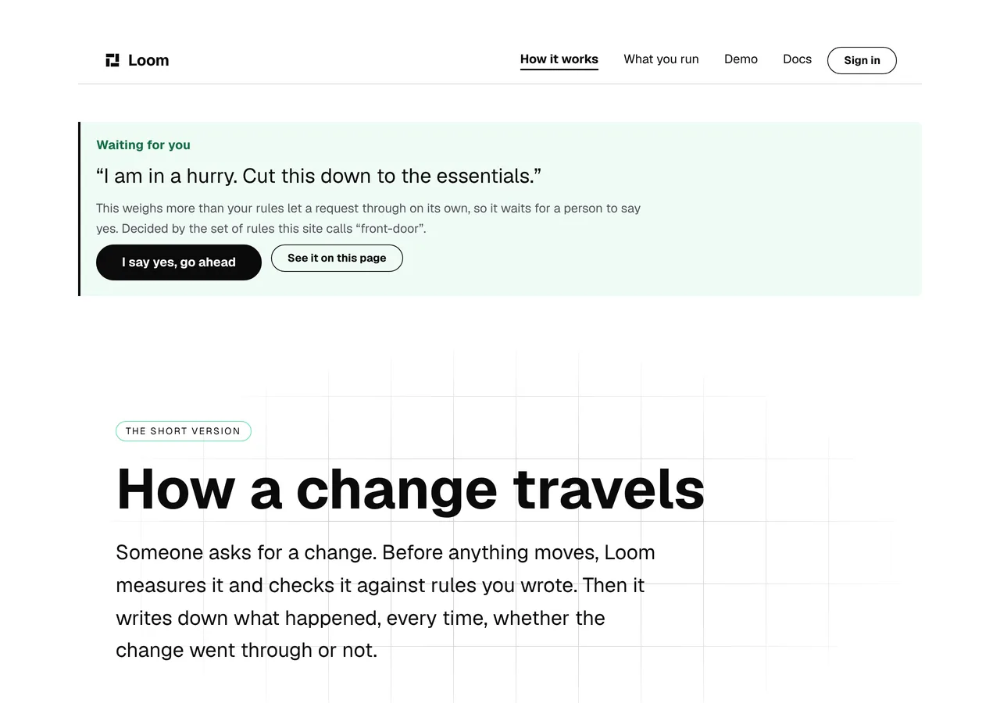
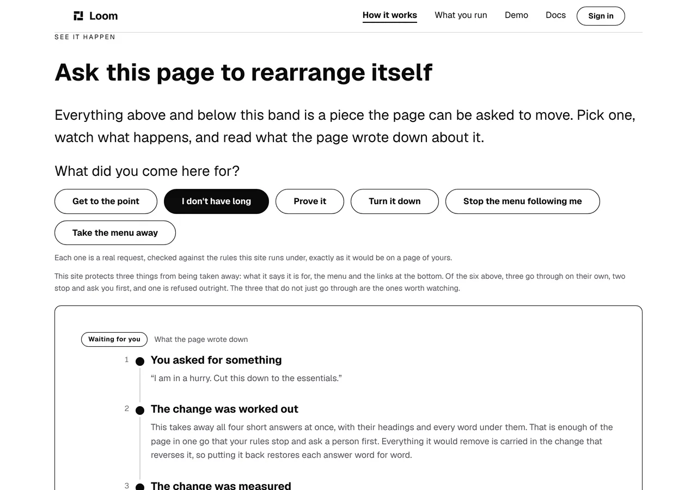
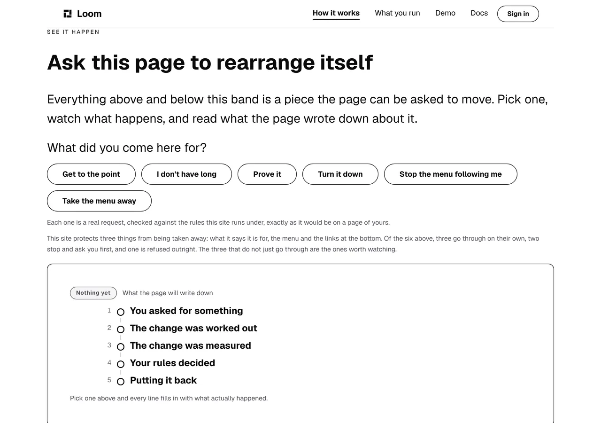
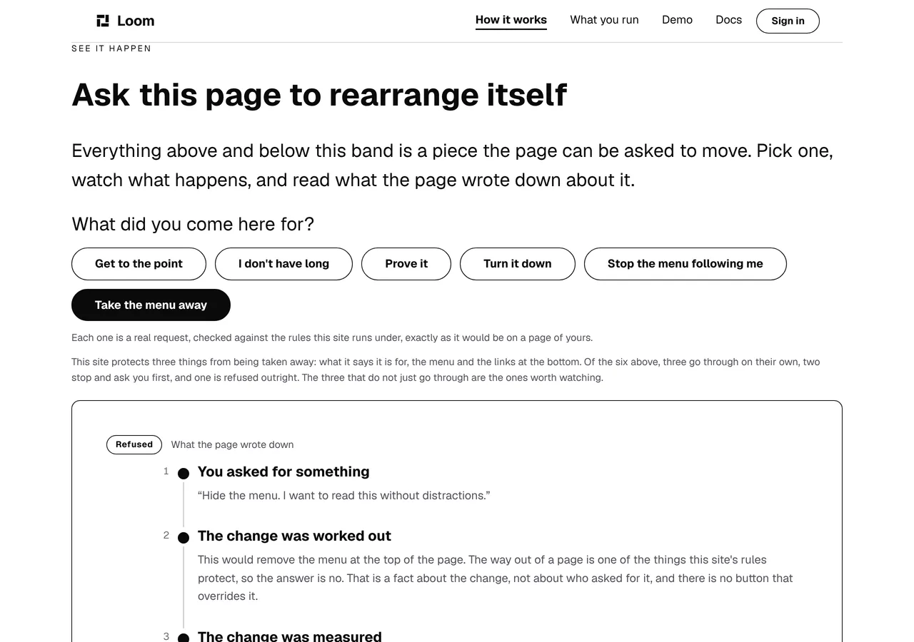
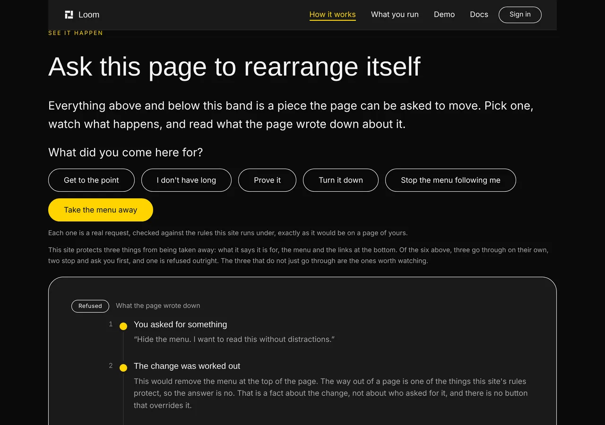

# 2026-10-17 — the chip that said nothing happened

**Build order section:** §4d — the marketing site.

**Branch:** `marketing-07-the-refused-chip` (→ `main`), cut
from `origin/main` at `c446b12`.

**No maintainer comment was outstanding.** This lane had no open pull request at
the start of the run; the four open ones belong to the framework, signals and
portal lanes. The findings queue had one entry owned by this lane that was still
open and is addressed at the foot of this report; everything else owned here is
closed or is a note rather than an ask.

**The site has one band where it stops describing the product and runs it, and
that band had two ways of saying six things.** This run gives it three, files
the reason it cannot have more, and leaves a rule behind that will not let the
next run quietly go back to one.

---

## How the work was chosen

I built the site and looked at it, because the brief says this surface exists to
be looked at and is judged by eye. Three pages, both palettes, wide and phone,
band by band. Most of it is in good order: the front door reads well, the four
steps and the stat band hold up, and the fluid ramp that landed on 13 October
has fixed the phone that the 13 October report called bad.

What did not hold up is on `/how-it-works`, which is the one page where a
visitor sees the product work rather than reading about it. Press one of six
requests and a panel fills in with what was asked, what was worked out, how much
moved, which rule decided and what putting it back would restore. The panel's
headline is a badge carrying the verdict in two or three words.

**There are five verdicts and the badge had two treatments**, because it was
asked a boolean:

```ts
props: { tone: record.landed ? "accent" : "outline" }
```

Read off the built page at `c446b12`, that is:

| the page is in this state | the chip says | and wore |
| --- | --- | --- |
| nothing asked yet | Nothing yet | `outline` |
| `problem`, `proof`, `calmer` | Allowed | `accent` |
| `shorter`, `unstick-menu` | Waiting for you | `outline` |
| the same two, approved | You said yes | `accent` |
| `drop-pitch` | **Refused** | **`outline`** |

So *your rules said no*, *your rules are waiting for you to decide* and *nobody
has asked this page anything* were one plain pill with a different word at the
end of it.

The one that costs something is **Refused**. Saying no, and saying which rule
said it, is what `docs/rollout.md` records as the differentiator — *"plenty of
things change a page with AI; Loom can say what changed, who asked, which rule
allowed it, and how to undo it."* At a glance it was dressed exactly like the
page having done nothing at all.

### The same screen contradicting itself

It is worse than a flat chip, and this is the part that is not a matter of
taste. `answer.ts` exports `toneFor` and argues it over twenty lines: the band
at the top of an answered page wears the accent **if the visitor can still act
on it**, which is why a held change gets it. That band is where the button is.

The panel 3,260 pixels below asked a different question and nobody had written
down that it was a different question. On `/how-it-works?ask=shorter` — one
request, one verdict, one screen:



```
text=Waiting for you (1 of 2)  x 123 y 176   1037x21
text=Waiting for you (2 of 2)  x 149 y 3436   122x27
```



`toneFor`'s own comment says it was exported so that the predicate *"lives here,
once, rather than being restated in a file nobody reads beside this one."*
`see-it-happen.ts` is that file, and it restated it.

---

## What shipped

**The badge is a table over the verdict**, exhaustive by the type system rather
than by anyone remembering, and it spends the three treatments on the three
answers a reader is actually asking for:

| the answer | verdicts | treatment |
| --- | --- | --- |
| the page changed | `landed`, `approved` | `accent` |
| your rules stepped in | `held`, `refused` | `outline` |
| the page is as it was | `nothing-to-do`, and no request at all | `neutral` |

```ts
} as const satisfies Record<Verdict, "accent" | "neutral" | "outline">
```

A sixth verdict added to `record.ts` now fails to compile here rather than
silently joining whichever side of a boolean it falls on.

**The treatments are spent the way the primitive defines them.** `loom.badge`'s
own docblock says `outline` *"sits on a coloured surface where a filled badge
would fight it"* — the panel is not a coloured surface, so `outline` was doing
no work and is now free to mean one thing: your rules stepped in. `neutral`
*"classifies quietly"*, which is exactly what *Nothing yet* is for.

**`toneFor` is untouched.** It answers a different question and it answers it
correctly; the fix was to stop a second file guessing at it.

### What a visitor actually sees move

One chip, and I would rather say that plainly than dress the diff up. **The
unasked panel's badge is the only pixel on this site that changed.**




The separation is made by moving *Nothing yet* out of the way rather than by
making *Refused* louder, because `outline` is the more assertive of the two
non-accent treatments and the rules having stepped in is the more assertive
thing to say. *Refused* is unchanged:





---

## The proof, and the five shots that did not move

Six addresses photographed on a production build of the branch, then the same
six on a production build of the same tree with the old boolean put back.

```
refused          identical
refused, bold    identical
refused, phone   identical
allowed          identical
waiting for you  identical
nothing yet      differs
```

Five of the six came back **byte-identical by `md5`**, so the only variable in
the sixth is the thing being argued about. That also states the limit of what
shipped honestly: `held` and `refused` still wear one treatment, and the next
section is why.

---

## What this lane could not do, and filed instead

**There is no tone in this library that means no.** Counted rather than
recalled:

- `loom.badge` registers `accent`, `neutral`, `outline`. None of the three is a
  refusal.
- **Seventeen `tone`, `state` and `variant` enums across seventeen primitives,
  twenty-three distinct members between them, and not one means no.** No
  `critical`, `danger`, `warning`, `caution` or `negative` anywhere. The nearest
  is `loom.perk-list-item`'s `excluded`, whose own comment says it is for a tier
  showing what it lacks — an absence, not a refusal.
- **And a primitive could not paint one if it wanted to.** `paletteSlotSchema`
  declares **seventeen** slots — four surface, four foreground, three accent,
  two brand-secondary, four border — and not one is a status colour. Every
  palette must declare every slot, so this is a schema change reaching every
  registered palette, not one prop list.

`toneFor` hit the same wall months ago and wrote it down — *"the library has no
red and that is a recorded decision, so a refusal cannot be painted as a
refusal."* This lane has now hit it from the other direction and got the same
answer, which is what makes it worth a finding rather than a shrug.

Filed for `Loom primitives` with the slot half for `Loom daily build`, with
three shapes costed and a recommendation. **Not worked around here**, because the
workaround is a component of this lane's own and 0067 does not allow one — and
because a mark meaning *refused*, chosen by one surface, is a vocabulary nobody
else shares.

---

## What is held, and one assertion that was holding the wrong thing

**`_lib/pages/verdict.test.ts`** (6 tests) reads the dressing **off the built
page**, never off the table that decides it. Five rules:

1. Every answer the panel can give is a treatment this deployment's registry
   actually validates — asked of `siteRegistry.validateProps` with the node's
   own type and the node's own props, so a badge that grew a second prop is
   checked too.
2. **An answered page is never dressed like one that was asked nothing.** This
   is the live bug.
3. A change that landed is never dressed like one that did not — held against
   `record.landed`, which the rules write and this route group does not.
4. The two predicates disagree about a held change, and agree about every change
   that landed. Written because they are four hundred lines apart in two files,
   return overlapping types, and the obvious tidy-up is to delete one.
5. The chip these rules read is the chip the route actually serves. They read
   `askRunFor`'s own tree, because it hands back the record beside it and running
   the sequence twice to learn one boolean is the waste this page was measured
   for on 13 October — which is only sound while `pageTreeFor` serves what
   `askRunFor` produced, and nothing else here would notice that stopping.

Nothing here asserts *which* treatment a verdict wears. That is a judgement and
it belongs in the file that makes it — so the day `loom.badge` grows a fourth
tone, this is a one-line change and nothing goes red on the way.

### Checked against the bug, not merely observed passing

Per the lesson this lane wrote down on 13 October, every rule was made to go red
against the thing it exists to catch, then restored.

| what I put back | what went red |
| --- | --- |
| `record.landed ? "accent" : "outline"`, the live bug | *never dresses an answered page the way it dresses one that was asked nothing* — **the live bug, caught** |
| a held change painted like one that landed | *never dresses a change that landed like one that did not*, and *disagree about a change the rules held* |
| the two predicates collapsed onto `toneFor` | three of the five, including the one written for it |
| a landed change painted quietly | *agree wherever the question is the same* |
| `refused: "warning"`, a tone nothing registers | *is a treatment this deployment's badge actually registers* |

**The first falsification corrected the test rather than confirming it, and it
is the reason this section exists at all.** The first version of
`verdict.test.ts` went green and then went green again with the live bug put
back. It read a text node as `node.text`, where the runtime holds `node.value`,
so every chip's words came back as the empty string, every state looked like
every other, and a rule phrased as *two states sharing a treatment must share an
answer* was trivially true. Vitest does not typecheck, so nothing said so, and
the only thing that caught it was running it against the bug and not believing
the pass.

Fixing it then showed the rule was **also wrong on the correct code** —
*Allowed* and *You said yes* legitimately share the accent and the rule forbade
it — so it was restated against `record.landed`, which is a fact the rules write
rather than a label this file compares.

`waiting.test.ts` carries a comment about exactly this mistake, made in exactly
this route group, and it is two inches above the line I tripped over. It records
itself as the second instance. This is the third.

### The one assertion that moved

`waiting.test.ts` held *the waiting panel wears no accent* and asserted
`toBe("outline")`. Its own docblock said the point was that it *"keeps it from
reading as a verdict beside the ones the same badge wears once there is a
record"* — and `outline` was also what *Waiting for you* and *Refused* wore, so
that assertion was **green on the exact arrangement it describes itself as
preventing**. It now asserts the rule it states, `not.toBe("accent")`, and the
distinctness it was reaching for is held in `verdict.test.ts` against every
answer the panel can give rather than against one guessed spelling.

I have called that out rather than slipping it in, because a literal becoming a
property is weaker *as a line* and I do not want it read as a test loosened to
get green. The coverage it was standing in for went up: one state checked
against one constant became six states checked against each other.

---

## Real numbers

`pnpm install && pnpm verify`, exit code read out of a file written as the last
thing on its line:

```
Test Files  231 passed (231)      Tests  5269 passed (5269)    # framework
Test Files  336 passed (336)      Tests  5944 passed (5944)    # @loom/app
Test Files   54 passed  (54)      Tests  1440 passed (1440)    # app/(marketing)
1229 findings, 0 malformed
1875 visuals in reports/, 131.8MB, none over 1.1MB
133 prerendered pages, 1842 text junctions, 0 run together; 3 metadata conventions, 0 unserved
EXIT=0
```

Nothing skipped, nothing deleted, no test weakened to pass. The route group was
53 files and 1,434 tests on 16 October; this run adds one test file and 6 tests.

---

## Findings

**Filed** — one entry: *nothing in this library can say no, so a refusal and a
page nobody has touched wear the same chip*, for `Loom primitives` with the
palette-slot half for `Loom daily build`.

**Closed** — the 11 October entry *the marketing surface is Loom trees with no
store behind them*, which the maintainer raised and which this lane had left
open. **The work was done on 12–13 October and the status line was never
updated**: `_lib/stored.ts` seeds the three pages through the published
`TreeStore.create` and never overwrites, `pageTreeFor` reads the store and falls
back to the builder, and `_lib/requested.ts` is the line 0259 said only this lane
could draw. Condition 1 has been met for five days and the file every run reads
first said it was open. That is the second instance of a shape this lane filed
on 1 October — *a finding named the remedy, said the branch had added it, and the
branch had not* — in the other direction.

---

## Found while building, and not acted on

Three things the band-by-band pass turned up that are real, are this lane's, and
are not this unit. None is filed, because none is blocked on another lane and
each is a line of work rather than a gap.

- **The front door says `100+` decisions written down. There are 270.** The
  constant is `DECISIONS_AT_LEAST` and it is a floor on purpose — the literal
  was bumped by hand ten times in eleven days before it became one, which is the
  19 August finding. Its own comment says to *"raise it deliberately, in round
  numbers, when the true count has moved well past it"*, and 270 is well past
  100. Left alone here because how confidently this site states its own scale is
  nearer positioning than arithmetic, and because this pull request is about
  something else. One constant, whenever you say a number.
- **On a phone the install command is cut off inside its panel**, measured
  rather than eyeballed:

  ```
  pre   x 15 y 5658  361x41
  code  x 24 y 5670  504x16
  ```

  504px of command in a 361px panel, so 143px of it is scrolled away with
  nothing on screen saying so — the band reads `npm install @jam-overture/loom
  @jam-overtu` and stops. The page itself does not overflow,
  `scrollWidth 390 / innerWidth 390`, so no check sees it, and **Copy** does
  hand over the whole command. Whether a command a reader cannot finish reading
  is a defect or a convention is a judgement about `loom.code` rather than about
  this page.
- **The questions band is two columns and one of them is open.** The first
  question is expanded on arrival, so the left column runs about three hundred
  pixels past the right and the band reads lopsided before anybody touches it.
  Closing it costs the band its only sign that the rows open at all.

## Needs your input

- **Whether a status colour is a thing Loom's palettes should have.** The
  finding costs three shapes. My recommendation is the palette slot, not today,
  and with your eye on it: it reaches every registered palette, and the two
  starter palettes' whole argument is that they are not decorative. A fourth
  badge tone built from slots that already exist is the cheap version and is two
  greys, which is a difference a reader has to be told about.
- **Whether the panel should be reachable from the change it describes.**
  Separate from the above and found the same way. A visitor who presses a choice
  lands on the record, and the band the record is *about* is above them and off
  the screen. Measured on `?ask=problem`, whose change moves the band about
  putting a change back: the panel explaining it is at `y 48`, and the heading of
  the band it moved is at `y -609`. The record says *this moves the band about
  putting a change back up to just under the headline* and the reader cannot see
  that it did. So *read what the page wrote down* is kept and *watch what
  happens* is not. `(demo)` solved its version of this on 11 October
  with a window that carries the reader to the change. I did not build it here:
  it is a band-sized piece of work and I would rather you said whether this page
  should grow one than find out in review.
- **Nothing here is positioning and no copy was invented.** Not one word a
  visitor reads changed. The only thing that moved is which of three registered
  treatments one chip wears.
