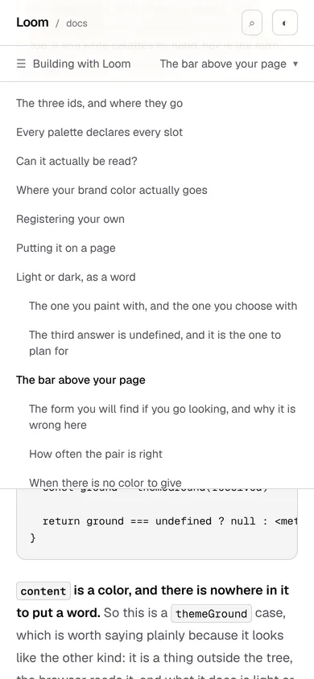
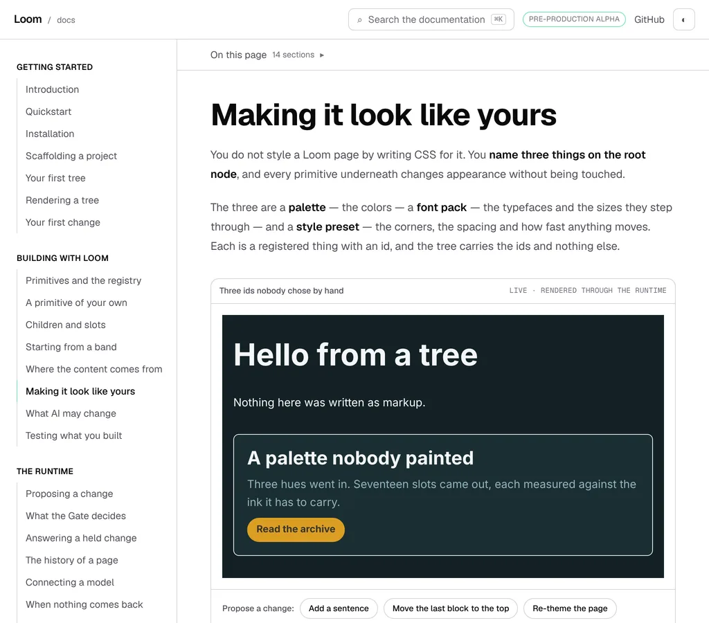
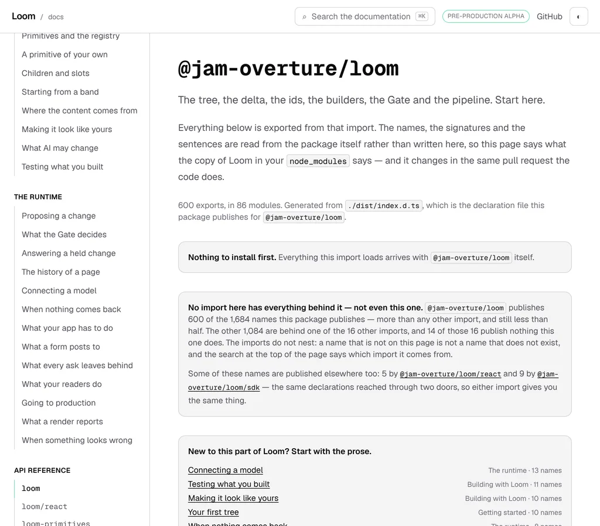
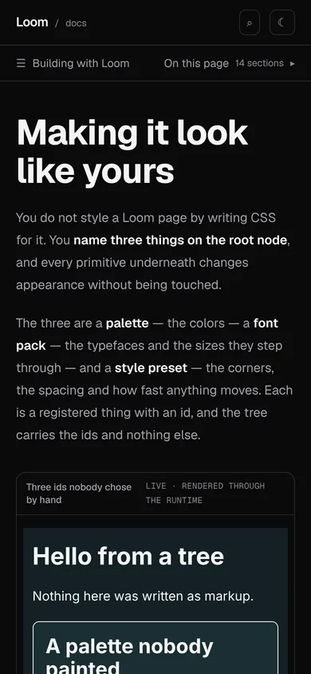

# 18 October 2026 — one chrome, one height

**Routine:** `Loom docs` · **Branch:** `docs-59-one-chrome-one-height` ·
**Section:** §4c

No open pull request from this lane at the start of the run. Six were open —
#670, #669, #668, #667, #666, #647 — none of them this lane's, and no
maintainer comment outstanding on any of them. None touches the `(docs)` route
group. Fresh branch off `origin/main` at `6ccd9ce` (#665).

## What this run is

The open finding this lane filed yesterday, with its own recommendation:

> `scroll-padding-top` is what keeps the thing a reader asked for from arriving
> behind whatever is stuck to the top of the window. … **All three numbers are
> right. What is missing is anything that would notice them stop being right.**
> … **Recommendation: 2**, as a unit of its own.

That is this. Remedy 2 was *a declared constant — the chrome's height, in one
module, read by the stylesheet through a custom property and by the components
through a class they share.* One finding closed, two filed.

## The finding named three files, and there were five

Looking for the first of them turned up two more, and the pair it had missed is
what makes the case: **the header's own height was written six times.**

| where | what it said | what it was |
| --- | --- | --- |
| `layout.tsx` | `h-14` | the header's own row |
| `_components/docs-bar.tsx` | `top-14` | the header's row again, as an offset |
| `_components/docs-bar.tsx` | `py-3` and a line of `text-sm` | the bar's row, 44 |
| `docs/layout.tsx` | `lg:top-14`, `lg:h-[calc(100vh-3.5rem)]` | the header's row, twice more |
| `docs/layout.tsx` | `xl:top-14`, `xl:h-[calc(100vh-3.5rem)]` | and twice more again |
| `globals.css` | `7rem`, `3rem` | the chrome plus clearance, and 160 minus it |
| `_lib/on-this-page.test.ts` | `102` | read off a screenshot and typed in |

Six of those rows are the header's row, the bar's row, or a number taken
against one of them. Every one was right on the day it was written, and none
was a function of any other — which is the whole finding. A run that gives the
bar a second line changes one of them and leaves the rest behind, and nothing
anywhere goes red.

## What is there now

**Three declarations, and the rest is arithmetic.** `globals.css`:

```css
:root {
  --chrome-edge: 1px;      /* the hairline a sticky band draws under itself */
  --chrome-header: 3.5rem; /* the header's own row */
  --chrome-bar: 2.75rem;   /* a control in the bar, which is the bar's row */

  --chrome-under-header: calc(var(--chrome-header) + var(--chrome-edge));
  --chrome: calc(var(--chrome-under-header) + var(--chrome-bar) + var(--chrome-edge));
  --chrome-rail: calc(100vh - var(--chrome-under-header));

  --chrome-clearance: 0.625rem;
  --chrome-inset: calc(var(--chrome) + var(--chrome-clearance));
  --press-landing: 10rem;
}
```

`_lib/chrome.ts` names the five classes that read them back, and the header, the
bar and both rails wear those classes. The file already existed for exactly this
kind of thing — it holds the article's id and the rail's scroller attribute,
*"one string that two files have to agree on, written in one of them and read in
the other"* — so the height went in beside them rather than into a new module.

### The one number a reader would notice is the one that is still typed

`--press-landing` is where a press of a contents row puts a heading, and it is
chosen rather than derived. Everything else about the chrome can move without
it moving, because the heading's own margin is written as the difference:

```css
scroll-margin-top: calc(var(--press-landing) - var(--chrome-inset));
```

A browser scrolls to a heading by insetting the scrollport and then clearing the
heading's own margin, so those two declarations add — and writing the second as
*the landing minus the first* is what makes the landing one declared number
instead of a sum two files have to keep agreeing on. That sum is what cost this
lane a live defect on 16 October: the reading line was 120, chosen against one
of the two numbers, and the mark sat on the section above the one a reader had
asked for, on every page, while three tests passed.

## Two things were wrong, and neither of them was a number

**The bar stuck at the header's row rather than at the row plus its hairline.**
`top-14` is 56; the header is 56 of row and 1 of border. So the bar covered the
header's bottom border by a pixel, and because the bar is translucent, what you
saw through it was a hairline at 85%. Both rails did the same thing. All three
start at `--chrome-under-header` now, which is one declaration and is 57.

**And `_lib/on-this-page.ts` still described the inset as `5rem`** and the
heading's margin as `5rem`. Both were true until 17 October and stale the day
after; the sum they describe was right, so nothing was wrong except the
sentence. It is the second kind of copy this unit is about and the kind no test
reaches: a comment quoting a number out of another file.

## What is held, and how

Four links of one chain, because a break anywhere along it is the same silent
defect.

**The parts are declared.** `--chrome-header`, `--chrome-bar`, `--chrome-edge`,
read out of `:root` in `globals.css`.

**Every property anything asks for is one of them.** This is the link worth the
most and the least obvious: `h-[var(--chrome-bar)]` on a page whose stylesheet
never declared `--chrome-bar` is **not an error**. It is a declaration the
browser throws away, and the bar has no height. Nothing in the rendered page
says which of those two you are looking at. So the test pulls every `var()` out
of the five class constants and insists the stylesheet declares each one — and
does the same for the properties the chrome's own declarations read, so the
chain cannot gain a gap in the middle.

**The inset still reads both bands' heights.** `scroll-padding-top` is
`var(--chrome-inset)`, and walking the declarations from there reaches
`--chrome-header` and `--chrome-bar`. That is the assertion the whole unit
exists for: a taller bar moves what clears it.

**The markup reads them through `chrome.ts` and spells none of them.** Three
files wear the five classes, and each is held twice — it reads the constant, and
it does not contain the constant's own value. A sweep of every component and
layout in the route group then fails on a new `top-14`, `h-14` or
`calc(100vh-3.5rem)` anywhere else. The sweep is the part worth keeping: five
assertions hold the five places that exist, and the finding's whole subject is
the sixth place nobody notices.

### What the test deliberately does not do

It does not evaluate `calc()`.

The finding's own remedy 1 was *a check that reads the Tailwind classes and
converts them to pixels*, and it rejected itself: a second implementation of
Tailwind's scale, wrong the first time somebody writes an arbitrary value. An
arithmetic evaluator for the stylesheet is the same mistake one layer down — a
second implementation of `calc`, wrong the first time a declaration multiplies.

So the numbers are not recomputed. The **expressions** are asserted exactly as
written, and adding them up is left to the browser, which is what a browser is
for. *A press lands a heading at `--press-landing`* is proved by two strings and
one fact about CSS:

- `scroll-padding-top` is `var(--chrome-inset)`;
- `scroll-margin-top` is `calc(var(--press-landing) - var(--chrome-inset))`;
- and the browser adds them.

One number is still read as a number — `--press-landing`, because the reading
line it is compared against is a figure in TypeScript, and those two are not in
the same language. `chrome-css.ts` is the reader, and it refuses a `calc`, a
`px` and a viewport unit rather than guessing at any of them.

## The pictures, and the numbers under them

Every shot was taken with `pnpm shoot --serve apps/loom` against a build of this
commit — `built 2026-10-18T14:03:15.668Z`.


```
…-phone-top  390x844@2x touch  scrollWidth 390 / innerWidth 390
    header > div                                     x 0 y 0   390x56
    #article > div:first-child                       x 0 y 57  390x45
    button[aria-label='Browse the documentation']    x 20 y 57  143x44
    button[aria-label='On this page']                x 206 y 57  164x44
    article.prose                                    x 20 y 142  350x24677
```

Read that against the three declarations and there is nothing left over.
`390x56` is `--chrome-header`. Each control is `44` tall, which is
`--chrome-bar`. The bar is `45`, which is the control plus the hairline it
draws. And `y 57` is the one number that moved today: **yesterday the bar was at
`y 56`**, because `top-14` is the header's row and the header is its row plus a
border. The bar was covering that border, and so were both rails.



```
…-phone-pressed  390x844@2x touch  scrollWidth 390 / innerWidth 390
    #article > div:first-child                       x 0 y 57  390x551
    h2#the-bar-above-your-page                       x 20 y 160  350x67
```

**`y 160`** is the measurement the whole unit had to not break, and it is the
same number yesterday's run recorded. The two declarations that put it there are
different declarations now — the inset grew out of the chrome and the heading's
margin shrank to the difference — and a browser adds them to the same place.



```
…-laptop  1024x900@2x  scrollWidth 1024 / innerWidth 1024
    header > div                 x 0 y 0   1024x56
    aside[data-rail-scroller]    x 0 y 57  256x843  holding 1826 in 843
    #article > div:first-child   x 256 y 57  768x45
    article.prose                x 304 y 142  672x17335
```

`843` is `--chrome-rail`, which is `100vh` less the 57 the rail starts at, and
`y 57 … 843` means it ends exactly at the foot of the window. It did before too,
from a different pair of numbers.


```
…-wide  1280x900@2x  scrollWidth 1280 / innerWidth 1280
    aside[data-rail-scroller]                   x 0 y 57  256x843
    aside:has(nav[aria-label='On this page'])   x 1056 y 57  224x843
    #article > div:first-child                  x 0 y 0  0x0
    article.prose                               x 304 y 97  704x17197
```

`article.prose x 304 … 704 wide` is the number yesterday's report recorded,
and the bar measures `0x0`. Both rails start at 57, from the same declaration
the bar uses; yesterday both started at 56, from a number each of them spelled
for itself.



```
…-reference-laptop  1024x900@2x  scrollWidth 1024 / innerWidth 1024
    #article > div:first-child   x 256 y 57  768x0
    h1                           x 304 y 97  672x40
```

`768x0`. The row is as tall as the controls in it, and a generated page between
1024 and 1279 has neither — the site's rail is already on screen and there is
nothing in the page to list. That property survived moving the height off the
padding and onto the control, which was the one thing worth checking: the height
is on the control, not on the row.



```
…-phone-dark  390x844@2x touch
    header > div                 x 0 y 0   390x56
    #article > div:first-child   x 0 y 57  390x45
```

Nothing about the chrome's height is a theme value, and the dark theme's block
declares none of it. The picture is here to say so.

## Decisions taken that were not specified

- **The parts are declared in the stylesheet, not in TypeScript.** The other way
  round is tempting and slightly neater — one module of numbers, set onto
  `<html>` as inline style — and it was rejected for two reasons. Inline style
  outranks every rule, so a chrome that varies by width would become impossible
  rather than cheap; and a layout that quietly stopped passing the style would
  take every class down with it, silently. A stylesheet declaring its own chrome
  is also where a reader of CSS looks for it.
- **The bar's row is a declared height rather than padding.** `py-3` and a line
  of `text-sm` came to 44 and nothing could read it, which is the half of the
  finding that made the chrome knowable only from a screenshot. What that trades
  is which way a mistake shows, and it is filed below: a control that outgrows
  its row now spills over the hairline instead of making the bar taller. It is
  the better failure, because it is the one a photograph shows.
- **The classes carry their own variants.** `SITE_RAIL_CLASS` is
  `lg:top-… lg:h-…` rather than a bare utility the caller prefixes. Tailwind
  generates the utilities it has **seen**, as text, in a file it scanned — so a
  class assembled at runtime from a prefix and a constant is a class nothing
  generated, and the symptom is an element with no height rather than an error.
  Written down in `chrome.ts`, because it is the kind of thing a later run would
  otherwise find out by shipping it.
- **The height went into `_lib/chrome.ts` rather than a new module.** That file
  already exists for this exact kind of thing — the article's id and the rail's
  scroller attribute, *"one string that two files have to agree on, written in
  one of them and read in the other."* Its opening sentence said *two names*;
  it says two names and a height now.
- **`withoutComments` is exported from `prose-barrier.ts`.** The two modules
  that closed this quote the old spellings in order to explain them, so a reader
  of the stylesheet that did not strip comments would find `3.5rem` in the prose
  about `3.5rem`. One stripper rather than a second copy of a one-liner.
- **The 102 is gone from the test rather than moved.** There is nothing left for
  it to guard: the inset is arithmetic over the two bands, so it cannot stop
  clearing them, and a floor asserting it clears a number somebody typed would
  be the finding again with extra steps.

## Records

None added, none superseded. Nothing here touches the tree schema, the delta
model or an `Accepted` record. It is chrome — the exception 0067 names, beside
the sidebar, the search box and the pager — so it composes no primitives,
because it is furniture rather than content. The shape it closes is
[0197](../decisions/0197-a-host-may-ask-which-way-round-a-palette-is-and-a-frame-standing-in-for-the-page-is-handed-both-ends.md)'s
at its smallest, which is the sentence `_lib/chrome.ts` already opened with.

## Findings

**One closed, two filed.**

Closed, filed by this lane yesterday:

- *the chrome is 102 pixels tall and the only thing that knows so is a number
  typed into a test* — by remedy 2, which is what that entry recommended. The
  closing note on it records the two things the entry had not found: six copies
  rather than three, and all three sticky things starting a pixel too high.

Filed:

- *the chrome is now one height at every width, and above 1280 forty-five
  pixels of it are not there* — this lane's. The bar is `xl:hidden`, so the real
  chrome at 1280 and above is 57 while the inset is 112. A press of a contents
  row is unaffected, because the landing is declared and the heading's margin is
  the difference; what is affected is every scroll with no heading in it, above
  all **moving focus to something off screen with a keyboard**. This was true
  yesterday and was not worth an entry then, because making the inset
  width-aware meant typing a second number. It is a two-line change now, which
  is this unit's dividend — and the two lines want Tailwind's `xl` read from the
  theme rather than transcribed, which is this same argument one layer up and so
  a unit of its own. Three remedies, recommending that one.
- *the bar's row is declared now, so a control that outgrows it spills instead
  of making the bar taller* — this lane's, and the stated limit of what shipped.
  jsdom lays nothing out, so no test here can see a control overflow its row,
  and `pnpm shoot`' `measure` prints boxes and never asserts (0213).

Three standing entries this run met again and did not duplicate:

- **`nextjs.org` is still unreachable** by `WebFetch` (`ENOTFOUND`). The
  15 October entry is open and accurate; this is its fifth recorded instance and
  wants no new entry. Nothing here needed it — the structure it models is
  already built, and this unit is about what holds that structure together.
- **The contents list is two elements with one accessible name** (16 October).
  Still true, and the shot list above met it: a `measure` for
  `nav[aria-label='On this page'] [aria-current]` printed `(1 of 2)` with the
  second at `0x0`. The entry named `page-contents.tsx`, which has since been
  deleted; the two elements today are the bar's panel and the rail beside the
  prose. The entry's remedy and its `#article` workaround both still apply, so
  it wants a line here rather than a second entry.
- **The reference pages carry the heading's id on the `<section>` around it**
  (15 October), which is still why those seventeen pages have no contents
  control. Unchanged, and it is the reason a reference page is in the pictures
  above: it is the one shape where both of the bar's controls stand down.
