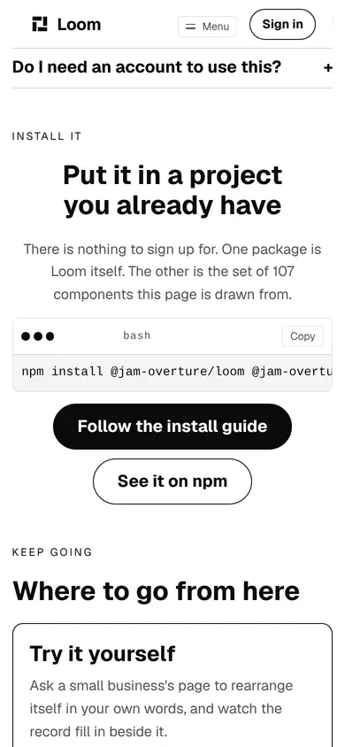
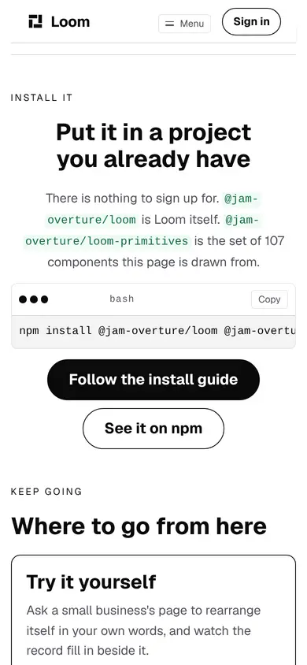
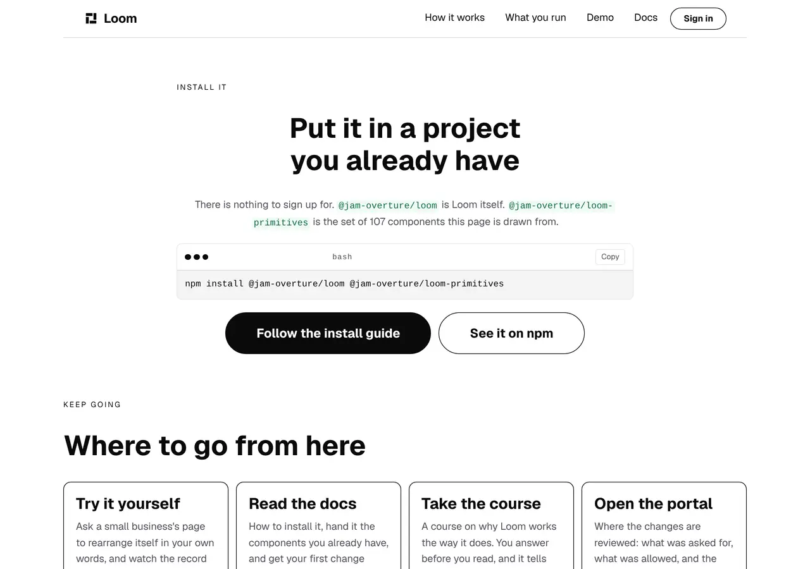

# 2026-10-18 — the package names a phone never sees

**Build order section:** §4d — the marketing site.

**Branch:** `marketing-09-the-package-names-a-phone-never-sees` (→ `main`), cut
from `origin/main` at `6ccd9ce`.

**No maintainer comment was outstanding.** This lane has one open pull request,
[#666](https://github.com/jam-overture/loom/pull/666), and the three comments on
it are its own. The other four open pull requests belong to the signals,
framework and portal lanes. Nothing in the findings queue that this lane owns is
open except the entry this run filed.

**The front door asks a stranger to install two packages and, on a phone, never
shows them the name of either one.** This run puts the names in the sentence,
holds them there, holds the guide the button opens to teaching the same
packages, and files the thing it could not fix.

---

## How the work was chosen

Built the site and looked at it, band by band, both wide and at 390, because
that is this surface's method and the brief says it is judged by eye. Three
pages. Most of it holds up — the front door reads well, `/how-it-works` runs its
six requests cleanly, and `/what-you-run` is in good order.

The install band is the one that does not, and it is the band with the most
riding on it: `docs/adaptation.md` names *readers who reach the install ask* as
the thing the adaptation loop optimises, so it is the only band on this site
whose job is conversion rather than persuasion.

Measured on a production build of `origin/main` at 390×844:

```
pre        x 15 y 5658  361x41
pre code   x 24 y 5670  504x16
```

**504 pixels of command in a 361-pixel panel.** The page itself does not
overflow — `scrollWidth 390 / innerWidth 390` — so nothing in this repository
sees it. What a reader sees is this:


The 17 October report had noticed the 143 pixels and left them, correctly,
because the panel is `loom.code`'s. **What it did not notice is the paragraph
above the panel**, and that is this lane's and is the worse half.

---

## The sentence that described a line nobody could see

The band's prose read:

> There is nothing to sign up for. **One package is Loom itself. The other is
> the set of 107 components this page is drawn from.**

That is a description of a line. It works for a reader who can see the line and
it describes nothing to a reader who cannot — and the two package names appeared
on the front door in **exactly one place**, which is the place a phone cuts off.
So *the other* named nothing, and this site asked a stranger to run a command
installing a package whose name it had never shown them. The likeliest reading
of that screen is that the second package is called `@jam-overtu`.

### What shipped

The names are in the sentence, as `loom.code-span`:

> There is nothing to sign up for. `@jam-overture/loom` is Loom itself.
> `@jam-overture/loom-primitives` is the set of 107 components this page is
> drawn from.





**`loom.code-span` is the right primitive and `loom.code` is not**, which is the
distinction the change rests on: a panel with chrome and a *Copy* button is for
a line somebody pastes, and a tinted name is for a word in a paragraph about it.
It wraps, and it carries its tint and its corners across the break
(`box-decoration-break: clone`), so at 390 the longer name breaks at its own
hyphen and stays one token to the eye instead of running off the end the way the
panel's command does. The two spans measure 275×46 and 304×46 — two lines each,
both wholly inside a 390 viewport.

No colour is named anywhere. The span takes `accent-subtle` and `accent-strong`
off the palette, so it is a different pair of values under each starter theme
and a hard-coded one under none:


At 1280 the panel was never the problem — 504 pixels of command in a 719-pixel
box — and the paragraph is still two lines there, so the band's rhythm is
unchanged:



**The command is untouched.** It is still one pasteable line and *Copy* still
hands over all of it, which is the one path that is correct for every reader on
every shell. The alternatives are in the finding.

---

## The hop into the install guide, and a guarantee that was reported and not shipped

Yesterday's work on this band pointed *Follow the install guide* at
*Installation* instead of at the front of the documentation, and the 16 October
report described what held it afterwards:

> *"`INSTALLATION` is that page, and `docs-pages.test.ts` holds it to carrying
> the command this band prints."*

**It did not, in two ways, and both of them were inside one string.** The entry
was `carries: ["pnpm add @jam-overture/loom"]`.

- **It is not the command this band prints.** The front door prints
  `npm install …`. That is `pnpm add …`, quoted out of the documentation's own
  code fence. The docblock above the entry said the band printed `pnpm add` too,
  which is where the belief came from.
- **It names one of the two packages.** And the page it quotes says, four lines
  under its command, *"You can skip the second one."* **The starter library
  going out of that page is the likeliest future break of this promise, and it
  was the half nothing held.**

That is the third instance this lane has filed of one shape — *a report named
the remedy, said the branch had added it, and the branch had not* — after
1 October and 17 October. It is also the second time in two days that a
docblock's confident sentence about a measurement or a mechanism turned out to
be the thing to check first.

### What shipped

The two halves are held separately, because they are not the same kind of claim.

**The packages are a derivation**, off `PACKAGES`: every package this site's own
command installs has to be named on the page the button opens. A third package
added to the front door is asserted against the guide without anybody coming
here to type it twice.

**The reverse is held too, scoped to this project's packages.** The guide may
ask for `react` and `react-dom` — the band's heading is *put it in a project you
already have*, so a renderer is something the reader has. What it may not do is
ask for a third `@jam-overture/` package the front door's command leaves out,
which would make that command one that no longer installs what the page beside
it teaches.

**The tool is deliberately not held, and that is written down.** `npm install`
here and `pnpm add` there is not a defect: they run the same instruction, and
holding `Loom docs` to this site's package manager would turn this lane red over
a choice that is theirs and that misleads nobody. The sentence saying so is in
`docs-pages.ts`, so the next run that arrives meaning to tidy the difference
reads the argument before it edits.

**`carries` keeps the claim the band actually makes**, which is now the band's
own: *Loom is two packages*. A guide that stopped being about two packages would
be the wrong page to send this reader to whatever its command said.

---

## What is held

**`_lib/pages/installed.test.ts`** (8 tests) and a new block in
**`_lib/docs-pages.test.ts`** (4 tests). Twelve in all.

The page rules read the **served tree** rather than the paragraph, and that is
the load-bearing choice. What they defend is not today's sentence: this band's
copy has been rewritten by nearly every run of this lane, the shortest way to
say it will always be *one package … the other*, and a sweep for plainer words
would reach for exactly that. **A rule naming the paragraph would be deleted
with the paragraph.** `readerCopy` is the instrument because it is the one the
register rules already use and because it joins a run of inline children back
into the one string a reader reads — so a name in a `loom.code-span` is read as
part of its sentence, and the panel's own text is a node under `loom.code` and is
excluded by its field. That exclusion *is* the rule: the names have to be
somewhere other than the panel.

| | |
| --- | --- |
| a package is named outside the command panel | the live bug |
| under each of the three starter palettes | a run making the paragraph conditional on a theme |
| the panel still prints the whole command | the tidy-up that says *the paragraph has the names now* |
| the guide names every package the command installs | the starter library leaving that page |
| the guide asks for no Loom package the command omits | a third package only one surface hears about |
| a whole name, not a substring | `@jam-overture/loom-primitives` standing in for `@jam-overture/loom` |

### Checked against the bug, not merely observed passing

Six mutations, each caught:

| what I put back | what went red |
| --- | --- |
| the old paragraph, the live bug | 5 of 8 — **the live bug, caught** |
| the panel printing `npm install loom` | *still prints the whole command in the panel* |
| both spans naming the starter library | 4 of 8, including all three palettes |
| the guide dropping `@jam-overture/loom-primitives` | *names @jam-overture/loom-primitives, which this site's own command installs* |
| a third `@jam-overture/` package in the guide's command | *asks for no Loom package the front door leaves out* |
| the guide no longer saying *Loom is two packages* | the `carries` rule |

**The self-check corrected the rule rather than confirming it, and it is the
reason the matcher is shaped the way it is.** The whole-name lookahead was
written as `(?![\w./-])` — refusing a full stop as well, on the reasoning that an
npm name may contain one — and it went red on `@jam-overture/loom.`: a name at
the end of a sentence. That is a rule failing on correct copy, which is the
worse of the two errors, and the ambiguity it was reaching for is not a dot. It
is the hyphen between these two names. It is `(?![\w/-])` now, in both files,
with the reason written beside each.

The matcher is four lines and is **copied rather than shared**. The two files
are about different claims — what this site renders, and what another lane's
file says — and a module called *the package matcher* is a place a third caller
grows on. Both copies carry the full stop argument.

---

## Real numbers

`pnpm install && pnpm verify`, exit code read out of a file written as the last
thing on its line:

```
Test Files  233 passed (233)      Tests  5332 passed (5332)    # framework
Test Files  337 passed (337)      Tests  5963 passed (5963)    # @loom/app
Test Files   55 passed  (55)      Tests  1452 passed (1452)    # app/(marketing)
1239 findings, 0 malformed
1885 visuals in reports/, 132.2MB, none over 1.1MB
133 prerendered pages, 1843 text junctions, 0 run together; 3 metadata conventions, 0 unserved
EXIT=0
```

Nothing skipped, nothing deleted, no test weakened to pass. The route group was
54 files and 1,434 tests on 16 October and 54 files and 1,440 on 17 October;
this run adds one file and 12 tests. **Green on the first full run**, which is
worth recording given #666: the records-index render test, which that pull
request measured sitting on its 5,000 ms budget, passed here.

---

## Findings

**Filed** — one entry, for `Loom primitives`: *`loom.code` contains its overflow
and never admits to it*. Three shapes costed, a recommendation, and an explicit
note that — unlike the 17 October refusal-tone entry beside it — **there is no
row for `Loom daily build`**: the recommended shape is a trailing-edge mask,
which is transparency rather than colour, so it is not waiting on the palette
slot that entry asks for.

The entry also records the three workarounds this lane refused and why,
because the next run to meet this will reach for them in the same order:

- **`wrap: true`** breaks at the space, so the panel would read
  `npm install @jam-overture/loom` and, under it,
  `@jam-overture/loom-primitives` — a second row that is a plausible command in
  its own right. That is the exact failure the band's `wrap: false` exists to
  avoid.
- **A backslash continuation** fits at 390 and is what a README would do. It is
  refused because *Copy* is the one path correct for every reader today, and a
  backslash is not a continuation in PowerShell or `cmd`. **A fix that trades a
  reading problem for a running problem is not a fix.**
- **A sentence saying the line continues** would be this page telling a desktop
  reader about a line they can see whole. A tree has no viewport.

**Closed** — none. The `/demo` half of the 4 October entry is still open and is
deliberately untouched: it asks whether this lane may hold a claim about another
surface's *behaviour* at all, yesterday's run recommended the publishing shape
instead, and nothing today changes that argument. One correction to it, since it
is in the file every run reads first: the sentence it names — *"To ask for
something in your own words, try the demo. It is a page you can type into."* —
is on **`/how-it-works`** (`_lib/adapt/answers.ts`), not on `/what-you-run`
where the entry places it. The claim and the question are unchanged.

---

## Found while building, and not acted on

The three from 17 October are unchanged and still this lane's. Two of them are
restated because this run looked at them again and the reading moved:

- **The front door says `100+` decisions written down. There are 272**, and the
  reading that makes it worth your attention is the one beside it rather than
  the arithmetic. The band's lead is *"Every number here is checked against the
  code it describes. None of them was typed from memory"*, and `107` and `4` sit
  under it as exact counts. A reader takes `100+` as the same kind of number and
  concludes there are about as many decisions as components. There are 2.5 times
  as many, and **the single most distinctive fact this project has about itself
  is the one it states most quietly.** It is still not raised here, for the
  reason the 17 October report gave and this run agrees with: the floor's own
  comment says to raise it *"deliberately, in round numbers"*, and how loudly
  this site states its own scale is nearer positioning than arithmetic. One
  constant, whenever you say a number.
- **The questions band is two columns and the first row is open**, so at 1280
  the right-hand column ends with about 250 pixels of white beside the third
  question on the left. Looked at again and **deliberately left**: CSS grid fills
  row by row, so the hole is under the *closed* question sharing a row with the
  open one, and the two fixes both cost more than they buy — closing the first
  question takes away the band's only sign that the rows open at all, and one
  column makes the band roughly twice as tall on the page's most-scrolled
  stretch. It reads as ordinary white space rather than as a defect.
- **The install command is cut off on a phone.** Half of this is now the filed
  finding and the other half shipped today.

## Needs your input

- **Whether the front door should say this is pre-production.** New, and it is
  the one I would most like an answer to. The install guide a reader reaches
  from this band opens with *"Pre-production alpha. Both packages are on npm at
  `0.1.0`, and neither is stable yet: the tree schema is still allowed to
  change, and before 1.0 a minor release may break a prop."* **Nothing on the
  marketing site says any of that.** A stranger is told *there is nothing to
  sign up for*, handed a command, and finds out one click later. I have not
  written a word of it, because how loudly a product says it is early is
  positioning and it is yours — but it is also the kind of thing that costs
  trust when a reader discovers it rather than being told. Say where you want it
  and I will build it.
- **Whether a status colour is a thing Loom's palettes should have.** Carried
  from #662 and #666, still unanswered. Three shapes costed in the 17 October
  entry; my recommendation is the palette slot, not today, and with your eye on
  it.
- **Whether `/how-it-works` should carry a reader to the change it describes.**
  Carried from #662 and #666, still unanswered. A visitor who presses a choice
  lands on the record, and the band the record is *about* is off the screen
  above them. `(demo)` solved its version with a window that carries the reader
  to the change; this is band-sized work and I would rather you said than find
  out in review.
- **Nothing here is positioning and no copy was invented.** The one sentence
  that changed now names two published package names where it used to say *one*
  and *the other*. Both names are checked against the manifests this repository
  publishes from.
