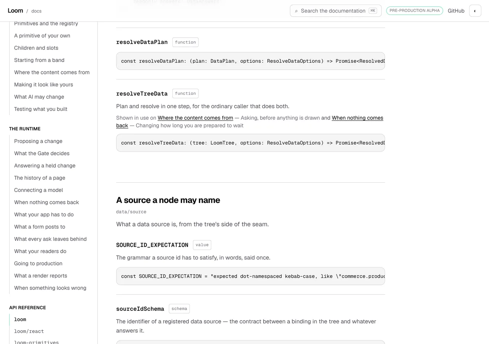
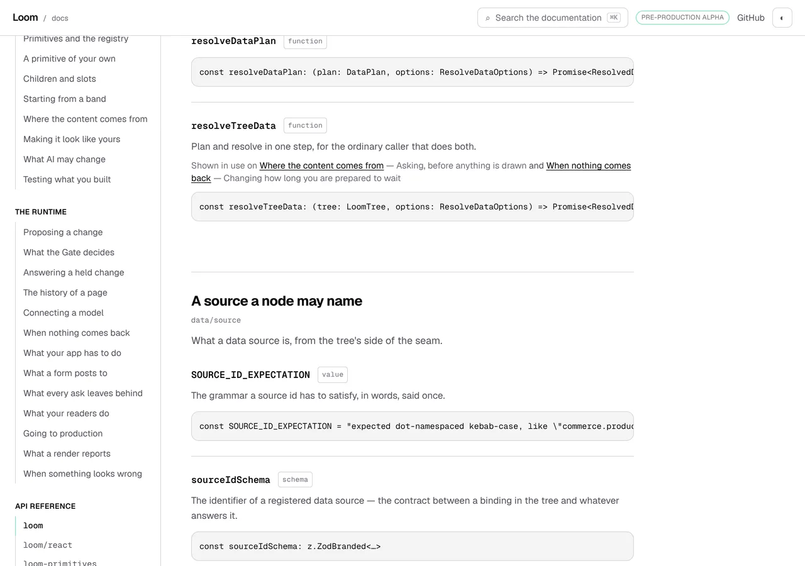
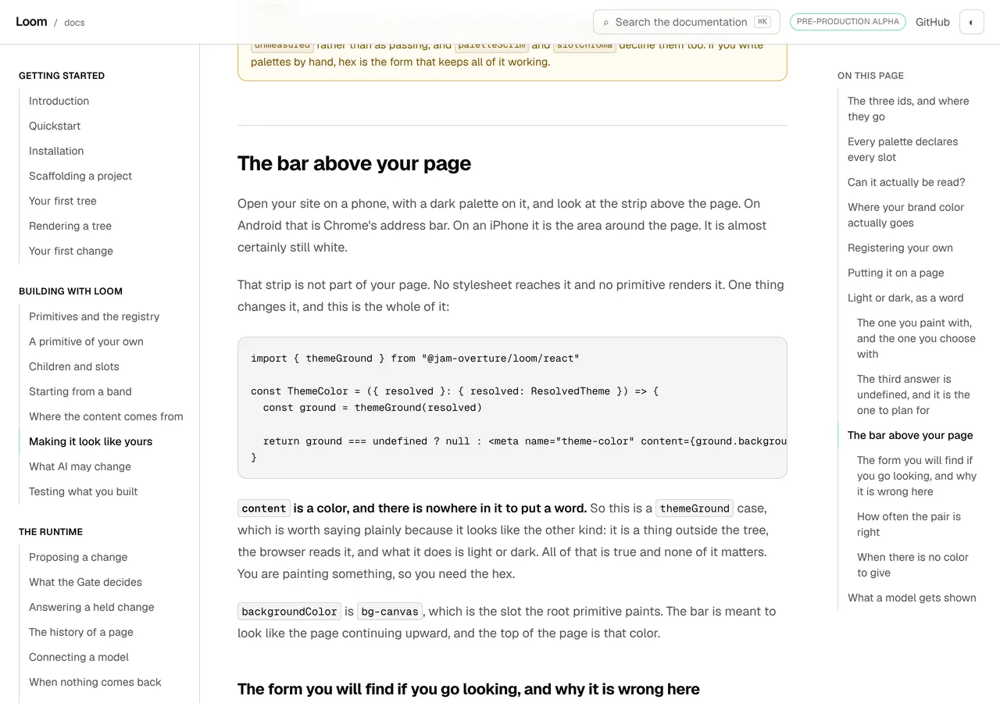

# 19 October 2026 — one breakpoint, and the red gate it ran into

**Routine:** `Loom docs` · **Branch:** `docs-60-one-breakpoint` ·
**Section:** §4c

No open pull request from this lane at the start of the run. Three were open —
#677 (`Loom portal`), #676 (`Loom marketing`), #675 (`Loom signals`) — none of
them this lane's, none touching the `(docs)` route group, and no maintainer
comment outstanding on any of them. Fresh branch off `origin/main` at `ed6d27e`
(#674).

One thing about the clone is worth a line, because it cost a minute and would
cost the next run the same: the container's `origin/main` was stale at
`1b66070`, 57 commits behind, and a branch cut from it had no `docs-bar.tsx` in
it at all. `git fetch origin main` reported `+ 1b66070...ed6d27e main
(forced update)` and the branch was re-cut. **Fetch before you branch**, not
only before you push.

## Read this part first: `main` was red

**`pnpm verify` was failing on `main` itself when this run started**, and it had
nothing to do with this branch. The merge gate is shared by four surfaces, so
that is every lane's problem and it was this lane's file.

```
FAIL |dom| app/(docs)/_components/architecture.test.tsx
     > the records index, rendered > links each row at the record itself
Error: Test timed out in 5000ms.
```

The open finding of 17 October calls this test *a coin flip* and says a red
`architecture.test.tsx` should be re-run and checked against the base before
anybody treats it as their own. Both were done, and both answers have changed:

- run alone on this branch, **four failures out of four** — 5,192, 5,303, 5,192
  and 5,801 ms;
- on a **clean worktree of `origin/main` at `ed6d27e`**, 6,155 ms, failed.

It is not intermittent any more. At 278 decision records it has crossed, and it
crossed on `main` rather than on anybody's branch. The full diff of this branch
touches none of the three files that test reads.

**So this run did that first.** The breakpoint unit below is what the run came
to do; it could not be shipped over a red gate, and the red gate was `Loom
docs`' own.

### Nobody had measured the inside of the test

Three entries have now proposed remedies for it — raise the timeout, split the
render, assert over a sample — and **all three are aimed at the render.** One
probe against the real 278-record table, six readings:

| what | ms |
| --- | --- |
| `render(<DecisionRecords />)` | **258** |
| `container.querySelectorAll("a")` | 15 |
| `screen.getAllByRole("row")` | 972 |
| `screen.getAllByRole("link")` | 3,742 |
| `screen.getAllByRole("link", { hidden: true })` | 2,022 |
| `screen.getByRole("link", { name })` | **4,064** |

The render is **5% of a test that was timing out at 5,000 ms.** Splitting it
would have bought a fifth of a second.

The cost is the role queries, and the reason is one sentence worth keeping:
**a role query is priced by the tree it is given, not by how many matches it
wants.** `getByRole` walks every element under `document.body` working out each
one's implicit role, then computes accessible names until one matches — so
asking for *one* link in a 278-row table costs very nearly what asking for all
of them costs.

**Scoping alone does not rescue it**, which is the second reading worth
keeping. Handing the query a single `<tr>` and asking it 278 times came to
6,213 ms, about 20 ms a call: the per-call cost is in the accessible-name
machinery rather than in the walk. A fix that only narrows the container is a
fix that fails again at a different record count.

### What shipped, and nothing was weakened

The per-row question is asked of the DOM — *this row's link points at the
record's file and carries its title* — and the accessible-name question, which
a DOM read cannot ask, is asked **once**, scoped to one row. Once is the number
of times it was asked before.

| test | before | after |
| --- | --- | --- |
| `links each row at the record itself` | 6,213 ms, **timed out**, checked **1** record | **239 ms**, checks **278** |
| `names a row's link by the record's title alone` | — | **243 ms**, new |
| `says once that the whole table leaves, and marks every row` | 4,890 ms | **556 ms** |
| the file | 19.0 s | **9.4 s** |

Two things to be plain about. **No timeout was raised and no assertion was
dropped.** And the old test was called *links each row* and checked the first
row — it checks every row now, so 277 href assertions were added while the
thing got 26 times faster. Both rewritten tests were mutation-checked: pointing
the component's `href` at a path that does not exist fails both.

The link sweep reads `a` elements rather than role matches, and that set is not
narrower. A role query matches an `<a>` **with** an `href` and anything carrying
`role="link"`; this matches every `<a>`, href or not. For a claim of the form
*every link is marked*, the anchors a role query filters out as inaccessible are
ones a reader could still meet.

**What to watch next.** The slowest test in the file is now *shows every record
the repository has, once* at 869 ms, which is still a `getAllByRole("row")` over
the whole table. That is 5.7× of headroom rather than sitting on the line, but
it is the next one to cross and it will cross for this same reason.

## What this run came to do

The open finding this lane filed yesterday, with its own recommendation:

> `--chrome` is the header's row, the bar's row, and the hairline each of them
> draws: 102 pixels. … At 1280 and above the bar is `xl:hidden` and the chrome
> is 57. So `scroll-padding-top` insets the scrollport by 112 on a wide screen
> where 67 would do. … **Recommendation: 1**, as a small unit of its own.

Remedy 1 was *read the breakpoint from Tailwind's theme and write the media
query against it, so `xl` is one value for the stylesheet and the markup*. That
is this. One finding closed, two filed.

## The plain version

Below 1280 a documentation page has a bar under the site's header holding both
of a narrow screen's navigations. At 1280 and above it does not: the page's own
contents get a rail beside the prose instead, and the bar stands down.

That is **one** decision, and three things depend on it:

1. the bar is hidden;
2. the contents rail arrives;
3. the chrome is 45 pixels shorter, so everything measured against the chrome
   should be 45 pixels shorter too.

The first two were in the markup, each spelling `xl:` for itself. **The third
was not there at all.** The stylesheet went on insetting the top of the page by
112 pixels on a screen with 57 pixels of chrome on it, which is 45 pixels of
blank page above whatever the browser had just scrolled to.

Nothing a reader who scrolls with a mouse ever meets. What meets it is every
scroll the browser performs by itself with no heading involved — a fragment in
the address bar, a search result, and the one that matters: **moving focus to
something off screen with a keyboard**, which scrolls by the padding alone.

## What is there now

**The stylesheet asks Tailwind for the width instead of writing it down.**

```css
@media (width >= theme(--breakpoint-xl)) {
  :root {
    --chrome-bar-band: 0px;
  }
}
```

`theme(--breakpoint-xl)` is the same declaration the `xl:` in `xl:hidden` and
`xl:sticky` compiles against. There is no second copy of `80rem` and so nothing
for a test to hold against anything: the query and the two variants are **one
value with three readers**. In the built stylesheet all three come out as
`@media (min-width:80rem)`, which is quoted below.

**And the thing it takes away is the bar's band, not the bar's row.** The
finding proposed `--chrome-bar: 0px` and that is wrong by a pixel, for a reason
worth the sentence: above the breakpoint the bar is not rendered, so its row
**and the hairline it draws under itself** are both absent. Zeroing the row
alone would have left a 1-pixel border in the chrome's height that no screen
has. So the declarations name the bar's whole contribution:

```css
--chrome-bar-band: calc(var(--chrome-bar) + var(--chrome-edge));
--chrome: calc(var(--chrome-under-header) + var(--chrome-bar-band));
```

A pixel is not worth a paragraph. Naming the thing that is actually absent is,
because the next person to change the bar reads the name.

### Where the breakpoint lives

`_lib/chrome.ts` — beside the chrome's two names and its height, which is where
the last three runs have been putting exactly this kind of fact.

```ts
export const BAR_BREAKPOINT = "xl"
export const BAR_BREAKPOINT_PROPERTY = `--breakpoint-${BAR_BREAKPOINT}`
export const BAR_HIDDEN_CLASS = "xl:hidden"
export const PAGE_RAIL_CLASS =
  "xl:sticky xl:block xl:overflow-y-auto xl:top-[var(--chrome-under-header)] xl:h-[var(--chrome-rail)]"
```

The classes are still written out in full and that is not an oversight. It is
the rule the module already carries: **Tailwind generates the utilities it has
seen, as text**, so `` `${BAR_BREAKPOINT}:hidden` `` is a class nothing
generated, and the symptom is an element with no rule rather than an error. The
tie between the name and the literal is an assertion instead.

`docs/layout.tsx` used to spell `xl:sticky xl:block xl:overflow-y-auto` beside
`PAGE_RAIL_CLASS`; those moved into the constant, because they are not a second
decision — they are the same one.

## What is held

**One value, three readers, and a sweep for the fourth.**

- `BAR_BREAKPOINT_PROPERTY` is `--breakpoint-${BAR_BREAKPOINT}`, and
  `BAR_HIDDEN_CLASS` is `${BAR_BREAKPOINT}:hidden`. Every utility in
  `PAGE_RAIL_CLASS` carries that same variant.
- There is **exactly one** `:root` block in the stylesheet that a media query
  guards, and its condition is `(width >= theme(--breakpoint-xl))` — asserted
  as the whole condition, which also holds the comparison. A `max-width` query
  reading the same variable would be the breakpoint minus a pixel, and the bar
  and the band would change at widths one apart.
- That block redeclares `--chrome-bar-band` and **nothing else**, and
  `--chrome-bar-band` is a property the base block declares, so the query is an
  override rather than a new name nothing reads.
- The inset still reaches the band: `--chrome-inset` names `--chrome`, which
  names `--chrome-bar-band`. A query that set a property nothing downstream
  read would pass every assertion above and change nothing on the screen.
- `docs-bar.tsx` wears `BAR_HIDDEN_CLASS` and does not contain its value;
  `docs/layout.tsx` wears `PAGE_RAIL_CLASS` and does not contain its value.
- And **no component or layout in the route group spells `xl:` at all**. That
  is the part worth keeping: five assertions hold the three readers that exist,
  and the finding's whole subject is the fourth one nobody notices.

### The link that is deliberately not a test

`theme()` itself. Tailwind fails the build on a theme variable it does not
have, so a query naming a breakpoint that does not exist never reaches a test.
That is the right place for it, and it is why `80rem` appears nowhere in
`chrome.test.ts`.

### Reading a stylesheet that now has two configurations

`chrome-css.ts` had one reader — *every custom property declared on `:root`* —
and that reader is now wrong on its own terms, because the chrome has a second
configuration above 1280. Folding the guarded block into the same map would
hand back whichever value came last in the file and call it *the* value of
`--chrome-bar-band`. There is no such value.

So there are two: `rootProperties` is what the page is at every width, with
`@media` rules taken out of the sheet first, and `guardedRoots` is the blocks a
query guards, each with **the condition exactly as written**. Keeping the
condition unresolved is the point — a reader that turned `theme(--breakpoint-xl)`
into `80rem` could not tell the two apart, which is the whole thing the query
exists to make checkable.

The `@media` rules are found by matching braces, which is `componentsLayer`'s
method in `prose-barrier.ts` and for its reason: a query holding a `:root`
block contains braces, so a lazy match stops at the first inner one.

## Decisions taken that were not specified

- **The band, not the row.** The finding proposed `--chrome-bar: 0px` above the
  breakpoint. That says the control in the bar is nothing tall, which is not
  what is true: the bar is not rendered, so its row *and* the hairline under it
  are both absent, and zeroing the row alone leaves a pixel of border in the
  chrome's height that no screen has. `--chrome-bar-band` names the bar's whole
  contribution and the query takes that to nothing. A pixel is not worth a
  paragraph; naming the thing that is actually absent is.
- **`theme()` rather than a transcribed `80rem` with a guard on it.** The
  finding's remedy 2 was to transcribe and hold it against the markup with a
  test. That is a sixth copy with a check attached, and this closes the
  question instead: one declaration, three readers, nothing to compare. The
  build is the guard, because Tailwind fails on a theme variable it does not
  have.
- **The media query sits inside `@layer base`.** Unlayered, it would outrank
  the `:root` block it overrides for a reason that has nothing to do with being
  written second — unlayered styles beat layered ones in the cascade. In the
  same layer the two are ordered by position, which is the ordering a reader
  of the file expects.
- **`PAGE_RAIL_CLASS` absorbed `xl:sticky xl:block xl:overflow-y-auto`.** They
  were in `docs/layout.tsx` beside the constant and they are not a second
  decision. Moving them is what makes *no `xl:` outside `chrome.ts`* a sweep
  that can be written at all.
- **`rootProperties` was narrowed rather than extended.** It could have grown a
  width argument and answered *what is `--chrome-bar-band` at 1400 pixels*.
  That is an evaluator for the cascade, which is `chrome-css.ts`' standing
  argument one layer along — the module refuses `calc` for the same reason. It
  reports what the sheet says at each of its two configurations and leaves the
  resolving to the browser.
- **The accessible-name assertion was split out and named, not deleted.** The
  test that used to carry it was called *links each row* and checked one row.
  Splitting the two claims let the per-row half go to the DOM and get 278 times
  wider, and left the a11y half asked exactly as often as it was before, under
  a name that says what it checks.

## Records

None added, none superseded. Nothing here touches the tree schema, the delta
model or an `Accepted` record.

The breakpoint unit is chrome — the exception
[0067](../decisions/0067-the-four-surfaces-are-one-application.md) names beside
the sidebar, the search box and the pager — so it composes no primitives,
because it is furniture rather than content. The test work is a test.

## Findings

**Two closed, two filed.**

Closed:

- *the chrome is now one height at every width, and above 1280 forty-five
  pixels of it are not there* (18 October, this lane's), by remedy 1, which is
  what that entry recommended. The closing note records the two things the
  entry had wrong: that reading the breakpoint from the theme was *a different
  argument* and therefore worth deferring, and that `--chrome-bar: 0px` was the
  number to write.
- *the records index test is now a coin flip* (17 October, filed by
  `Loom marketing`, owned by this lane). Not a coin flip any more and not
  closed by any of the three remedies three entries proposed. The closing note
  is the measurement.

Filed:

- *the sweep that works for `xl:` cannot be written for `lg:`, because one
  prefix carries two decisions* — this lane's, and the stated limit of what
  shipped. Twelve uses of `lg:` in the route group: some are *the site's rail
  is on screen*, four are a page gutter. A sweep forbidding it would ask four
  pieces of padding to move into the chrome's module. Three remedies,
  recommending *leave it*.
- *a reference page's anchors land 48 pixels below where a written page's
  headings land, and the number they use was chosen against nothing* — this
  lane's, found while reading the reference pages for a picture. Details in the
  entry.

Standing entries this run met again and did not duplicate:

- **`nextjs.org` is still unreachable** by `WebFetch`. The 15 October entry is
  open and accurate; nothing here needed it, since the structure it models is
  built and this run is about what holds that structure together.
- **The composed preview URL.** The URL below was taken from the `vercel[bot]`
  comment rather than guessed from the branch name, which is the 16 October
  entry's remedy.

## The pictures, and the numbers under them

Every shot was taken with `pnpm shoot --serve apps/loom`. The *after* pictures
are of a build of this commit, `built 2026-10-19T14:32:23.462Z`. The *before*
pictures are of a build of the same tree with **the five-line media query
removed and nothing else**, `built 2026-10-19T14:41:49.538Z` — so the only
variable between a pair is the thing being argued about.

### The one that moved

A reference page's symbol anchor is the cleanest subject for this, because it
is the kind of scroll the finding is about: the browser inserts the scrollport
by `scroll-padding-top` and the anchor has no margin written as a difference,
so where it lands *is* the inset plus its own `scroll-mt-24`.



```
…-before-wide-anchor  1280x900@2x  scrollWidth 1280 / innerWidth 1280
    header > div                 x 0 y 0  1280x56
    #article > div:first-child   x 0 y 0  0x0
    #s-resolveTreeData           x 304 y 208  704x214
```



```
…-wide-anchor  1280x900@2x  scrollWidth 1280 / innerWidth 1280
    header > div                 x 0 y 0  1280x56
    #article > div:first-child   x 0 y 0  0x0
    #s-resolveTreeData           x 304 y 163  704x214
```

**208 and 163**, and the difference is 45. Read them against the declarations
and nothing is left over: 208 is an inset of 112 plus the anchor's own 96, 163
is an inset of 67 plus the same 96, and `#article > div:first-child` measures
`0x0` in both because the bar is not there. The 45 pixels were a band of blank
page above the thing the reader asked for, on a screen with 57 pixels of chrome
on it.

### The one that must not move, and did not

A press of a contents row is the case the landing was declared for, and it was
the thing most at risk: the heading's own margin is written as
`calc(var(--press-landing) - var(--chrome-inset))`, so moving the inset moves
the margin by the same amount in the other direction.



```
…-wide-press  1280x900@2x  scrollWidth 1280 / innerWidth 1280
    h2#the-bar-above-your-page   x 304 y 160  704x67
```

**`y 160` in both builds**, and the two files are byte-identical:

```
56e73d348c78ea5d6bc5e276b553b9d1  …-before-wide-press.png
56e73d348c78ea5d6bc5e276b553b9d1  …-wide-press.png
```

That is what makes the pair above evidence rather than decoration. The inset
changed by 45 and the margin changed by 45 the other way, so the landing is the
same number it was yesterday at phone width, from two different declarations.

### Below the breakpoint, nothing changed at all


```
…-laptop-anchor  1024x900@2x  scrollWidth 1024 / innerWidth 1024
    header > div                 x 0 y 0  1024x56
    #article > div:first-child   x 256 y 57  768x0
    #s-resolveTreeData           x 304 y 208  672x214
```

`y 208`, which is the number 1280 used to give. The bar exists here, so the
inset is still 112 and should be; the row measures `768x0` because this is a
generated reference page between 1024 and 1279, where both of the bar's
controls stand down.


```
…-phone-top  390x844@2x touch  scrollWidth 390 / innerWidth 390
    header > div                                   x 0 y 0  390x56
    #article > div:first-child                     x 0 y 57  390x45
    button[aria-label='On this page']              x 206 y 57  164x44
```

Every one of those is the number yesterday's report recorded: 56 of header, the
bar at `y 57` and 45 tall, a control of 44. The query is `min-width`, so a phone
never enters it.

### What the pictures also found

`#s-resolveTreeData` landing at **163** at 1280 and **208** at 1024 is correct
at both widths and is still two different places for one kind of act — a
written page's heading lands at 160 at every width. That is the reference
pages' own `scroll-mt-24`, a constant where the prose headings have a
difference, and it is filed below rather than fixed here.


## Test numbers

`pnpm install && pnpm verify` — **exit 0**, read out of a file written as the
last thing on its line, with nothing else running beside it.

- framework: **233 files, 5,421 tests passed**
- application: **338 files, 5,999 tests passed**
- `findings:check`: 1,253 findings, 0 malformed
- `reports:check`: 1,896 visuals, none over 1.1MB — **1,902 now**, because the
  gate ran before this report's six pictures were taken. `findings:check` and
  `reports:check` were both re-run against the final tree and are both exit 0
  (1,253 findings, 0 malformed; 1,902 visuals, none over 1.1MB). Nothing else
  in the tree changed after the gate: the commit adds this report, its shot
  list, its pictures, and the two findings' entries.
- `prerender:check`: 133 prerendered pages, 1,848 text junctions, 0 run
  together; 3 metadata conventions, 0 unserved

Nothing failed, nothing was skipped, and no test was weakened.

**Twenty-two tests are new or rewritten.** Sixteen are new: 8 in
`_lib/chrome.test.ts` (*the width the chrome changes at*) and 8 in
`_lib/chrome-css.test.ts` (*the `:root` blocks a media query guards*, plus the
one holding `rootProperties` to the unguarded blocks). Two in
`architecture.test.tsx` were rewritten and one was added there — *names a row's
link by the record's title alone* — which is the accessible-name half of a test
that used to make both claims at once.

### On reading the gate, which mattered today

**Two full runs.** The first was red, and the red was not this branch's — it
was `architecture.test.tsx` timing out, which the section at the top of this
report is about. The second, after the fix, is exit 0 and is the one quoted
above; it is on this commit's tree and the only thing written after it is this
paragraph.

The first run is also the clearest instance yet of the thing `docs/routines.md`
warns about. **The session's own notification for that run said "exit code 0".
The file said `EXIT=1`.** The notification is the status of the whole compound
line; the file is the status of `pnpm verify`. A run that had trusted the
notification would have opened a pull request on a red gate with a report
saying green — and on this particular day it would have been a pull request
claiming green on a tree where `main` itself was red.

Every exit code in this report was read out of a file written as the last thing
on its line.

## The preview

Taken from the `vercel[bot]` comment after opening the pull request, not
composed from the branch name, which is the remedy the 16 October finding
*the composed preview URL, fifth instance* asks every lane to follow.

https://loom-git-docs-60-one-breakpoint-jpizzolato36-6341s-projects.vercel.app

Worth one line rather than an entry: **this one would have been guessable.**
`docs-60-one-breakpoint` is short enough that Vercel kept it whole and added no
hash segment, so a composed URL would have been right today. That is luck
about a branch name's length and not a reason to compose the next one — the
remedy is free, and yesterday's branch got `docs-59-one-chrome-8cc42b`.

The two pages the pictures above are of:

- [/docs/api-reference/runtime](https://loom-git-docs-60-one-breakpoint-jpizzolato36-6341s-projects.vercel.app/docs/api-reference/runtime)
- [/docs/building-with-loom/theming](https://loom-git-docs-60-one-breakpoint-jpizzolato36-6341s-projects.vercel.app/docs/building-with-loom/theming)

Every picture above was taken with `pnpm shoot --serve apps/loom` against a
build in this container, not fetched from the preview: `*.vercel.app` is denied
by the environment's egress policy, which is the open finding of 12 October and
still true.

## One thing about the clone, for the next run

The container's `origin/main` was 57 commits stale when this run started, and
`git checkout -b … origin/main` produced a tree with no `docs-bar.tsx` in it.
`git fetch origin main` answered `+ 1b66070...ed6d27e main (forced update)`.

Nothing in `docs/routines.md` says to fetch before branching — it says to fetch
before pushing to a branch you left open. A run that trusts the clone's
`origin/main` can cut a branch from last week and not notice until a file it
expects is missing, or worse, not notice at all.
