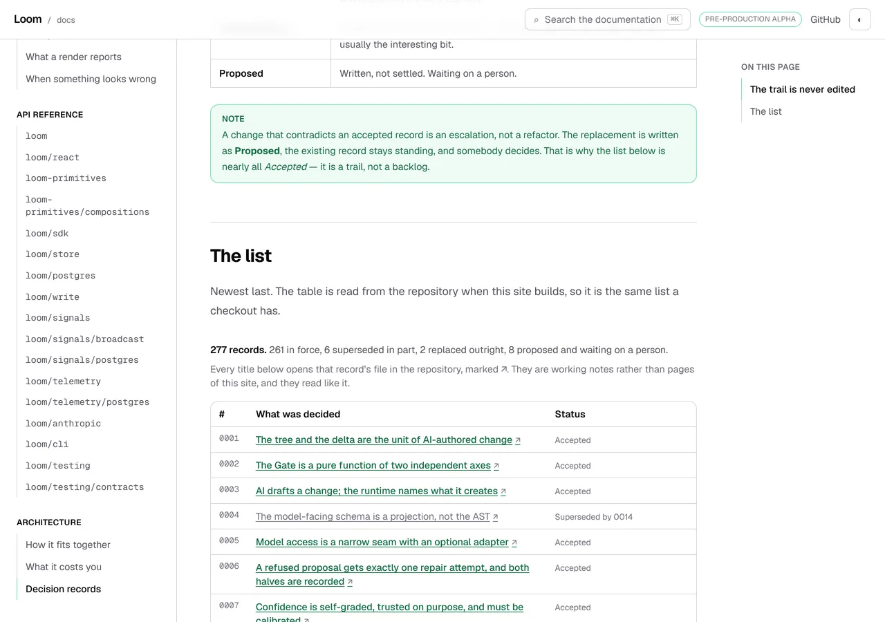
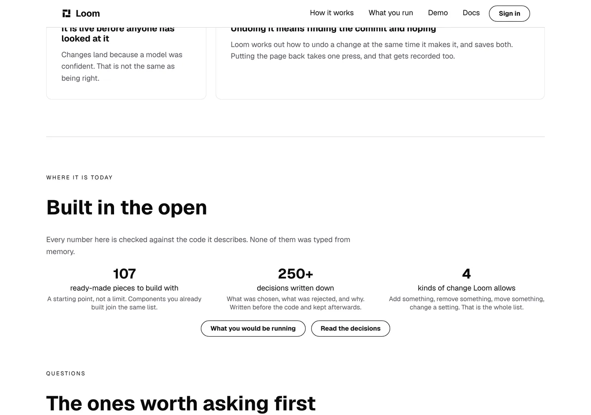

# 2026-10-19 — the quietest number on the front door

**Build order section:** §4d — the marketing site.

**Branch:** `marketing-10-the-quietest-number-on-the-front-door` (→ `main`), cut
from `origin/main` at `d217778`.

**No maintainer comment was outstanding.** This lane has no open pull request:
#670 merged yesterday at 17:34 and #666 before it. The two pull requests open
this morning, #674 and #675, belong to the portal and signals lanes. The three
comments on #670 are this lane's own and the vercel bot's.

**The front door said there were `100+` decisions written down. There are 277,
and one press away this same site says so exactly.** This run fixes the number,
sends that press to the page of this site that states it rather than to a folder
on GitHub, and gives the floor a bound in the direction it was never checked in.

---

## How the work was chosen

Built the site and looked at it, band by band, wide and at 390, which is this
surface's method. Three pages, and most of it holds up: the front door reads
well, `/how-it-works` runs its six requests cleanly and its record panel is the
strongest thing on the site, `/what-you-run` is thin but sound.

`FINDINGS.md` had one open entry owned by this lane, and it is this one. From
25 August, filed by `Loom primitives` after opening a marketing file for the
fifth time in seven days:

> *"The two counts are the part worth looking at: they are facts about the
> registry and about `decisions/`, asserted in a lane that owns neither…
> Deriving both from `STARTER_PRIMITIVES.length` and a directory listing at
> build time would end it, and is `Loom marketing`'s call."*

Half of it closed on 4 September when the primitive count started counting the
registry. The other half has been `DECISIONS_AT_LEAST = 100` ever since.

It was also the first item under *Found while building, and not acted on* in
both the 17 and 18 October reports, deferred both times as nearer positioning
than arithmetic. **The press under the band is what changes that**, and it is
the half neither run looked at.

---

## The band promised something it half kept

*Built in the open* leads with:

> Every number here is checked against the code it describes. None of them was
> typed from memory.

Three numbers under it: `107`, `100+`, `4`.

All three claims are true. `107` is counted off the registry the site renders
with; `4` is `TREE_OPERATIONS.length`; `100+` is a floor, and `facts.test.ts`
has asserted since 27 August that the records on disk are at least that many.
Nothing is broken and nothing is red.

**What the band cannot say is which of the three is which.** Two are exact
counts and the third is a lower bound, drawn at the same size in the same row
under the same sentence. A reader taking `100+` for the same kind of number as
`107` comes away with a project that has about as many decisions as components.


There are **277**. That is 2.5 times the component count, and it is the single
most distinctive fact this repository has about itself — stated, until today, in
the quietest way available.

### The press is what made it worth fixing rather than noting again

Under the three numbers sat *Read the decisions*, pointing at
`github.com/jam-overture/loom/tree/main/decisions`.

That is a directory listing. A stranger who has just read that this project
writes down what it chose and what it rejected pressed it, left the product into
a new tab, and arrived at 277 filenames in a column — no titles, no standing, no
count.

**And `(docs)` already serves the readable version of the same thing.** It is
built from the index `pnpm decisions:index` generates, by `Loom docs`, and it
states the number exactly in its second paragraph:



So the front door said `100+` and one press of its own button reached a page of
the same site saying `277`. That is not a conservative claim. It is two numbers,
and the reader meets both inside ten seconds.

---

## What shipped

**The floor is 250.** A round number, raised deliberately, which is what the
constant's own comment has said to do since it was written.



Nothing else on the band moved. `Read the decisions` measures
`x 674 y 695 172x35` before the change and `x 674 y 695 172x35` after it, and
the two full-band shots differ in the stat and in nothing else — which is what
makes the pair evidence rather than decoration.

No colour is named anywhere, so the same band is the palette's yellow on black
under `bold`:


**The press lands on this site.** *Read the decisions* opens
`/docs/architecture/decision-records`. The reader stays inside one application,
which is [0067](../decisions/0067-the-four-surfaces-are-one-application.md)'s
whole reason for making the four surfaces one, and gets every record by title
and standing rather than a scroll of filenames. The repository is still one
press further on: each title on that page opens its file, and the footer offers
`decisions/` under *The project* beside *Source*, which is the frame a reader
looking for the folder is already in. The footer is deliberately unchanged.

### Why the number is still a floor and not a count

The 25 August finding asked for a directory listing at build time. **It is
refused, and this is the answer rather than a deferral.**

Counting `decisions/` means reading the disk, and `/` is server-rendered on
demand (`ƒ` in the build output) rather than prerendered. The read would
therefore happen in the deployed function, where the repository is not — so the
count would be right in every screenshot in this report and wrong on the
deployment. `(docs)` reads the same index safely because its pages are built
once, at build time, in a checkout;
`(docs)/_lib/architecture/source.ts` carries the other half of why, which is
that the idiomatic spelling of the path does not survive the bundler either.

A fallback to the floor when the read fails would be worse than a floor: the
site would disagree with its own proof. So the floor stays and gains a bound
instead.

---

## What is held

**`facts.test.ts`**, two new rules. **`docs-pages.test.ts`**, five more from one
new entry in `DOC_PAGES`, which is the existing machinery rather than anything
written today.

| | |
| --- | --- |
| the floor is never more than 45% behind the records on disk | the live bug: a floor nothing checks for staleness |
| the front door links to the page that states the count | the control going back off-site |
| that page is an address this application serves | the documentation moving it |
| it is headed *Decision records* | the page being renamed |
| it still says *which sensible alternative was rejected, and why* | this site's caption promising something the page stopped saying |
| it still says *The trail is never edited* | the same, for *kept afterwards* |

**The staleness bound is the one worth arguing about, and it is a coupling.**
The old rule — *never claim more records than there are* — is satisfied **more**
comfortably the further behind the floor falls. It is the one assertion in that
file that goes quieter as the claim it guards degrades, and it is how `100`
survived 175 records.

So `DECISIONS_FLOOR_FRACTION` is `0.55`: the floor may sit at no less than 55%
of the records on disk. At 277 records it next fires at 455, which is months
away, and the failure says exactly what to type:

```
the front door says "100+" and there are 277 records — raise DECISIONS_AT_LEAST
in copy.ts to a round number at or above 152
```

The 19 August finding is that writing a decision record in any lane left the
marketing site red. **This brings a weak version of that back** — roughly one
bump per 180 records instead of one per record — and I think that is the right
trade, because there is no way to notice a stale floor that does not fail
somewhere, and the only suite that can see `decisions/` is this one. If you
would rather have the silence, deleting that one test is the whole of it.

### Checked against the bug, not merely observed passing

Five mutations, each caught:

| what I put back | what went red |
| --- | --- |
| `DECISIONS_AT_LEAST = 100`, the live bug | *never lets the floor fall so far behind* — **the live bug, caught** |
| *Read the decisions* pointing at GitHub again | *sends a reader from the record count to the page that states it* |
| the doc page at a path nothing serves | 5 of the 6 rules over that entry |
| the page headed *The decision records* | *is headed the way this site says it is* |
| the page no longer saying *The trail is never edited* | *still carries* |

**The second mutation is why that rule is asserted against the published tree
rather than through the sweep.** `docs-pages.test.ts` holds *no link into the
documentation goes anywhere undeclared*, and a band that quietly went back to an
off-site address satisfies it perfectly: there is no `/docs/` link left to
object to. It passed, measured rather than assumed, while the tree rule went
red.

---

## Real numbers

`pnpm install && pnpm verify`, exit code read out of a file written as the last
thing on its line:

```
Test Files  233 passed (233)      Tests  5421 passed (5421)    # framework
Test Files  338 passed (338)      Tests  5993 passed (5993)    # @loom/app
Test Files   55 passed  (55)      Tests  1459 passed (1459)    # app/(marketing)
1252 findings, 0 malformed
1900 visuals in reports/, 132.8MB, none over 1.1MB
133 prerendered pages, 1848 text junctions, 0 run together; 3 metadata conventions, 0 unserved
EXIT=0
```

Nothing skipped, nothing deleted, no test weakened to pass. The route group was
54 files and 1,452 tests on 18 October; this run adds no file and 7 tests — two
written here, five from `DOC_PAGES` gaining a fifth entry.

---

## Findings

**Filed** — one entry, for `Loom primitives`: *`external` draws an arrow on one
of the three primitives that take it*. `loom.inline-link` renders `↗` after the
words and says so in its own docblock; `loom.link` and `loom.action` set
`target="_blank" rel="noreferrer noopener"` and draw nothing. So a control that
takes the reader off the site is, on this site, indistinguishable from one that
does not — which is the before/after pair above saying something neither picture
shows: *Read the decisions* used to open a new tab to GitHub, and it looked
exactly like this.

**Closed** — the `decisions/` half of **25 August — *the primitive count and the
generated reference***, which is this lane's only open entry. Closed with an
answer rather than a build: the derivation it asks for cannot be done safely on
a server-rendered route, the reasoning is in `copy.ts` where the next run will
read it, and the bound above is what exists instead.

---

## Found while building, and not acted on

- **`(docs)` wears a `PRE-PRODUCTION ALPHA` badge in its header and this site
  says nothing.** Visible in the landing shot above, which is now a page this
  lane sends people to — so a visitor who presses *Read the decisions* meets
  that badge, on the same domain, having been told by the front door only that
  there is nothing to sign up for. This is the question I asked on #670 and it
  is sharper than it was yesterday: the claim is already published, on this
  deployment, by another surface. Still not written here, because **how loudly a
  product says it is early is positioning and it is yours.**
- **The questions band's two columns are uneven at 1280.** Unchanged from
  17 and 18 October and still deliberately left; the reasoning is in those
  reports and nothing this run saw moved it.
- **The `/demo` half of the 4 October finding is still open** and still
  untouched. It asks whether this lane may hold a claim about another surface's
  *behaviour* at all, and the publishing shape recommended on 17 October is
  still the right answer.

## Needs your input

- **Whether the front door should say this is pre-production.** Carried from
  #670, unanswered, and the one I would most like settled. See above: the
  documentation already says it in its chrome, so the site is now telling a
  visitor two different things about its own maturity depending on which page
  they are on.
- **Whether the staleness bound is a coupling you want.** New. It is one test
  and I have argued both sides above; my recommendation is to keep it, because
  the alternative is the state this band was in for seven weeks.
- **Whether a status colour is a thing Loom's palettes should have.** Carried
  from #662, #666 and #670, still unanswered.
- **Whether `/how-it-works` should carry a reader to the change it describes.**
  Carried from #662, #666 and #670, still unanswered.
- **Nothing here is positioning and no copy was invented.** One digit changed
  and one address changed. Both are facts about this repository, checked against
  it.
