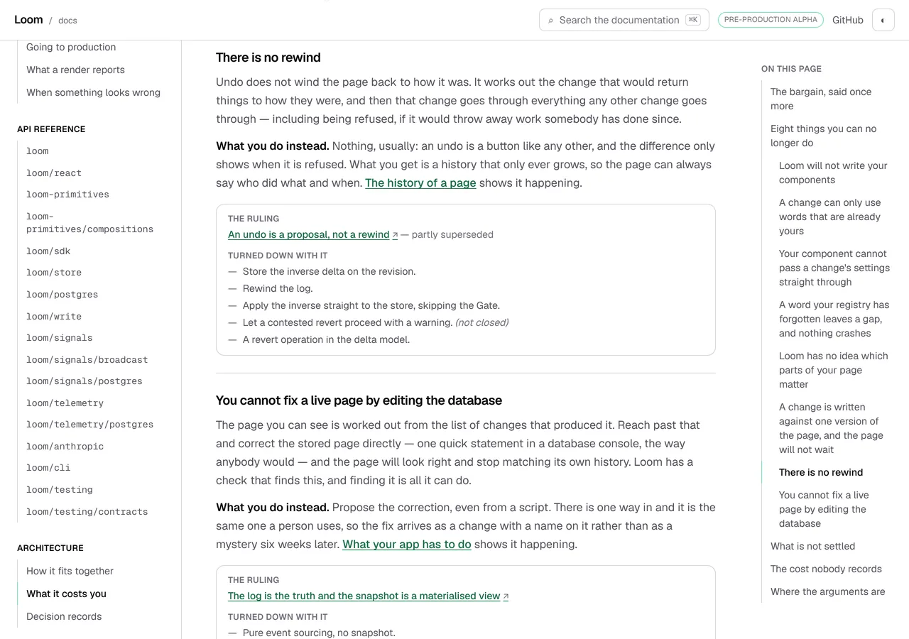
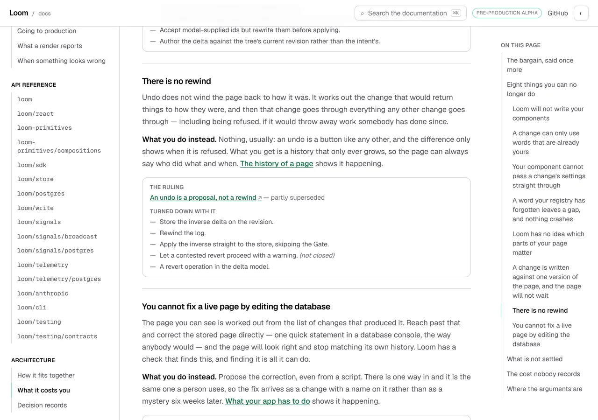
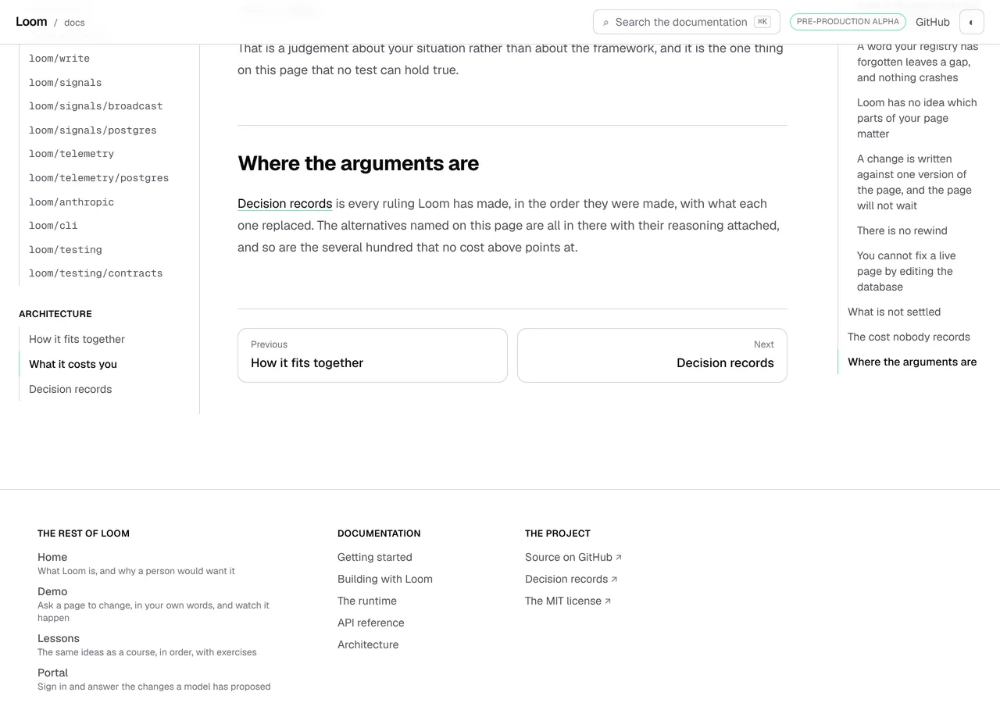
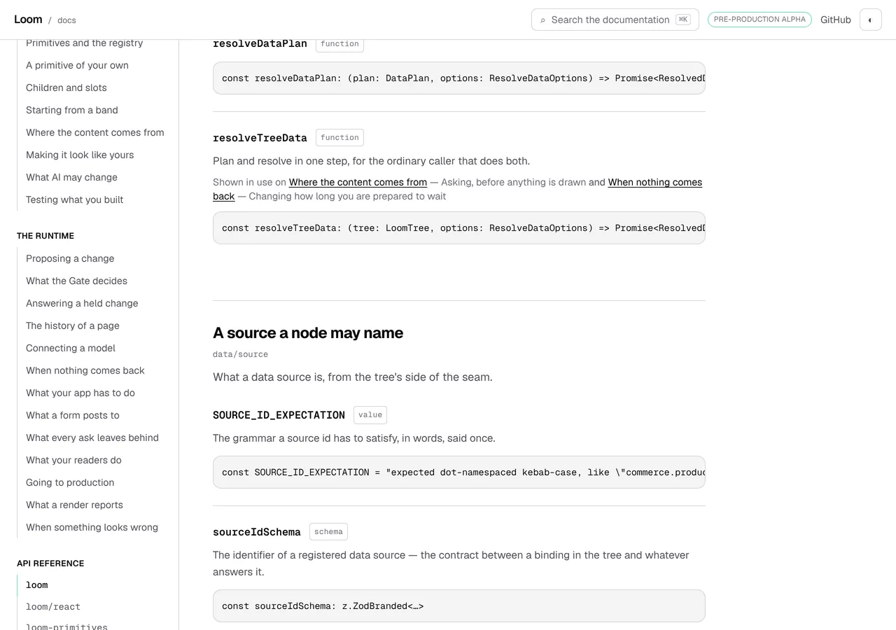
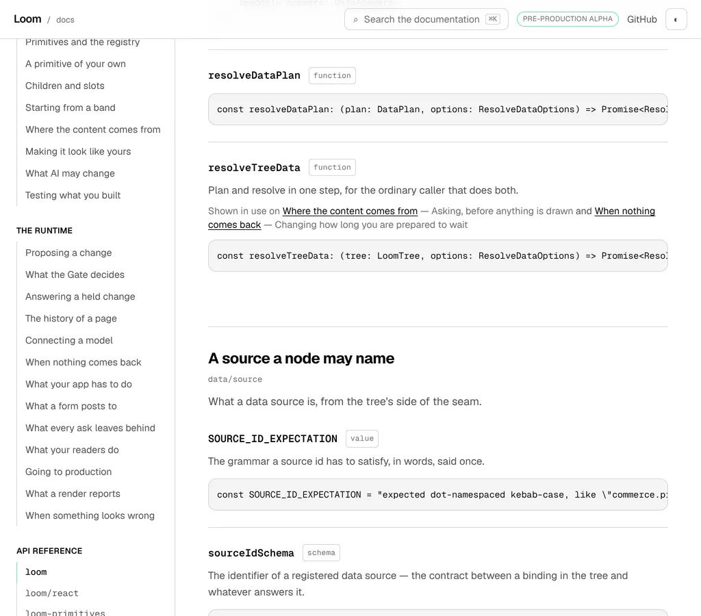
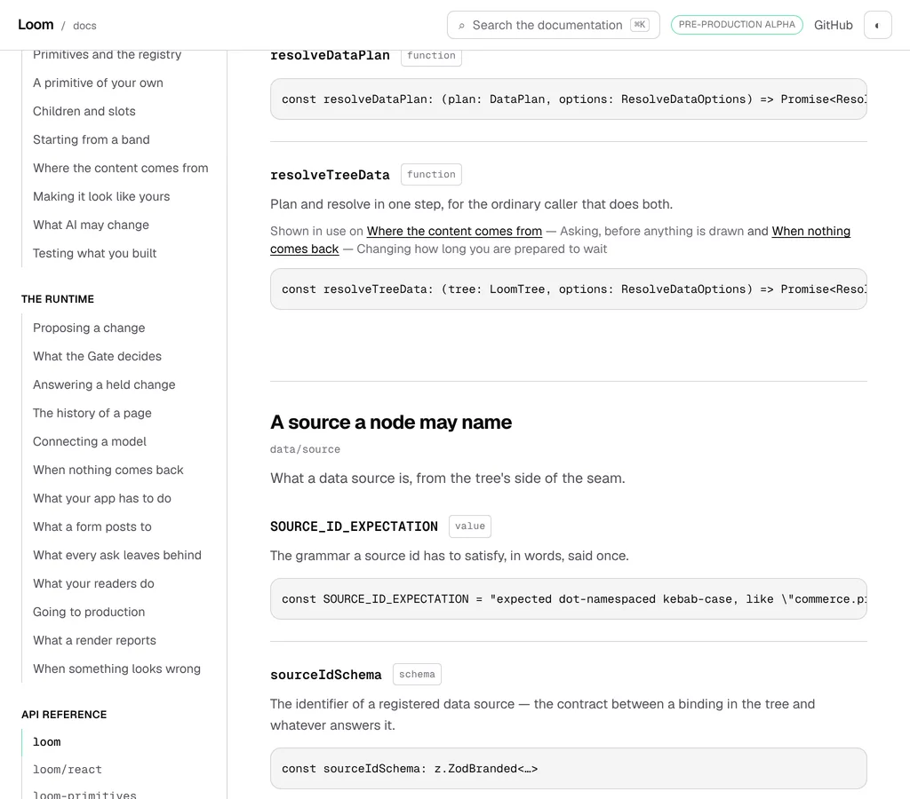
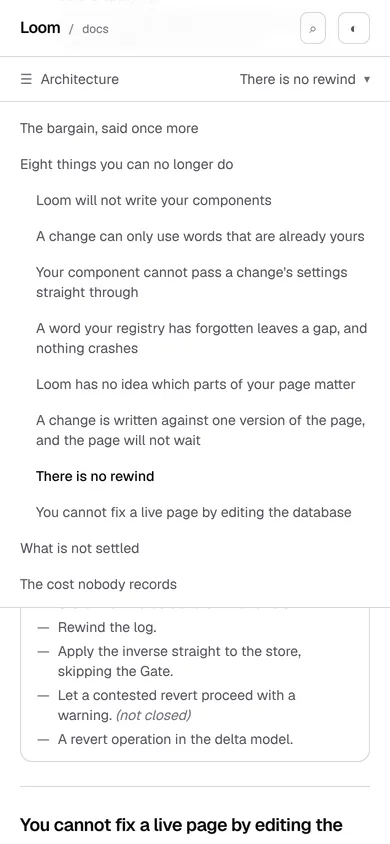
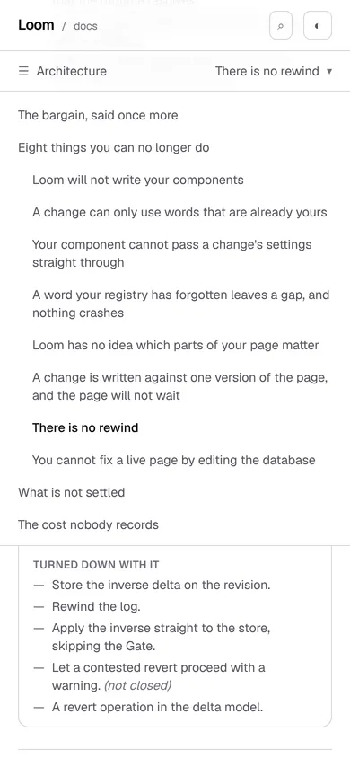

# 20 October 2026 — the place an anchor lands, for the three kinds of anchor the stylesheet cannot reach

**Routine:** `Loom docs` · **Branch:** `docs-61-the-place-a-reference-anchor-lands` ·
**Section:** §4c

No open pull request from this lane at the start of the run. Three were open —
#683 (`Loom marketing`), #682 and #680 (`Loom signals`) — none of them this
lane's, none touching the `(docs)` route group, and no maintainer comment
outstanding on any of them. Nothing to address ahead of the plan.

Branch cut from `origin/main` at `08d7622` (#681), **after** `git fetch origin
main`, which moved the clone's `origin/main` on from `e1682dd`. That is
yesterday's closing note followed rather than rediscovered.

## The plain version

Press a row in a page's contents and the thing it names should arrive in the
same place every time. One number says where: `--press-landing`, ten rem, 160
pixels down the window.

Yesterday it was one place for some rows and three other places for others.

| what a reader pressed | where it stopped, at 1280 |
| --- | --- |
| a heading written in the page's markdown | **160** |
| a heading one of the Architecture components renders | **67** |
| an export on a reference page | **163** |
| an export on a reference page, at 1024 | **208** |

The second row is the one worth looking at twice. On *What it costs you* the
contents rail has thirteen rows in it; five are `##` lines in the page's own
file and **eight are headings a component renders out of the decision records**.
They sit side by side in one list. A press of one of the five stopped at 160; a
press of one of the eight stopped at 67, which is ten pixels below the bottom of
the site header — the heading a reader had just asked for arrived jammed under
the chrome.

## Why those three were outside the arrangement

Getting a reader to the landing takes two declarations, because that is how a
browser does it:

- `html { scroll-padding-top: var(--chrome-inset) }` insets the top of the
  scrollport by whatever is stuck up there;
- the box being scrolled to carries the rest of the way as its own
  `scroll-margin-top`, written as **the landing minus the inset** so the landing
  stays one number while the chrome changes height.

The second lives in a rule for `.prose h1`–`h4`, and that rule is written
`:not(.not-prose *)` on purpose: `.not-prose` is the barrier that keeps this
stylesheet's prose styling out of a rendered `LoomTree`. **Everything the site
renders inside the barrier is therefore outside the arrangement unless it says
so itself**, and three kinds of anchored thing live there:

| rendered inside `.not-prose` | what it wore | where it landed |
| --- | --- | --- |
| a reference page's module band | `scroll-mt-24` | inset + 96 |
| a reference page's export | `scroll-mt-24` | inset + 96 |
| an Architecture heading (8 costs, 8 ideas) | nothing at all | inset + 0 |

Both spellings were written by somebody who was right at the time and neither
was *connected to* the landing. This is the same shape as the six copies of the
header's height that the 17 October finding was about, one layer along: nothing
goes red when a number stops agreeing, and what a reader gets is the thing they
asked for in the wrong place.

## What is there now

**One property, four readers.** `globals.css` declares the difference:

```css
--press-margin: calc(var(--press-landing) - var(--chrome-inset));
```

The prose rule reads it — `scroll-margin-top: var(--press-margin)` — and the
three kinds of anchor outside the prose read it through a class in
`_lib/chrome.ts`:

```ts
export const PRESS_LANDING_CLASS = "scroll-mt-[var(--press-margin)]"
```

`api-reference.tsx` wears it on the module band and on every export;
`architecture-costs.tsx` and `architecture-ideas.tsx` wear it on the heading
that carries the `id`. The calc is written once, in the stylesheet, and no file
transcribes it.

### Why a class and not a second rule

The obvious implementation is another CSS rule for the reference body, and it
is wrong here for a reason the stylesheet's own reader already states.
`chrome-css.ts`' `soleDeclaration` insists that `scroll-margin-top` is declared
**exactly once**, because a test that picks between two declarations of one
property is the shape of the defect that let the reading line be held against
the wrong half of this pair for a day. A second rule would be that second
declaration. A class puts the property on the element without adding one.

It also does the thing the finding asked for and the finding did not ask for:
the Architecture headings are nothing to do with the reference pages, and they
were the worse of the two cases.

## The pictures, and the numbers under them

Every shot was taken with `pnpm shoot --serve apps/loom` against a build in this
container. The *after* pictures are of a build of this commit,
`built 2026-10-20T13:59:50.042Z`. The *before* pictures are of a build of the
same tree with **the four source files reverted to `main` and nothing else**,
`built 2026-10-20T14:08:08.422Z` — the stylesheet and the three components, so
the only variable between a pair is the thing being argued about.

### One rail, two kinds of row

This is the case the unit is for, and both halves of it are in one list on one
page.



```
…-before-wide-rendered-row  1280x900@2x  scrollWidth 1280 / innerWidth 1280
    header > div   x 0 y 0  1280x56
    h3#no-rewind   x 304 y 67  704x28
```



```
…-wide-rendered-row  1280x900@2x  scrollWidth 1280 / innerWidth 1280
    header > div   x 0 y 0  1280x56
    h3#no-rewind   x 304 y 160  704x28
```

**67 and 160**, and 67 is eleven pixels below a header that is 56 tall. Read it
against the declarations and nothing is left over: before, the inset is 67 and
the heading's own margin is nothing; after, the margin is
`160 − 67 = 93` and the two add up to the landing.

### The row beside it, which must not move, and did not

A press of *Where the arguments are* — a `##` in the page's own markdown, four
rows further down the same rail.




```
…-wide-written-row  1280x900@2x  scrollWidth 1280 / innerWidth 1280
    header > div                  x 0 y 0  1280x56
    h2#where-the-arguments-are    x 304 y 160  704x67
```

`y 160` in both builds. The two files are not byte-identical and the difference
is worth stating exactly rather than rounding to *the same*: **2,984 pixels of
4,608,000 differ, all of them inside one 178×32 box on a single rail row, and
not one of them differs by as much as 2%** —

```
compare -metric AE          → 2984
compare -metric AE -fuzz 2% → 0
```

— which is sub-pixel antialiasing of one line of rail text and not a moved
element. That pair is what makes the pair above evidence rather than decoration:
the landing one press arrives at moved 93 pixels and the landing the press
beside it arrives at did not move at all.

### The reference pages, which is what the finding was about




```
…-before-wide-symbol  #s-resolveTreeData  x 304 y 163   h3 at y 187
…-wide-symbol         #s-resolveTreeData  x 304 y 160   h3 at y 184
```





```
…-before-laptop-symbol  #s-resolveTreeData  x 304 y 208   h3 at y 232
…-laptop-symbol         #s-resolveTreeData  x 304 y 160   h3 at y 184
```

**208 → 160** at the width most readers are at, and 163 → 160 above 1280. The
finding's table predicted both to the pixel, which is the one satisfying thing
about a measurement filed the day before it is acted on.

### And on a phone





```
…-before-phone-rendered-row  390x844@2x touch   h3#no-rewind  x 20 y 112  350x28
…-phone-rendered-row         390x844@2x touch   h3#no-rewind  x 20 y 160  350x28
```

112 is the inset with the bar on screen, which is what an element with no
`scroll-margin-top` gets. 160 is the landing. The phone is where the chrome is
tallest and the window shortest, so the 48 pixels bought here are the ones a
reader has least of.

## What this does not do, stated rather than discovered

**The landing is where the anchored *box* lands, not where its words land.**
That has always been true — a prose `h2` lands its border at 160 and its text at
193, because the padding and the rule are inside its own box — and it stays
true in three shapes now:

| anchored thing | box at | words at |
| --- | --- | --- |
| a prose `h2` | 160 | 193 |
| a reference module band | 160 | 193 |
| a reference export | 160 | **184** |
| an Architecture heading | 160 | 160 |

The export is nine pixels tighter than a heading because its block carries
`py-6` where an `h2` carries `pt-8` and a rule. Nothing here is wrong and no
reader could name the difference; it is written down because *the landing* is
now a claim this site makes in four places, and the claim is about the box.

**`#article` and the one panel scroll are deliberately not in it.** The skip
link hands a reader the top of the page, where the scrollport's own inset is the
whole answer, and `long-code.tsx` scrolls a collapsing panel back to its own top
rather than to a named place. The second is a fifth position chosen against
nothing and is filed below rather than changed, because *scroll a panel you just
closed* is a different act from *go to the thing this link names*.

## Decisions taken that were not specified

- **A property rather than the expression, copied.** The finding's remedy 1 was
  a rule carrying `calc(var(--press-landing) - var(--chrome-inset))` for the
  reference body. Written that way it is the arithmetic in two places and a
  second declaration of a property `chrome-css.ts` insists is declared once.
  `--press-margin` is the same remedy with one copy.
- **The Architecture headings were brought in too, which the finding did not
  ask for.** They are the same defect, they are worse — 93 pixels against 48 —
  and they are eight of the thirteen rows on the rail of the page they are on.
  Fixing the reference pages and leaving them would have been a unit that made
  three landings into two.
- **The class goes on the element that carries the `id`.** On a reference page
  that is the `<section>` for a module and the `<div>` for an export; on an
  Architecture page it is the `<h3>`, inside a `<section>` that keeps its own
  rule and padding above the landing. The target of a fragment is the element
  with the `id` and nothing else, so anywhere else would have been a margin on
  a box nobody scrolls to.
- **The sweep forbids a number, not an absence.** `scroll-mt-\d` in a component
  or layout in this route group is now a failing test. What it cannot see is an
  anchor with no scroll margin at all, which is the instance that actually
  happened here — filed below with three remedies rather than half-built.
- **Two docblocks were rewritten rather than left true-ish.** `chrome-css.ts`
  and `on-this-page.ts` each describe this arrangement in prose, and both said
  the margin was a `calc` on a prose heading. A comment that is the only
  description of a mechanism is part of the mechanism.

## Records

None added, none superseded. Nothing here touches the tree schema, the delta
model or an `Accepted` record.

The whole unit is chrome — where a scroll stops — which is the exception
[0067](../decisions/0067-the-four-surfaces-are-one-application.md) names beside
the sidebar, the search box and the pager, so it composes no primitives and
needs none. No finding for `Loom primitives` came out of it.

## Findings

**One closed, one filed.**

Closed:

- *a reference page's anchors land 48 pixels below where a written page's
  headings land, and the number that puts them there was chosen against nothing*
  (19 October, this lane's), by remedy 1, which is what that entry recommended —
  with the one difference recorded in the closing note: the expression is
  declared as `--press-margin` and read, rather than written into a second rule.
  The entry's table of predicted landings was right at both widths.

Filed:

- *the sweep that stops an anchor picking its own landing cannot see an anchor
  that picks none, and the one that picks none is the instance that happened* —
  this lane's, and the stated limit of what shipped. Three remedies, with a
  recommendation.

Standing entries this run met again and did not duplicate:

- **The contents list is two elements with one accessible name** (16 October,
  open, this lane's). Met exactly as the entry describes: the phone shot's
  `a[href='#no-rewind']` resolved to two elements — the bar's panel and the
  wide rail, both in the document — and `pnpm shoot` refused the press and
  exited 1 rather than photographing the wrong one. Worked around in the shot
  list by scoping the selector to the bar (`#article > div:first-child > nav[…]`),
  which is a shot list knowing a layout's shape and is the cost the entry
  predicts. The harness refusing loudly is the behaviour working.
- **The reference pages carry the heading's id on the `<section>`** (15 October,
  open, this lane's). Untouched and still correct: this unit changes where that
  `<section>` lands, not what carries the `id`. Moving the `id` onto the `<h2>`
  would start the contents rail rendering on seventeen pages that already carry
  a two-column contents list of their own, which is a design question rather
  than a margin.
- **`*.vercel.app` is denied by the environment's egress policy** (12 October,
  open). Every picture above was taken against a build in this container.
- **The composed preview URL** (16 October). The URL below is taken from the
  `vercel[bot]` comment rather than guessed from the branch name.

## Test numbers

`pnpm install && pnpm verify` — **exit 0**, read out of a file written as the
last thing on its line, with nothing else running beside it.

- framework: **233 files, 5,444 tests passed**
- application: **343 files, 6,059 tests passed**
- `findings:check`: 1,259 findings, 0 malformed
- `reports:check`: 1,916 visuals, none over 1.1MB, 409 cited by no file
- `prerender:check`: 133 prerendered pages, 1,847 text junctions, 0 run
  together; 3 metadata conventions, 0 unserved

Nothing failed, nothing was skipped, and no test was weakened. `main` was green
when this run started, which is worth a line only because yesterday it was not.

**Three full runs, and the third is the one quoted.** The first was green on the
code alone. A comment in `globals.css` was rewritten while the second was in
flight — harmless, and the kind of thing that makes *the gate was green on this
tree* a weaker sentence than it looks — so a third was run over the finished
tree, with the two findings' entries, the shot list, the ten pictures and this
report in it. Its numbers are the ones above and they are identical to the
second's.

What was written after that third run is **this report's prose and nothing
else**: the paragraph above about test counts, and the preview URL at the foot,
which cannot be known until the pull request exists. `findings:check` and
`reports:check` are the two gate steps that read these files, and both were
re-run against the final tree — 1,259 findings, 0 malformed; 1,916 visuals, none
over 1.1MB. No file under `apps/` or `src/` was touched after the gate.

Every exit code here was read out of a file written as the last thing on its
line, and nothing was piped into `tail` or `tee`.

**Six tests are new and two were rewritten.** The six:

- four in `_lib/chrome.test.ts`, as a `where a press lands` block — the class
  reads the property and names no number; the property is the difference,
  transitively; the three files wear it through the module and spell none of
  it; and no component or layout in the route group names a scroll margin of
  its own (19 tests in that file before, 23 after);
- one in `api-reference.test.tsx`, over all four anchors a generated page
  renders (42 before, 43 after);
- one in `architecture.test.tsx`, over the sixteen headings the two components
  render, asked **through the rail's own `SECTION_SELECTOR`** rather than
  through a copy of it — so a component that renders a heading the rail will
  link to and gives it no landing fails there whether or not anybody remembers
  that file (22 before, 23 after).

The two rewritten are both in `chrome.test.ts`: *makes the heading's own margin
the difference* now reads the property and then the rule that reads it, which is
two strings where there was one, and the chain walk that checks every property a
chrome declaration names was widened from `--press-landing` to every `--press`.

### Mutation-checked, four ways

Each of the four was reverted on its own and the gate re-read:

| what was put back | what failed |
| --- | --- |
| `scroll-mt-24` on the reference band | the route-group sweep, **and** the reference's own anchor test |
| the Architecture heading's class removed | the sixteen-heading test |
| `--press-margin` transcribed as `3rem` | the arithmetic test, and the stylesheet's own |
| `PRESS_LANDING_CLASS` as `scroll-mt-12` | the test that the class reads the property and names no number |

## The preview

Taken from the `vercel[bot]` comment after opening the pull request, not
composed from the branch name, which is the remedy the 16 October finding asks
every lane to follow.

https://loom-git-docs-61-the-place-a-90a788-jpizzolato36-6341s-projects.vercel.app

**This one would not have been guessable**, which is the other half of
yesterday's note. `docs-61-the-place-a-reference-anchor-lands` is long enough
that Vercel truncated it and added a hash segment: the host is
`loom-git-docs-61-the-place-a-90a788-…`, where a composed URL would have said
`loom-git-docs-61-the-place-a-reference-anchor-lands-…` and 404ed. Yesterday's
short branch was luck; this is the ordinary case.

The two pages the pictures above are of:

- [/docs/architecture/what-it-costs-you](https://loom-git-docs-61-the-place-a-90a788-jpizzolato36-6341s-projects.vercel.app/docs/architecture/what-it-costs-you)
- [/docs/api-reference/runtime](https://loom-git-docs-61-the-place-a-90a788-jpizzolato36-6341s-projects.vercel.app/docs/api-reference/runtime)

Every picture above was taken with `pnpm shoot --serve apps/loom` against a
build in this container, not fetched from the preview: `*.vercel.app` is denied
by the environment's egress policy, which is the open finding of 12 October and
still true.
