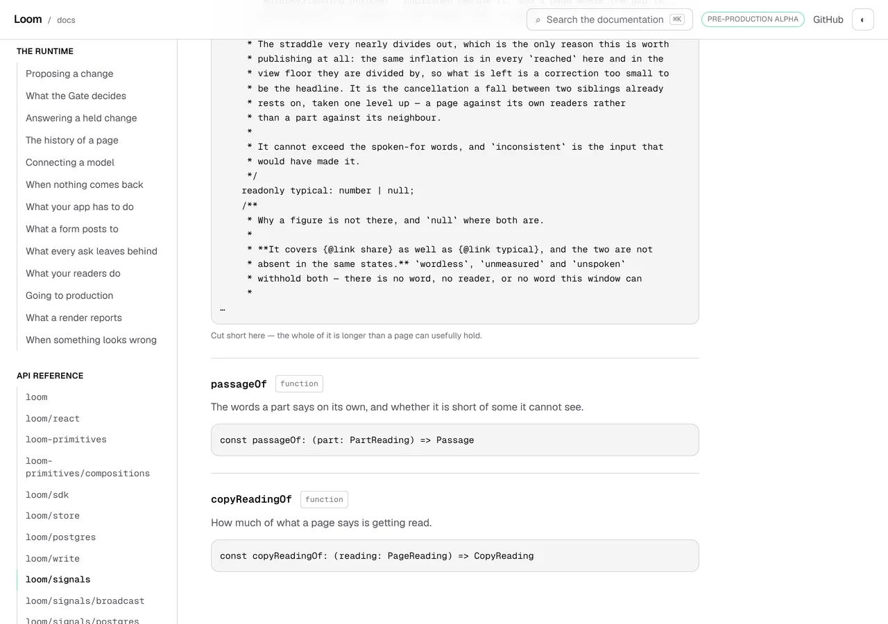
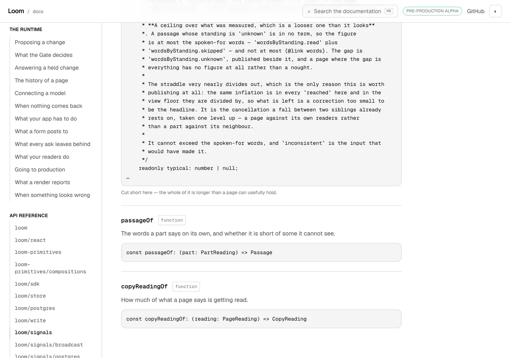
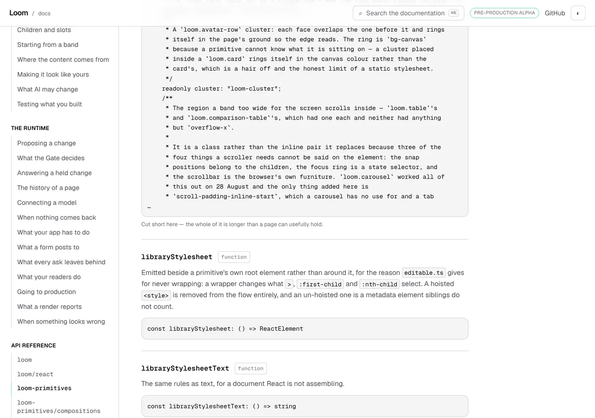
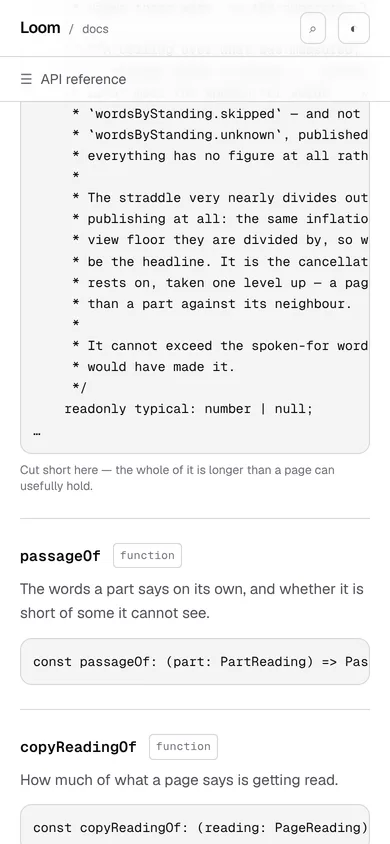
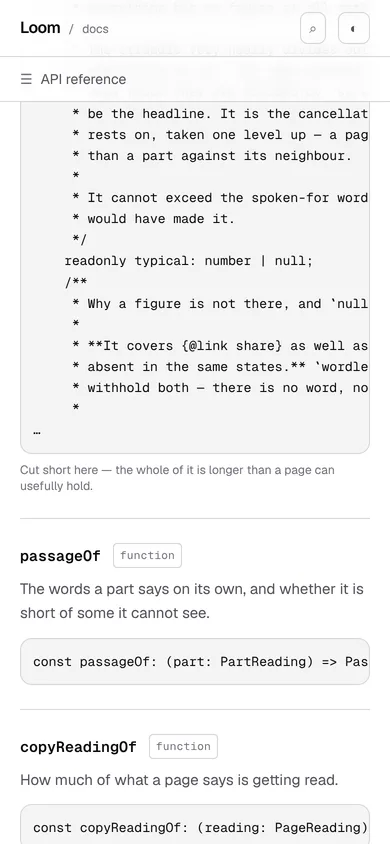

# 21 October 2026 — a signature is cut after it is cleaned, not before

**Routine:** `Loom docs` · **Branch:** `docs-62-a-signature-is-cut-after-it-is-cleaned` ·
**Section:** §4c

No open pull request from this lane at the start of the run. Three were open —
#691 (the maintainer's own project-thread branch), #690 (`Loom marketing`) and
#687 (`Loom signals`) — none of them this lane's, none touching the `(docs)`
route group. The comments on them are a `vercel[bot]` deployment table and each
lane's own summary; **no maintainer comment is outstanding anywhere**, so
nothing came ahead of the findings queue.

Branch cut from `origin/main` at `b20504e` (#689), after `git fetch origin main`.

## The plain version

The API reference pages print the real declaration of every export the package
publishes. A declaration longer than six thousand characters is cut short, with
an ellipsis and a line saying so.

Two things used to happen in the wrong order:

1. **the declaration was cut**, then
2. **the comments inside it were cleaned** — citations like `(0038)` lifted out,
   and any comment whose sentence needs its number dropped whole.

A cut lands wherever the character count stops. Inside these types — unions and
object types whose members each carry a doc comment — it lands inside a comment
about as often as not, and what that leaves is a comment that **opens and never
closes**. The cleaner finds a comment by its closing delimiter, so an unclosed
one is not a comment to it at all. It skipped the whole tail.

Swap the two steps and both problems go. Nothing can reach the page through a
cut that the cleaner has already been over, because cutting text only ever takes
characters away.

## Why it mattered, which is not what it looks like

A dangling comment on a page is untidy. The reason this was filed twice in four
days, by another lane both times, is the *other* half:

- a citation inside the cut comment was **not lifted**, so a comment the package
  had written correctly failed the rule it complies with;
- a comment whose grammar needs its number was **not withheld**, so the one case
  the rule exists to hold back reached the page as half a sentence.

`extract.test.ts` catches that — it is the test that says no decision-record
number may reach a reader — and the failure it prints names the **type**:

> a decision number reached the page: expected [ "SilenceCondition's signature" ]
> to deeply equal []

The number it found was `0212`, in a comment on a member that branch had not
touched, written by another lane, correctly parenthesised, and clean in every
generation before that one. The failure is **positional**: the same comment
passes a hundred characters earlier in the file. So the lane that meets it is
reliably a lane that did not write it, and the first minutes of reading the
failure are spent looking for a citation nobody added.

It happened to `Loom signals` on 18 October and again eight hours later, and to
this lane on 15 October. Each time it was worked around in `src/` by shortening
a comment until the cut moved — which is **not a fix**, as that lane's own entry
says: shortening does not bring a 13,000-character declaration under a 6,000
cap, it just moves the cut, and whether the new one lands in a cited comment is
luck.

## What is there now

One function, in `extract.ts`, where `extractSymbol` used to do it inline:

```ts
export const publishedSignature = (
  full: string
): { readonly signature: string; readonly truncated: boolean } => {
  const cleaned = readerFacingSignature(full)

  if (cleaned.length <= SIGNATURE_CAP) return { signature: cleaned, truncated: false }

  return { signature: `${withoutAHalfComment(cleaned.slice(0, SIGNATURE_CAP))}\n…`, truncated: true }
}
```

Three things changed and they are worth separating, because they are three
claims and only the first is the defect:

| | before | after |
| --- | --- | --- |
| order | cut, then clean | **clean, then cut** |
| the cap counts | the declaration | **the text the page shows** |
| a comment the cut opened | published | **dropped** |

`withoutAHalfComment` is the third: it drops back to the opening delimiter when
the cut left one with no close. The member that comment described goes with it,
because that member is past the cut already.

### Why the cap moved too

It follows from the order rather than being a separate decision — the cap is
applied to whatever is cut, and what is cut is now the cleaned text. It is also
the more defensible of the two readings: the constant's own sentence is *past
this, a signature stops being something a person reads*, and the characters a
citation or a withheld comment occupies are not characters a person reads.

**It is a smaller correction than it sounds, and the measurement is in the
docblock rather than implied.** Twelve published signatures are over the cap,
and all twelve are still over it once cleaned — these types carry few citations
for their length, so the cut moves by tens of characters, not hundreds. Nothing
gained its whole declaration. What the order buys is the paragraph above, not a
longer page.

## The pictures

Every shot was taken with `pnpm shoot --serve apps/loom` against a build in this
container. The *after* pictures are of a build of this commit, `built
2026-10-21T13:58:40.201Z`. The *before* pictures are of a build of the same tree
with **`extract.ts` and `reference.generated.json` reverted to `main` and
nothing else**, `built 2026-10-21T14:05:34.893Z` — so the only variable between
a pair is the change being argued about.

### `CopyReading`, which is the case the 15 October entry was filed on



The tail reads:

```
    readonly typical: number | null;
    /**
     * Why a figure is not there, and `null` where both are.
     *
     * **It covers {@link share} as well as {@link typical}, and the two are not
     * absent in the same states.** `wordless`, `unmeasured` and `unspoken`
     * withhold both — there is no word, no reader, or no word this window can
     *
…
```

That `/**` has no end. It is the shape the cleaner cannot see, and anything
cited below `readonly typical` was published exactly as the package wrote it.



```
     * It cannot exceed the spoken-for words, and `inconsistent` is the input that
     * would have made it.
     */
    readonly typical: number | null;
…
```

Same member, and the comment above it is closed. The line underneath — *Cut
short here — the whole of it is longer than a page can usefully hold* — is in
the same place in both, measured at `x 304 y 476  704x16` before and after.

### `LIBRARY_CLASS`, on a different door, to show it is not one page's luck




5,335 characters after, 6,002 before; `x 304 y 475` before and `y 476` after,
which is the one pixel a shorter block moves the paragraph under it.

### And on a phone





## What moved in the generated file

**Eleven signatures of 1,700**, which is the whole blast radius:

```
ChangeAnalysis  CopyReading  KindAction  KindReachChange  LIBRARY_CLASS
LibraryCopyChange  LoomRenderContext  PairReach  RegistryAudit
RenderDiagnostic  SilenceCondition
```

Twelve are cut, and `PrimitiveDefinition` is the one whose cut already landed on
a boundary, so it is byte-identical.

**Eight of the twelve were published with a comment the cut had left open.
None is now** — a sweep over all 1,752 symbols in the generated file reports
zero, and that sweep is one of the new tests.

| | before | after |
| --- | --- | --- |
| signatures cut short | 12 | 12 |
| of those, ending in an unclosed comment | **8** | **0** |
| signatures changed at all | — | 11 of 1,700 |

## Decisions taken that were not specified

- **Both shapes the 15 October entry offered, not one.** It proposed cleaning
  first *or* closing the cut. Cleaning first fixes the number reaching the page;
  it does not stop a cut landing mid-comment, which still publishes half a
  sentence under an ellipsis. Taking only the first would have left eight blocks
  looking exactly as broken as the picture above while being correct.
- **The cap now counts the cleaned text**, which the entries did not ask for and
  which follows from the order. Argued in the docblock and measured, because it
  changes what `truncated` means: *what you are reading is cut*, which is what
  the page's own sentence claims.
- **A function with a name rather than three lines in `extractSymbol`.** The
  order is the thing that was wrong, and an order is easier to assert about a
  function than about a statement in the middle of a symbol walk. It is exported
  for that reason and for no other.
- **The two workarounds in `src/` are left alone.** `SilenceCondition`'s and
  §39's member comments were shortened to dodge this; shorter reference prose is
  better prose either way, and undoing them would be this lane editing two other
  lanes' files to make a point. Said in the closing note so nobody re-lengthens
  them believing they have to.
- **`withoutAHalfComment` looks for the last `/**` and asks whether a `*/`
  follows it.** It cannot tell an opener in a string literal type from a real
  one — which is the exposure `COMMENT_IN_CODE` beside it already has, on the
  same strings, and no published declaration has one today.

## Records

None added, none superseded. Nothing here touches the tree schema, the delta
model or an `Accepted` record.

The whole unit is a build-time generator and its tests, so it composes no
primitives and needs none. No finding for `Loom primitives` came out of it.

## Findings

**Two closed, two filed.**

Closed, both `Loom signals`' and both this lane's to fix:

- *the API reference truncates a long signature mid-comment, and a citation past
  the cut is never lifted* (15 October) — by both of the shapes it offered.
- *a generated signature is truncated before its comments are cleaned, so a long
  union fails the decision-number check on a citation nobody added*
  (18 October, with its same-day second section) — by the ordering it named.

Filed, both this lane's and both stated limits of what shipped:

- *the cut now lands on a member boundary wherever it lands in a comment, and
  mid-token wherever it lands in code* — ten of twelve end on a whole member as
  a side effect of dropping the half comment; `PrimitiveDefinition` ends
  `readonly role?: P`. Three remedies, recommendation is cutting back to the last
  complete line, not urgent.
- *a cut signature says it was cut and never says how much is missing, and the
  worst of them shows a reader 29 of 168 members* — `LIBRARY_CLASS` is the map
  of every class name the primitive library writes, and a reader who needs one
  of the 139 below the ellipsis is told only that the whole is "longer than a
  page can usefully hold". Four remedies, recommendation is to say the count and
  then to link the declaration.

Standing entries this run met again and did not duplicate:

- **`*.vercel.app` is denied by the environment's egress policy** (12 October,
  open). Every picture above was taken against a build in this container.
- **The composed preview URL** (16 October). The URL below is taken from the
  `vercel[bot]` comment rather than guessed from the branch name.

## Test numbers

`pnpm install && pnpm verify` — **exit 0**, read out of a file written as the
last thing on its line, with nothing else running beside it.

- framework: **233 files, 5,489 tests passed**
- application: **348 files, 6,174 tests passed**
- `findings:check`: 1,267 findings, 0 malformed
- `reports:check`: 1,925 visuals, none over 1.1MB, 409 cited by no file
- `prerender:check`: 133 prerendered pages, 1,851 text junctions, 0 run
  together; 3 metadata conventions, 0 unserved

Nothing failed, nothing was skipped, and no test was weakened.

**Two full runs, and the second is the one quoted.** The first was green on the
code alone, before the report, the findings entries and the pictures existed;
the second was run over the finished tree with all of them in it, and the two
test counts are identical. What was written after it is **this report's prose
and nothing else** — the five numbers above and the preview URL at the foot,
which cannot be known until the pull request exists. `findings:check` and
`reports:check` are the two gate steps that read these files and both were
re-run against the final tree. No file under `apps/` or `src/` was touched
after the gate.

Every exit code here was read out of a file written as the last thing on its
line, with nothing piped into `tail` or `tee`.

**Eight tests are new.** Five hold `publishedSignature` against written-out
declarations — a type whose members each carry a cited comment, and one whose
members each carry a comment the rule withholds — and three sweep the generated
file. The first of the five is the one worth reading, because it asserts the
**order** by running the old one beside the new one on the same string:

```ts
const cutFirst = readerFacingSignature(`${declaration.slice(0, SIGNATURE_CAP).trimEnd()}\n…`)

expect(DECISION_NUMBER.test(cutFirst), "cut first, then cleaned").toBe(true)
expect(DECISION_NUMBER.test(signature), "cleaned first, then cut").toBe(false)
```

`extract.test.ts` went from 61 tests to 69.

### Mutation-checked, three ways

Each mutation was applied on its own, the reference regenerated, and the file
re-run:

| what was put back | what failed |
| --- | --- |
| the old order — cut, then clean | **4**: the ordering test, both withholding tests, and the sweep for an unclosed comment |
| the half comment published again | **2**: the ordering test and the sweep |
| the cap counted on the declaration | **1**: *does not cut a declaration whose length is all in comments the page withholds* |

The third is worth a sentence rather than a tick. The sweep over the real
reference did **not** catch it, and should not have: no export in this package
is over the cap raw and under it cleaned, so the mutation is invisible in the
generated file and only the written-out declaration can state the rule. That is
the same shape as the 28 September entry about a test derived from the list it
checks — the sweep holds what is there, and the written-out case holds what the
rule says.

## The preview

Taken from the `vercel[bot]` comment after opening the pull request, not
composed from the branch name.

https://loom-git-docs-62-a-signature-f6566b-jpizzolato36-6341s-projects.vercel.app

**Truncated and hashed again**, which is the ordinary case rather than the
exception: `docs-62-a-signature-is-cut-after-it-is-cleaned` is 45 characters and
`docs-62-a-signature` is what survives, with `f6566b` standing for the rest. A
URL composed from the branch name would have had no hash segment and would have
404ed — the 16 October entry's remedy, followed, at the cost of one API call in
a turn that was already open.

The two pages the pictures above are of:

- [/docs/api-reference/signals](https://loom-git-docs-62-a-signature-f6566b-jpizzolato36-6341s-projects.vercel.app/docs/api-reference/signals)
- [/docs/api-reference/primitives](https://loom-git-docs-62-a-signature-f6566b-jpizzolato36-6341s-projects.vercel.app/docs/api-reference/primitives)

Every picture above was taken with `pnpm shoot --serve apps/loom` against a
build in this container, not fetched from the preview: `*.vercel.app` is denied
by the environment's egress policy, which is the open finding of 12 October and
still true.
