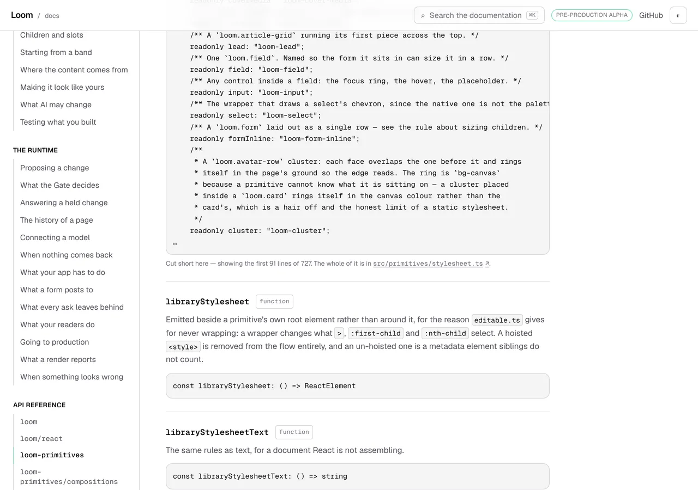
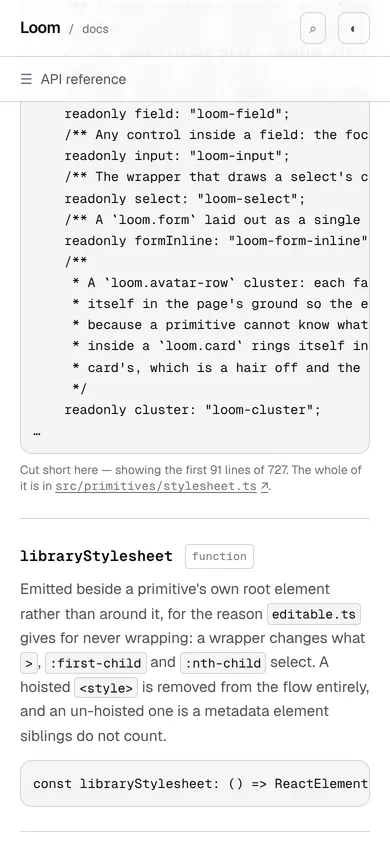
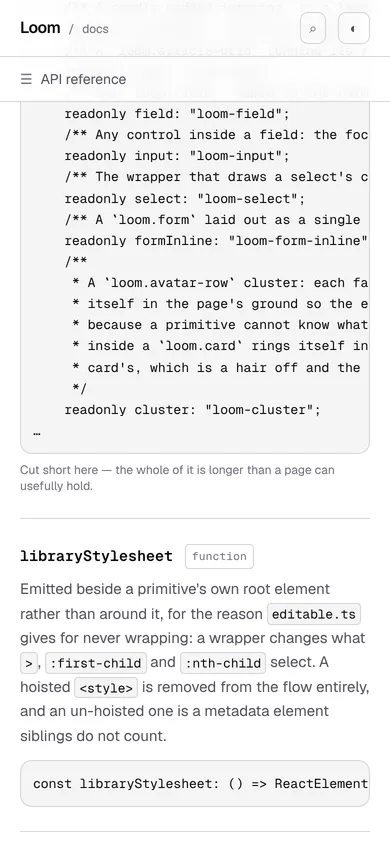

# 22 October 2026 — how much of a cut signature is missing, and where the rest of it is

**Routine:** `Loom docs` · **Branch:** `docs-63-how-much-of-a-cut-signature-is-missing` ·
**Section:** §4c

No open pull request from this lane at the start of the run. Three were open —
#695 (`Loom marketing`), #694 (the maintainer's own project thread) and #693
(`Loom signals`) — none of them this lane's, none touching the `(docs)` route
group. The comments on them are a `vercel[bot]` deployment table and each
lane's own summary; **no maintainer comment is outstanding anywhere**, so
nothing came ahead of the findings queue.

Branch cut from `origin/main` at `2f3723a` (#692), after `git fetch origin main`.

The queue picked the work: the two findings this lane filed on #692 last night,
both owned by this lane, both about the same four lines of one page. They are
one unit because they are one sentence — the grey line under a block that was
cut short.

## The plain version

An API reference page prints the real declaration of every export. A few of
them are too long for a page, so they stop part way with an ellipsis and a line
saying so. That line used to say:

> Cut short here — the whole of it is longer than a page can usefully hold.

It said exactly that under all twelve of them. One of the twelve is missing ten
lines. Another is missing six hundred and thirty-six.

It now says how much, and where the rest is:

> Cut short here — showing the first 91 lines of 727. The whole of it is in
> `src/primitives/stylesheet.ts` ↗

And the block above it now ends where a line ends, instead of wherever the
character count happened to stop.

## The three things that changed

### 1. The sentence says how much

`LIBRARY_CLASS` is the map of every class name the primitive library writes.
Measured against the declaration each was read from, the twelve are not twelve
of the same thing:

| export | shows | of | of the whole |
| --- | --- | --- | --- |
| `KindReachChange` | 132 | 142 | 93% |
| `KindAction` | 129 | 140 | 92% |
| `PairReach` | 118 | 133 | 89% |
| `CopyReading` | 107 | 122 | 88% |
| `RegistryAudit` | 105 | 125 | 84% |
| `LibraryCopyChange` | 112 | 142 | 79% |
| `LoomRenderContext` | 111 | 143 | 78% |
| `SilenceCondition` | 125 | 180 | 69% |
| `ChangeAnalysis` | 107 | 159 | 67% |
| `PrimitiveDefinition` | 82 | 176 | 47% |
| `RenderDiagnostic` | 136 | 298 | 46% |
| `LIBRARY_CLASS` | **91** | **727** | **13%** |

A reader of `KindReachChange` is missing ten lines. A reader of
`LIBRARY_CLASS` is missing six hundred and thirty-six. Until today they were
told the same thing, in the same words, in the same grey.

**Lines rather than members**, which the finding had proposed as members. The
measure has to be true of a union, an object type and a function type alike,
and counting members means tracking brace depth through a string this module
otherwise treats as text — which is a parser where a line count will do. It is
also what the cut is now *made of*, after change 3 below: the block ends where
a line ends, so *the first 91 of 727 lines* describes the rule rather than
approximating it.

**Both numbers are counted on the cleaned text**, which is the text the page
shows, and not on the declaration it was read from. Cleaning drops comments the
citation rule withholds whole; counting those would tell a reader they are
missing lines no reader was ever going to see. The written-out test case for
this is a declaration of 1,202 lines that renders as 302, where the two
readings differ by a factor of four.

### 2. The sentence says where the rest is

`moduleOf` already knew the declaring file, so a cut carries the path and the
page links it. The twelve resolve to twelve files under `src/`, every one of
which is really there — which is one of the new sweeps, because this is the
only field in the generated reference naming a file in *this repository* rather
than in the published package, and so the only one that can rot without
anything else noticing.

Two notes on what the link is and is not:

- It goes to the **source**, not to the declaration the signature was read
  from. `dist/` is not in the repository and there is no address to send a
  reader to. For all twelve the two are the same text; where they could differ
  is a declaration TypeScript widens on emit, which is filed.
- `blob/main` was written out in two places and is now written in one.
  `surfaces.ts` holds `repositoryFileUrl`, beside the `REPOSITORY_URL` the
  header and footer already read, and `architecture/source.ts`'s
  `repositoryHref` composes it. `LICENSE_URL` is now built from it too. Two of
  the three are pinned to their literal address by a test —
  `architecture.test.ts` writes out
  `https://github.com/jam-overture/loom/blob/main/lessons/…` for a lesson and a
  record, and both still pass. The licence link is not pinned anywhere and is
  the same string by construction; the footer's test imports the constant, so
  it would not have caught a change in it. Said rather than tidied: pinning a
  constant to its own value is a test that holds nothing.

### 3. The block ends where a line ends

Ten of the twelve ended on a whole member as of yesterday, as a side effect of
dropping a comment the cut had left open. The two that did not:

```
PrimitiveDefinition     readonly role?: P
RenderDiagnostic        (four spaces, and then the ellipsis)
```

`readonly role?: P` is `readonly role?: PrimitiveRole` with the name cut in
half. Nobody was misled — the ellipsis is on the next line — but *exact* is the
whole claim a generated signature makes.

It is one `lastIndexOf("\n")` and it costs at most one line of content: the
furthest any cut on the site was from its line end is twenty-two characters. A
fragment with no line end in it at all is left as it is rather than emptied; no
published export is one today.

## The part that was not in the plan: the two steps do not commute

This is the thing worth reading, and it was the generated file that said so
rather than any test.

Dropping a comment the cut left open and cutting back to a line end are both
steps that take characters off the end, so the order looks like it could not
matter. **Run the line-end step second and it reintroduces exactly what the
comment step exists to remove.** Measured on the real reference, both of these
came out of the wrong order:

- the comment step lands on the line *before* the dropped comment — which is a
  whole member — and then the line-end step takes that member off, leaving a
  bare `*/` as the last line on the page. Ten of the twelve.
- where that member's own comment ran over two lines, taking the member off
  landed the block **inside** that comment, on its opening delimiter, with no
  close: the shape of yesterday's defect, one day later and from the other
  direction. `LibraryCopyChange`, which ended on `/** The type whose kept words
  gained the most reading,`.

Cut to a line end **first**, then drop the trailing comment, and both go: the
comment step's own output always ends at a line end, so it is the step that can
safely run last. That order is in the function, in the docblock, and in a test
that fails under either of the other two arrangements.

This is the second day running that a defect here has been an ordering of two
correct steps. Yesterday's was *clean before cutting*; today's is *cut to a
line before dropping the comment*. Four steps now compose in one statement, and
what makes the statement readable is that each step is a named function with
the argument for its position in its own docblock.

## One rule, not a third

Fixing the cut to a line end turned up a case the half-comment rule could not
see. `PrimitiveDefinition`'s cut landed mid-name, and cutting back to the line
end put the end of the block just after a comment that had **closed properly**
— eighteen lines about a `role` that is past the cut. Nothing was malformed and
nothing was unclosed; it was a page ending with a paragraph about a member that
is not on it.

The 21 October finding had warned that *a third rule about the cut is a third
thing to hold true*, and it was right. So the half-comment rule was
**generalised rather than joined**: what is dropped is a comment with nothing
under it, and whether the cut fell inside the comment or just after it is not a
difference a reader can see. `withoutAHalfComment` became
`withoutATrailingComment`, and the unclosed case is now the closed case of one
rule rather than a second rule beside it.

A comment separated from what it describes is still left alone, which is what
keeps the other eleven as they are: a comment that closes and has a member
under it keeps both halves, because the member is on the page.

## `truncated: boolean` became `cut: ApiCut | undefined`

The flag and the measure are one fact — *this block is cut* is exactly *there
are lines behind the ellipsis* — so carrying both would have been two fields
that have to agree. One field carries the fact and the measure, and the page
switches on its presence.

It is why the generated file's diff is **+62 / −1,765**: `"truncated": false`
left 1,751 exports and `"cut": { … }` arrived on twelve. The file is smaller
than it was. The three places that consume it — the validator, the page and the
sweeps — each read one field where they read two.

The validator refuses one shape, in the spirit of the narrower-door rule beside
it: a cut whose `shown` is not less than its `whole`, because *showing the first
91 lines of 91* is a true sentence that says nothing. The generator cannot
produce one, which is the point of refusing it at module scope.

## The pictures

Every shot was taken with `pnpm shoot --serve apps/loom` against a build in
this container. The *after* pictures are of a build of this commit, `built
2026-10-22T14:03:57.426Z`. The *before* pictures are of a build of the same
tree with the seven changed source files reverted to `main` and nothing else —
so the only variable between a pair is the change being argued about.

### `LIBRARY_CLASS`, which is the case the finding was filed on




The block above the line is **byte-identical** in the pair — `LIBRARY_CLASS`
already ended on `readonly cluster: "loom-cluster";` — so the whole of the
difference is the sentence and the link. The paragraph is in the same place in
both, measured at `x 304 y 476  704x16`. `PrimitiveDefinition`'s moves by one
pixel — `y 476` before, `y 475` after — which is the shorter block above it.

Thirteen per cent is the number that makes this finding's remedy 3 worth the
maintainer's opinion, and it is filed: the page now says plainly that it is
showing a reader ninety-one lines of a seven-hundred-line list, which is an
honest answer to a question the page still cannot answer. More below.

### `PrimitiveDefinition`, which is the block that changed shape


This is the one where all three changes land at once: the half name is gone
because the cut is at a line end, the eighteen-line comment about `role` is
gone because it describes nothing, and the sentence says 82 of 176. It is also
the only one of the twelve that shows a reader **less** than it did yesterday —
1,145 characters less — and that is the rule working rather than a cost:
every character it lost was a paragraph about a member that was not there.

### And on a phone





The sentence was already two lines at 390 and it still is: `350x32` before and
after, against `704x16` at 1280. That is the measurement worth taking of a line
that got longer — **it cost no third line on a phone**, so nothing below it
moves at the width where a wrap would have shown.

## Decisions taken that were not specified

- **Lines, not members**, as the measure. Argued above and in `ApiCut`'s
  docblock. The finding asked for members.
- **The denominator is the cleaned text**, not the declaration. It follows from
  the cap counting the cleaned text, which was yesterday's change, and it is
  the only reading where the sentence on the page is about the page.
- **One field rather than two.** `truncated` is gone. The alternative kept the
  generated diff small by leaving 1,751 lines saying `false` in a file nobody
  reads by hand.
- **The comment rule generalised rather than extended.** The 21 October entry's
  own warning about a third rule is the reason, and it was the right warning.
- **`repositoryFileUrl` in `surfaces.ts`.** Three places send a reader to a file
  in the repository and `blob/main` was written out in two of them. This is a
  consolidation the run needed rather than one it went looking for, and it is
  two lines in the file that already holds the repository's address.
- **The two workarounds in `src/` are still left alone**, as yesterday's report
  said. Nothing here needs them undone.

## Records

None added, none superseded. Nothing here touches the tree schema, the delta
model or an `Accepted` record.

The whole unit is a build-time generator, a validator and four lines of a page
that was already furniture by its own docblock, so it composes no primitives
and needs none. **No finding for `Loom primitives` came out of it.**

## Findings

**Two closed, three filed.**

Closed, both this lane's and both filed on #692 last night:

- *the cut now lands on a member boundary wherever it lands in a comment, and
  mid-token wherever it lands in code* (21 October) — by its remedy 1, and by
  the generalisation of the comment rule that remedy turned out to need.
- *a cut signature says it was cut and never says how much is missing, and the
  worst of them shows a reader 29 of 168 members* (21 October) — by its
  remedies 1 and 2 together, as recommended. Its remedy 3 is a question for the
  maintainer and is re-filed rather than closed with the rest.

Filed:

- *a cut signature now tells a reader how much is missing, and nothing can
  check the number it tells them* — `shown` is re-counted off the page by a
  sweep; `whole` is a claim about text the generated file does not carry, held
  only by the written-out case. Three remedies, recommendation is to leave it
  written down, because the mutation that would make it wrong was planted and
  died.
- *a map of 168 class names is not a signature, and thirteen per cent of one is
  not a reference* — the carried remedy 3. Four remedies; 3 (link a line
  anchor) is an hour in this lane and 2 (a list-shaped presentation) is the
  first thing this section would build that is a rendering rather than a
  transcription, which is his call.
- *the link under a cut signature goes to the source, and the signature was
  read from the declaration* — a stated limit. Two remedies, recommendation is
  to leave the words doing the work.

Standing entries this run met again and did not duplicate:

- **`*.vercel.app` is denied by the environment's egress policy** (12 October,
  open). Every picture above was taken against a build in this container.
- **The composed preview URL** (16 October). The URL below is taken from the
  `vercel[bot]` comment rather than guessed from the branch name.

## Test numbers

`pnpm install && pnpm verify` — **exit 0**, read out of a file written as the
last thing on its line, with nothing else running beside it.

- framework: **234 files, 5,547 tests passed**
- application: **349 files, 6,208 tests passed**
- `findings:check`: 1,280 findings, 0 malformed
- `reports:check`: 1,935 visuals, none over 1.1MB, 409 cited by no file
- `prerender:check`: 133 prerendered pages, 1,911 text junctions, 0 run
  together; 3 metadata conventions, 0 unserved

Nothing failed, nothing was skipped, and no test was weakened.

**Eleven tests are new.** Eight in `extract.test.ts` (69 → 77) and three in
`api-reference.test.tsx`. The four worth reading are the ones that hold a rule
rather than a result:

- **the block ends where a line ends** — a type of four hundred uncommented
  members, so the cut has no comment to fall back to and the last line has to
  be a whole member;
- **a comment the cut left describing nothing is dropped, closed or not** —
  written out with the cap landing *inside* the member line, so the line the
  cut falls back to is a comment whose member is past it. The whole signature
  is asserted exactly: `type Wide = {\n    readonly kept: string;\n…`;
- **both numbers count the text a reader gets** — a declaration of 1,202 lines
  that renders as 302, where counting the declaration would be wrong by a
  factor of four;
- **the source is a file that is really there** — a sweep that opens all twelve
  paths, because this is the one field in the reference naming a file in this
  repository.

### Mutation-checked, five ways, no survivors

Each mutation was applied on its own, the reference regenerated, and
`extract.test.ts` and `api-reference.test.tsx` re-run:

| what was put back | what failed |
| --- | --- |
| the comment step before the line end | **2**: the written-out closed-comment case, and the sweep for a block ending on a comment |
| no line-end step at all | **3**: the line-end case, the closed-comment case, and the sweep for a block ending on whitespace |
| only an unclosed comment dropped | **2**: the written-out closed-comment case and the sweep |
| `whole` counted on the declaration | **1**: *counts both numbers on the text a reader gets* |
| no source carried on a cut | **1**: *points a reader at a source file that exists* |

The first row is the one worth a sentence rather than a tick: it is the
ordering above, and the two tests that catch it are both about the *comment*
rather than about the line. That is the shape of the defect — the line-end step
run late does not leave a ragged line, it leaves a comment behind.

**Two full runs, and the second is the one quoted.** The first was green on the
code alone; the second was run over the finished tree with the report, the
findings entries and the pictures in it, and the two test counts are identical.
What was written after it is **this report's prose and the preview URL below**,
which cannot be known until the pull request exists. No file under `apps/` or
`src/` was touched after the gate.

Every exit code here was read out of a file written as the last thing on its
line, with nothing piped into `tail` or `tee`.

## The preview

PENDING
