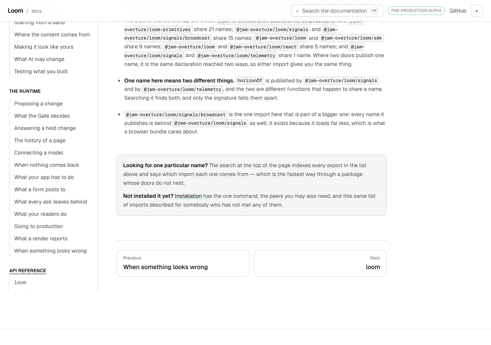
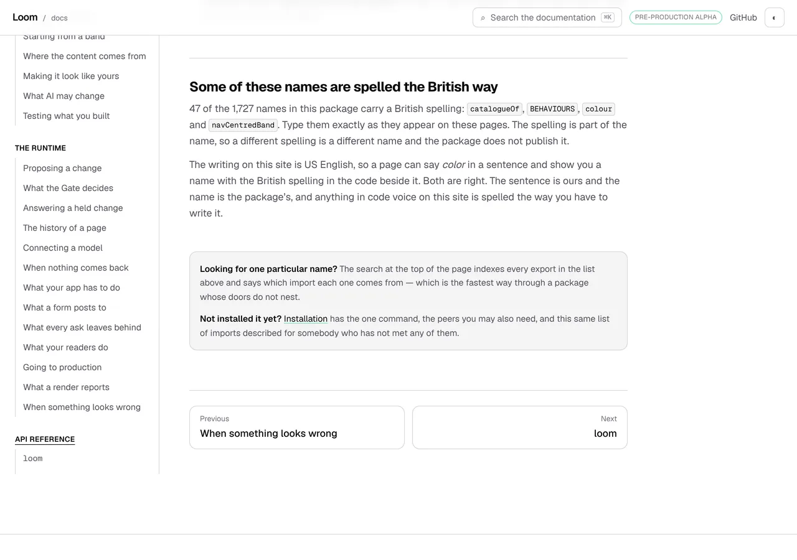
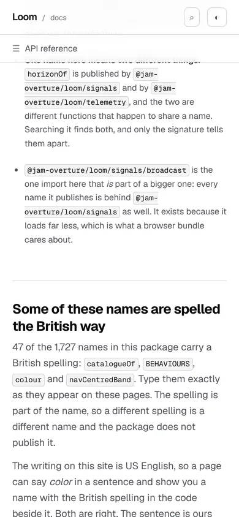
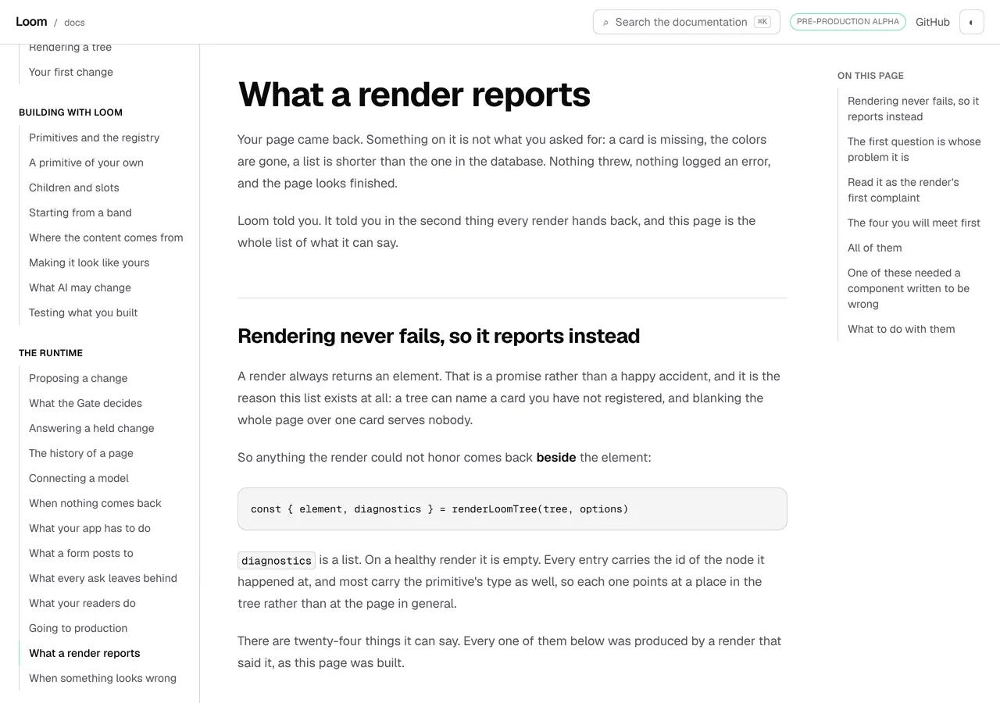

# 23 October 2026 — one spelling for the reader, and the package's own where it is the package's name

**Routine:** `Loom docs` · **Branch:** `docs-64-one-spelling-for-the-reader` ·
**Section:** §4c

No open pull request from this lane at the start of the run. #696 merged
overnight as `2cfd93d`. Three pull requests were open — #698 (`Loom marketing`),
#697 (`Loom signals`) and #694 (the maintainer's own project thread) — none of
them this lane's and none touching the `(docs)` route group.

**No maintainer comment is outstanding anywhere**, including on #696, where the
one question this lane put to him is still unanswered: whether a list-shaped
export may be given a list-shaped presentation. That finding stays open and
nothing here touches it.

Branch cut from `origin/main` at `2cfd93d` (#696), after `git fetch origin main`.

## Why this, and not the queue

**The queue had one item that was ready**, and this run did not take it: remedy
3 of *a map of 168 class names is not a signature* — link a cut signature at a
line anchor in the source rather than at the top of the file. It is this lane's,
it is about an hour, and it is still the next thing. The other eight open
findings owned here are stated limits with *leave it* as the recommendation.

What this run did instead, and the reason, said plainly so it can be
disagreed with: the line anchor is **half a remedy on a page this lane has
worked for four days running**, and its other half is a design question waiting
on the maintainer. The register this site is written in had never been measured
at all, and it turned out to be inconsistent in the one word the theming pages
are mostly about. A reader meets that on every page; the line anchor is met by
a reader who has already decided to go and search a source file.

That is a judgement rather than a rule, and if the rule is *the queue first*,
this run got it wrong and the next one should take the line anchor.

## The plain version

This site is written in American English. It said *color* twenty-six times and
*colour* five. It said *behavior* four times and *behaviour* three. The page
about theming and the page about writing a primitive of your own disagreed with
each other about the one word they are both mostly about.

Thirty-seven British spellings are now American — thirty of them in the prose
of fifteen pages, three in page summaries, three in two files the site shows a
reader verbatim, and one in a test's own key — and a test sweeps all
forty-nine pages so it cannot drift back.

The part that is not housekeeping is **why the site could not simply be
American**: the package it documents is not.

## The package publishes 47 names spelled the British way

| the word | published names | examples |
| --- | --- | --- |
| `catalogue` | 28 | `catalogueOf`, `DataCatalogue`, `CATALOGUE_TYPES` |
| `behaviour` | 13 | `BEHAVIOURS`, `PrimitiveBehaviours`, `BehaviourName` |
| `colour` | 5 | `colour`, `ColourPairing`, `colourDifference` |
| `centred` | 1 | `navCentredBand` |

47 of 1,727, read off the generated reference rather than counted by hand.

So *US spelling everywhere a visitor reads* — the maintainer's instruction of
26 September, which `(marketing)/_lib/voice.test.ts` has held three pages to
since — cannot be the rule here as written. `(marketing)` never names an
export, so it never meets the collision. This surface names seventeen hundred
of them.

**The rule that shipped is about which voice a word is in, not about the word:**

- **A word in a sentence is ours**, and it is spelled the American way.
- **A name in code voice is the package's**, and it is spelled whichever way the
  package spells it.

The clearest illustration of the split is in the file that *A primitive of your
own* shows a reader verbatim, where both halves are on one line:

```ts
operational: { background: colour("bg-surface-muted"), color: colour("fg-muted") },
```

`colour` is Loom's function. `color` is CSS's property. Both are correct and
neither is the site's choice. What *was* the site's choice is the sentence above
that block, which said *the badge takes its two colours from the theme* and now
says *colors*.

## The sweep is short, because the search index already does the hard part

`voice.ts` reads each page the way the search box reads it — `search/prose.ts`
for the thirty-one written pages, `search/rendered.ts` for the eighteen
generated ones — and that gives the rule its exemption for free:

**both readers already take names out.** A name between backticks on a written
page and a name inside `<code>` on a generated one arrive as an ellipsis
(`search/words.ts`). So the words the sweep sees are the words in sentences, and
the names were never among them. Nothing had to be taught about backticks, and
no second reader of these pages exists to keep true.

One thing the sweep reads that is not on a page: **the one-line summary
`nav.ts` keeps per page.** A reader meets it in the sidebar, under a pager link
and in the page's `<meta name="description">`. Three of the forty-nine carried
a British spelling, and a sweep that skipped them would have passed over the
copy with the highest chance of being read on a page nobody opens.

## The exemption is derived, and that is the whole point of it

`packageBritishNames` is every published name with a British spelling in it,
filtered out of the package's own export list. **Nothing in this repository
lists one.** The day somebody renames `PrimitiveBehaviours`, the exemption goes
with the name in the same commit, rather than quietly becoming the site's only
spelling of a word the package no longer uses.

### Two bugs in one matcher, and the second is the interesting one

**A `/g` regular expression kept between calls.** `test` on a `/g` matcher
resumes from its own `lastIndex`, so filtering seventeen hundred names through a
shared one reports a name as British because the previous name was, and skips
the next for the same reason. What came back was neither right nor repeatable.
Nothing in `spelling.ts` exports a matcher now; every reader builds its own, and
a test asks the same question twice and expects the same answer.

**A word boundary that is not there.** `\b` sits between a word character and a
non-word character, and the middle of `PrimitiveBehaviours` has no such place.
Pointed at the export list, the sentence matcher found **two** British names out
of forty-seven. The exemption the whole rule leans on was very nearly empty, and
the page would have printed *2 of the 1,727 names*.

The obvious fix is to drop the boundaries and match anywhere in the string, and
it is wrong:

```
IrreversibilityReason
              ^^^^
```

*…ty* and *Re…* meet at a word join and spell `tyre`. A matcher with the
boundaries dropped cannot tell that join from a real one, and the shape is
ordinary rather than unlucky — `securityRealm` is the same join. So an
identifier is **split into its words first** and the one sentence matcher is
run over each, which is why there is one list of spellings in that file and not
two.

The stated cost of keeping the boundaries is a **prefixed form**: *recentre*
and *discoloured* carry a British spelling where `\b` cannot see it. Widening
the list to match a prefix would match the middle of words that are not these,
which is the trade the module is written around. Nothing on this site says one
today, and the docblock says so rather than leaving it to be discovered.

## What a reader is told, and where

One band, at the foot of the reference's front page, which is the one screen
where a reader has several of these names in front of them at once — quoted
here as it read at `2cfd93d`, before `main` was merged in and the denominator
moved to 1,746:

> **Some of these names are spelled the British way**
>
> 47 of the 1,727 names in this package carry a British spelling: `catalogueOf`,
> `BEHAVIOURS`, `colour` and `navCentredBand`. Type them exactly as they appear
> on these pages. The spelling is part of the name, so a different spelling is
> a different name and the package does not publish it.
>
> The writing on this site is US English, so a page can say *color* in a
> sentence and show you a name with the British spelling in the code beside it.
> Both are right. The sentence is ours and the name is the package's, and
> anything in code voice on this site is spelled the way you have to write it.

Both numbers and all four examples are **handed in** rather than written.
*Forty-seven of the names below* is a true sentence today and a false one the
morning a forty-eighth is published, and nothing would have gone red — which is
the rule `nav.ts` already states about the heading on that page.

The examples are **one name per word, shortest first**: one for `catalogue`, one
for `behaviour`, one for `colour`, one for `centred`. They were six until the
word list was rewritten so each entry is a word with its inflections in it
rather than one spelling — `catalogue` and `catalogued` are one word to a reader
and were two examples making the same point.

**The band takes its facts as a prop** rather than importing them, which is the
arrangement `api/body.tsx` already keeps for everything else on that page. It is
not tidiness: the case worth testing is a package with no British name in it,
and there is no way to make this repository's package be one.

## The spelling change that broke a test, which is the test working

`absences.ts` registers every sentence on this site that reads as dated, keyed on
a fragment of its own words. One of them is

> whether today's answer is grey

in the theming page, listed under *`today` meaning under the rules as they stand*.
Changing `grey` to `gray` took the page's sentence out from under its key, and
**two** tests went red: the sweep reporting an unregistered dated sentence, and
the registry reporting a key nothing on the site says any more. Both were right
and the fix was the key.

It is worth a paragraph because it is the one cost of a spelling sweep that is
not spelling: **a page's exact words are a key in three places in this route
group** — the dated-claim registry, the verbatim quotations `cross-references.ts`
holds between pages, and the literal addresses `architecture.test.ts` pins. Only
the first had a key in a sentence this run touched. The other two would have
gone red the same way, which is the property to rely on rather than a thing to
remember.

## What is outside the sweep, and was done by hand

The sweep reads an MDX file. What an MDX file does not contain is **what its
components print**: `<ScaffoldTranscript />` is a tag with nothing between its
ends on disk and forty lines of transcript on the screen. All thirty-one written
pages embed at least one such component — 124 instances of 82 distinct ones. The
eighteen generated pages are covered outright, because there the component is
the page.

It is not where the drift was: every British spelling the sweep found was in
prose or in a summary. Three were found by hand in copy a reader does read and
the sweep cannot:

- `own/status.service.ts` — two comment lines in the file *A primitive of your
  own* shows verbatim, above the `colour(…)` calls quoted earlier: *the badge's
  two colours per state*, and *it names no colour that means bad*;
- `quickstart/quickstart.ts` — a comment in the file the quickstart tells a
  reader to save and run.

A fenced block is deliberately not prose to either reader, which is right for
names and is why these three needed a person. Filed.

## The defect a screenshot caught and the gate did not

The band's second paragraph says *a page can say `color` in a sentence*, with
`color` in italics. The source has an ordinary space after `</em>`.
`container.textContent` under vitest has it. The page `next build` produced did
not:

```html
…so a page can say <em>color</em>in a sentence…
```

**`pnpm prerender:check` passed** on that build — 133 pages, 1,917 text
junctions, 0 run together — and the first picture of the band is where it was
seen.

It is the 9 September run-together class one step to the left of where the
check looks. `hazards.ts` looks for React's `<!-- -->` separator, which is
written between two adjacent *text children*; a space that survives is a text
child and gets one, and a space that is dropped leaves no second child and so no
marker. `{" "}` restores it, and the built page now reads
`<em>color</em> <!-- -->in`, separator and all.

The mechanism is not established here and the finding does not claim one. What
is established is that the source has the space, one transform keeps it, the
other does not, and the reader gets the one nothing was reading. A sweep across
all 133 built pages for the same shape found **one** other closing tag followed
immediately by a letter — `<code>PageReading</code>s`, a plural on a chip,
which is correct — and 77 more at a `</span>`, every one of which carries the
space *inside* the span (`<span>Asked: </span>Make the main heading…`) and is
also correct. So the noise a check for this shape would make is measured rather
than feared, and the finding carries that number.

**This is the argument for the rule that a report carries a visual**, made
again and from the inside: three screenshots were taken today and one of them
was the only thing in the run that read the page a reader gets.

## Decisions taken that were not specified

- **US prose rather than the package's spelling in prose.** The alternative was
  to follow the package and write *colour* in sentences, which would have been
  self-consistent on this surface and inconsistent with the maintainer's own
  instruction and with `(marketing)`. His instruction is unqualified and this
  surface is one a visitor reads.
- **`catalogue` → `catalog` in prose**, which is the least comfortable of the
  four because the thing is named `PrimitiveCatalogue`. It follows from the rule
  above and the alternative is a per-word judgement, which is the thing a
  derived exemption exists to avoid.
- **Three sentences in *Connecting a model* now name their argument in code
  voice** rather than in prose — *Without `catalogue` the model is told nothing*
  rather than *Without a catalogue*. The paragraph above them introduces the
  three as names, so this is clearer as well as consistent; it is the one place
  the rule changed a sentence's shape rather than a letter.
- **Two modules rather than one.** `spelling.ts` is the words and the arithmetic
  over the package; `voice.ts` is the reader. They are separate because the
  reference's front page is one of the pages the reader reads, and a component
  on it importing the reader is a cycle.
- **One name per word in the examples, shortest first.** Argued above.
- **The band is at the foot of the page** rather than in the lead. A reader who
  has not met one of these names yet does not need to be told about spelling;
  one who has just read every row of imports on the page does.

## Records

None added, none superseded. Nothing here touches the tree schema, the delta
model or an `Accepted` record. Renaming the package's British-spelled exports
**would** be architectural, and that is said in the finding rather than started
here.

The whole unit is two tests, a word list, 37 words of prose and one band on a page
that is furniture by its own docblock. It composes no primitives and needs none.
**No finding for `Loom primitives` came out of it**, beyond its share of the
naming entry below.

## Findings

**Four filed, none closed.**

- *the package publishes 47 names spelled in British English, and the site that
  documents it is written in American English* — `Loom daily build` and
  `Loom primitives`. **It asks for no code.** Three shapes; the recommendation
  is the one that shipped, which is to leave the names alone and let the band
  carry it. Renaming is marked architectural with its cost counted, so whoever
  considers it finds the number rather than rediscovering it.
- *the spelling sweep reads 49 pages and cannot read the copy every written one
  of them prints from a component* — this lane, a stated limit, with the three
  hand-found instances and the numbers above. Recommendation is to leave it,
  with the docblock saying so; the complete answer lives in
  `tools/prerender/`, which is not this lane's and would make one lane's word
  list four surfaces' rule.
- *three surfaces a visitor reads have British spellings in their copy, and only
  two of the six have a test that would say so* — `Loom demo` (7 instances,
  including *"Every colour and typeface on the page changes at once"* on the
  public demo), `Loom portal` (4, including *"That key was not recognised."*,
  which is a message a person reads) and `Loom lessons` (1). Measured rather
  than guessed, with the instrument's crudeness stated. **The recommendation is
  to fix the instances, not to copy the sweep**: there are two word lists in
  this repository now and a third copy is the thing `measure.ts` has a paragraph
  against. Where a shared one would live is `src/` or `tools/`, which belongs to
  no surface lane.
- *a space lost between a tag and the text after it leaves no separator, so the
  one check written for run-together text cannot see it* — `Loom daily build`,
  `tools/prerender/hazards.ts`. The defect above, with the sweep's number in it
  and three remedies; the recommendation is the few lines beside the separator
  sweep.

Standing entries this run met again and did not duplicate:

- **`*.vercel.app` is denied by the environment's egress policy** (12 October,
  open). Every picture below was taken against a build in this container.
- **`merge=ours` leaves a generated file stale** (15 October, closed by its own
  remedy). Met head-on when `main` was merged in after the pull request opened,
  and it did not bite — the section below says why, and both regenerators were
  run as the check.
- **The composed preview URL** (16 October). The URL below is taken from the
  `vercel[bot]` comment rather than guessed from the branch name.
- **`nextjs.org` is refused by the gateway** (15 October, open, the
  maintainer's). Not needed this run; nothing here is a structural question.

## Test numbers

`pnpm install && pnpm verify` — **exit 0**, read out of a file written as the
last thing on its line, with nothing else running beside it.

- framework: **FW_FILES files, FW_TESTS tests passed**
- application: **APP_FILES files, APP_TESTS tests passed**
- `findings:check`: FINDINGS_N findings, 0 malformed
- `reports:check`: VISUALS_N visuals, none over 1.1MB, UNCITED_N cited by no file
- `prerender:check`: PRE_PAGES prerendered pages, PRE_JUNCTIONS text junctions, 0 run
  together; 3 metadata conventions, 0 unserved

Nothing failed, nothing was skipped, and no test was weakened.

**Sixty-two tests are new**: 52 in `voice.test.ts` — one per page, plus two
floors and the matcher's own check — and 10 in `spelling.test.ts`. Two more in
`api-doors.test.tsx`, and one row added to the heading list it already
asserted. The four worth reading are the ones that hold a rule rather than a
result:

- **the sweep is reading every page the rail lists, with words on each of
  them** — the floor under the 49 rows above it, which is what stops the file
  passing on a morning when the reader is broken and every page comes back
  empty;
- **it would say so if a page had one** — the same page's words with a British
  sentence appended, so a matcher that stopped matching fails here rather than
  passing everywhere;
- **each page's summary is among the words it reads** — the second floor, and
  it was written *because a mutation survived*: see below;
- **the two readers are not the same read** — `PrimitiveBehaviours` is visible
  to one and invisible to the other, which is the boundary bug written down as
  a test.

### Four mutations, one survivor and one near-survivor

Each was applied on its own and the two new files re-run. **This section is why
the test count went up after the gate was green**, and two of the four rows are
worth more than a tick.

| what was put back | what failed |
| --- | --- |
| the no-boundary name matcher | **2**: *answers the same question the same way twice* and *does not read a British spelling across the join* |
| one page's `colour`, restored in the MDX | **1**: that page's row, naming the page and the word |
| the summary dropped from the reader | **0 at first** — see below |
| a shared `/g` matcher across both readers | **0, and it stays 0** — see below |

**The summary dropped from the reader survived, and now does not.** Taking
`page.summary` out of what `readerPages` returns broke nothing: every row below
it is about what is left, and the three summaries that carried a British
spelling had already been fixed. So the sweep would have gone on passing while
quietly not reading the copy in the rail, the pager and every page's
description. `voice.test.ts` now asserts each page's summary is among the words
read, which fails under that mutation and is the second floor in the file.

**The shared `/g` matcher survived and that is the correct result.** The
original bug was real and was `test` on a shared matcher; every reader here
uses `matchAll`, which clones the matcher and leaves the original's `lastIndex`
alone, so sharing one is not observable today. Building one per call is a guard
against the next caller rather than a property a test can hold, and both the
module and the test now say so rather than implying the test covers it. What is
load-bearing is that **no matcher is exported**, so a future `test` cannot be
written against a shared one.

**Three full runs before the pull request, and a fourth after `main` was merged
in.** The first was green on the code alone. The second was over the committed
tree with the report, the findings and the pictures in it. The third followed
the mutation work above — a test was added after a mutation survived, so the
second run's count was no longer the tree's — and gave 5,593 and 6,273.

**The numbers above are the fourth run's**, over the merge recorded at the foot
of this report, which brings two other lanes' work onto this branch. What was
written after it is **this report's preview URL and pull-request number**,
which cannot be known until the pull request exists.

Every exit code here was read out of a file written as the last thing on its
line, with nothing piped into `tail` or `tee`.

## Added after the pull request opened: main merged in, and the denominator moved

#697 and #698 landed on `main` while this branch was being written, and the
first of them published nineteen more names out of `src/signals/`. `main` was
merged into this branch rather than left for tomorrow, for one reason worth
writing down.

`.gitattributes` gives `*.generated.json` a **`merge=ours`** driver, and the
15 October entry says what that costs: a clean merge keeps the branch's copy of
the API reference, the copy goes stale, and `pnpm verify` then fails somewhere
naming neither the merge nor the file — *"on 15 October, as two failures in
`(docs)` about `src/signals/` exports that no page mentions"*, which is the
same directory that moved today.

**It did not bite, and that is worth knowing too.** The driver only decides a
file both sides changed, and this branch never touched the generated reference,
so the merge took `main`'s copy outright. `pnpm build && pnpm --filter @loom/app
docs:api` and `pnpm decisions:index` were both run afterwards and **both
produced no change**, which is the check rather than the fix.

What did move is the number the band prints:

| | at `2cfd93d` | after the merge |
| --- | --- | --- |
| names the package publishes | 1,727 | **1,746** |
| of them spelled the British way | 47 | **47** |

**The numerator did not move**, and that is the derived list working: nineteen
names arrived and not one of them is British-spelled, so the band says *47 of
the 1,746* without anybody editing a sentence. The four examples are unchanged.

**The pictures below were taken before the merge**, at `2cfd93d`, and the band
in them reads *1,727*. They are left as they are rather than retaken: the pair
is a controlled comparison — two builds of one tree differing only by this
branch's `(docs)` diff — and retaking the *after* against the merged tree would
leave the *before* describing a different package. What the pair is evidence
for is the band, and the band is the same band.

## The pictures

Every shot was taken with `pnpm shoot --serve apps/loom` against a build in
this container. The *after* pictures are of a build of this commit, `built
2026-10-23T14:49:06.226Z`. The *before* pictures are of a build of the same
tree with everything under `app/(docs)/` reverted to `main` and nothing else,
so the only variable between a pair is the change being argued about.

Both reference shots are scrolled to the same element — the *Where to go from
here* box at the foot of the page — which lands at `x 304 y 404 704x160` in the
after and `x 304 y 403 704x160` in the before. **One pixel apart**, so what
changed between the pair is the thing above it and nothing else.

### The band, and the page without it





The band measures `x 304 y 93 704x61` for its heading. The four names in it are
`catalogueOf`, `BEHAVIOURS`, `colour` and `navCentredBand` — the shortest name
carrying each of the four British words the package uses, chosen by
`spelling.ts` rather than typed.

### And on a phone



`350x88` against `704x61` at 1280 — two paragraphs that wrap and nothing that
scrolls sideways (`scrollWidth 390 / innerWidth 390`). **There is no before at
this width**, and that is deliberate rather than an omission: the before is a
page with no band on it, so a phone picture of it would be a picture of the box
below. What the phone shot is evidence for is that the band lays out at 390,
which is a question only the after can answer.

### The prose, on the page where two of the words are in one screen




*What a render reports* is the page with the most of this in one screen: the
first paragraph and the fourth both carried one. Nothing else on the page moves
— `honour` and `honor` are the same width to within a hair, and no line in
either picture wraps differently.

## The preview

Taken from the `vercel[bot]` comment after opening the pull request, not
composed from the branch name.

https://loom-git-docs-64-one-spellin-bfb3bb-jpizzolato36-6341s-projects.vercel.app

**Truncated and hashed again**, which is the ordinary case rather than the
exception: `docs-64-one-spelling-for-the-reader` is 35 characters,
`docs-64-one-spellin` is what survives, and `bfb3bb` stands for the rest. A URL
composed from the branch name would have had no hash segment and would have
404ed — the 16 October entry's remedy, followed.

The page the band is on:

- [/docs/api-reference](https://loom-git-docs-64-one-spellin-bfb3bb-jpizzolato36-6341s-projects.vercel.app/docs/api-reference)

and one of the pages whose prose changed:

- [/docs/the-runtime/what-a-render-reports](https://loom-git-docs-64-one-spellin-bfb3bb-jpizzolato36-6341s-projects.vercel.app/docs/the-runtime/what-a-render-reports)

Every picture above was taken with `pnpm shoot --serve apps/loom` against a
build in this container, not fetched from the preview: `*.vercel.app` is denied
by the environment's egress policy, which is the open finding of 12 October and
still true.

The pull request is **#699**.
