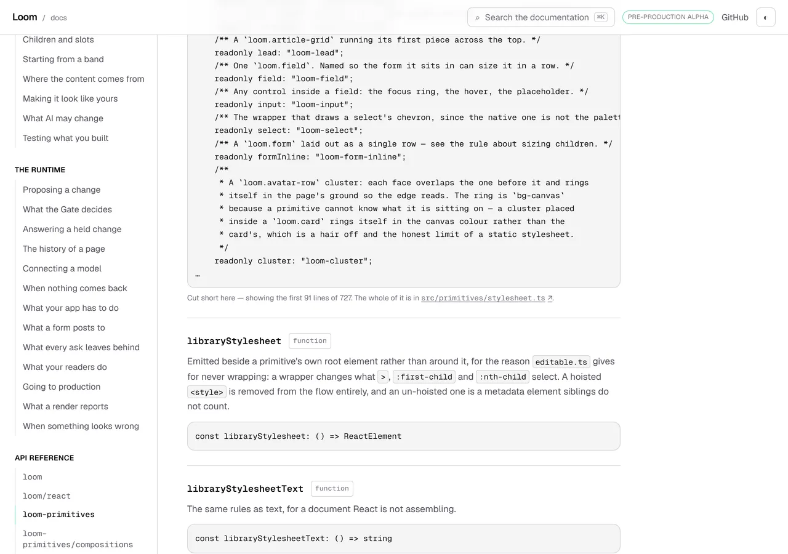
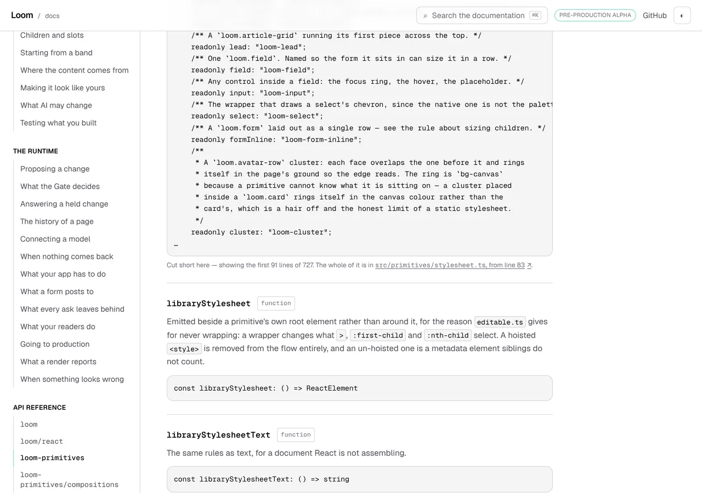
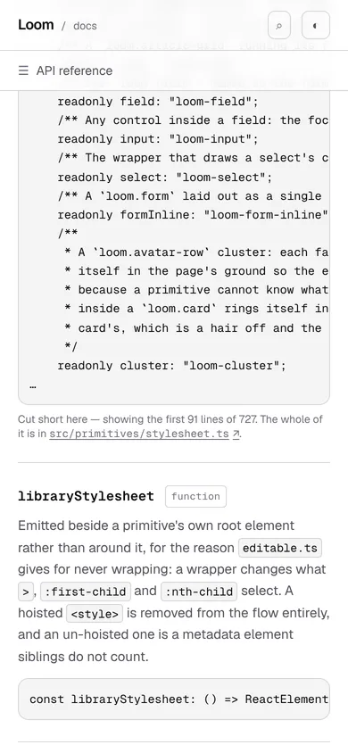
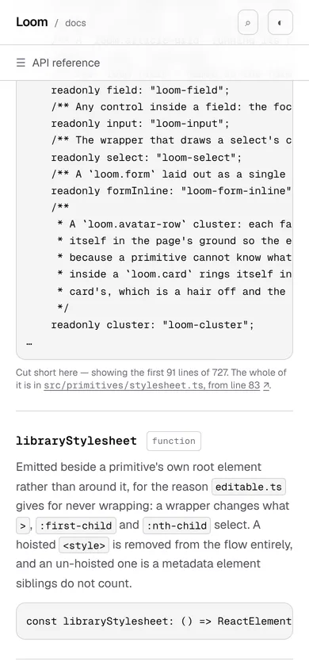
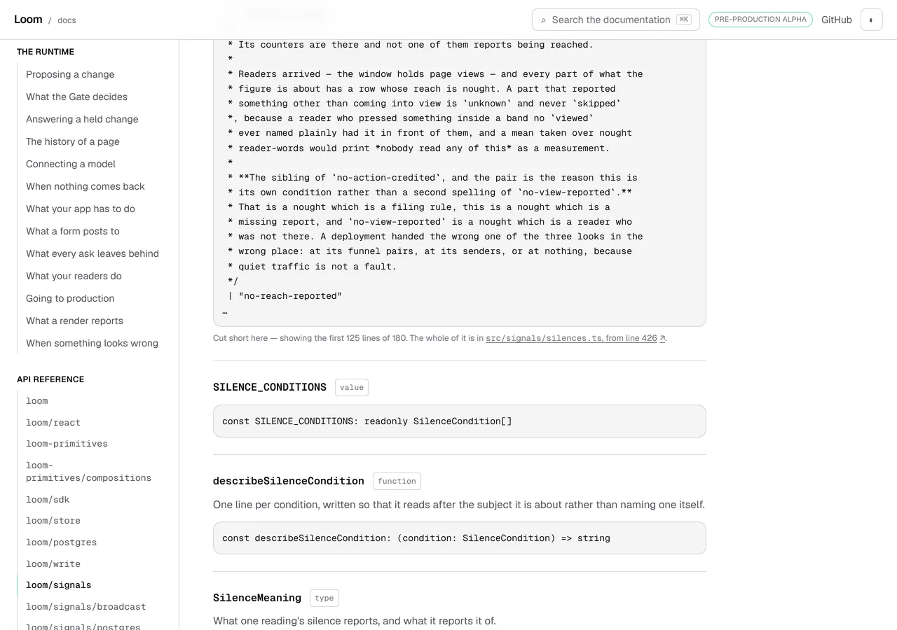

# 24 October 2026 — a link under a cut signature lands on the declaration

**Routine:** `Loom docs` · **Branch:** `docs-65-a-link-that-lands-on-the-declaration` ·
**Section:** §4c

No open pull request from this lane at the start of the run. #699 merged
overnight as `3547af0`. Three were open — #701 (`Loom marketing`), #700
(`Loom signals`) and #694 (the maintainer's own project thread) — none of them
this lane's and none touching the `(docs)` route group.

**No maintainer comment is outstanding anywhere.** The one question this lane
has put to him is still unanswered and is not urgent: whether a list-shaped
export may be given a list-shaped presentation. Nothing here touches it.

Branch cut from `origin/main` at `3547af0` (#699), after `git fetch origin main`.

## This is the queue item the last run did not take

Yesterday's report said so in as many words: *the line anchor is the next thing
this lane does, and if the rule is the queue first, this run got it wrong.* It
is taken now. It is remedy 3 of *a map of 168 class names is not a signature*,
which was carried over from the 21 October entry and has been the ready item in
this lane's queue for three days.

## The plain version

Twelve of the package's 1,798 exports have a declaration too long to put on a
page. Under each of those blocks the site says how much is missing and links
the file the rest of it is in:

> Cut short here — showing the first 91 lines of 727. The whole of it is in
> `src/primitives/stylesheet.ts`.

The link went to the **top of the file**, and these files are long.
`LIBRARY_CLASS` — the map of every class name the primitive library writes — is
727 lines starting on line 83 of a 2,406-line stylesheet. A reader who pressed
that link arrived at a text file with a search to run, which is the search they
came to the reference to avoid.

The sentence now ends:

> The whole of it is in `src/primitives/stylesheet.ts`, **from line 83**.

and the link goes to `…/src/primitives/stylesheet.ts#L83`.

**The line is in the words and not only in the href.** A link labelled with a
path that lands eighty lines down a file has done something the reader was not
told about. The label names the whole destination instead, so a reader who was
never going to leave the page gets the number anyway.

## Why it parses the file rather than searching it

A text search for the name is the obvious way to find a declaration and it is
wrong here, measurably:

| | where the declaration is | where a text search lands |
| --- | --- | --- |
| `KindAction` | `library-action.ts:215` | `:81` |
| `LibraryCopyChange` | `library-copy-change.ts:384` | `:61` |
| `KindReachChange` | `library-reach-change.ts:383` | `:41` |
| `PairReach` | `funnel.ts:296` | `:38` |
| `CopyReading` | `copy.ts:224` | `:49` |

**Five of the twelve**, every one of them because the name is written above the
declaration in some *other* export's doc comment, in a `{@link}`. A reader sent
to line 81 of `library-action.ts` lands in a paragraph about a different export
and reads it as the declaration of the one they came for.

That is the shape of failure this whole unit is written around. A line number
is the one field on this page that is **confidently wrong** when it is wrong: a
404 announces itself, and a plausible paragraph does not. So

- `declarationLineIn` parses the file and looks only at **top-level
  statements** — a name declared inside a function or a namespace is not the
  export, and matching one would be the confident wrong answer;
- it takes `getStart`, not `pos`, so the line is the `export type` and not the
  first line of the comment above it — a reader lands on the declaration with
  its sentence just above, which is the way round a reader wants it;
- `0` means **no line**, exactly as `""` already means no file, and the page
  then says nothing about a line rather than linking to the top of the file and
  calling it the declaration;
- a sweep reads each of the twelve lines **off the file it names** and asks
  whether that line declares that name, rather than asking the generator twice.

No export needs the `0` path today: all twelve are declared at the top level of
their own module's file. The cases it exists for are a name a module only
re-exports and a module with no file under `src/`, and both are written out as
tests rather than waited for.

## Only the start of it, and the number that says why

A range anchor — `#L42-L363` — would highlight the whole extent on GitHub and
is a better answer to *is the name I came for in here* than a start is. It is
not what shipped, for a reason worth having in writing:

**the page's two numbers are counted in two different files.** 91 and 727 are
lines of the declaration, read from `dist/` and counted on the cleaned text the
page shows. 83 is a line of the source. Measured across the twelve, they agree
on nine and differ on three — `RenderDiagnostic` is 322 source lines and 298
declaration lines, `PrimitiveDefinition` 180 against 176, `LoomRenderContext`
146 against 143 — the difference being comments the citation rule withholds and
what emit does.

So the cheap way to print a range, `line + whole − 1`, is **wrong on a quarter
of them**, by 24 lines on `RenderDiagnostic`. Anyone who builds shape 2 has to
read the declaration's end position rather than add. That is filed rather than
left to be discovered, and it is the one new finding of the run.

## Decisions taken that were not specified

- **A line on `ApiCut` rather than a URL.** `repositoryFileUrl` grew an
  optional line and `#L83` stays the one module that knows this site reads from
  GitHub, which is what that function's docblock already claims about paths.
- **`0` rather than `undefined`.** The field beside it already says *no source*
  with an empty string, and `0` is not a line any file has. One idiom in one
  type beats two that mean the same thing.
- **The line inside the link's label**, after the path and outside the `<code>`.
  The destination is the path *and* the line, so the words that carry the link
  are the words that name both.
- **The validator refuses a line with no file.** `source: ""` with a line is
  two fields disagreeing about whether a reader has anywhere to go; the rule
  cannot produce one, because the line is only read once the file has been
  found.
- **No range**, argued above with the number.
- **The measure got a name**, `ApiCutMeasure`, where two signatures had spelled
  out `Omit<ApiCut, …>` and would now have had to agree about two keys rather
  than one. It landed in the wrong place first — between `publishedSignature`'s
  docblock and the function, so eight paragraphs about the order a signature is
  cleaned and cut in documented a type alias — and the third commit on this
  branch moves it above the block. Caught by reading the diff before the gate
  was re-run, which is the one thing a test could not have said.

## Records

None added, none superseded. Nothing here touches the tree schema, the delta
model or an `Accepted` record.

The unit composes no primitives and needs none — the cut sentence is furniture
on a generated page — so **no finding for `Loom primitives` came out of it**.

## Findings

**One filed, none closed; one updated.**

- Filed: *a cut block's two numbers are counted in two different files, and the
  cheap way to print a range would be wrong on a quarter of them* — this lane,
  a stated limit, with the three-row table and the recommendation to leave it.
- Updated: *a map of 168 class names is not a signature* now records **shape 3
  as shipped**, with its original status kept under it. **Shape 2 is what stays
  open** — giving a list-shaped export a list-shaped presentation — and that is
  the maintainer's call, not this lane's: it would be the first thing this
  section builds that is a *rendering* of the package rather than a
  transcription of it.

Standing entries this run met again and did not duplicate:

- **`*.vercel.app` is denied by the environment's egress policy** (12 October,
  open). Every picture below was taken against a build in this container.
- **The composed preview URL** (16 October). The URL below is taken from the
  `vercel[bot]` comment rather than guessed from the branch name.
- **The commit author line** (23 October). Every commit here is the session
  default, `Claude <noreply@anthropic.com>`, which is one of the two identities
  known to deploy.

## Test numbers

`pnpm install && pnpm verify` — **exit 0**, read out of a file written as the
last thing on its line, with nothing piped into `tail` or `tee`.

- framework: **237 files, 5,656 tests passed**
- application: **351 files, 6,290 tests passed**
- `findings:check`: 1,298 findings, 0 malformed
- `reports:check`: 1,948 visuals, none over 1.1MB, 409 cited by no file
- `prerender:check`: 133 prerendered pages, 1,930 text junctions, 0 run
  together; 3 metadata conventions, 0 unserved

Nothing failed, nothing was skipped, and no test was weakened.

**Which tree those are of, said rather than implied.** That run was over the
code and its tests, before this report, its six pictures and the finding were
written — so two of the five lines above are of a tree this branch no longer
has: `findings:check` reads **1,299** with the entry filed below, and
`reports:check` reads **1,954** with the six visuals. The three test lines are
unchanged, because nothing under `src/` or `app/` moved after it. A second run
over the committed tree is what the next commit on this branch records.

**Sixteen tests are new**: 10 in `extract.test.ts` — seven for
`declarationLineIn`, two sweeps over the twelve real cut blocks and one
refusal in the validator — 4 in `surfaces.test.ts` for the address, and 2 in
`api-reference.test.tsx` for what the sentence says.

The run-together class filed yesterday was watched for and did not appear:
1,930 junctions against yesterday's 1,918, which is this change's own
`</code>, from line 83` among them, and 0 run together. The space in that
phrase is **inside** a text node rather than between two tags, which is the
shape the 23 October entry measured as safe.

### Three mutations, three killed

Each applied on its own, with the affected tests re-run.

| what was put back | what failed |
| --- | --- |
| the line found by a text search | **5**: four of the unit cases, and the generated file drifting from what the generator now produces |
| `KindAction`'s line moved to 81 in the committed reference | **1**: the sweep, naming the file, the line and its text — ``KindAction — src/signals/library-action.ts:81 is `*   {@link KindAction.weighed} is how many there were.` `` |
| `pos` instead of `getStart`, so the line is the comment above | **4**: three unit cases and the drift test |

The second is the one worth reading. The sweep over the committed file is
**independent of the generator**: it opens the source, takes the line the
reference claims, and asks whether that line declares that name — so a wrong
line fails even when the generator that wrote it agrees with itself. The first
mutation did *not* fail that sweep, because the committed file still held the
right numbers; what caught it was the drift test that regenerates and compares.
The two together are what hold this, and neither does it alone.

## The pictures

Taken with `pnpm shoot --serve apps/loom` against a build in this container.
The *after* pictures are of a build of this commit, `built
2026-10-24T13:59:31.868Z`. The *before* pictures are of a build of the same
tree with everything under `app/(docs)/` reverted to `main` and nothing else,
`built 2026-10-24T14:06:51.476Z`, so the only variable between a pair is the
change being argued about.

**The sentence measures the same box in both**: `x 304 y 476 704x16` at 1280,
and `x 20 y 462 350x32` at 390. Identical to the pixel, which is what makes the
pair a reading of the words and of nothing else — the eleven words added fit on
the line that was already there.

### The foot of the longest block on the site

Everything above the sentence is byte-identical between the two: the last
member on the page is `readonly cluster: "loom-cluster";`, the ellipsis that
says the block was cut is in the same place, and the next export —
`libraryStylesheet` — starts at the same height.

### And on a phone

`350x32` in **both**, against `704x16` at 1280: two lines before and two lines
after, so the eleven added words did not cost a third, and nothing scrolls
sideways (`scrollWidth 390 / innerWidth 390`). That is the question only a
phone picture answers, and it is the reason there is a before at this width —
the box is the same, so the pair is a reading of the words.

The path is in code voice and *from line 83* is not, which is the font
difference this width is large enough to show.

The sixth picture, `2026-10-24-docs-a-link-that-lands-on-the-declaration-before-wide-signals.webp`,
is the signals page before the change. It is not shown because its pair below
differs from it in exactly the way the first pair does, and one illustration of
that is enough; it is committed so that the claim can be checked rather than
taken.

### The page with six cut blocks on it

The signals door has six of the twelve, and **five of those six are rows in the
table above** — the ones a text search would have sent a reader to a `{@link}`
in a different export's comment. The one in the picture is the sixth, where a
search would have landed correctly: `SilenceCondition`, on line 426 of a
1,331-line file. That is an accident of which block the shot list named — it
was written before the table was computed — and it makes the point anyway:
**nothing on the page distinguishes the two cases**, which is why the line is
found the same way for all twelve rather than searched for and spot-checked.

## The preview

Taken from the `vercel[bot]` comment after opening the pull request, not
composed from the branch name.

https://loom-git-docs-65-a-link-that-86e952-jpizzolato36-6341s-projects.vercel.app

The two pages the pictures are of:

- https://loom-git-docs-65-a-link-that-86e952-jpizzolato36-6341s-projects.vercel.app/docs/api-reference/primitives
- https://loom-git-docs-65-a-link-that-86e952-jpizzolato36-6341s-projects.vercel.app/docs/api-reference/signals

Every picture above was taken against a build in this container, not fetched
from the preview: `*.vercel.app` is denied by the environment's egress policy,
which is the open finding of 12 October and still true.

The pull request is **#702**.
