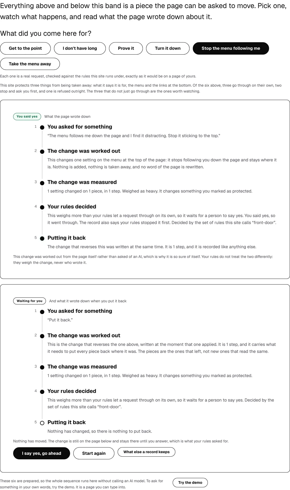
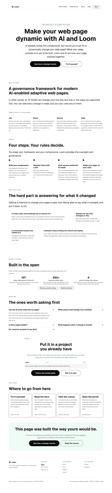
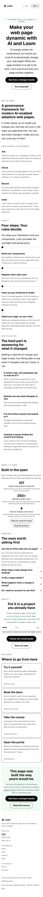
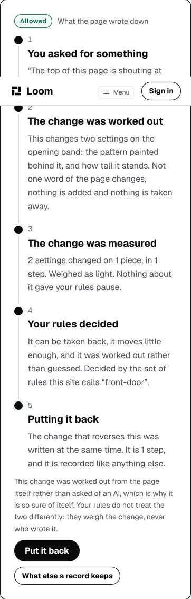

# 2026-10-24 — a link to the page it was drawn on, and the origin no page needed after it

**Build order section:** §4d — the marketing site.

**Branch:** `marketing-15-a-link-to-the-page-it-was-drawn-on` (→ `main`), cut
from `origin/main` at `3547af0`.

**No maintainer comment was outstanding.** This lane has no open pull request;
#698 merged yesterday. The two open this morning are #700, which is the signals
lane's, and #694, which is an interactive session's. Nothing on #698 is anybody
but this lane and the Vercel bot.

**Something a visitor sees moved, after three runs where nothing did.** The
record panel on `/how-it-works` carried a third control, *See every line the
machinery wrote*. It was a link to the address the reader was already at, and
the thing it promised is a thing no page of this site is allowed to show. It is
gone, and what stands in its place goes somewhere real.

---

## How the work was chosen

`FINDINGS.md` first, and nothing owned by this lane was both open and ready to
build: the newest entry, filed yesterday, asks for `servedPages` to refuse a
thin sweep and names two real arguments against itself; the one before it is a
question about what is worth measuring, recommending *leave it*. Both are
honest to leave open.

So the work came from the 23 October report's own last line instead:

> *"**Three runs in a row have moved nothing a visitor sees.** Worth saying out
> loud rather than leaving to be noticed. Every positioning question this
> surface has is unanswered, and the brief forbids inventing copy, so the work
> available without an answer is structural."*

The run started by looking at the site rather than at the ledger: a production
build of `main`, served and photographed at the front door, both other pages,
and an address carrying a request. The first thing that came out of that is
below.

---

## 1. The control that promised the one thing this product has, and reloaded the page

The record panel on `/how-it-works` offered three controls. Two of them are the
visitor's decision: *I say yes, go ahead* under a held change, and *Put it
back* under one that landed. The third said:

> **See every line the machinery wrote**

and its destination was `askHref(context.origin, { ask, approve })` — an
address of `/how-it-works`, which is the page it was drawn on.

### What it was for, and when that stopped existing

Nothing about it was careless when it was written. The five rungs of the panel
are the record in words a stranger can read; underneath each of them is a line
the runtime actually wrote, and **`/how-it-works` used to print those in full**
— 341 lines of JSON, which the docblock at the head of `pages/how-it-works.ts`
puts at 73% of the visible text of that page. While the choices band lived on
the front door, this control
was the way from the short version to the long one, on another page.

Two things happened and neither was to this control:

| | |
| --- | --- |
| **26 September** | the maintainer had the page cut, and the raw panel went with the glossary |
| **1 October** | the maintainer moved the choices band onto `/how-it-works` |

After the first there was nothing to link to. After the second, the link was to
the page it was on.

### Measured over every state this site can be served in

75 states: three pages crossed with no request and every request crossed with
both answers a visitor can give.

| | |
| --- | --- |
| states carrying this control | **24** |
| of those, where its destination resolved to the address being served | **12** |
| of those, where it dropped the undo the visitor had just asked for | **12** |

The second row is a reload. The third is worse, and it is a shape this lane has
already written down twice. `answer.ts` has the paragraph, over the one function
that gets it right:

> *"a control that quietly dropped `back=1` would put the change the visitor had
> just reversed back on the page while claiming to do nothing but scroll. That
> failure is this site's recorded shape rather than a hypothetical: the undo is
> the parameter two of this lane's own findings were about."*

This is its third instance, in the file next door. A reader on
`?ask=unstick-menu&approve=1&back=1` — the one address on this site where the
rules hold an undo, which is the most interesting state the demonstration can
reach — pressed *See every line the machinery wrote* and was handed the page
with the change still on it.

### Why nothing was red

Every instrument this surface has was looking somewhere else, and each of them
was right to:

- `routes.test.ts` asked whether the address is one this application serves. It
  is.
- `docs-pages.test.ts` holds every link into the documentation. This was not
  one.
- `anchors.test.ts` holds same-page fragments. This had none.
- `voice.test.ts` reads the words. *See every line the machinery wrote* is
  plain English and passes.

**A link to the page you are on is served, is not a fragment, and goes
nowhere.** Nothing in the route group had a rule of that shape.

### Why it could not simply be pointed at the record again

Because the destination is not this lane's to rebuild. `voice.test.ts` carries
the maintainer's instruction of 26 September as a sweep over every route:

> *"That panel and that glossary are both gone. What is left is the simpler rule
> the maintainer asked for: **no page of this site uses one of these words,
> anywhere.** The vocabulary is the documentation's to teach."*

The lines the machinery writes are written for a logging system and our
vocabulary arrives in them whether anybody chose it or not. Printing them on
this site again means weakening that test, and the brief says not to.

### What it is now

**What else a record keeps**, pointing at
`/docs/the-runtime/what-every-ask-leaves-behind` — the documentation page headed
*What every ask leaves behind*, which is where the vocabulary is taught.

It keeps the thing the old control was for: a reader who has just watched five
lines fill in and wants to know whether that is all a record holds has somewhere
to go. It is also the page the closing band's sentence already names, and the
two readers are different — the closing band is read by somebody who got to the
end of the page, and this is read by somebody standing in front of the record.

`docs-pages.test.ts` holds that destination in four ways: it is an address this
application serves, it is headed what this lane thinks it is headed, no link on
this site goes into the documentation at an undeclared address, and the page
carries the phrase this site sent the reader for. The old destination was held
by nothing.




---

## 2. And then no page of this site needed to know its own address

The control was the only thing in any page builder on this surface reading
`context.origin`. One `grep` over the page builders, the chrome and the request
reader — the five modules `pages/handed.test.ts` sweeps:

```
apps/loom/app/(marketing)/_lib/pages/see-it-happen.ts:315:      href: askHref(context.origin, {
```

So removing it made `origin` a context field nothing reads, which is exactly
what `handed.test.ts` exists to catch: *a context field is a promise that some
page reads it.* It had to go off the context or the gate stays red, and it
should have gone anyway.

### The invariant this makes structural

[0259](../decisions/0259-a-surface-the-portal-governs-renders-from-the-store-and-a-page-built-at-render-time-is-not-one.md)
made the three site pages stored rows on 12 October. A stored row is written
once and served from **every host this deployment answers on**, so an href with
a host in it freezes whichever one happened to seed it — and every preview
deployment has one of its own. That is why `site.ts` grew `askPath`,
`sitePath` and `surfacePath` that day, and why `stored.ts` seeded with
`origin: ""`.

**The invariant was true by hand and held by nothing.** It was true because
three builders had been written carefully, which is the kind of true that lasts
until the fourth — and it was already not quite true, because of the control
above.

It is structural now. A page builder that is never handed an origin cannot
write one.

### Which is the same move `counting` made nine days ago

`render.ts` has the precedent in its own file, dated 21 October:

> *"The answer used to travel as `counting` on the page context: the tree was
> built with it, `home.ts` handed it to a `ChromeContext`, and nothing read it
> at the other end… What it decides is which attributes the renderer writes, so
> it belongs where the renderer's other options are."*

The origin decides exactly one thing now, and it is the same kind of thing:
which origin this page may frame, which is a render concern.
`renderSitePage(route, context, { origin })` rather than
`renderSitePage(route, { origin, ...context })`, and the three route modules
pass `await servedOrigin()` where they already had it.

### And `askHref` has no callers left

The absolute spelling of this site's own address is deleted. Its docblock said
it kept taking an origin *"because metadata still needs an absolute URL"*, and
that named a caller that does not exist: the canonical link, the share card, the
structured data and the sitemap all go through `internalHref` and `surfaceHref`,
which are untouched and are still right. What is left is `askPath`.

| | before | after |
| --- | --- | --- |
| page context fields | 8 | **7** |
| context types carrying an origin | 4 (`PageContext`, `ChromeContext`, `AnswerContext`, `SeeItHappenContext`) | **0** |
| ways to spell an address of this site with a host in it | `askHref`, `internalHref`, `surfaceHref` | **`internalHref`, `surfaceHref`** — neither reachable from a builder |

---

## 3. Three rules, in the file that already asks where a link goes

All three sweep the 75 served states in `routes.test.ts`, beside *sends nobody
to an address this application does not serve*, and under the coverage guard
that file already carries.

**1. Writes no link with a host in it, on any page, in any state.** 0259's
condition, checked rather than conventional. What is swept is an absolute href
whose path *this application serves* — the source and the decisions on GitHub,
the package on npm and the license file all have paths nothing here answers on,
so a link that leaves the product is not its subject.

**2. Leaves the product only for addresses with a path of their own.** The floor
under the first. Rule 1 reads *leaves the product* as *this application does not
serve that path*, and a link to somebody's bare front page resolves to `/`,
which this application does serve. Nothing on this site offers one. This says
so, rather than rule 1 quietly becoming approximate the day something does.

**3. Sends nobody to the address they are already reading.** The class the
defect belonged to.

### Both sides of rule 3 go through `askedFor`, and both halves of that are load-bearing

Measured rather than reasoned, because the obvious implementation is green on
the defect that produced it:

- **The defect was spelled absolutely and the address it matched is a path.** A
  string comparison reads them as two different places.
- **`asRequested` puts the reader's palette onto every one of this site's own
  links at render.** So the link a served page carries has a `theme=` the
  address of the reader holding it does not. Two strings, one page, and again a
  rule that finds nothing.

So both sides go through `askedFor`, which is this site's one reader of an
address, and what is compared is what it hands back.

### What rule 3 steps over, and what that costs

**The chrome.** Measured on the front door: the mark in the bar, the mark in the
footer and the palette the reader is already wearing all point at `/`. None of
them is a defect — a brand mark goes home from every page including home, and
the furniture is the same on every page by design, so *where the reader is* is
not a question it can answer. The rule looks at a page's own bands.

**A bare request**, which is what each of the six choices is. The row offers all
six and one of them is the one you made, for the same reason the menu keeps the
page you are on. It is an exemption rather than a mark because **`loom.action`
has no `current`** — `loom.link` does and emits `aria-current`, the choices are
buttons, and nothing in the tree can say which one the reader took except the
`primary` variant they already wear. Filed for `Loom primitives`. The day the
prop exists, the exemption is deleted.

The exemption's cost is stated in its own docblock: a lone control spelled
`askPath({ ask })` and nothing else reads as a choice and is not reported.

### Falsified, by putting the control back, both ways

| the control, restored as | rule 1 | rule 3 |
| --- | --- | --- |
| it was — `askHref(origin, { ask, approve })` | **24 red** | **6 red** |
| a path — `askPath({ ask, approve })` | green | **6 red** |

Either spelling is red somewhere. The six rule 3 reports in both rows are the
`approve=1` states, which are the ones the bare-request exemption does not
cover. Both runs are in the report's own history and the control is back as it
should be.

And the first rule reads something: without the restore, all 75 states sweep
clean, and `destinations.length` is held above its floor by the test beside it.

---

## What is held

| | |
| --- | --- |
| a link in a tree of this site carrying a host | **red in all 75 states** — and unspellable from a builder |
| a band control pointing at the address being served | red, with the state and the href named |
| an off-site link with no path of its own | red, so rule 1 cannot go approximate |
| a page context field nothing reads | already held by `handed.test.ts`; `origin` is off the context rather than exempted |
| where *See every line the machinery wrote* went | nowhere; the page now sends that reader to the documentation page that answers it, held four ways by `docs-pages.test.ts` |

---

## Real numbers

`pnpm install && pnpm verify`, exit code read out of a file written as the last
thing on its line, over the tree being pushed with this report and the findings
entries already in it:

```
Test Files  237 passed (237)      Tests  5656 passed (5656)    # framework
Test Files  351 passed (351)      Tests  6277 passed (6277)    # @loom/app
Test Files   56 passed  (56)      Tests  1491 passed (1491)    # app/(marketing)
1301 findings, 0 malformed
1955 visuals in reports/, 136.7MB, none over 1.1MB, 409 cited by no file
133 prerendered pages, 1918 text junctions, 0 run together; 3 metadata conventions, 0 unserved
EXIT=0
```

Nothing skipped, nothing deleted, no test weakened to pass.

The route group was 56 files and **1,488** tests at `3547af0`, measured on that
revision rather than carried from a report. This run adds **no file and three
tests**, which are the three rules in §3. The `app/(marketing)` row is the
subset run separately on the same tree, from `apps/loom` — run from the
repository root instead it reports one failure, in `mark.test.ts`, which reads
`app/icon.svg` relative to `process.cwd()`. That is the wrong cwd rather than a
failure and is the only way this subset count can be taken wrong.

**The gate was run twice and the numbers above are the second.** The first began
before the last edits landed, and `vitest` reads a file when it runs it, so it
is not a reading of this tree — it also went red on a scratch test file this run
had written to measure the defect in §1 and deleted while it was running. The
only thing written after the second run is this paragraph and three corrections
to this report's own prose, none of which is a file any check reads.

---

## The site

Photographed off a production build of this branch, started and stopped by the
harness. The shot list is
[`2026-10-24-marketing-a-link-to-the-page-it-was-drawn-on.shots.json`](2026-10-24-marketing-a-link-to-the-page-it-was-drawn-on.shots.json).








`scrollWidth 1280 / innerWidth 1280` on every wide shot and `390 / 390` on both
phone shots, read off the harness rather than off the picture.
`built 2026-10-24T12:12:29.854Z`.

---

## Findings

**Closed** — one, this lane's own:

- *1 October, **no request on the mechanism page can produce a held undo***.
  Closed by work that landed on 10 October and was never marked: `unstick-menu`
  is the sixth choice it asked for, and `undo.test.ts` holds its undo as held.
  The entry's own reasoning about *why* is wrong and is corrected at its foot
  rather than edited out — it argued that only a **move** has an inverse of its
  own weight, and a setting change is the other operation whose inverse is
  itself.

**Filed** — three:

- ***a control cannot say it is the one the reader already took***, for
  `Loom primitives`. `loom.action` has no `current` where `loom.link` has one.
  It costs a screen reader the chosen request and it costs rule 3 an exemption.
- ***a control that drops part of what the visitor has done is held by
  nothing***, for this lane. The instance is fixed and the class is not; the
  recommendation is to make it unspellable first (one shared `where()`) and to
  add the rule second.
- ***the palette switcher offers the palette the reader is already wearing***,
  for this lane. A judgement rather than a defect, recorded because rule 3
  deliberately steps over it, and recommending *leave it* until a prop can say
  `aria-current="true"` rather than `page`.

**No decision record.** Nothing here decides a direction. Taking the origin off
the page context is 0259's own condition made structural, and the three rules
are three sweeps inside one route group. Both are written where the next person
to read them will be.

---

## Found while building, and not acted on

- **`(docs)` wears a `PRE-PRODUCTION ALPHA` badge and this site says nothing.**
  Carried from #670, #676, #683, #690, #695 and #698, unanswered.
- **The questions band's two columns are uneven at 1280.** Unchanged since
  17 October and still deliberately left.
- **The `/demo` half of the 4 October finding is still open** and untouched.
- **36 of the 52 changed files are test files losing one property each.** That
  is what taking a required field off a shared context costs: 77 lines across
  them wrote an origin into a context literal, 70 of them spelled
  `origin: ORIGIN`, and every one of those hunks is the same hunk. Fifteen are source, and they are the diff worth reading. It is
  worth saying because a 52-file diff usually means something else.

## Needs your input

- **Whether the front door should say this is pre-production.** Carried from six
  pull requests, and still the one I would most like settled. One sentence, and
  it is positioning, so it is yours.
- **Whether a status colour is a thing Loom's palettes should have.** Carried
  from eight, unanswered. A refusal and a hold are drawn in the same treatment
  because the library has no way to say *no* in a colour.
- **Whether `/how-it-works` should carry a reader to the change it describes.**
  Carried from eight, unanswered.
- **Whether *What else a record keeps* is the right thing to offer there at
  all.** The honest alternative is no third control: the closing band already
  links that page, and a panel with two buttons is a panel about the decision in
  front of the reader. I kept it because losing it would be the fourth thing
  this page has lost without gaining anything, but it is a judgement about the
  page and you may disagree.
- **No copy was invented and nothing here is positioning.** One control label
  changed, from *See every line the machinery wrote* to *What else a record
  keeps*, and the second is true where the first was not.
