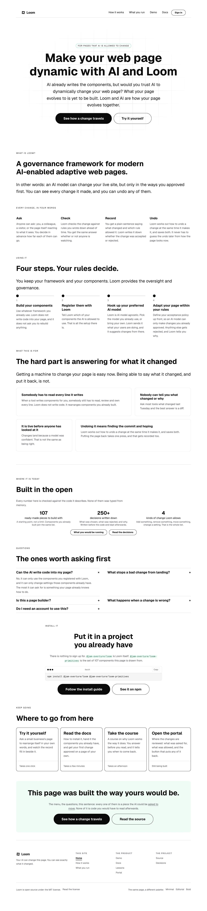

# 2026-10-24 (evening) — what the site is for, written down, and the sentence shape the maintainer banned

**Build order section:** §4d — the marketing site.

**Branch:** `marketing-16-what-the-site-is-for-written-down` (→ `main`), cut
from `origin/main` at `cd77429`.

**This run is a maintainer conversation rather than a plan.** He opened with
*"I am still not happy with the marketing site"* and asked what questions he
needed to answer. He then answered six of them, gave the message as a chain,
banned a sentence shape by quoting one of this site's own headlines, picked a
headline out of a draft, and settled the two things this lane had left open.

His instruction for this run, in full:

> *"Memorialize this so it is not forgotten and drives all future marketing
> work."*

So this is that, plus the one half of it a document cannot do on its own.

---

## Why a document was the right answer and was not enough

This lane has asked for positioning on seven consecutive pull requests, each
time under `## Needs your input` at the bottom of a comment. Nothing was ever
answered, and three runs in a row before this one moved nothing a visitor sees,
because the work available without an answer is structural and the brief forbids
inventing copy.

The failure was partly in the asking. **A question at the foot of a pull request
comment is filed, not asked**, and a routine that files the same question seven
times is a process pretending to be a conversation.

The answers are in `docs/positioning.md`. What a document could not fix is the
other half of his message, which was about the writing itself — and this lane's
own recorded history says a register nobody chose becomes the voice of the
product within a week of anybody fixing it by hand. So the checkable part is a
test.

---

## 1. `docs/positioning.md`

**Quotations are verbatim and are the only authority in the file.** Everything
else is this lane's reading and is marked as such. What it settles:

| | |
| --- | --- |
| **what Loom is** | *"the governance model that lets AI safely adapt, evolve, and manage your page automatically"* |
| **what the site leads with** | what you can build, and why it beats how you do it now |
| **what stays under the hood** | the rules, the record, the undo, the refusals |
| **who is reading** | *"a web developer… assume it is the casual web developer. Imagine junior level developer"* |
| **why they would look** | nobody is searching for this, so the job is to be interesting rather than to meet a pain |
| **what it costs** | the framework is free and installed; the portal is the paid part |
| **is it ready** | *"Yes, say the framework is ready."* |

The chain is his, verbatim, and is the spine of the site:

> React/TypeScript components > Loom framework / Primitives > Loom designed web
> page > Signals broadcasting to your AI model > AI reacting to signals and
> redesigning page > Greater user engagement and conversion

### The distinction the file exists to protect

**What Loom *is* and what the front door *leads with* are different sentences**,
and a run that collapses them rebuilds the site this one is replacing. Loom is a
governance model. The front door is about what you can build. He said it plainly:

> *"Don't worry about the controls. That is the stuff under the hood."*

### What it overrules

`docs/rollout.md`'s three marketing bullets, two of which are now wrong:
*the differentiator is not adaptation, it is the record*, and *the audience is
probably not hobbyists*. **Five months of this site were built on the first of
those.** Nothing about the product changed — the record is still the thing Loom
does that nothing else does — but it is no longer the opening.

The bullets are **kept with a dated superseded note** rather than deleted, the
way `routines.md` handles its own reversed section: a run that finds the new
file without the old one cannot tell what changed. That note is also the hook
that makes the new file findable, because `rollout.md` is in every marketing
run's *read first* list and `positioning.md` is not yet. See *Findings*.

---

## 2. The sentence shape, and a rule narrow enough to be true

He banned a headline by quoting it:

> *"Stop saying stuff like this "You decide what may change, before anyone
> asks"… it's not that what you are saying is incorrect, it's that no one talks
> like that. It is obvious AI written crap and is not allowed."*

The tell is a trailing clause carrying no fact. It is there for rhythm. It is
the mirror of the habit `routines.md` already bans — *no sentence opening on a
negation to set up a reveal* — and it arrived the same way: nobody chose it,
each run wrote in the register of the one before.

### The first rule I tried was wrong, and measuring is what caught it

*No sentence ends in a short comma clause*, swept over the three pages as
authored, flags **34 strings**. Among them:

```
"Pick the model you already use, or bring your own."
"Anything else gets rejected, and Loom tells you why."
```

Both are the register the site is **supposed** to be in — the first is built on
his own line of 1 October. A rule that bans those bans the thing he asked for.

**In a sentence the second clause usually carries a fact. In a headline it is
almost always a flourish.** The same sweep over headlines alone:

| | |
| --- | --- |
| headlines on the site | 49 |
| ending in a comma clause | **9** |
| of those, written by this lane | **9** |
| of those, the maintainer's own | **0** |

That is a clean boundary and it is why the rule is about headlines. The ones it
cannot see are a table in `positioning.md` for a person to read.

### The nine, rewritten rather than repunctuated

`routines.md` says it of the em-dash rule and it is truer here: **the fix is a
rewrite, not a comma**, because the flourish survives losing its punctuation.

| before | after |
| --- | --- |
| You decide what may change, before anyone asks | You choose what the AI is allowed to change |
| Your own components, never rewritten | Loom never rewrites your components |
| It runs in your app, not in front of it | It runs inside your app rather than in front of it |
| Which parts you reach, and never who you are | It counts which parts you reach and never who you are |
| One request, and only when somebody asks | Your server calls the model only when somebody asks |
| It writes code, and somebody has to read all of it | Somebody has to read every line it writes |
| Nobody can say what changed, or why | Nobody can tell you what changed or why |
| Adapt your page, on your rules | Adapt your page within your rules |
| Five steps, every time | The same five steps every time |

**`may` went with them**, which is half of why the first one read as a legal
notice. People say *can*, or *is allowed to*.

`journey.test.ts` pinned the old heading string and went red, which is the
correct kind of red: it holds that the mechanism page names the step count and
that no page names a different one. It now pins the new heading and still holds
both.

---

## 3. What he settled while this was being built

Three answers arrived mid-run and are in the file:

- **The demonstration stays.** *"We can leave the demo for now until we get a
  video up and running."* This lane had read his earlier *"don't worry about
  showing it on the marketing page"* as an instruction to delete the band where
  a visitor asks the page to change itself. **That reading was wrong and nothing
  is deleted.** It was never acted on, because a deletion that large was put to
  him rather than assumed.
- **The front door is rewritten first.** *"Front door first."*
- **The headline is chosen**, out of three proposed:

  > **A web page that rearranges itself around the people using it.**

  > *"I like the second headline. Simplest but gets to the point."*

  It replaces his own headline of 27 September, which is in `copy.ts`'
  `MAINTAINERS_OWN`. **That swap is not in this pull request** — it belongs to
  the front-door rewrite, where the sentences under it change too, and moving a
  headline without the paragraph it introduces is how a page ends up arguing
  with itself.

---

## What is held

| | |
| --- | --- |
| a headline ending on a flourish | **red on the route that carries it**, named with its field and its words |
| a page with no headlines | red, so the rule cannot pass over nothing |
| the mechanism page's step count | unchanged, and still held against every other page |
| the positioning answers | verbatim in a file, with what each one overrules |
| `rollout.md`'s superseded bullets | visible, dated, and pointing at the file that replaces them |

Not held by anything: that a future run **reads** `positioning.md`. Filed.

---

## Real numbers

`pnpm install && pnpm verify`, exit code read out of a file written as the last
thing on its line, over the tree being pushed with this report and the findings
entry already in it:

```
Test Files  237 passed (237)      Tests  5656 passed (5656)    # framework
Test Files  354 passed (354)      Tests  6357 passed (6357)    # @loom/app
Test Files   56 passed  (56)      Tests  1497 passed (1497)    # app/(marketing)
1304 findings, 0 malformed
1961 visuals in reports/, 137.1MB, none over 1.1MB, 409 cited by no file
133 prerendered pages, 1932 text junctions, 0 run together; 3 metadata conventions, 0 unserved
EXIT=0
```

The route group was 56 files and **1,491** tests at `cd77429`, measured on that
revision. This run adds no file and **six tests**: the headline rule and its
floor, over three routes. The `app/(marketing)` row is the subset run separately
on the same tree, from `apps/loom`.

Nothing skipped, nothing deleted, no test weakened to pass.

---

## The site

Photographed off a production build of this branch, started and stopped by the
harness. Nine headlines changed and nothing else a visitor sees moved.




`scrollWidth 1280 / innerWidth 1280` on all three, read off the harness rather
than off the picture. `built 2026-10-24T17:53:52.632Z`.

---

## Findings

**Filed** — one, for `Loom daily build` and the maintainer:

- ***two files that send a run to its lane's reading list do not mention
  `positioning.md`***. `routines.md`'s lane table has a spelling for a lane
  owning a document already, in the signals row, and the routine brief's *read
  first* list is the maintainer's. Not done rather than done, for the reason the
  portal routine gave when it filed the absence of `routines.md` itself: a
  routine cannot write the governance it is bound by.

**No decision record.** Positioning is the maintainer's and a record is for a
decision that would be expensive to reverse by a routine. The reversal is
already dated in two files.

---

## Found while building, and not acted on

- **Most of what the site argues is now the wrong story.** `/how-it-works` is
  entirely governance; the front door's *Every change, in four words* and
  *The hard part is answering for what it changed* are too; `/what-you-run` is
  reassurance about an anxiety a junior developer does not have yet. Listed in
  `positioning.md` as a backlog. **Rewriting is not deleting** and the file says
  so: a band comes off when he says it does.
- **`copy.ts`' `MAINTAINERS_OWN` is about to lose an entry**, for the first
  time. It exists so his lines are held verbatim, and the mechanism for him
  *replacing* one of them has never been exercised.

## Needs your input

- **Nothing blocking.** The front door rewrite is specified well enough to build
  from `positioning.md` alone, and it is next.
- One thing worth knowing rather than deciding: the chain's last link,
  *Greater user engagement and conversion*, is the only outcome claim on the
  new site, and it is yours rather than mine. I will use your words for it.
