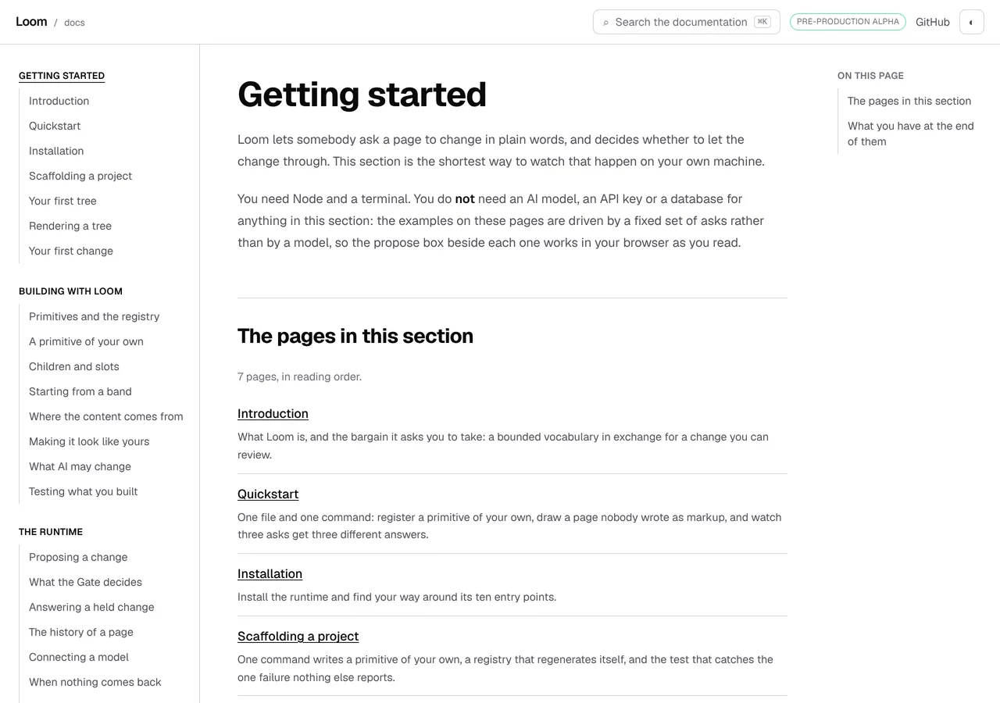
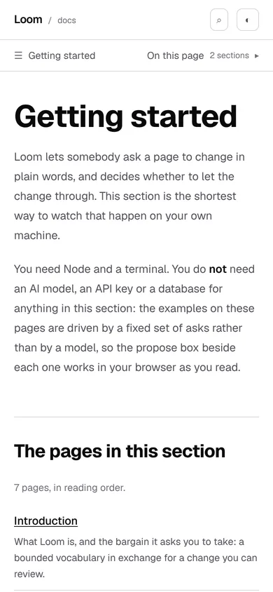
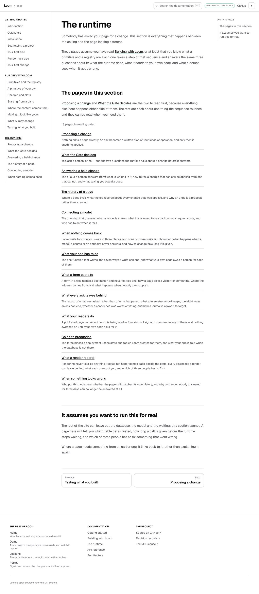
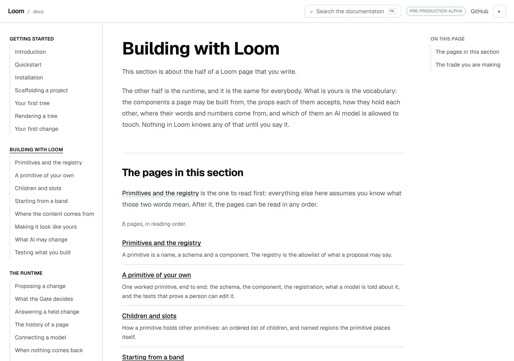
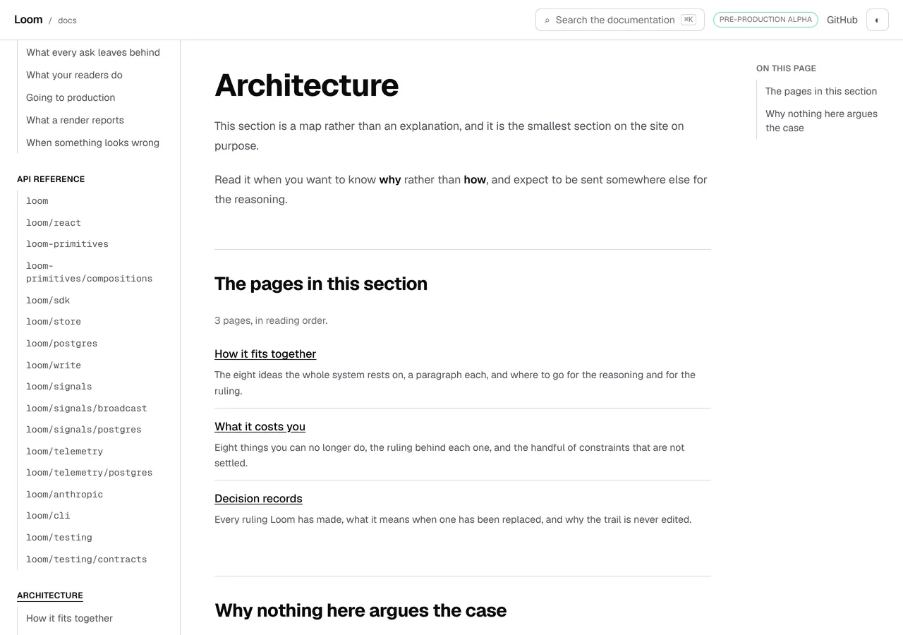

# 25 October 2026 — a section is an address

**Routine:** `Loom docs` · **Branch:** `docs-66-a-section-is-an-address` ·
**Section:** §4c

No open pull request from this lane at the start of the run. #702 merged
overnight as `3e7f29e`. Five were open — #700, #706, #707 and #708
(`Loom signals`) and #704 (`Loom marketing`) — none of them this lane's and none
touching the `(docs)` route group.

**No maintainer comment is outstanding for this lane.** There is no pull request
of this lane's to carry one, and the most recently active of the five open
threads, #704, holds only routine-authored comments addressed *to* him rather
than replies from him. The one question this lane has put to him is still
unanswered and is not urgent: whether a list-shaped export may be given a
list-shaped presentation (the 22 October finding, shape 2). Nothing here touches
it.

One thing read on #704 and worth carrying: `docs/positioning.md` exists on that
branch and is not on `main`, so nothing in it reached this run. It is the file
that decides what the copy on a visitor-read surface says, and the four pages
below are copy a visitor reads. When it lands, this lane should read it on every
run.

Branch cut from `origin/main` at `0c5d867` (#705), after `git fetch origin main`.

## The plain version

Four addresses on this site served nothing.

`/docs/api-reference` is a page: it says which import to write and how much of
the package is behind each one. `/docs/getting-started` was a 404, and so were
`/docs/building-with-loom`, `/docs/the-runtime` and `/docs/architecture`.

That matters for the ordinary reason rather than a clever one. **Shortening an
address is something readers do.** Somebody two pages into the runtime who wants
to see what else is in it deletes the last segment, and on this site that put
them on the application's not-found page. So did following a link to *the
Architecture section*, which nobody could write, because the section was not
anywhere.

Each of the four is a page now. It says what the section is for in a paragraph, what
you need before you start it, and then lists the pages in it with the one-line
summary each of them already has.

## Why nothing could have said so

This is the part worth keeping. A section with no page of its own is a
**completely legal** section:

- `nav.ts` has modelled a landing page since the reference got one. A section
  either has one or does not, and both are valid.
- The rail already draws a section's title as plain text where there is no
  landing page and as a link where there is, so four sections rendered correctly
  without one.
- `content.test.ts` already looked for a section's own `page.mdx` when deciding
  which pages are on disk, with a comment saying *a written landing page is a
  page like any other*. It was reading for a file that nobody had written.
- No link on the site pointed at any of the four missing addresses, so the
  cross-reference check had nothing to fail on.

Every instrument was in place and the thing they were instruments for had never
been built. The rule is now one assertion rather than four pages somebody wrote
once: **every written section has a landing page and a file behind it.** A sixth
section added tomorrow with no page of its own fails in `content.test.ts`.

## What a landing page says, and what it does not

The sidebar already lists a section's pages. A landing page that only did that
again would be a page added because an address was empty, which is the shape the
26 September marketing finding is about — ten defensible pages that nobody ever
saw together.

So each of the four answers the thing the rail cannot: **who arrives here, what
they need first, and what they have at the end.** *Getting started* says you need
Node and a terminal and nothing else — no model, no key, no database. *The
runtime* says it assumes you have read *Building with Loom* and that it is the one
section that cannot leave out the database and the waiting. *Architecture* says it
will send you somewhere else for every argument, and that this is the section
working rather than the section being thin.

**The list of pages under that is generated**, from the same `nav.ts` the rail,
the pager, the search index and the page metadata all read. A landing page that
typed its own list would be a second copy of the reading order, and the first time
a page moved the two would disagree with nothing going red — the rail saying one
order and the section's own page another. The count above the list is counted for
the same reason: *seven pages* is a true sentence until somebody adds an eighth.

## `/docs` still goes to the Introduction

`docsEntryPoint()` was `docsOrder[0]`, which is now the Getting started section's
own page. It is the first page **inside** the first section instead, so the
address `/docs` has pointed at all along is the address it still points at.

The reason is the distinction the whole unit rests on. A section's own page is for
somebody who shortened an address or pressed a section's name in the rail — they
have a position and want to see the shape of where they are. A stranger arriving
at `/docs` for the first time has no position, and what they are owed is the page
that says what Loom is with a tree on it they can ask for a change. A list of what
is coming is the wrong first screen for them and the right one for the other
reader, and both readers exist.

`arrival.test.ts` asked the same question of `docsOrder[0]`; it asks
`docsEntryPoint()` now. The claim — *the route is on the first page a reader is
given* — is unchanged, and it is put to the function that answers it.

## A local component rather than a composed one

`PagesInThisSection` is a React component in the route group, not a composition
of registered primitives, and under 0067 that needs saying out loud.

It is navigation furniture, the same family as the rail and the pager: a list of
this site's own addresses, arranged. The direct precedent is `api-doors.tsx`, the
reference's own landing page, whose docblock makes the same claim in the same
words — *furniture rather than content* — because every sentence on it comes from
somewhere else and the file only arranges them. Nothing in either is content.

**It is a judgement rather than a rule**, so it is in *Needs your input* as well
as here. `loom.feature-grid` with `loom.link` would render a list of titles and
sentences, and if the maintainer would rather a section's landing page were
composed from the library the site documents, it is a one-component change and
the argument for it is the brief's own: a documentation site that cannot be built
from its framework is evidence against the framework.

## Decisions taken that were not specified

- **Four pages rather than one.** A reader who can shorten three section
  addresses out of five and not the fourth has learned nothing. Architecture
  gains least from a landing page and has one for that reason.
- **`DOCS_LANDING_SLUG` in the MDX rather than `""`.** The constant exists
  because `slug === ""` reads as a page that forgot its name, so the landing
  pages spell it, and `content.test.ts` now expects the constant on a landing
  page and the quoted slug everywhere else.
- **`docsSectionAt` is exported.** `nav.test.ts` had a private copy of it and the
  new component needed the same lookup; one exported function beats two.
- **`undefined` rather than a throw from that lookup**, and the throw in the
  component instead. A page naming a section that does not exist should fail the
  build while somebody is looking at the file, which is `pageMetadata`'s idiom
  for the same mistake, and a test asking which section a page is in wants to say
  so itself.
- **The counting sentence is a pure function**, `pagesInReadingOrder`. Its
  singular branch is reachable — a one-page section is allowed — and no section
  has one, so a function of the number is how that branch gets a test rather than
  being a line nothing has ever run.
- **The "read this one first" sentence sits above the list**, not under it. A
  reader who scans to the list and leaves should have passed the sentence.

## Records

None added, none superseded. Nothing here touches the tree schema, the delta
model or an `Accepted` record.

## The cross-lane diff, named

One file outside this lane changed: `apps/loom/app/(marketing)/_lib/routes.test.ts`.

Its strongest half is a list of **plausible addresses nothing serves**, because a
route resolver that said yes to everything would pass every other rule in the
file. `/docs/getting-started` was one of the six, standing for *a section address
with no page behind it* — and this branch makes it an address the application
serves, so the assertion went red on a rule that is right and an example that had
moved underneath it.

The row was replaced rather than deleted, with two that keep both halves of what
it stood for: `/docs/the-runtimes` for a section renamed and
`/docs/getting-started/first-tree` for a page renamed. The list is one longer than
it was, the rule is untouched, and a comment above the two says what happened. It
is filed for `Loom marketing` as well, because the lane that edited the file is
not the lane that owns it.

## Findings

**Three filed, one of them closed on arrival. None of this lane's open entries
closed.**

- Filed, open: *the arrival route and the section's own page both answer what
  should I read, and only one of them notices a page added to Getting started* —
  this lane, a stated limit. The subsequence half is **already held** by
  `arrival.test.ts` (*never sends a reader backwards through the sidebar*), which
  is written down so that nobody rebuilds it; what nothing asserts is
  completeness, and the recommendation is to leave it until a page is added to
  Getting started and nobody notices.
- Filed, closed by this branch: *a sweep over the pages on disk read one
  directory deep* — `servableHrefs()` listed each section's subdirectories and
  asked each for a `page.mdx`, so the first link written to `/docs/building-with-loom`
  failed a check that was right about the rule. The module's own comment already
  held the first instance of the same shape, from the other side: a generated page
  has no `page.mdx` at all. `content.test.ts` had the complete version nine lines
  away the whole time.
- Filed, closed by this branch: *a route sweep used `/docs/getting-started` as
  its example of an address nothing serves* — `Loom marketing`, the cross-lane
  edit above.

The unit composes no primitives and needs none, so **no finding for
`Loom primitives` came out of it** — subject to the judgement in *Needs your
input*, which could turn that sentence into one.

Standing entries this run met again and did not duplicate:

- **`*.vercel.app` is denied by the environment's egress policy** (12 October,
  open). Every picture below was taken against a build in this container.
- **The composed preview URL** (16 October). The URL below is taken from the
  `vercel[bot]` comment rather than guessed from the branch name.
- **The commit author line** (23 October). Every commit here is the session
  default, `Claude <noreply@anthropic.com>`, which is one of the two identities
  known to deploy.
- **The harness subscribes a routine's session to its own pull request**
  (24 October, open, `Loom daily build`). Handled the same way: the pull
  request's state is read once and the session unsubscribes. No check-in armed.

## Test numbers

`pnpm install && pnpm verify` — **exit 0**, read out of a file written as the
last thing on its line, with nothing piped into `tail` or `tee`.

- framework: **237 files, 5,656 tests passed**
- application: **364 files, 6,466 tests passed**
- `findings:check`: 1,306 findings, 0 malformed
- `reports:check`: 1,967 visuals, 137.5MB, none over 1.1MB, 409 cited by no file
- `prerender:check`: **137 prerendered pages**, 1,932 text junctions, 0 run
  together; 3 metadata conventions, 0 unserved

**133 pages prerendered yesterday and 137 do now**, which is the four addresses
this branch is about, counted by a tool that had no opinion about them.

Nothing failed in that run, nothing was skipped, and no test was weakened.

**Three full runs, and the one quoted above is the third**, over the tree as it
ships: the pages, the six pictures and the three findings entries all in place.

The first went red, on one assertion, and it is the cross-lane diff described
above: `(marketing)/_lib/routes.test.ts` used `/docs/getting-started` as its
example of an address nothing serves. That is the only failure this branch has
produced, in any run. The second was green, and the third exists because the
four pages were reordered after it — the list moved above the fold, which is a
change to pages four sweeps read, so the gate was run again rather than taken on
trust.

**Ten tests are new**: 7 in `section-landing.test.tsx` — the list against the
navigation, the summaries, the page it is on left out of it, the counted
sentence in both its forms, and a section the documentation does not have — 2 in
`content.test.ts`, for every written section having a landing page with a file
behind it and for each one naming its own section, and 1 in `nav.test.ts` for
the four written addresses. Three existing assertions were rewritten rather than
added to: the entry point, what every section is asked for, and the arrival
route's claim about the page a reader is given.

### Three mutations, three killed

Each applied on its own, with the affected tests re-run.

| what was put back | what failed |
| --- | --- |
| `docsEntryPoint` returning `docsOrder[0]` again | **2**: the entry-point test, and the arrival route's *is the first page a reader is given* |
| the Architecture landing page's entry removed from `nav.ts` | **2**: *serves every written section's own address*, and *links to every page that exists* — the file is on disk and nothing in the rail reaches it |
| `<PagesInThisSection section="architecture" />` on the runtime's page | **1**: *lists its own pages on each landing page* |

The second is the one worth reading. It is the failure the old site could not
have: before this branch, a `page.mdx` in a section directory with no entry in
`nav.ts` was a page nobody could reach and no check could see. It is caught from
both directions now — the navigation says there must be a file, and the
filesystem sweep says there must be a listing.

The third killed one test rather than two, and that is the honest reading of it:
the list the component draws is correct for the section it was asked about, so
only the check that reads the page's source and compares the slug it names with
the directory it sits in can see that the wrong section was named. A rendering
test cannot, because nothing rendered wrongly.

## The pictures

Taken with `pnpm shoot --serve apps/loom` against a build in this container,
`built 2026-10-25T14:30:01.281Z`.

### What the four addresses served before

This is the screen, photographed at an address that still serves it. It is what
`/docs/getting-started`, `/docs/building-with-loom`, `/docs/the-runtime` and
`/docs/architecture` gave a reader until this branch: no chrome, no rail, and no
way back into the documentation except the button, which goes to the front door
of the product rather than to the section they were in.

### And what they serve now

Three things in that picture are the chrome doing its own job with no change
made to it. **The rail marks the section's name** — underlined, with
`aria-current` — because `SectionTitle` already drew a section with a landing
page as a link and four sections had never had one. **The right-hand rail lists
the page's headings**, because a landing page is a page. And the pager at the
foot offers *Introduction* as next, because a landing page is in the reading
order like any other.

**The list is above the fold**, at `y 472` against a 900-pixel viewport. The
first version of these pages put the section's own voice before the list and
measured the count line at `y 913` — 33 pixels under it — so a reader who
shortened an address to see what was in the section had to scroll to find out.
The order is now the opening, the list, and everything else, on all four.

### On a phone

`y 685` against 844, so the count and the first row are on the first screen here
too, and `scrollWidth 390 / innerWidth 390` — nothing scrolls sideways. Taken by
a browser reporting `hover: none` and `pointer: coarse`, which is what the
`touch` in the harness line above means.

### The longest section, whole

Thirteen rows, each with the sentence `nav.ts` already carried. Nothing on this
page is typed twice: the number, the titles, the addresses and the summaries are
one list read once.

### The other two

Both measured with the count line above the fold — `y 548` and `y 444` against
900 — which is the property the reordering was for and the reason it is measured
on three pages rather than argued on one.

## The preview

Taken from the `vercel[bot]` comment after opening the pull request, not composed
from the branch name.

The four addresses to open on it are `/docs/getting-started`,
`/docs/building-with-loom`, `/docs/the-runtime` and `/docs/architecture`.

Every picture above was taken against a build in this container, not fetched from
the preview: `*.vercel.app` is denied by the environment's egress policy, which
is the open finding of 12 October and still true.
