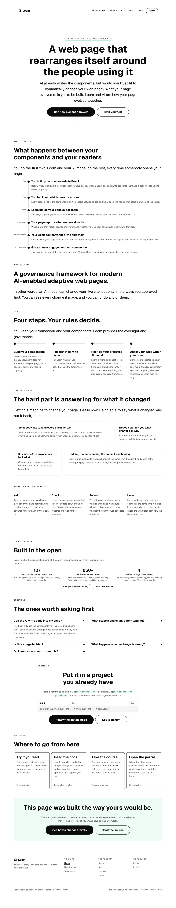
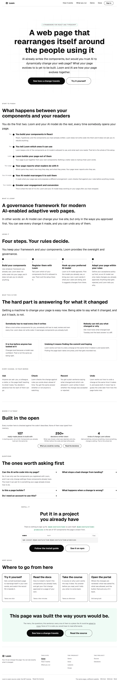
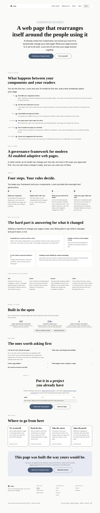
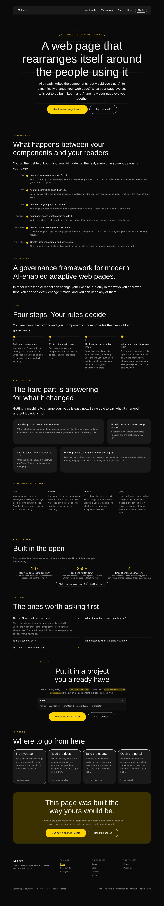
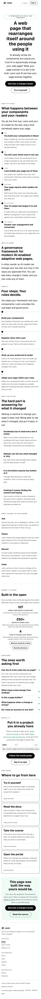

# The front door leads with the chain

**25 October 2026 · `Loom marketing` · branch `marketing-16-what-the-site-is-for-written-down`**

The second unit on this branch. The first wrote `docs/positioning.md` from the
maintainer's answers of 24 October; this one builds the thing that file
specifies. His instruction was *"Front door first."*

## What shipped

**The headline he settled on.** *A web page that rearranges itself around the
people using it* replaces *Make your web page dynamic with AI and Loom*, which
was also his, from 27 September. Three were put to him on #704 and he took the
second: *"I like the second headline. Simplest but gets to the point."*

**The chain, as the first band under it.** The six links he wrote are now a band
of the front door, in his order:

> React/TypeScript components > Loom framework / Primitives > Loom designed web
> page > Signals broadcasting to your AI model > AI reacting to signals and
> redesigning page > Greater user engagement and conversion

`docs/positioning.md` calls it the message and says a page that explains those
six in order, for a junior developer, **is the site**. It is `_lib/chain.ts`,
with his wording kept beside each rendering, and `_lib/chain.test.ts` holds the
band to his order rather than to itself.

**Two bands moved and neither was rewritten.** `positioning.md` names two things
on this page as *"wrong as of today"* and both were wrong in their position
rather than in their words:

| band | was | is |
| --- | --- | --- |
| *Every change, in four words* | third | sixth, after *What this is for* |
| *The hard part is answering for what it changed* | fifth, before the reader had been told what Loom builds | unchanged, and now after the chain |

Nothing was deleted, nothing was reworded, and no link broke: neither band is
pointed at by an anchor.

**The title and the description.** They were the record — *Loom — every change
your AI makes, written down* — which is the half `positioning.md` puts under the
hood. They are now the build case. A `<title>` is the opening, so it followed
the headline rather than waiting for a second decision.

## What it looks like

The front door, 1280×900, under the palette the site is served in:

The band itself, which is the unit:

The same page under the other two registered palettes, which is the bar this
lane is held to:

And at 390×844, where the marker moves above the title and the rail stays:

No colour is named anywhere in the diff. Every rung is a `loom.milestone` in a
`loom.milestone-list`, both registered, and nothing was added to the registry.

## The decision that was not specified: the chain is not numbered

`positioning.md` says *six*. The band does not, and no sentence on this site
says how long the chain is.

The reason is `journey.ts`, which exists because the front door once said *Every
change takes the same four steps* one press above a page headed *Five steps,
every time, in the same order*. Both sentences were true of what they described.
A stranger reading them in that order has been shown, on the first screen, that
this site cannot count the thing it offers to count for them.

This page already says *Four steps* two bands below the new one and
`/how-it-works` says five. A third count would undo the whole of that fix. So
`loom.milestone`'s `marker` carries **who does each one** instead:

> You · You · Loom · Your page · Your AI model · Your readers

Which turns out to be the better column anyway. The shape of the chain is
legible at a glance, and the shape is the sell: the reader's own work stops at
the second rung. `chain.test.ts` holds that property rather than the wording.

## The claim, and the one line published in his words

*Greater user engagement and conversion* is the last rung's heading, verbatim.
`positioning.md`: *"it is the maintainer's own phrasing and is the payoff the
site is allowed to promise."* Writing a better-sounding version of it is exactly
what this lane may not do, so it is quoted, it is in `MAINTAINERS_OWN`, and
`voice.test.ts` fails if it ever stops being rendered.

The other five links are **rendered rather than quoted**, and `chain.ts` says
why: *Loom framework / Primitives* uses a word this site keeps off itself, and
*AI reacting to signals and redesigning page* is a note to himself rather than a
sentence for a stranger. A test holds that exactly one of the six is published
in his words.

## `MAINTAINERS_OWN` lost an entry, which it had never done

The list holds his lines verbatim so a sweep cannot rewrite one by accident. The
case it had never met was him **replacing** one, and it is the right outcome:
his 27 September headline left the list with the page rather than staying there
exempting a sentence nobody renders. His lead paragraph under it is untouched
and still exempt. Nothing of his was edited — the old headline is in `reports/`
and in the record of the conversation.

The literal now lives once, as `HEADLINE` in `copy.ts`, read by the hero and by
the list.

## Numbers

- `pnpm install && pnpm verify` — **green**, exit 0.
- **355 test files, 6366 tests, all passing.** Nothing skipped, nothing
  weakened.
- The route group alone: 57 files, 1506 tests.
- Eight new tests in `chain.test.ts`.
- `prerender:check`: 133 prerendered pages, 1932 text junctions, 0 run together.

Two existing tests changed, and both were assertions about the copy that
changed rather than about behaviour: `share.test.ts` names the front door's card
headline, which is derived from the title; `chain.test.ts`' own first draft read
the hero's eyebrow as the first band, which it is.

## What was left out, and why

**`usingIt` now overlaps the chain**, and this run did not touch it. Its four
beats are *build your components · register them · hook up your model · adapt
within your rules*, which is roughly the chain's first two links and its fourth
and fifth, said again two bands later. The overlap is real and it is visible in
the full-page shot above.

It was left because that band is his: he directed it on 30 September and two of
its sentences are his own words. `positioning.md`'s rule is that **a band comes
off because the maintainer said so**, and he has not. It is the first question
in the pull request comment.

**`/how-it-works` and `/what-you-run` are untouched.** `positioning.md` says
what happens to them has not been decided, and the front door was explicitly
first.

## Findings

**Filed.** The front door's headline and eyebrow are typed out again as literals
in two other lanes' files — a specimen under `src/primitives/` and the portal's
preview screen — so today's swap left both quoting a sentence this site no
longer says, with nothing failing. The entry names the class as well as the two
instances: a surface's copy quoted as a literal outside its route group is a
quotation nothing holds, and the three mechanisms this route group has for
exactly that problem all stop at its boundary.

**Closed:** none.

## Open questions

They are in the pull request comment, where he will see them. The first is
`usingIt` above.
