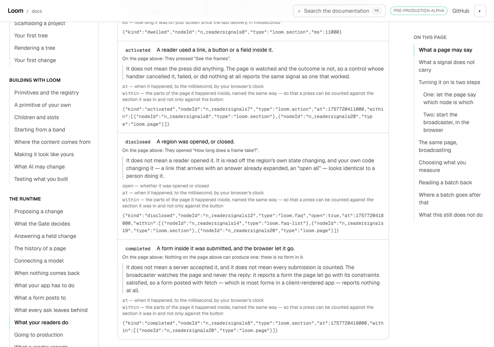
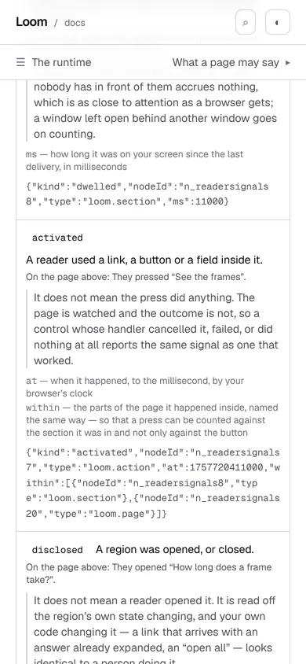
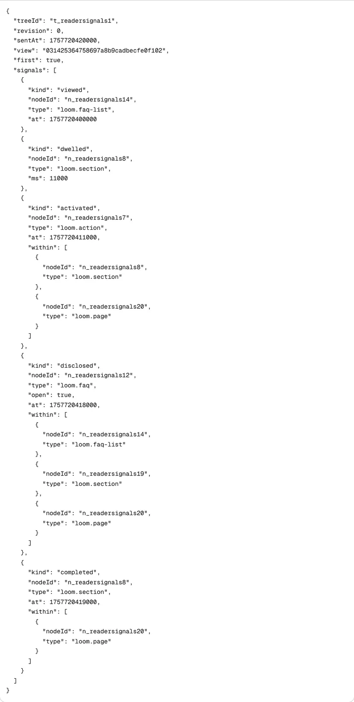

# 26 October 2026 — three rows the page was wrong about, and a cap that stopped the fourth

**Routine:** `Loom docs` · **Branch:** `docs-67-what-a-page-collects` ·
**Section:** §4c

No open pull request from this lane at the start of the run. #709 merged
overnight as `1ac8c1b`. Four were open — #710, #711 and #706 (`Loom signals`)
and #712 (`Loom marketing`) — none of them this lane's and none touching the
`(docs)` route group.

**No maintainer comment is outstanding for this lane.** There is no pull request
of this lane's to carry one, and every comment on the four open threads is
routine-authored and addressed *to* him.

Branch cut from `origin/main` at `1ac8c1b` (#709), after `git fetch origin main`.

## The plain version

**The page that teaches reader signals was wrong about what a signal carries,
and had been since 17 September.**

- `activated` carries `at` **and `within`**. The page said `at`.
- `disclosed` carries `open`, `at` **and `within`**. The page said `open`.
- `completed` carries `at` **and `within`**. The page said `at`.
- A delivery carries `audience`, `view` and `first`. The site had never named
  any of the three, anywhere.

`within` landed on all three delegated kinds with
[0167](../decisions/0167-a-delegated-signal-names-the-regions-it-happened-inside.md)
on **17 September**. Five weeks, and nothing went red, because the thing that was
wrong was a sentence somebody typed and a sentence is as long as its author left
it.

Three of those four are fixed on this branch. The fourth needed a page, the page
needed prose, and the prose crosses a cap I may not raise — which is the other
half of this report.

## What shipped

**Every field the vocabulary panel names is read off the runtime.**
`beyondTheAddress()` asks `collectionNoticeOf` (0313) for the whole vocabulary
and prints, per kind, the fields it carries beyond the three every kind carries.
That table is keyed by the schema's own fields through `keyof Required<…>`, so a
field added to a batch without a sentence does not compile — the page cannot now
be wrong about a signal's shape unless the runtime is.

The shared three are an **intersection**, not a list: a field is shared when
every kind carries it under the same sentence, matched on the sentence as well as
the name, so two kinds that described one field differently would keep their own
rows rather than being merged into a claim neither makes.

**The printed delivery is a whole delivery.** `OneBatch` prints *one delivery, as
it leaves the page*, and it was built by hand with `treeId`, `revision`, `sentAt`
and `signals`. A real broadcast mints a page-view key once, puts it on every
batch, and marks the opening one `first` — both since
[0146](../decisions/0146-a-reader-signal-stays-anonymous-and-a-funnel-is-correlated-inside-one-page-view.md).
So the one block on this site showing a reader what arrives at their endpoint was
missing the two fields every funnel reading in `src/signals/` is built on.

The key is minted by `mintViewKey`, the runtime's own minter, from a byte source
that counts rather than from `crypto` — the same reason the instant on these
signals is frozen. A page whose bytes differ per build is a failed prerender
check, not a documentation improvement. It is a real key of the real width and
the schema's pattern is what judges it.

**The example signals carry their real ancestry.** `EXAMPLES` holds one real
signal per kind, parsed by `readerSignalSchema` on the way out, and three of them
had no `within` at all. They parsed, because `within` is optional — a host may
turn the ancestry walk off, and an absent `within` means *we did not look* rather
than *there was nothing above it* (0167). So three example signals showed a shape
a broadcaster with the walk on never sends.

Found by the new completeness assertion rather than by reading the file: *the
fields a row names are exactly the keys its own example signal turned out to
have* went red on `activated` on its first run. The ancestry is read off the
example tree by the same walk that finds the node the signal is addressed to —
one chain, head and tail, so the ancestry a signal prints cannot belong to a
different node from the one it names. `activated` now names the section the
page's own prose quotes, and the page root, nearest first.

**The claim about the live block's configuration is held against the value.**
`claims.test.ts` held the paragraph under the live block — *`viewed` for the two
sections and the questions band* — by running a regular expression over the
component's source, because the constant was private to a `"use client"` module.
`DEMONSTRATION_KINDS` and `DEMONSTRATION_TYPES` are `_lib/signals/demonstration.ts`
now and the test reads the value. The regex had the usual cost: it could not see
the constant move, so it failed with *the live block no longer has a TYPES
constant* rather than with anything about the claim it exists to hold.

## What did not ship, and why

**A finished, tested *What to tell your readers* section**, printing the whole
notice `collectionNoticeOf` derives — the kinds, what every observation says,
every field of a delivery including the three the site had never named, the six
things never collected, where readers are counted from and how long a delivery
lives — with the call that produced it generated above it, copyable.

It is written, it renders, its tests pass, and **it is not on this branch**,
because `search/build.test.ts` went red:

```
expected 80819 to be less than 80000
```

That is the prose search index's **total** cap: what a reader who leaves the
search box open eventually receives. The numbers, measured:

| | gzipped |
| --- | --- |
| the index on `main` | **79,738** |
| the new section's prose | **+1,081** |
| the cap | 80,000 |

**The site had 262 bytes of headroom.** That is about 580 characters of English
here — a short paragraph. The panels themselves cost the index nothing, because a
component's copy is not in the page file; the cost is entirely the prose around
them, which is the part the brief insists comes first.

An editorial pass over the whole page — cutting the new section, and replacing a
paragraph the notice had made redundant — bought **160 bytes**. Gzip is very good
at English that resembles the English around it, so trimming is not a lever:
fitting under the cap means deleting the explanation and shipping four tables with
no words.

**Raising the cap is settled, and settled against me.**
[0157](../decisions/0157-the-catalogues-public-surface-is-the-list-and-the-lookup-not-every-band-by-name.md)
considered exactly that and rejected it in the words *forbidden by the test's own
comment* — and the comment on this assertion goes further than forbidding it, it
says what firing **means**: *when this one fires, sharding is finished as an
answer and the question becomes whether a browser should be sent the whole site's
prose at all.* That is a decision about what the search box is. It is above this
lane and it is in *Needs your input*.

So this run did what 0157 did and what the escalation rule says: **built what
does not depend on it, and said what it left out.** The finding carries the
measurements, the three costed shapes, and a note that the removed work is in
this branch's history rather than needing rediscovery.

**One trap, refused and written down.** Putting the section's prose inside the
component would have made it invisible to the index and to the cap, and the
section would have shipped today. That is dodging a search budget by making
reader-facing prose unsearchable — the exact opposite of the second bullet in the
same finding, which is that none of that copy would be in the search index. It
was considered and refused.

## Decisions taken that were not specified

- **The hand-written field sentence survives as an optional field, for a kind the
  runtime has not got.** `SIGNAL_FIELDS` is keyed by `ReaderSignalKind`, so a
  kind that is agreed on and not built has nothing to read, and a page wanting to
  describe one ahead of time has to write the sentence. It holds nothing today —
  the runtime has all five — and the five strings it did hold are gone, three of
  them wrong.
- **`produceKinds` stopped returning a string and started returning fields.** The
  rendering is a list rather than a line, so a kind with three extra fields reads
  as three rows instead of a sentence somebody had to keep accurate.
- **The single-kind branch of the intersection is tested rather than reasoned
  about.** One kind is a legal configuration and *what every kind carries* is not
  a useful division of one kind's fields, so that branch returns nothing shared
  and the kind keeps a complete list.
- **`demonstration.ts` stays even though the notice that also wanted it does
  not.** The move stands on its own: a claim about a value is better held against
  the value than against a regular expression over the file the value is in.

## Records

None added, none superseded. Nothing here touches the tree schema, the delta
model or an `Accepted` record. **The cap question is escalated as a finding
rather than as a `Proposed` record**, deliberately: nothing has been decided, the
repository's own pattern for *here is a wall, here are three shapes, costed,
above this lane* is a findings entry (the 23 October spelling entry is the
precedent), and a `Proposed` record would make `Loom merge` skip a pull request
whose shipped half decides nothing.

## Cross-lane diff

**None.** Every file changed is inside `apps/loom/app/(docs)/`, plus `FINDINGS.md`
and this report. Nothing in `src/` was touched, and the one thing this unit
wanted from the runtime — `collectionNoticeOf` — was already published from
`@jam-overture/loom/signals`.

## Findings

**One filed and closed, one filed and open, one existing entry partly met.**

- Partly met: *what a page collects is now a value a surface can print, and the
  two surfaces that would print it describe it in prose instead* (24 October,
  `Loom signals`). The half that needed no new prose is done. The page is written
  and not shipped. The worked example's half is `Loom demo`'s and untouched. The
  entry's status also records that it was right about more than it claimed: the
  prose was not a second copy of the truth, it was a stale one.
- Filed, closed by this branch: *the page's own example signals carried no
  ancestry, so three of five showed a shape no broadcaster with `within` on ever
  sends* — recorded for the general shape, which is that **an optional field is
  the one a produced example quietly stops carrying.** A required field going
  missing takes the producer down with a parse error; an optional one is a hole
  that validates. Every producer on this site that builds an example of a schema
  shape has the same exposure, and the cheap defense is the one used here:
  compare the example's own keys against the table rather than trusting the schema
  to have an opinion.
- Filed, open: *the prose search index is 262 bytes under its total cap, so the
  next page anybody writes on this site crosses it* — with the per-section table,
  the three costed shapes, the recommendation, the refused trap, and the two
  consequences of the 23 October component-copy gap that this section would have
  met (spelling, and search — the second of which moves that entry's
  recommendation).

No finding for `Loom primitives` came out of this unit.

Standing entries this run met again and did not duplicate:

- **`*.vercel.app` is denied by the environment's egress policy** (12 October,
  open).
- **The composed preview URL** (16 October). The URL below is taken from the
  `vercel[bot]` comment rather than guessed from the branch name.
- **The commit author line** (23 October). Every commit here is the session
  default, `Claude <noreply@anthropic.com>`.
- **The harness subscribes a routine's session to its own pull request**
  (24 October, open, `Loom daily build`). Handled the same way: the pull
  request's state is read once and the session unsubscribes. No check-in armed.

## Test numbers

`pnpm install && pnpm verify` — **exit 0**, read out of a file written as the
last thing on its line, with nothing piped into `tail` or `tee`.

- framework: **240 files, 5,746 tests passed**
- application: **366 files, 6,492 tests passed**
- `findings:check`: 1,320 findings, 0 malformed
- `reports:check`: 1,981 visuals, 140.9MB, none over 1.1MB, 410 cited by no file
- `prerender:check`: **137 prerendered pages**, 1,943 text junctions, 0 run
  together; 3 metadata conventions, 0 unserved

Nothing failed in that run, nothing was skipped, and no test was weakened.

**Four full runs, and the one quoted above is the fourth.** The first was killed
after a type error was found by hand (below). The second was killed when a stray
test process from the first turned out to be competing with it for the machine.
**The third went red, and it is the run this report is mostly about**: two
failures, one of them the stale compiled fences the new section's ten extra
lines shifted, and one of them the search index cap. The fourth is the branch as
it ships, after the section came out.

**A note on reading that third run**, because it is the rule in
`docs/routines.md` catching something in the act: the harness reported the
background command as *exit code 0*. The file said `EXIT=1`. The file was right.
Nothing was lost, because the file is what this lane reads — which is the whole
reason the rule says to write the status as the last thing on its line.

**Eleven tests are new**: 6 in `signals/notice.test.ts` — every kind covered,
the fields named being exactly the schema's table for each kind, a sentence on
every field, the field three rows used to leave out, the shared address left out
of every row, and the single-kind branch — 4 in `signals/page.test.ts` (the
example-signal completeness check, the whole delivery, the page-view key, and
what a pending kind may and may not read) and 1 in
`_components/reader-signals.test.tsx` (every field in its kind's row, read back
out of the document).

Four existing assertions were rewritten rather than added to: what a row is
asked for, what a kind on either list says, whether both lists say the same
things, and the live block's configuration — the last of which stopped being a
regular expression over a component's source.

### Four mutations, four killed

Each applied on its own, with the affected tests re-run.

| what was put back | what failed |
| --- | --- |
| the rows dropping `within` again — the exact state of 25 October | **4**: the schema-table match, *names the field three rows of this page used to leave out*, the example-signal completeness check, and *reads its fields off the schema once the runtime has it* |
| the printed delivery losing `view` and `first` | **2**: *is a whole delivery* and *names a page view the schema would accept as one* |
| the `activated` example losing its ancestry again | **1**: the example-signal completeness check — which is the assertion that found this defect in the first place |
| the panel printing one field per kind instead of the list | **1**: *prints every field each kind carries, in that kind's row* |

**One of these got away on its first attempt**, and it is worth the paragraph.
*Is a whole delivery* was first written as two `toContain`s against a field list
plus a subset check — *every key on the batch is a field the runtime names*.
Taking `view` and `first` back off the batch left every remaining key still
named, so it passed, and only the view-key assertion noticed. It is stated the
other way round now — **which named fields the block does not have**, which must
be exactly `["audience"]` — so a field going missing from the block fails, and
so does a field added to a delivery that the block then does not carry. The
`audience` exception is an exception for a reason rather than by exemption: a
delivery carries it only where the host serves an audience, nothing on this site
does, and a notice names it anyway because a notice is a ceiling.

### A type error no test would have found

An earlier shape of `demonstration.ts` returned `Pick<ReaderSignalOptions,
"kinds">`, where `kinds` is **optional** — a broadcaster asking for nothing in
particular means every kind. A test spreading it is a type error and is not a
test failure: vitest does not typecheck, so every test passed and `tsc --noEmit`
did not. Caught by running the application's typecheck directly rather than
waiting for the gate, which is worth doing after a change to a shared constant's
type.

## The pictures

Taken with `pnpm shoot --serve apps/loom` against a build in this container,
`built 2026-10-26T14:56:53.907Z`.

**There is no *before* picture**, and the reason is worth stating rather than
leaving as an absence: the old page is on `main`, and photographing it means
building `main` in a second checkout. What the old rows said is a literal in the
diff and is quoted above — `activated: "at — when it happened"` — so the claim
is checkable without a photograph of it.

### The rows, with the fields the schema gives them



`disclosed` draws **three** field lines where it drew one — `open`, `at` and
`within`, measured at `y 474`, `y 492` and `y 510` — and `activated` draws two
where it drew one. Each line is the field's name in the payload and the
runtime's own sentence about it, addressed to a reader.

### On a phone, and the overflow this change made worse



`scrollWidth 390 / innerWidth 390` — nothing scrolls sideways, taken by a
browser reporting `hover: none` and `pointer: coarse`.

The example signals grew with the ancestry: an `activated` is about 200
characters now. In the scroller they sat in, the line ended mid-word at the
panel's edge with nothing on the screen saying there was more — which is the
**18 October finding against `loom.code`**, met here in a docs component and made
worse by the change above it. A reader comparing a row's field list to the signal
under it has to be able to see the signal, so the block wraps. `break-all`
rather than wrapping on whitespace, because `JSON.stringify` without spaces has
none to wrap on.

### The delivery, whole



`view` and `first` are the two lines that were not there this morning, and the
three `within` arrays are the three that were empty of ancestry. Every id in them
is a node on the tree at the top of that page: `activated` happened inside
`n_readersignals8`, which is the section the page's own prose quotes, and inside
`n_readersignals20`, which is the page.

## Needs your input

**One question, and it is the one the cap's own comment reserves for you.**

**Should a browser be sent the whole site's prose?** The search box fetches one
section's words at a time and never stops fetching, so a reader who leaves it
open receives all five — 79,738 gzipped bytes today against a cap of 80,000. The
cap is not nearly spent, it is spent: 262 bytes, which is a short paragraph. The
next section anybody writes on this site crosses it, whoever writes it, and the
finding has the per-section numbers (`the-runtime` is also within 4,000 of its
own 40,000).

**My recommendation is shape 2**: the box stops holding every section it has
fetched. It already knows which page a reader is on, and the per-section remedy
already written down — shard the big section by page — makes this particular
number worse rather than better, because the total is measured over files as
served. So the change is to what the box *keeps*, not to how the words are cut
up. I did not build it, because what the box is for is yours and because 0157's
*forbidden by the test's own comment* covers the cheap alternative.

Two standing questions, neither new, neither urgent, neither blocking: whether a
list-shaped export may be given a list-shaped presentation (22 October), and
whether a produced table on this site should be composed from the library rather
than arranged locally (#709).
