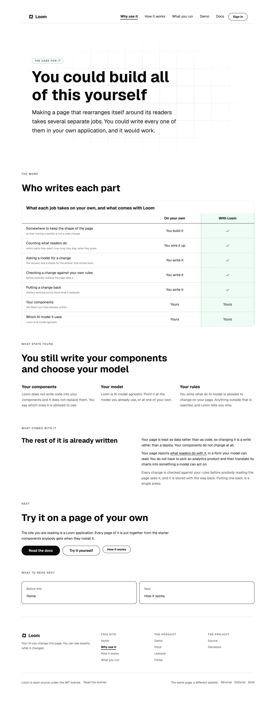
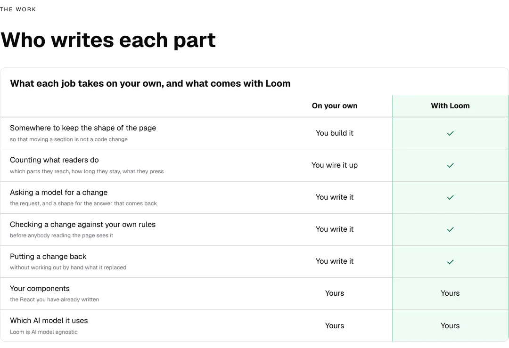
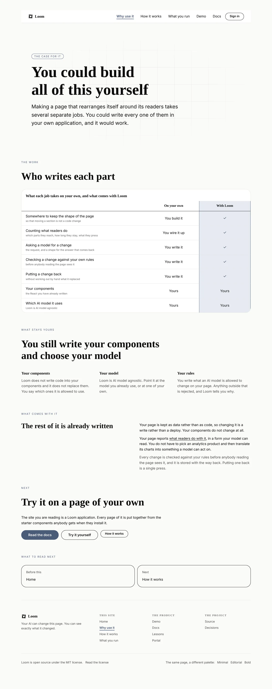
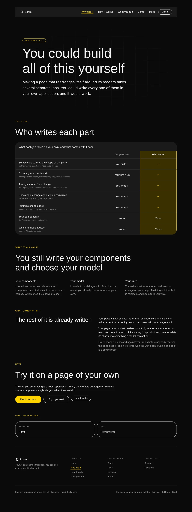
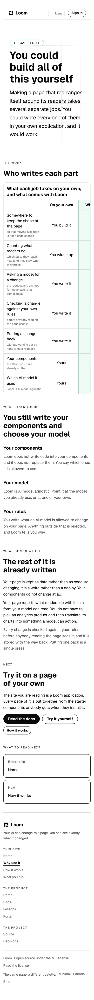
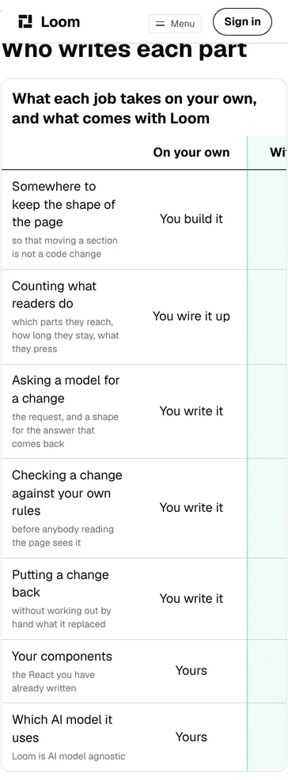

# Why use it, which is the half of his instruction the site had not answered

**26 October 2026 · `Loom marketing` · branch `marketing-17-why-use-it`**

`docs/positioning.md` records the maintainer's answers of 24 October, and the
instruction this run is built on is in two parts:

> *"Don't worry about the controls. That is the stuff under the hood. The
> building part and why this build is better than traditional methods is
> preferred."*

The front door now leads with his chain, which is the **building** part. That
landed yesterday on #704. Nothing on this site answered the second part. A
visitor who has read the chain and believes it knows what Loom makes; they have
not been told why they would reach for it rather than wire the same thing up
themselves, which for *"the casual web developer… junior level"* is the next
question and often the only one.

## What shipped

**A fourth page, `/why-use-it`.** It is the comparison the library already had a
primitive for and this site had never used: `loom.comparison-table`'s own
description is *"the band that answers how is this different from what I use
now"*.

The page is four bands and a close:

| band | what it is |
| --- | --- |
| hero | *You could build all of this yourself* |
| **The work** | the table: each job, what it takes on your own, what comes with Loom |
| **What stays yours** | your components, your model, your rules |
| **What comes with it** | the five rows of the table, as sentences |
| **Next** | the docs, the demonstration, how a change travels |

**It is second in the reading order**, before `/how-it-works`. `site.ts` has
held since the third page was written that the order is *the order a stranger
needs them in*, and the sentence that put `/how-it-works` ahead of
`/what-you-run` is the same one that puts this ahead of both: a reader who does
not yet believe the thing is worth having has no use for how a change travels.

**It is in the bar**, which now carries six items against the ceiling of eight
the maintainer set on #166.

**Nothing was deleted and nothing was rewritten.** `positioning.md` names
`/how-it-works`, `/what-you-run` and two bands of the front door as *"wrong as
of today"*, and is explicit that it authorises neither deleting nor rewriting
them. This run added a page and left all four alone.

## The table, which is the page

Seven rows, two columns. Five of them are a job Loom has already written, and
the cell on the Loom side is the mark alone so the column reads as a column of
ticks at a glance:

| | On your own | With Loom |
| --- | --- | --- |
| Somewhere to keep the shape of the page | You build it | ✓ |
| Counting what readers do | You wire it up | ✓ |
| Asking a model for a change | You write it | ✓ |
| Checking a change against your own rules | You write it | ✓ |
| Putting a change back | You write it | ✓ |
| **Your components** | **Yours** | **Yours** |
| **Which AI model it uses** | **Yours** | **Yours** |

**The last two rows are the reason the table is worth reading**, and the
argument for them is not this run's. `compositions/comparison-band.ts` states it
about its own band and is why that one carries a `partial`:

> *"a comparison band where the first column is `yes` all the way down is an
> advertisement rather than a comparison; a reader discounts the whole table on
> sight."*

These two are the places where Loom gives you nothing you did not already have,
and saying so is what makes the five above them credible.
`why-use-it.test.ts` holds *at least one row the two columns answer the same
way* rather than holding the wording, so the property survives a rewrite of
every word on the page.

## What it looks like

The page at 1280, under the palette the site is served in:



The table itself, which is the unit:



The same page under the other two registered palettes, which is the bar this
lane is held to:





At 390, where the table is the thing worth watching, and where it does not come
out well. The section below has the measurement:





And the bar, which is the one thing on another page this change touched:


No colour is named anywhere in the diff. Every element on the page is a
registered primitive, and `why-use-it.test.ts` reads the whole tree against the
registry the site is built with rather than trusting that.

## What the camera found, and what it cost

Two things were wrong in the first photographs and one of them is still wrong.

**The hero had two paragraphs and the second read as a caption.** A
`tone: "muted"` paragraph under a `size: "lead"` one renders a step smaller and
a step lighter, so *This page is what each job takes on your own* sat under the
lead looking like a footnote on it — at 1280, and worse at 390 where it was
four lines of small grey type under the only thing on the screen. What it said
is what the band under it says with a heading and a caption, so it is gone
rather than restyled. Every hero on this site is one paragraph again.

**The three tiles under *What stays yours* were ragged**, at 27 words against
17 and 23. That is inside the twelve-word spread `balance.test.ts` allows and it
was still visible, which is the thing that file says about itself: a rule that
catches the hole does not catch every lean. The first tile is 21 words now and
the spread is four.

**The table does not fit a phone, and this is a finding rather than a fix.**
Measured on the build these pictures came from:

```
2026-10-26-marketing-the-table-phone  390x844@2x touch  scrollWidth 390 / innerWidth 390
    table  x 15 y 880  451x802
```

Nothing overflows — the page is 390 in a 390 viewport — because the band has a
scroller of its own. Inside it the table is 451 wide, so **the whole of the
*With Loom* column is past the right edge at rest** and a reader on a phone sees
seven criteria, seven answers in the column the page is arguing *against*, and a
sliver of tint where the answer is.

It is the band's narrow design working exactly as written, against a case it was
not measured on. Below 48rem the criterion column drops to 9rem so that 92
pixels of the *next subject* are visible, with scroll snapping on every cell —
which is the right answer for three or four subjects, where no width fits and
the question is how well the band says *there is more along here*. With two
subjects fitting is on the table and the minimums alone are 368 of 390, so the
band is over the edge on padding. No prop reaches it: `density: "tight"` saves
about 24 pixels of the 61 it needs, and it is a reading decision rather than a
fitting one.

Filed for `Loom primitives` with the arithmetic and two shapes it might take.
What this lane did instead is nothing to the band, because it is `src/`. The
page already carries *What comes with it*, which says the five marked rows as
sentences, so a phone reader who scrolls past the table meets the substance in
prose. That band was written because a scan is not an explanation, and it
happens to be what keeps the phone reading honest.

## What it may claim, and what it does not

**The subject is work rather than a competitor.** Nothing on the page names
another product, measures one, or says Loom is better than one. His word was
*traditional methods*, and the honest reading of that for a junior developer is
*the code you would otherwise write yourself* — which this repository can speak
to, because every row is a thing in it.

**It makes no outcome claim.** `positioning.md` allows this site exactly one,
*greater user engagement and conversion*, and it is his phrasing on the front
door's last rung. A second page promising a result would be this lane inventing
positioning, so `why-use-it.test.ts` holds the words a result would be written
in off this page: *conversion*, *engagement*, *revenue*, *faster*, *uplift*,
*boost*, *x more*. It is a blunt substring check for `copy.ts`' reason about the
reserved vocabulary — a rule that cannot be argued with is worth more here than
a subtle one that erodes an exception at a time.

## The one test constant that moved, and why it had to

**`MOST_WORDS_ON_THE_SITE` went from 3,300 to 3,800.** This is the only number
in this diff that was not added, and it is the thing to look at hardest.

`budget.test.ts` caps the whole site's word count, and the cap is deliberately a
literal: *"The measurement chose the number once, in a comment, in front of a
reviewer who can overrule it."* It is also held from below, so a ceiling nothing
is near reports itself as stale rather than passing quietly. Both halves are
right.

What happened is that **the ceiling was a three-page ceiling.** The three pages
measured 3,179 of 3,300 in the state that says the most, which is the margin the
binding-ceiling rule asks for; a fourth page of any useful length cannot fit in
the 121 words that were left. So:

| | |
| --- | --- |
| the site, authored | 3,248 words |
| the site, in the state that says the most | 3,703 words |
| the new ceiling | 3,800 |
| how binding that still is | 0.97, against the three fifths the file requires |

The method is the file's own rather than a new one: measure, pick a number a
little above, write the comment, and put it in front of somebody who can
overrule it. **It is still binding from below**, which is the clause that makes
raising one cost something — a run that wants to raise it again has to add copy
a reviewer agrees is worth the words.

It is also filed as a finding, because the shape is worth deciding rather than
re-arguing: a total with no term for how many pages it is a total of re-decides
the size of the site every time somebody adds one.

## Decisions taken that were not specified

**The page is not numbered and no sentence on it says how many jobs there are.**
`chain.ts` has the whole argument and this is the third page to follow it: the
front door says *Four steps*, `/how-it-works` says five, and a third count is
how a stranger finds out on the first screen that a site offering to count
things for them cannot count its own. A table does not have to say how many rows
it has.

**The hero's eyebrow is not the page's own label.** It was *Why use it* for an
hour, and `naming.test.ts` refused it on all twenty-five served states: that
file holds *a band that names a page offers the way there*, and a hero carrying
the page's own name names it with no link in the band. The rule is right about
every other case and has no way to say *the reader is already here*. The eyebrow
is *The case for it* now, which says what the band is for instead of repeating
the title above it. Filed rather than fixed, with the one-clause fix written
down and the reason it was not taken today.

**Three container types were classified in `balance.test.ts`.** That file holds
*every container this site renders is on one of two lists*, so a new band is red
until somebody decides whether the rule about ragged cells applies to it. All
three were decided on the layout rather than on convenience:

| | | |
| --- | --- | --- |
| `loom.comparison-row` | **a row** | its cells are `<td>`s in a `<table>`, so their widths are the table's columns and their heights are the row's. The spread here is three words against the twelve allowed |
| `loom.comparison-table` | not a row | holds rows, read downward, nothing stretches one row to another's height |
| `loom.hero` | not a row | stacks its own children. Unclassified until today only because no hero on this site had two children of one type |

**One phrase on the page carries its own link**, which is the site convention
`inline.test.ts` holds over every served state. It is *what readers do with it*,
and it points at the band on `/what-you-run` that says what this deployment
counts rather than at that page's address — `whatLeaves` on that page explains
the choice: a link to a band goes red the day the band moves and a link to a
page does not.

## Numbers

`pnpm install && pnpm verify`, exit code read out of a file written as the last
thing on its line:

```
Test Files  240 passed (240)      Tests  5746 passed (5746)    # framework
Test Files  366 passed (366)      Tests  6606 passed (6606)    # @loom/app
Test Files   58 passed  (58)      Tests  1632 passed (1632)    # app/(marketing)
1321 findings, 0 malformed
137 prerendered pages, 1934 text junctions, 0 run together
EXIT=0
```

Nothing skipped and nothing weakened. The route group was 57 files and 1,506
tests yesterday; it is 58 and 1,632 now. Eight of the 126 are
`why-use-it.test.ts`; the rest are the site-wide sweeps reading a fourth page —
every `it.each(SITE_ROUTES)` in this route group gained a case, which is what
makes adding a page to this site cost what it costs.

Three test files other than the new one changed, and none of them is an
assertion that got easier:

| file | what changed |
| --- | --- |
| `balance.test.ts` | three container types classified, one of them **into** the rule rather than out of it |
| `budget.test.ts` | the site word ceiling, argued above |
| `addressed.test.ts`, `announced.test.ts`, `browser-bar.test.tsx` | one line each: the new page's module, in lists each file holds to `SITE_ROUTES` in both directions |

## Findings

**Three filed.**

- **A two-subject comparison is the one shape of the band that could fit a
  phone, and it is the shape that does not.** Owned by `Loom primitives`. The
  section above has it; the entry has the arithmetic, the two shapes a fix
  might take, and the general question underneath — the narrow rendering has
  one behaviour for a band whose subjects cannot fit and for one whose subjects
  nearly do.
- **A page that says its own name is stranded** by `naming.test.ts`' rule that a
  band naming a page offers the way there. Nothing is broken, the instance is
  worked around, and the entry carries the one-clause fix and why it was not
  taken in this pull request.
- **The site's word ceiling is a total with no term for how many pages it is a
  total of**, so a new page is red before a word of it is written. Owned by this
  lane. The ceiling is raised and argued here; what is filed is the shape, with
  two alternatives and the question underneath them, which is his.

**Closed:** none.

## Open questions

They are in the pull request comment. The first is whether this page should draw
the line between the free framework and the paid portal, which `positioning.md`
says the front door may draw and `voice.test.ts` currently forbids anywhere on
the site.
