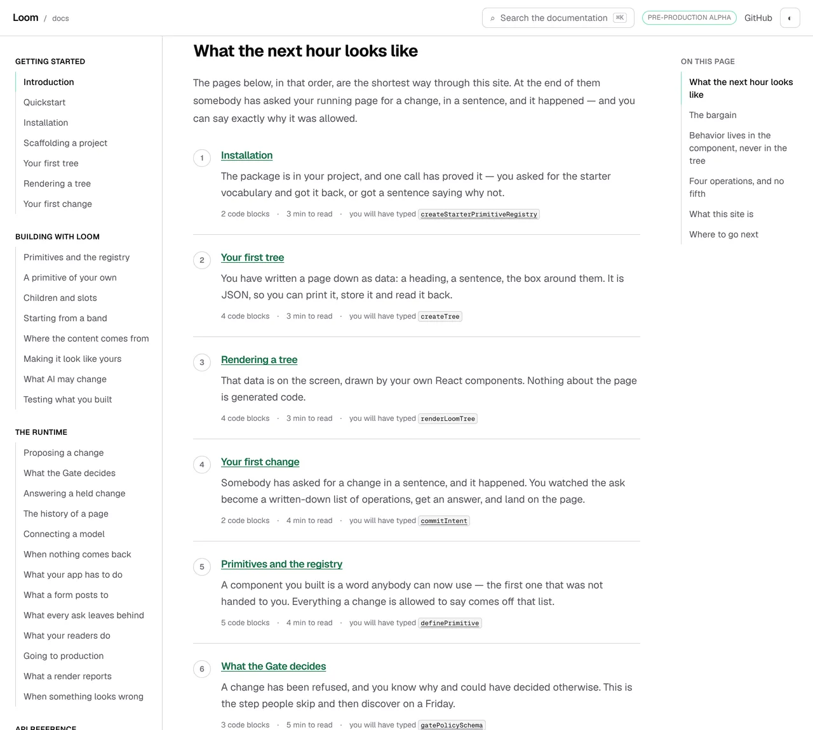
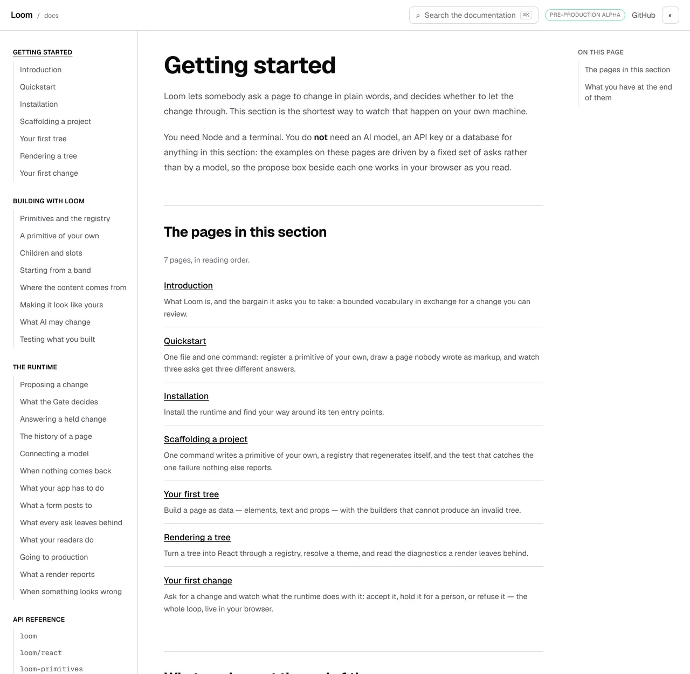

# 27 October 2026 — the four pages the route walks past, and the facts that excuse them

**Routine:** `Loom docs` · **Branch:** `docs-68-the-route-says-what-it-walks-past` ·
**Section:** §4c

No open pull request from this lane at the start of the run. #713 merged
overnight as `a3600f1`. Four were open — #714, #715 and #706 (`Loom signals`)
and #716 (`Loom marketing`) — none of them this lane's, none touching the
`(docs)` route group.

**No maintainer comment is outstanding for this lane.** The only non-bot comment
on #713 is this lane's own, addressed *to* him, and it is the escalation
repeated under *Needs your input* below.

Branch cut from `origin/main` at `a3600f1` (#713), after `git fetch origin main`.

## The plain version

**The first page of this site promises a stranger an hour, in six stops. Until
today nothing anywhere knew which pages that hour goes past.**

Everything about the six was held: each address is a page, each title is the
rail's own, each checkpoint is a name the runtime publishes and the page really
prints, each anchor is a real heading, the order never doubles back, the
sentences carry no jargon, the blocks are counted and the minutes fit the hour.
Nine assertions, and **every one of them is of the form *this stop is still
true***.

None of them could be of the form *these are still all of them*, because a list
says nothing about what is not in it. So the failure this leaves open is the one
that actually happens: somebody writes a new page for Getting started, the rail
carries it, the section's own page lists it, and the route — six entries in a
file nobody opens when they write a page — goes on promising an hour that never
mentions it. Nothing renders differently. No link breaks. The only person who
finds out is the stranger, and they find out by finishing.

**Every page the route passes is now either a stop or named with the reason it
is not one**, and the reason has to be a fact the site can be asked about.

## What shipped

**A second list, and the pair held against the site.** `OFF_ROUTE` names the
four pages the route walks past, each with an excuse and a sentence.
`routeAccountFaults` returns everything wrong with the pair as sentences a
person can act on, and the module throws at import when the list is not empty —
so a page added in front of a stop is a build failure rather than a page.

The four:

| page | why the route does not stop there |
| --- | --- |
| `getting-started/introduction` | the route is drawn on it |
| `getting-started/quickstart` | the route's own prose offers it |
| `getting-started/scaffolding-a-project` | *Installation* covers the same ground |
| `the-runtime/proposing-a-change` | *Your first change* covers the same ground |

**The reasons are facts, not sentences we are taken at our word on.** This is
the part that cost the thinking, because a hand-written list of excuses goes
stale exactly the way the thing it is excusing does. Each of the three kinds is
checked against the site:

- **`the-route-is-printed-here`** — that page's source draws `<ArrivalRoute />`.
- **`the-route-offers-it-in-its-own-prose`** — the route's page links to that
  address. Rewrite the paragraph above the route to drop the link and the excuse
  for skipping the Quickstart falls with it, in the same commit.
- **`a-stop-covers-the-same-ground`** — the step exists **and comes earlier in
  the rail**. *Covered by* is a claim about a reader who has already been
  through something, so an excuse pointing at a stop further along is an excuse
  about a reader who has not got there yet.

There is deliberately **no fourth kind** — no *trust me, a first hour does not
go here*. The moment one exists, the list stops being held and becomes a list of
opinions, which is the thing it was built to replace.

**Two kinds of page are off the route by rule rather than by name**, and an
excuse for either is refused as an excuse holding nothing up: a section's own
page, which is a listing rather than somewhere a reader is sent to type, and a
page the route does not pass at all.

## The judgement this run had to make, because the finding did not make it

**What *passes* means.** The first build read it as *every page in rail order up
to the last stop*, and it immediately asked for seven more excuses — the pages
of *Building with Loom* that sit between *Primitives and the registry* and the
runtime section:

```
loom: the arrival route does not account for every page it passes —
  - the route passes building-with-loom/a-primitive-of-your-own and neither stops there nor says why it does not
  - the route passes building-with-loom/composition and neither stops there nor says why it does not
  - the route passes building-with-loom/starting-from-a-band and neither stops there nor says why it does not
  … four more
```

The honest reason for each of those seven is *a first hour does not go here*,
which is precisely the unverifiable fourth kind. Seven opinions to catch one
page is the wrong trade, so the rule was narrowed to the reading it has now:
**the route is responsible for the pages a reader meets before it takes them out
of a section.** It enters Getting started at the top and leaves from the last
page, so the whole section is its business. It enters Building with Loom at the
first page and leaves from there, so the seven after it are the section the
route declined to finish rather than pages it walks past.

That keeps every catch worth having — a page added anywhere in Getting started,
or in front of either of the two later stops — and it is written into the
module's own docblock with what it gives up. The finding carries the cost of
moving the line back: four excuses become eleven, and seven of them would be
judgement the build cannot hold.

## Decisions taken that were not specified

- **The check throws at import rather than failing a test.** It is what this
  module already does with the hour budget, and the reason is the same: a route
  that has gone stale should not render. A test alone would leave the site
  serving a promise it has stopped keeping until somebody ran the suite.
- **The faults are a list rather than the first one.** A page added to a section
  is usually a page added *with* its siblings; reporting one at a time would
  cost a build per page.
- **`stop` is a step id, not an address.** The covering stop is named by the
  `id` the route already gives each step, so the page it is on is stated once.
- **The one component change is a handle, not a hook.** `ArrivalRoute` carries
  `data-arrival-route` so the screenshot harness can measure the route as one
  rectangle instead of matching on a spacing class. Nothing styles it, nothing
  reads it at runtime, and one test holds it.
- **Nothing is printed on the page.** The totals footer was removed on the
  maintainer's instruction of 29 September as unnecessary, and a list of pages
  the route skips and why would be exactly that section coming back. The account
  is for the build, not for the reader — and printing it from a component is
  also how reader-facing prose becomes unsearchable, which is the trap this lane
  refused in writing yesterday.

## Records

None added, none superseded. Nothing here touches the tree schema, the delta
model or an `Accepted` record. Nothing is escalated as `ARCHITECTURAL` by this
unit; the one question above this lane is the search cap, which is unchanged and
repeated below.

## Cross-lane diff

**None.** Every file changed is inside `apps/loom/app/(docs)/`, plus
`FINDINGS.md` and this report. Nothing in `src/` was touched, nothing in another
surface's route group, and no primitive was wanted that does not exist — the
unit draws nothing.

## Findings

**Two filed, one existing entry closed.**

- **Closed:** *the arrival route and the section's own page both answer what
  should I read, and only one of them notices a page added to Getting started*
  (25 October, this lane). That entry costed two shapes and said of this one
  *worth taking the day a page is added to Getting started and nobody notices;
  not worth taking before.* It is taken a day early, and the new entry says why:
  the failure is silent in both directions, so *the day nobody notices* is not a
  day anybody can be waiting for.
- **Filed:** *a curated list is checked against everything it declares and
  nothing it leaves out* — the general shape, with the table of what checks each
  excuse, and what the narrowing above does not catch.
- **Filed:** *mutation testing before the first commit is how a run loses the
  work it is testing* — this run did exactly that, in the module the branch
  exists for. Owned by every routine, and a line somebody may want in
  `docs/routines.md`.

No finding for `Loom primitives` came out of this unit.

Standing entries this run met again and did not duplicate:

- **`*.vercel.app` is denied by the environment's egress policy** (12 October,
  open).
- **The composed preview URL** (16 October). The URL below is taken from the
  `vercel[bot]` comment rather than guessed from the branch name.
- **The commit author line** (23 October). Every commit here is the session
  default, `Claude <noreply@anthropic.com>`, checked with
  `git log --format='%an <%ae>'` before the push rather than after.
- **The harness subscribes a routine's session to its own pull request**
  (24 October, open, `Loom daily build`). Handled the same way: the state is
  read once and the session unsubscribes. No check-in armed.

## Test numbers

`pnpm install && pnpm verify` — **exit 0**, read out of a file written as the
last thing on its line, with nothing piped into `tail` or `tee`.

- framework: **240 files, 5,779 tests passed**
- application: **367 files, 6,644 tests passed**
- `findings:check`: 1,330 findings, 0 malformed
- `reports:check`: 1,990 visuals, 141.7MB, none over 1.1MB, 410 cited by no file
- `prerender:check`: **137 prerendered pages**, 1,943 text junctions, 0 run
  together; 3 metadata conventions, 0 unserved

Nothing failed in that run, nothing was skipped, and no test was weakened. The
prose search index is **unchanged** — this unit adds no words to any page, which
is the only reason it could be built today at all.

**Two full runs.** The first was started before the component handle and the
report existed and was **killed deliberately**, not finished: its log says
`EXIT=143` while the harness reported the background command as *exit code 0*,
which is the second sighting this week of the rule in `docs/routines.md` about
reading the status out of the file. The run quoted above is the branch as it
ships.

**Twenty-six tests are new**: 25 in `arrival/arrival.test.ts` — five on what the
route passes, four on each excuse being a fact rather than a claim, fifteen on
the ways an account is refused, and one asking nothing of a route with no steps
— and 1 in `_components/arrival-route.test.tsx` for the handle the harness
measures by. No existing assertion was changed or removed.

### Five mutations, five killed

Each applied on its own, with the affected tests re-run.

| what was put back | what failed |
| --- | --- |
| the reason for skipping the Quickstart removed | the module refuses to load: *the route passes getting-started/quickstart and neither stops there nor says why it does not* |
| the link to the Quickstart taken out of the route's own prose | the module refuses to load: *getting-started/quickstart says the route's own prose offers it, and getting-started/introduction does not link to it* |
| *passes* widened back to rail order | the module refuses to load, naming all seven pages of Building with Loom after the stop |
| a covering stop allowed to come after the page it covers, and *Scaffolding a project* pointed at a later one | **2**: *is covered by a step the reader has already been through*, and the crafted refusal |
| **a page added to Getting started and the route left alone** | the module refuses to load: *the route passes getting-started/reading-the-diff and neither stops there nor says why it does not* |

The last of those is the finding's own scenario, run rather than argued: a
`nav.ts` entry and a `page.mdx` were added in front of *Your first change*, the
way anybody writing a new page would add them, and the build stopped.

**It took two attempts to run honestly.** The first time, the page was added to
`nav.ts` without a file on disk, and the suite went red for an unrelated reason
— a page the rail names and the disk has not got — which would have been
reported here as a kill that proved nothing. The file is in the mutation now.

### The twenty minutes this run lost, written down

The first mutation was planted before anything was committed, and the restore
afterwards was `git checkout -- <path>`. On a branch with no commit on it that
is not an undo of the mutation; it is an undo of the work. The new module went
with it, and the next three mutations ran against a file that no longer had the
code under test in it — reporting *is not a function* in a shape that reads at a
glance like a real failure of the new rules.

Rebuilt from the session's own transcript, committed, and every mutation after
that restored with `git restore --source=HEAD -- .`. It is filed as a finding
because the discipline that cost the work is the discipline the repository asks
for, and because a run that does not notice reports three kills that were the
restore.

## The pictures

Taken with `pnpm shoot --serve apps/loom` against a build in this container,
`built 2026-10-27T14:04:16.589Z`.

**No page changed, and that is deliberate** — the totals footer under this route
was removed on the maintainer's instruction of 29 September, and a list of
skipped pages printed on the page would be that section coming back. So these
are pictures of the subject rather than of a change, and both were taken on this
branch.

### The route, with every page it walks past visible beside it



**All four skipped pages are in this frame.** In the rail: *Introduction*,
*Quickstart* and *Scaffolding a project* under Getting started, and *Proposing a
change* sitting directly above *What the Gate decides* under The runtime. The
route beside them is six stops, measured at `y 233` through `y 1013`, four of
which are Getting started pages. Nothing on the screen says the other four were
a decision — until today, nothing anywhere did.

### The same question, answered by the section's own page



*7 pages, in reading order*, derived from `nav.ts` — the list that picks up a new
page the moment the rail does. That is the number the route is now held against:
seven passed, four stopped at, three named with a reason, and no fourth state
for a page to be in.

## The preview

TBD

## Needs your input

**Nothing new, and the one question from yesterday is still open and still
blocking the page it was about.**

**Should a browser be sent the whole site's prose?** The prose search index sits
at 79,738 gzipped bytes against a cap of 80,000 — **262 bytes**, about one short
paragraph. The *What to tell your readers* section of
`/docs/the-runtime/what-your-readers-do` is written, tested and not shipped
because it costs 1,081. Raising the cap is forbidden by 0157 and by the test's
own comment, which says what the firing *means*: sharding is finished as an
answer, and the question becomes whether a browser should be sent the whole
site's prose at all.

**My recommendation is unchanged: the search box should stop holding every
section it has fetched.** It already knows which page the reader is on.

**This run was chosen to fit around that.** The unit above adds no prose to any
page, which is why it was the right thing to build today — but it is worth
saying plainly that *every page this site still needs* costs index bytes it has
not got. The cap is not blocking one section any more; it is blocking the
section of work this lane exists to do.

Two standing questions, neither new, neither blocking: whether a list-shaped
export may be given a list-shaped presentation (22 October), and whether a
produced table on this site should be composed from the library rather than
arranged locally (#709).
