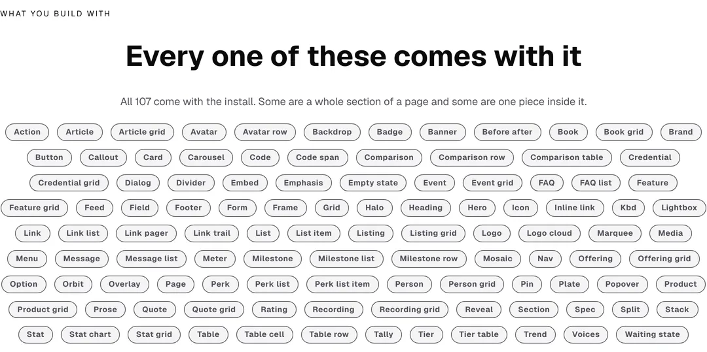
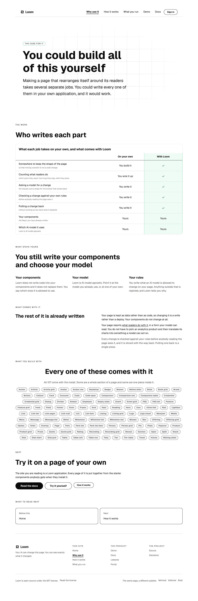
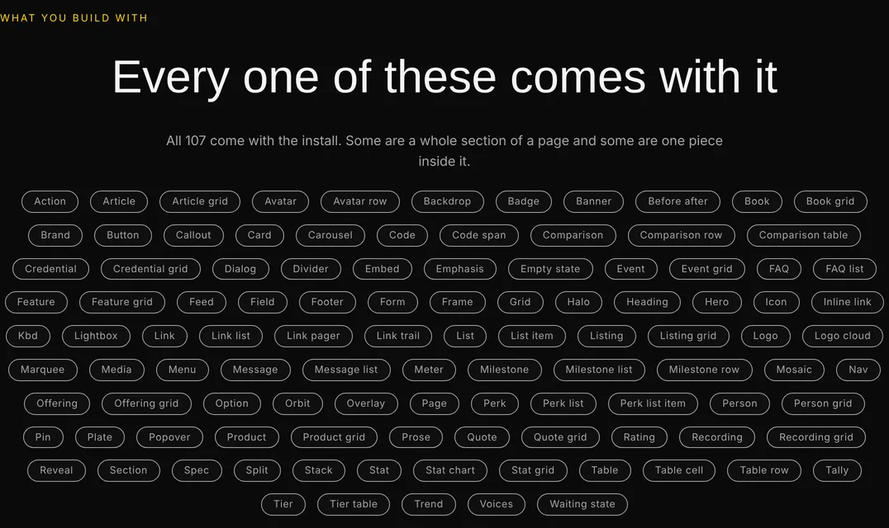
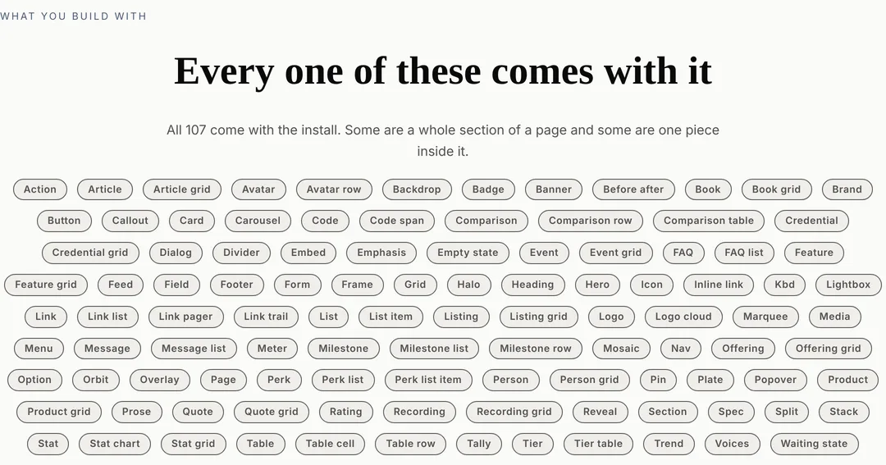
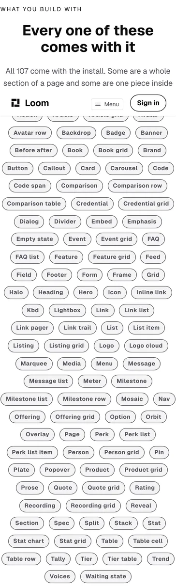

# The set, shown instead of counted

**27 October 2026 · `Loom marketing` · branch `marketing-18-what-you-get`**

**Preview:** the pull request carries it. Not opened from this run:
`*.vercel.app` is denied by the environment's network policy, filed on
27 September. Every picture below is off a local production build of this
commit, `built 2026-10-27T11:45:05.482Z`.

`docs/positioning.md` records the maintainer's direction of 24 October, and the
half of it this run is built on is one clause:

> *"The building part and why this build is better than traditional methods is
> preferred."*

The front door leads with his chain. `/why-use-it` answers the comparison. What
neither of them does — what **no page of this site has ever done** — is show a
reader one of the things they would be building with. The front door has said
*107 ready-made parts to build with* since the facts band was written, and
`/what-you-run` says *"a starter set comes with it and this site is made out of
that set"*. Both are figures of speech to somebody who has not seen the set.

A developer deciding whether this is worth an afternoon is asking a concrete
question: **is there a table in there, is there a pricing tier, is there
something that holds a photograph.** A number cannot answer it and a sentence
cannot either.

## What shipped

**One band on `/why-use-it`, between the explanation and the way out.** It
prints the name of every part in the starter library — 107 of them — read off
the registry this site renders with.



The band in the page it belongs to, which is the reading it was placed for:



The same band under Bold, which is the same tree with three registered ids on
its root and nothing else changed:





And at 390, where it is the one thing on this page that was worth watching after
yesterday:



*(The bar across the top of that picture is the site's sticky header, which the
harness scrolled under when it clipped a mid-page element. It is in the
photograph and not in the band. The whole page at 390 is
`2026-10-27-marketing-why-use-it-phone.webp`.)*

## The names are not written down anywhere in this lane

That is the only property worth defending here, and `library.ts` is the whole of
it: the list is `catalogueOf(siteRegistry)` projected through one function, so a
part registered by `Loom primitives` tomorrow is on this site with nobody in
this lane touching a file, and a part removed is off it.

`copy.ts` already decided this question for the **number** and the reasoning
carries over word for word — a literal here makes every run that registers a
part come and edit a digit. A hundred literals would be the same mistake with a
hundred times the surface, and it would be *wrong* rather than merely stale: a
page saying *all 107* while printing the 104 somebody typed in August is a false
claim, not an incomplete one. `why-use-it.test.ts` holds the figure and the
chips against each other for exactly that.

**The projection is mechanical**: strip `loom.`, turn the hyphens into spaces,
sentence case. The alternative — a hand-written label per part — reads better on
perhaps six of them (*Before after* would be *Before and after*) and is a
hundred-entry table in this lane that goes stale the first time the library
grows. One exception survives: `loom.faq` comes out as *Faq*, which reads as a
typo rather than as a word, so a two-entry casing table turns it into *FAQ*.
`library.test.ts` holds every entry in that table to a name the projection
actually produces, so a part renamed in `src/` leaves a rule that silences
nothing rather than a quiet special case nobody can find.

## Why the small ones are in it

*Table cell* and *Perk list item* sit in the field beside *Hero* and *Tier
table*, and the first reading is that they are clutter. They are the
granularity the rest of the site is claiming: a change names a part, so a part a
change should be able to name has to be in the set. The caption says so —
*"Some are a whole section of a page and some are one piece inside it"* — rather
than leaving half the list looking like an oversight.

## The ceiling moved again, and that is the thing to look at hardest

**`MOST_WORDS_ON_THE_SITE` went from 3,800 to 3,900.** It is the second raise in
two days and a reviewer should read it as one.

What crossed it this time is not a page. It is this one band, which measures
**152 words, of which 143 are the names**. Measured on this branch: **3,855 in
the state that says the most**, against 3,703 the day before.

So a ceiling whose own file says it stands for *"how much a visitor is asked to
read"* moved for a band in which **a reader is asked to read nothing**. A field
of one-word chips scanned for the word *Table* is exactly where the proxy and
the thing it stands for come apart.

**The measurement was deliberately not changed.** An exemption written by the
run that needed one is how a budget erodes, and a rule that counted a cell
differently from a sentence is a larger change than this band justifies. What
was done instead is the honest version: measure, raise, date the comment, and
say in the comment itself that **a third raise is not a thing to reach for** —
the next run that finds this red should report it and leave the number alone.

The finding of 26 October already asks the maintainer the question underneath
it, and a dated note now records this as its second instance. Either shape it
offers would have let both of these bands land without a run editing a constant.

## What was tried first, and could not be built

**This run set out to show the code.** The chain's second rung says *"That list
is the whole of the setup"*, and the obvious next band is the eight lines that
are that list in a reader's own project. It cannot go on this site.

His instruction of 26 September is that **no page uses a reserved word
anywhere**, and `voice.test.ts` reads the words a page *renders*, text nodes
included — which a code panel is. The setup is spelled in the reserved list:
`definePrimitive`, `createPrimitiveRegistry`, `renderLoomTree`. There is no
honest snippet that avoids them, and a snippet that avoided them by being
approximate would be worse than none.

Filed, with the one-clause narrowing it would take, the shape of the package-name
exemption it would copy, and the explicit statement that the ruling is his
rather than this lane's. The band that shipped answers *what is in there*; it
does not answer *what do I write*, and the second is the question his
instruction is actually about.

## Decisions taken that were not specified

**It is a band on `/why-use-it` rather than a fifth page.** The page's table
says *you build it* against a mark five times over, and the set is the concrete
form of that mark. A page of its own would have been a second answer to the same
question, in a site where two of the four pages are already flagged in
`positioning.md` as arguing the wrong thing.

**The chips are `loom.badge` with `tone: "neutral"`.** The accent treatment
claims attention and there are 107 of them; a field of 107 things all claiming
attention is a field claiming none. `balance.test.ts` needed no new
classification — the run sits in a `loom.stack`, which that file has held as
*flows and wraps* since it was written.

**The band carries no link.** Every other band on this page ends in somewhere to
go, and this one deliberately does not: the next band is *Try it on a page of
your own* and it offers the documentation, the demonstration and the mechanism
page in a row. A hundred names followed by a fourth control is a reader being
asked to choose at the moment they have just finished scanning.

## Numbers

`pnpm install && pnpm verify`, exit code read out of a file written as the last
thing on its line:

```
Test Files  240 passed (240)      Tests  5779 passed (5779)    # framework
Test Files  368 passed (368)      Tests  6640 passed (6640)    # @loom/app
1329 findings, 0 malformed
137 prerendered pages, 1943 text junctions, 0 run together
EXIT=0
```

Nothing skipped and nothing weakened. The route group gained one test file
(`library.test.ts`, 13 cases) and four cases in `why-use-it.test.ts`.

One test constant moved and it is argued above. The other two changed files are
the page builder and its test.

## Findings

**One filed, one extended.**

- **The site leads on the building part and may not print one line of the code a
  reader would write.** Owned by this lane, and the ruling is the maintainer's.
  The entry has the table of blocked lines, the one-clause narrowing, and what
  it costs either way.
- **The word ceiling entry of 26 October** gains a dated note recording the
  second instance, the fact that it was a band rather than a page, and the
  statement that a third raise should not happen before he answers.

**Closed:** none.

## Open questions

They are in the pull request comment. The new one is whether a code panel may
carry the words the setup is written in. The three carried from previous runs
are his and are unchanged.
