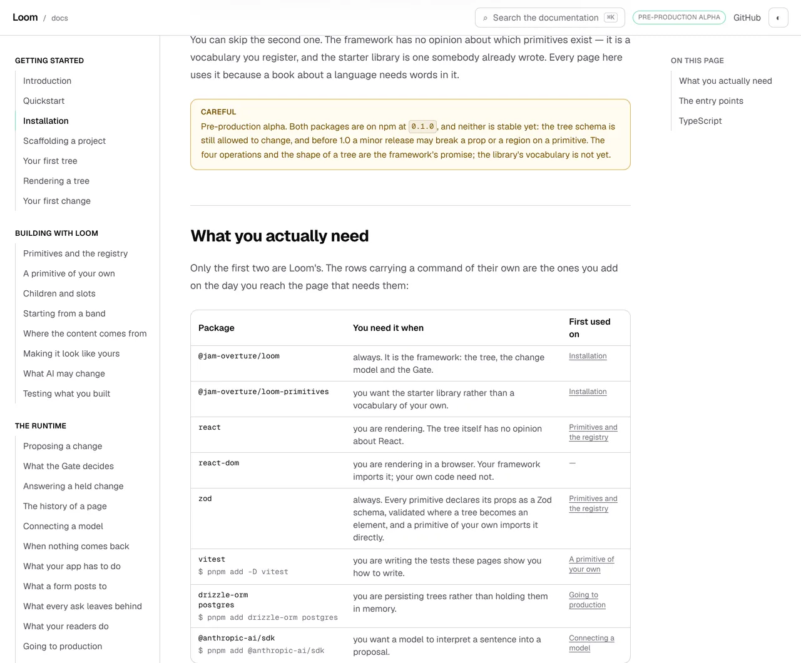
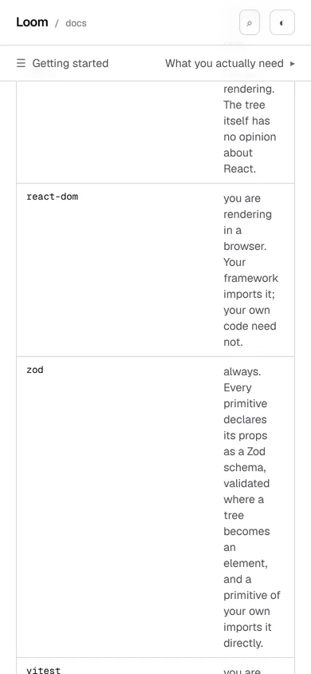

# 28 October 2026 — the install command and the eight packages this site tells you to import

**Routine:** `Loom docs` · **Branch:** `docs-69-install-what-the-pages-import` ·
**Section:** §4c

No open pull request from this lane at the start of the run. #717 merged
overnight as `86e5b38`. Three were open — #719 (`Loom marketing`), #718 and
#706 (`Loom signals`) — none of them this lane's, none touching the `(docs)`
route group.

**No maintainer comment is outstanding for this lane.** The only non-bot
comment on #717 is this lane's own, addressed *to* him, and it is the question
repeated under *Needs your input* below.

Branch cut from `origin/main` at `86e5b38` (#717), after `git fetch origin main`.

## The plain version

**A stranger who follows this site's own hour, from its own first page, cannot
finish it.** They run the one command *Installation* gives them, follow five
pages, reach the step where they register a primitive, paste the block, and get

```
Cannot find module 'zod'
```

The command installed four packages. The code blocks on this site import
**eight**.

This was not a near miss. `zod` is imported on
`/docs/building-with-loom/primitives`, which is the arrival route's **fifth
stop** — and the route passes *Installation* and no other page that installs
anything, so a reader on it has run exactly one command and that command was
missing a package they are about to be shown an import of.

**Three things were true at once, and each of them is a check doing its job:**

- **The block compiles.** `fences/program.ts` type-checks every block against
  *this repository*, which has zod. A test that resolves imports cannot see a
  fault whose entire content is *a reader's tree is not this one*. That
  sentence is already written on this site — `teaches.test.ts` carries it about
  the 27 September door — and this is the same shape arriving about a different
  kind of name.
- **The page said so in prose.** *"`zod` is the only hard dependency"*, two
  screens below the command. The site was not wrong about what a reader needs.
  It was wrong about what it told them to type.
- **The quickstart installs it.** `QUICKSTART_DEPENDENCIES` has had `zod` since
  that file was written. The quickstart is off the arrival route **by name** —
  *the route's own prose offers it*, yesterday's entry — so a reader taking the
  hour never reaches the one command on this site that was right.

## What shipped

**One list, and three things read off it rather than typed.**

`_lib/installing.ts` carries `INSTALLABLE`: nine packages, each with the
sentence saying when a reader wants it, whether the command installs it, and
whether it is run or dev. From it come

- **the command** the Installation page prints, through `<InstallCommand />`;
- **the table** of what each one is for, through `<WhatYouNeed />`, grouped on
  the sentence rather than the package — so `drizzle-orm` and `postgres` are
  one row with one command because the answer to *when do I need this* is the
  same sentence, and they separate by themselves the day it stops being;
- **the page a reader first meets each one on**, derived from the blocks
  themselves in the site's reading order. That is the column that cannot go
  stale, and it is also the useful one: a reader looking at `vitest` is told
  *A primitive of your own*, which is where they will want it.

**What holds it true** is a sweep over every code block on the site, read with
`ts.preProcessFile` — the scanner `api/requires.ts` already reads imports with,
and the right one here because it is a scanner rather than a parser, so a
`sketch` deliberately never compiled still gives up the imports at the top of
it. A reader copies a sketch too.

**The faults stop the build rather than failing a test**, which is what
`arrival/route.ts` does and for the same reason: a page that has started lying
to a stranger should not render. Five kinds:

| | |
| --- | --- |
| a block imports something no entry names | `/docs/… has a block importing nanoid, and nothing on this site tells a reader to install it` |
| an entry nothing imports, with no reason | `the install list carries left-pad, no block on this site imports it, and it says no reason` |
| a reason that has stopped being true | `react excuses itself as imported by nothing, and /docs/… imports it` |
| **the route meets a package the command leaves out** | `the arrival route stops at /docs/building-with-loom/primitives, which imports zod, and the command on /docs/getting-started/installation does not install it` |
| the command is printed somewhere the route never passes | `the install command is printed on /docs/…, which the arrival route does not stop at` |

The fourth is the class rather than the instance, and it is the one that was
red before this branch.

**`zod` is now in the command**, and `vitest` is not: the route does not stop
at a page that imports it, so the rule does not ask for it and putting a test
runner in the first command a stranger runs would be a choice made to satisfy
nothing. It is a table row with `pnpm add -D vitest` beside it and *A primitive
of your own* in the last column.

## The judgement this run had to make

**Whether the two install commands on this site become one list.** They do not.
`QUICKSTART_DEPENDENCIES` answers a different question — what one file, shown
verbatim and executed by `quickstart.test.ts`, imports — and merging them would
make one list answer two questions, which is how a list starts being wrong
about one of them.

What was wrong is that they could **disagree in silence**, and they had: the
quickstart installed `zod` and the page a reader on the route reaches did not.
So they are tied rather than merged, in one assertion: every package the
quickstart installs is one `INSTALLABLE` has an entry for.

## Decisions taken that were not specified

- **The peers table became a component.** It was four hand-typed rows about
  packages the pages import, which is the drift this unit exists to remove, and
  the same page already renders `<EntryPoints />` from the runtime's own
  `exports`. The new table carries `data-needs` for the same reason that one
  carries `data-doors`: this page has two tables and a selector saying `table`
  resolves to both.
- **The command is rendered through `CodeBlock`.** It is the same block with
  the same copy button the fence produced; what changed is where the words come
  from, not what a reader sees. `QuickstartInstall` renders its line as a
  styled div with no copy button, which is now the odd one out — not changed
  here, because it is not this unit's and the diff is already across two pages'
  worth of furniture.
- **No new prose was written to carry any of it.** A `pnpm add` line under a
  heading is how every documentation site says this, and it is the shape a
  reader already knows. The page's prose went **down** by about 550 characters.
- **`react-dom` is allowed an excuse that is a sentence.** The arrival route's
  account refused exactly that shape yesterday. Filed, with the reason the
  trade is a different size at one package than it was at seven.

## Records

None added, none superseded. Nothing here touches the tree schema, the delta
model or an `Accepted` record, and nothing is escalated as `ARCHITECTURAL`.

## Cross-lane diff

**None.** Every file changed is inside `apps/loom/app/(docs)/`, plus
`FINDINGS.md`, this report and its pictures. Nothing in `src/`, nothing in
another surface's route group, and no primitive was wanted that does not exist
— the unit draws a table and a code block, both of which this route group's
own chrome already had.

## Findings

**Three filed, none closed from the existing queue.**

- **Filed and closed on filing:** *the install command and the site's code
  blocks were two lists, and the one package the arrival route needed was
  missing from the command* — the defect above, written down because it was
  found by measuring rather than by anything going red.
- **Filed, open:** *the sweep behind the install list reads code blocks, so a
  package a page only talks about is invisible to it* — the stated limit, in
  the module's docblock as well.
- **Filed, open:** *one entry in the install list excuses itself with a
  sentence, and the route's account refused exactly that shape a day earlier* —
  the asymmetry, costed, with the recommendation to take the factual version
  the day a second package wants it.

Standing entries this run met again and did not duplicate:

- **`*.vercel.app` is denied by the environment's egress policy** (12 October,
  open). Every picture below was taken against a build in this container.
- **The composed preview URL** (16 October). The URL below is taken from the
  `vercel[bot]` comment rather than guessed from the branch name.
- **The commit author line** (23 October). Checked with
  `git log --format='%an <%ae>'` before the push rather than after.
- **The harness subscribes a routine's session to its own pull request**
  (24 October, open, `Loom daily build`). The state is read once and the
  session unsubscribes. No check-in armed.
- **Mutation testing before the first commit** (27 October, this lane's own).
  Followed: the branch was committed before the first mutation, and every
  restore was `git restore --source=HEAD -- .`.

## Test numbers

`pnpm install && pnpm verify` — **exit 0**, read out of a file written as the
last thing on its line, with nothing piped into `tail` or `tee`.

- framework: **240 files, 5,791 tests passed**
- application: **371 files, 6,724 tests passed**
- `findings:check`: 1,339 findings, 0 malformed
- `reports:check`: 1,999 visuals, 142.5MB, none over 1.1MB
- `prerender:check`: **137 prerendered pages**, 1,943 text junctions, 0 run
  together; 3 metadata conventions, 0 unserved

Nothing failed, nothing was skipped, and no test was weakened.

**Thirty-five tests are new**: 26 in `_lib/installing.test.ts`, 8 in
`_components/installing.test.tsx`, and 1 in `_lib/teaches.test.ts`. One
existing assertion was **changed**, and it is worth naming: *puts every package
in the install command on the page a stranger starts from* matched the command
out of the page's `bash` fence, which no longer exists. It reads the list now,
and the second half of what it used to do — that the page carries no second
copy of the command — is its own test, which is the shape the quickstart's
check took a month earlier.

### The search index, which went the right way for once

| | 27 October | today |
| --- | --- | --- |
| prose index, gzipped | 79,738 | **79,659** |
| headroom against 80,000 | 262 | **341** |

Removing four hand-typed table rows from a page file gave **79 bytes** back.
That is not a remedy and it is not offered as one — it is about a seventh of
the section the 26 October entry could not ship. The cap is still what it was.

### Five mutations, five killed

Each applied on its own, on a committed branch, restored with
`git restore --source=HEAD -- .`, with `installing.test.ts` re-run between.

| what was put back | what failed |
| --- | --- |
| `zod` removed from the list | the module refuses to load: *`/docs/building-with-loom/primitives` has a block importing zod, and nothing on this site tells a reader to install it* |
| **`zod` in the list but out of the command — the 28 October state** | the module refuses to load: *the arrival route stops at `/docs/building-with-loom/primitives`, which imports zod, and the command on `/docs/getting-started/installation` does not install it* |
| `react-dom`'s reason removed | the module refuses to load: *the install list carries react-dom, no block on this site imports it, and it says no reason* |
| **a block on a route page starts importing something new** (`nanoid` added beside the `zod` import on *Primitives and the registry*) | the module refuses to load, naming the page and the package |
| `react` given `react-dom`'s excuse | the module refuses to load: *react excuses itself as imported by nothing, and `/docs/building-with-loom/primitives` imports it* |

The second is the defect reproduced rather than argued, and the fourth is the
scenario this will actually meet: somebody writes a page, reaches for a package,
and the build asks them whether a reader can install it.

## The pictures

Taken with `pnpm shoot --serve apps/loom` against a build in this container,
`built 2026-10-28T14:15:25.913Z`. Both viewports measured `scrollWidth 1280 /
innerWidth 1280` and `390 / 390` — no overflow at either.

### The command, with `zod` in it


The block is `main pre` at `y 322`, 702×53. Before this branch the same line
ended at `react-dom`.

### What you actually need, read off the pages



Eight rows from nine packages, measured at `y 495`, 704×566. `drizzle-orm` and
`postgres` share a row because they share a sentence. `react-dom` is the one
with a dash in the last column — nothing on this site imports it, and the list
makes it say why.

### The same table on a phone



`350×1594` inside a 390-wide page: it scrolls, and nothing spills sideways.

## The preview

Taken from the `vercel[bot]` comment after opening the pull request, not
composed from the branch name.

https://loom-git-docs-69-install-wha-cbf5a3-jpizzolato36-6341s-projects.vercel.app

The page the whole unit is about:

- https://loom-git-docs-69-install-wha-cbf5a3-jpizzolato36-6341s-projects.vercel.app/docs/getting-started/installation

**The preview deploying at all is evidence**, because the module throws at
import when the site imports something it does not install — a green deployment
is the check passing.

Every picture above was taken against a build in this container, not fetched
from the preview: `*.vercel.app` is denied by the environment's egress policy,
which is the open finding of 12 October and still true.

The pull request is **#720**.

## Needs your input

**Nothing new, and the question from the last two runs is still open.**

**Should a browser be sent the whole site's prose?** The prose search index is
at **79,659 gzipped bytes against a cap of 80,000** — 341 bytes, about one
short paragraph, and 79 of those were given back by this unit rather than
earned. Raising the cap is forbidden by 0157 and by the test's own comment,
which says what the firing *means*: sharding is finished as an answer, and the
question becomes whether a browser should be sent the whole site's prose at
all.

**My recommendation is unchanged: the search box should stop holding every
section it has fetched.** It already knows which page the reader is on.

**This run was again chosen to fit around that**, which is now the second
consecutive unit picked for adding no prose. That is worth saying plainly: the
cap is not blocking one section, it is selecting what this lane is able to
build, and two days of that has been affordable because both units were worth
building on their own. The third will not be.

Two standing questions, neither new, neither blocking: whether a list-shaped
export may be given a list-shaped presentation (22 October), and whether a
produced table on this site should be composed from the library rather than
arranged locally (#709) — which this unit adds a second instance to.
