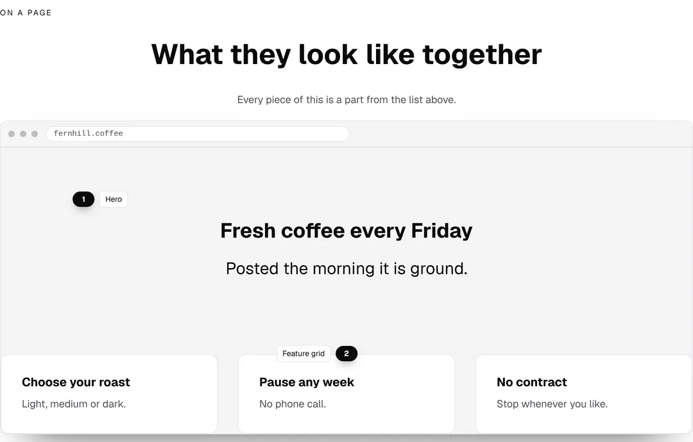
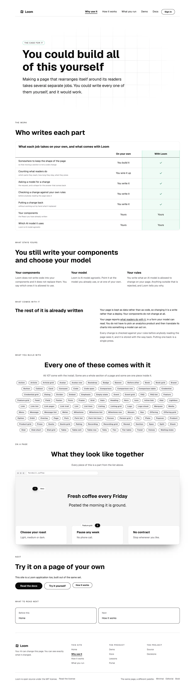
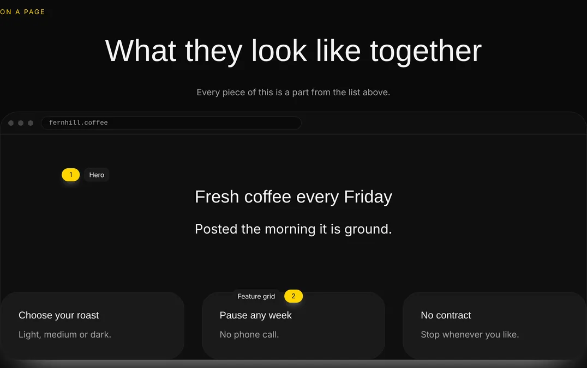
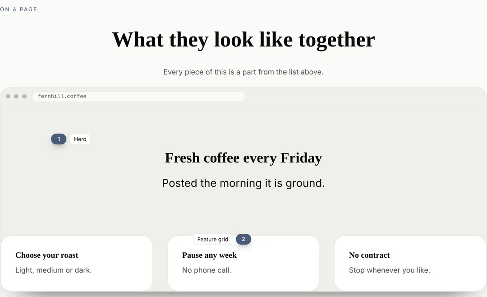
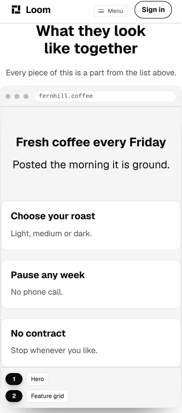

# A page made of the set, in a browser, on the page that lists the set

**28 October 2026 · `Loom marketing` · branch `marketing-19-a-page-made-of-the-set`**

**Preview:** the pull request carries it. Not opened from this run: `*.vercel.app`
is denied by the environment's network policy, filed on 27 September. Every
picture below is off a local production build of this commit.

Yesterday `/why-use-it` started printing the name of all 107 parts. That answers
*what is in there*. It leaves the next question where it was, and for the
audience `docs/positioning.md` names — *"the casual web developer… junior
level"* — it is the only question that matters: **what do they look like when
they are on a page.**

Until today the only page on this site built out of the starter set was this
site, and a visitor cannot see that. They are standing on it.

## What shipped

**One band on `/why-use-it`, between the set and the way out.** A browser, and
inside it a small product page for a coffee subscription that is obviously not
Loom. Two marks name two of the things on it, with the same words the chips
above print for them.



The band in the page it belongs to, which is the reading it was placed for —
the set, then a page made out of the set, then *Try it on a page of your own*:



Under Bold, which is the same tree with three registered ids on its root and
nothing else changed:





And at 390, where `loom.pin` does the thing that made marks possible at all:
the dots stop being an overlay and become a legend under the screen, without
this lane asking for it.



## It is rendered, not photographed

The ordinary way to put a page on a landing page is a screenshot, and
`loom.plate` would take one. It would have been wrong here, and the reason is
the project's own argument: **a picture of a page is fixed, and the thing being
claimed is that a page is data.**

What is in the frame is a tree. It is composed at the moment the rest of the
page is, out of the same library, and it wears whichever palette the visitor
asked for — so the proof survives the one press that would expose a screenshot
as a screenshot. The three pictures above are the same band under three
palettes and nothing in `example.ts` knows which one it is in.

**This is the first use of `loom.frame` or `loom.pin` on any surface of this
application.** The frame's own note says why it exists and it reads as though it
was written for this band: *"A page selling software has to show the software,
and a bare screenshot dropped into a section reads as a stray image every
time."* It was the largest gap the library had, it has been registered for
weeks, and the one surface that sells software had never rendered it.

## The example carries no button, on purpose

A landing page has a control on it and this one does not. Both honest endings
were worse than leaving it out:

- A control pointing at a fragment lands nowhere, which is the defect
  `anchors.test.ts` exists to catch.
- A control pointing anywhere real is a lie about the fictional product. A
  reader who presses *Start a box* and arrives in the documentation has been
  tricked by the one site whose pitch is not being tricked.

So the frame shows the shape of a page rather than a working one, and
`example.test.ts` holds it to carrying nothing with an `href` on it. *Action* is
in the field of chips above, and the band directly below is three controls that
all go somewhere.

## The marks are the part that ties the two bands together

A pin's label is `partNameOf` over the type it points at, which is the same
projection the chips band runs. So a mark reads **Hero**, and a reader who
wants the rest of them finds that exact string twenty rows up. Nothing is typed
in this lane and a part renamed in `src/primitives/` renames both.

`example.test.ts` holds the half that could go quietly wrong: **every mark
points at a type that is really in the tree below it.** A mark reading *Feature
grid* over a page with no feature grid on it is a lie a reader can see and that
no other check here would report — every tree would still be valid, every name
would still be a real part, and the picture would be wrong.

Two marks rather than five, and that is a judgement. A frame with a label on
each of six things is a diagram: the reader stops looking at the page and
starts reading the labels. Two is enough to establish that the things on the
screen have names in the list above.

## The ceiling did not move, and the band was paid for

**This is the part to read hardest.** The entry filed on 26 October says a third
raise of `MOST_WORDS_ON_THE_SITE` *"is not a thing to reach for"*, and the site
had 45 words of headroom against a band that measures 61.

The number was left alone and the words were found on the same page:

| | words |
| --- | --- |
| the band — heading, caption, two marks, the address, the example's own copy | **+61** |
| *Try it on a page of your own*, whose sentence the band now shows | −13 |
| the hero's *in your own application* | −3 |
| **the site, in the state that says the most** | **3,889 of 3,900** |

The first cut is the honest one. That closing band used to carry the whole
claim on its own — *"Every page of it is put together from the starter
components anybody gets when they install it"* — to a reader who had been shown
nothing, and it now sits under a picture of exactly that. It reads *"This site
is a Loom application too, built out of the same set."* The second is a
tightening and is worth three words.

So the budget worked rather than bound, which is the first time it has. **It
does not close the question underneath it**, and two numbers say why: the site
now has **eleven words of slack**, and the next band is unlikely to find
thirteen redundant words waiting for it on its own page. A ceiling that can only
be met by cutting something on the same page will eventually be met by cutting
something that should have stayed. The 26 October entry carries all of this as a
dated note.

## Decisions taken that were not specified

**A coffee subscription rather than a piece of software.** An example page for a
fictional SaaS product reads as a page about Loom, which is the one thing it
must not do. *fernhill.coffee* cannot be mistaken for this product by anybody.

**It is on `/why-use-it` rather than the front door.** The front door leads with
the maintainer's chain and is already seven screens at 1280; the set and a page
made out of the set are one argument, and splitting them across two pages would
make the weaker half of it the one a stranger meets.

**The example's heading is a level three.** It is a page inside a page, and
`pages.test.ts` holds every route of this site to exactly one `h1`. A reader
sees type at the size `loom.hero` sets; an outline sees a thing under the band
that introduced it, which is what it is.

## Numbers

`pnpm install && pnpm verify`, exit code read out of a file written as the last
thing on its line:

```
Test Files  240 passed (240)      Tests  5791 passed (5791)    # framework
Test Files  370 passed (370)      Tests  6697 passed (6697)    # @loom/app
1337 findings, 0 malformed
137 prerendered pages, 1943 text junctions, 0 run together
EXIT=0
```

The route group itself is **60 files and 1,662 tests**.

Nothing skipped and nothing weakened. The route group gained one source file
(`example.ts`) and one test file (`example.test.ts`, 6 cases), plus two cases in
`why-use-it.test.ts` and one classification in `balance.test.ts`.

**The first run of the gate was red and it is worth saying so**: `vitest` is
green on a `Set<string>` built from branded primitive types and `tsc` is not, so
`example.test.ts` passed its own suite and failed `pnpm typecheck`. Caught by
reading `verify.exit` rather than the session's notification, which said the
opposite — the trap `docs/routines.md` describes, met and survived.

## Findings

**One filed, one extended.**

- **Where a mark goes over a frame is a measurement, and nothing in the
  repository can take it.** For `Loom primitives`, as an offer rather than a
  request: `loom.pin`'s `x` and `y` are percentages of a surface whose height
  the author cannot know, so a mark is placed by guessing and photographing. The
  entry carries the measurement off this build — the row of tiles is at 79.6% to
  92.6% of the screen — and three shapes, of which *let a mark name a node
  rather than a point* is the one a model would also find easier to write.
- **The word ceiling entry of 26 October** gains a dated note recording the
  third instance and the first one that was paid for rather than argued past,
  with the table above in it.

**Closed:** none.

## Open questions

They are in the pull request comment and all four are the maintainer's. The
three carried from previous runs are unchanged: whether a code panel may print
the words the setup is spelled in, what shape the site's word ceiling should
be, and whether `Using it` and `What is Loom?` stay on the front door now that
the chain says it earlier.
