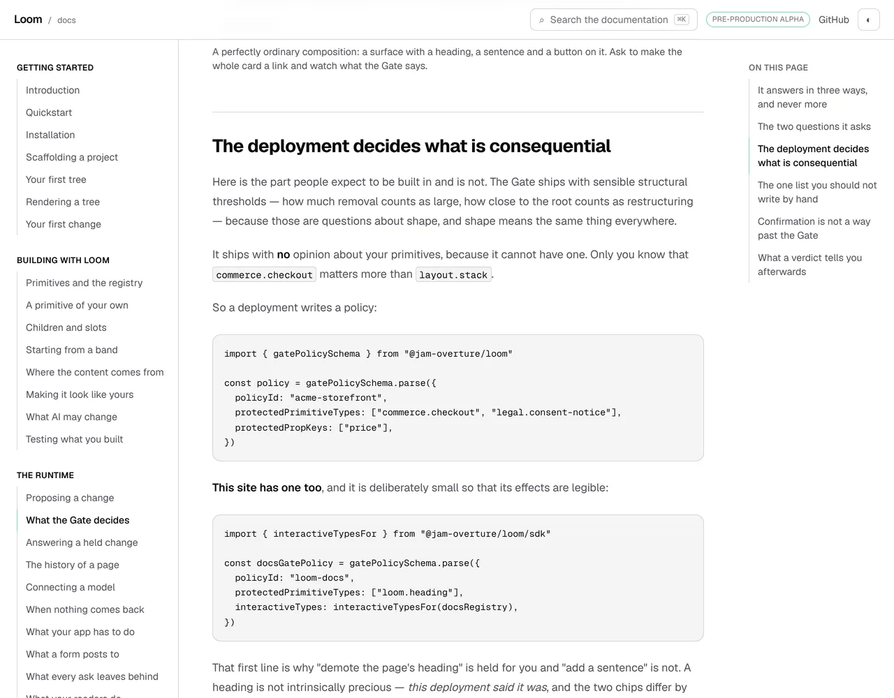
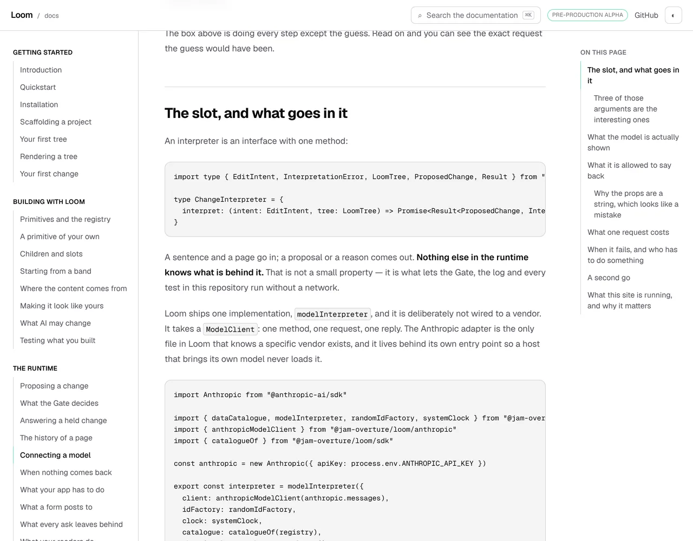
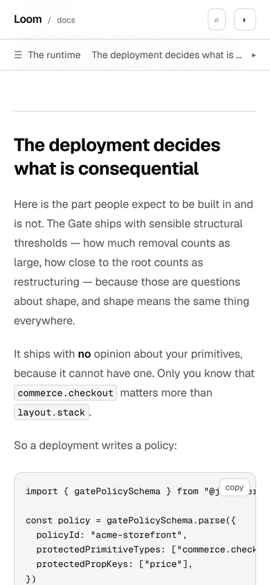

# 29 October 2026 — the name a reader has not met

**Routine:** `Loom docs` · **Branch:** `docs-70-the-name-a-reader-has-not-met` ·
**Section:** §4c

No open pull request from this lane at the start of the run. #720 merged
overnight as `3e6c147`. Three were open — #722 (`Loom marketing`), #721 and #706
(`Loom signals`) — none of them this lane's, none touching the `(docs)` route
group.

**No maintainer comment is outstanding for this lane.** The only non-bot comment
on #720 is this lane's own, addressed *to* him, and the question it asks is
repeated under *Needs your input* below because it is still open.

Branch cut from `origin/main` at `3e6c147` (#720), after `git fetch origin main`.

## The plain version

This is on the **last page of the arrival route** — the six-stop hour this site
offers a stranger — and it is the page whose promise, in the route's own words,
is that `gatePolicySchema` is *the one published name you will have typed by the
end of it*:

```ts
const policy = gatePolicySchema.parse({
  policyId: "acme-storefront",
  protectedPrimitiveTypes: ["commerce.checkout", "legal.consent-notice"],
  protectedPropKeys: ["price"],
})
```

**Copy it and you get `gatePolicySchema is not defined`.** There is no import on
the page. The import was in
`_lib/fences/context/the-runtime--what-the-gate-decides.ts`, a file no reader
will ever open, and the block compiled because the page is *assembled* with that
file and a reader is not.

**Eleven names on five pages were in that state.** Two of the five pages are
stops on the route.

### Why nothing was red

A context file lends a page what its story assumes — a `session`, a `db`, an
`ids` factory the page made two sections ago. Those are the narrator's and a
reader is meant to substitute their own; `../context/README.md` has said so
since the mechanism was built. It also allowed a second kind of lending, under a
rule written for a good reason: **a snippet must never be made to compile
against an invented function**, so a context file needing a name the runtime
really provides has to import the real one.

**That rule asked whether the name was real. It never asked whether the reader
could get hold of it.**

And the files said so, three times, in their own docblocks:

> *"`renderRequest` is not [the story's], and **the page does not import it**"*
>
> *"re-exported here **because the page introduces it in prose rather than in an
> import**"*
>
> *"`renderLoomTree` is the runtime's and **is imported as such**"* — imported
> *there*, not on the page.

Nobody read those sentences as a fault, because every check in this repository
agreed the block compiled. It did.

It is **28 October one layer in.** That day the install command was missing a
package the route walks a reader into importing. The package is installed now
and **the import statement was still missing** — same cause, and it is the
sentence `teaches.test.ts` already carries about the 27 September door: *a test
that resolves imports cannot see a fault whose entire content is "a reader's
tree is not this one."*

## What was in that state, measured

| page | name | the block that used it |
| --- | --- | --- |
| `building-with-loom/composition` | `buildElement`, `buildSlot` | two program blocks |
| `the-runtime/connecting-a-model` | `EditIntent`, `InterpretationError`, `LoomTree`, `ProposedChange`, `Result` | the block that writes the interpreter interface out |
| `the-runtime/what-your-app-has-to-do` | `EditIntent` | the block that builds an intent |
| `the-runtime/what-a-render-reports` | `renderLoomTree` | the page's only program block |
| `the-runtime/what-the-gate-decides` | `gatePolicySchema`, `interactiveTypesFor` | both program blocks |

The five type-only ones on *Connecting a model* were found by the module and not
by the eye: they are written `export type { … } from`, so a grep for
`^export {` walked past all five.

## What shipped

**The rule, in one sentence.** A name the runtime provides is the reader's to
import, so **the page shows the import**. A name the story lends is one the
reader does not need, so the context file **declares** it.

`_lib/fences/lent.ts` reads every `export … from` in every context file and
resolves it against the page's own fences:

- which block **first calls** the name, read as a name and not as text — a block
  that mentions it in a string is not calling it;
- which block **first shows an import that binds it**, matched on what the line
  binds rather than what it says, so `import { gatePolicySchema as schema }` is
  not an import of `gatePolicySchema`;
- and whether the calling block was one an `import` statement **could have gone
  in at all.**

**That last one is the exception, and it is a fact rather than a sentence**,
which is the shape `arrival/route.ts` gives the pages the route walks past. You
cannot write an `import` in the middle of an object literal. `object-body` and
`function-body` fences are, by their own declaration, a fragment of a larger
file, so a runtime name called only from those may still be lent — and the test
checks that excuse **by reading the fences**, not by believing the file. A
`sketch` is left out of the demand for the reason the word exists: it carries an
ellipsis and has already told the reader it is incomplete.

**Eleven imports are on the pages.** The generated program for the Gate page is
the clearest way to see what moved:

```diff
-import {
-  docsRegistry,
-  gatePolicySchema,
-  interactiveTypesFor,
-} from "../context/the-runtime--what-the-gate-decides"
+import { gatePolicySchema } from "@jam-overture/loom"
+import { interactiveTypesFor } from "@jam-overture/loom/sdk"
+
+import { docsRegistry } from "../context/the-runtime--what-the-gate-decides"
```

Only `docsRegistry` is the story's. The other two were the runtime's all along
and are now typed where a reader can see them.

## The judgement this run had to make

**Whether the rule is per block or per page.** It is **per page, in reading
order**: a runtime name must be imported by a program block *at or before* the
first that calls it. Per block is stricter and reads worse — it would put an
import line above every four-line fragment on *Children and slots*, and the rest
of this site has never written that way. Per page is also what a reader actually
gets: they read top to bottom, and `program.ts` already hoists and merges a
page's imports for exactly that reason.

The cost is stated rather than hidden: a reader who lands **mid-page** — from
search, or from the route's own `checkpointHref`, which anchors on a heading —
can still meet a block whose import is two screens up. That is a different
finding and this run did not open it.

## Decisions taken that were not specified

- **The check is a test, not a module that throws at import.** `installing.ts`
  refuses to load on a fault because the Installation page renders it, and *a
  page that has started lying to a stranger should not render*. Nothing renders a
  lent name, so a throwing module would need a page invented to hold it. The
  three rules a context file already lives under are tests in
  `compiled.test.ts`, and this is the fourth of the same kind.
- **The fault sentence says a different thing for a type than for a value.** A
  missing value is `gatePolicySchema is not defined` at run time; a missing type
  is a file that will not compile. One message for both would have been wrong
  half the time, and six of the eleven were types.
- **A second test is anchored on the route rather than on the mechanism.** *Shows
  the import for every name the arrival route promises a reader will type.* It
  overlaps the first heavily and it earns its place: mutation 5 below moves the
  Gate page's import from block 1 to block 2, where `tsc` is happy because the
  assembled module hoists imports, the name is no longer lent so the first test
  cannot see it, and the reader standing in front of block 1 still has nothing.
- **Nothing was written into the prose.** Not a dodge this time but the shape of
  the work: every one of the eleven changes is a line inside a fence, and a fence
  is not in the prose index.

## Records

None added, none superseded. Nothing here touches the tree schema, the delta
model or an `Accepted` record, and nothing is escalated as `ARCHITECTURAL`.

## Cross-lane diff

**None.** Every file changed is inside `apps/loom/app/(docs)/`, plus
`FINDINGS.md`, this report and its pictures. Nothing in `src/`, nothing in
another surface's route group, and no primitive was wanted that does not exist.

## Findings

**Two filed, one of them closed on filing.**

- **Filed and closed on filing:** *eleven names a page tells a reader to call
  had their import in a file no reader will ever see, and one of them is what the
  arrival route promises* — the defect above.
- **Filed, open:** *three names are still lent to blocks that cannot carry an
  import, so a reader copying a fragment is shown the call and not the door* —
  the stated limit, costed three ways, with the recommendation to fix
  `renderRequest` on *Rendering a tree* only (it is the third stop on the route)
  and leave the two on *Children and slots*.

Standing entries this run met again and did not duplicate:

- **`*.vercel.app` is denied by the environment's egress policy** (12 October,
  open). Every picture below was taken against a build in this container.
- **The composed preview URL** (16 October). The URL below is taken from the
  `vercel[bot]` comment rather than guessed from the branch name.
- **The commit author line** (23 October). Checked with
  `git log --format='%an <%ae>'` before the push.
- **The harness subscribes a routine's session to its own pull request**
  (24 October, open, `Loom daily build`). No check-in armed.
- **Mutation testing before the first commit** (27 October, this lane's own).
  Followed: the branch was committed at `79a895a` before the first mutation, and
  every restore was `git restore --source=HEAD -- .`.
- **Never let anything run after the gate on the same line** (`docs/routines.md`).
  Followed, and it mattered twice: see *Test numbers*.

## Test numbers

`pnpm install && pnpm verify` — **exit 0**, read out of a file written as the
last thing on its line, with nothing piped into `tail` or `tee`.

- framework: **240 files, 5,816 tests passed**
- application: **373 files, 6,768 tests passed**
- `findings:check`: 1,347 findings, 0 malformed
- `reports:check`: 2,008 visuals, 143.2MB, none over 1.1MB
- `prerender:check`: **137 prerendered pages**, 1,943 text junctions, 0 run
  together; 3 metadata conventions, 0 unserved

Nothing failed, nothing was skipped, and no test was weakened.

**Twenty-two tests are new**, all in `_lib/fences/lent.test.ts`. No existing
assertion was changed or removed.

### The gate went red once, and it is worth saying why

The first clean run of the gate came back **EXIT=1** with every test passing.
`reports:check` found three `.png` files in `reports/` — the screenshots this
run took *while the gate was running*, before `pnpm reports:shrink` had stored
them as `.webp`. Because `reports:check` sits before `pnpm --filter @loom/app
verify` in the chain, the application suite and `prerender:check` never ran at
all: the gate was red and the branch was not.

Two things about it are worth keeping. **The harness's own summary of that run
said "exit code 0"** — the status of the compound line, whose last command was
the `echo` — and the file said `EXIT=1`. That is the third instance of the
failure mode *Reading the merge gate* exists for, arriving one step to the right
again, and it cost nothing only because the file was read and the summary was
not believed. And the cause is filed: a run may not write into a file the gate
checks while the gate is reading it.

The numbers above are from the run after that, with nothing else touching the
tree.
### The search index, which did not move

| | `main` (3e6c147) | this branch |
| --- | --- | --- |
| prose index, gzipped | 79,659 | **79,659** |
| prose index, raw | 254,705 | **254,705** |
| code index, gzipped | 9,716 | **9,759** (cap 12,000) |
| code index, raw | 36,424 | **36,890** (cap 60,000) |

**Not one byte of prose.** Eleven import lines went onto five pages and the
prose index is identical to `main` to the byte, because `search/prose.ts` strips
fenced code — a fence is a thing to copy rather than a thing to read. The cost
landed where it should, in the code index, and it is 43 gzipped bytes against a
cap with 2,241 of headroom.

That matters more than usual this week, and it is said plainly rather than
claimed as a virtue: see *Needs your input*.

### Five mutations, five killed

Each applied on its own, on the committed branch at `79a895a`, restored with
`git restore --source=HEAD -- .`, with `lent.test.ts` re-run between.

| what was put back | what failed |
| --- | --- |
| **the 28 October state of the Gate page** — the import out of block 1 and back into the context file | both checks: *expected [ Array(1) ] to deeply equal []*, and *…/what-the-gate-decides calls gatePolicySchema in the block at line 61 and never shows the import* |
| a fragment that lends `createElement` is promoted from `tsx object-body` to a program | the lent check: two faults, because the excuse stopped being true the moment a block that could carry the import started calling it |
| the context file lends `planReverts`, which no block on the page uses | *what-the-gate-decides lends planReverts and no block uses it* |
| the page shows the import **under a different name** — `import { gatePolicySchema as schema }` | both checks, because an import is matched on what it binds and not on what it says |
| the import is moved to the block **below** the one that calls it | **the route check alone.** `tsc` is happy — the assembled module hoists a page's imports — and the name is no longer lent, so the lent check cannot see it. The reader standing in front of block 1 still has nothing. This is the mutation that justifies the second test. |


## The pictures

Taken with `pnpm shoot --serve apps/loom` against two builds in this container.
Both viewports measured `scrollWidth 1280 / innerWidth 1280` and `390 / 390` —
no overflow at either.

### The Gate page, before — the version a stranger met


`built 2026-10-29T14:42:38.019Z`, from `origin/main` at `3e6c147`. Both blocks
measured 702×138. Copy either one and `gatePolicySchema` is not a name your
file has.

### The same page, after



`built 2026-10-29T14:27:00.839Z`, from this branch. **Nothing else on the page
moved**: the heading, the prose either side, the rail and the contents list are
the same pixels. Both blocks are 702×180 — two lines taller, which is the import
and the blank line under it, and that is the whole diff a reader sees.

### The interface a reader is invited to paste



The five that a grep walked past, because they are written `export type { … }
from`. Measured at `y 300`, 702×138.

### The Gate page on a phone



`348×180` inside a 390-wide page: the block scrolls, the page does not.

## The preview

*Filled in from the `vercel[bot]` comment after the pull request was opened,
not composed from the branch name.*

https://loom-git-docs-70-the-name-a-58e797-jpizzolato36-6341s-projects.vercel.app

The two pages the unit is about:

- https://loom-git-docs-70-the-name-a-58e797-jpizzolato36-6341s-projects.vercel.app/docs/the-runtime/what-the-gate-decides
- https://loom-git-docs-70-the-name-a-58e797-jpizzolato36-6341s-projects.vercel.app/docs/the-runtime/connecting-a-model

Every picture above was taken against a build in this container, not fetched
from the preview: `*.vercel.app` is denied by the environment's egress policy,
which is the open finding of 12 October and still true.

## Needs your input

**One question, and it is the same one the last three reports have ended with.**

**Should a browser be sent the whole site's prose?** The prose search index is
at **79,659 gzipped bytes against a cap of 80,000** — 341 bytes, about one short
paragraph. Unchanged by this branch, to the byte, because every line this unit
added is inside a fence.

**This is the third consecutive unit chosen to fit around that number**, and the
28 October report said plainly that the third would not be affordable. It turned
out to be, because the defect this unit went looking for was real and was
nowhere near the prose. **That is luck, not a plan.** The next run has no fourth
thing of this shape queued, and the first page anybody writes crosses the cap.

Raising it is forbidden by
[0157](../decisions/0157-the-catalogues-public-surface-is-the-list-and-the-lookup-not-every-band-by-name.md)
and by the test's own comment, which says what the firing *means*: sharding is
finished as an answer, and the question becomes whether a browser should be sent
the whole site's prose at all.

**My recommendation is unchanged: the search box should stop holding every
section it has fetched.** It already knows which page the reader is on. That is
a decision about what the search box *is*, which is why it is yours and not
mine — but it is now the thing selecting what this lane builds, and one more
week of that will start costing pages that should have been written.

Two standing questions, neither new, neither blocking: whether a list-shaped
export may be given a list-shaped presentation (22 October), and whether a
produced table on this site should be composed from the library rather than
arranged locally (#709).

The pull request is **#723**.
