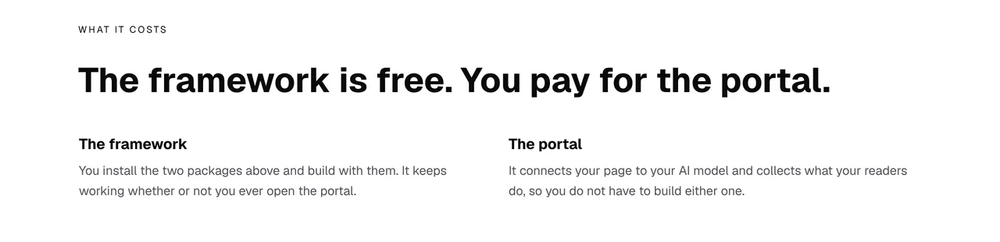
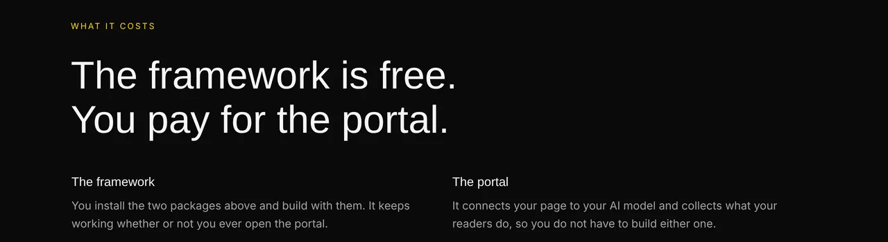
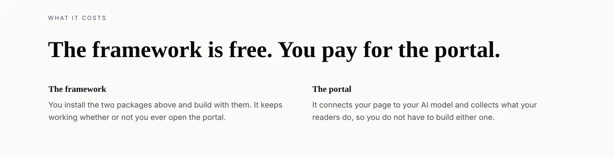
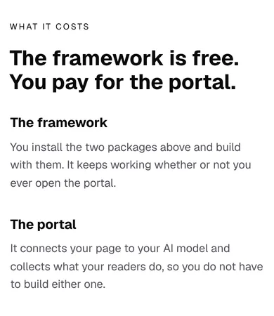

# What it costs, said once and on purpose

**29 October 2026 · `Loom marketing` · branch `marketing-20-what-it-costs`**

**Preview:** the pull request carries it. Not opened from this run: `*.vercel.app`
is denied by the environment's network policy, filed on 27 September. Every
picture below is off a local production build of this commit.

The front door now says what Loom costs. It is the first thing this site has
ever said about money, and the reason it took five weeks is the first finding
below rather than anything about the copy.

## The part to read first: the answer was already in the repository

`docs/positioning.md` was written on 24 October out of six answers the
maintainer gave that day. One of them is this, verbatim:

> *"Someone installs it, if they want easy hook up for signals and to their AI
> models, they'll pay for the portal."*

The file's reading of it, in the same paragraph: the framework is free and
installed, the portal is the paid part, and **"the front door may say both."**

**On 27 October, three days later, this lane asked him on #716:** *"may the
site say the framework is free and the portal is paid?"*, listed under *Still
waiting from last time, all three yours*. That run had `docs/positioning.md`
open — it is the second item on the read-first list and the report cites it —
and read it for the headline, the audience and the chain without noticing that
the question it was about to ask was answered three screens further down.

So the site spent five more days silent about the one commercial fact it has
permission to state, and the maintainer was asked for a ruling he had already
given. That is filed as a class rather than an incident, because
nothing stopped it and nothing would stop the next one: answers live in a file
and questions live in a pull request comment, and there is no channel between
them.

## What shipped

**One band on the front door, directly under the install command.**



Under Bold, which is the same tree with three registered ids on its root:



And Editorial:



And at 390:



It says two things and has nowhere to put a third. `costs.test.ts` holds that
from both ends: `COST_CLAIMS` is the data the band renders, the test fails on a
third claim, and it fails on a claim typed straight into the tree rather than
into the array — which is the obvious way for a later run to add one without
noticing it had. It also asserts the band names no amount, which `voice.test.ts`
would catch on a route sweep, but this is the band where somebody will one day
be tempted and a failure that names the band is worth more than one that names
the route.

**Nothing was relaxed to land it, and that is worth saying because the obvious
way to write this band is to widen the rule that was stopping it.** The
maintainer's instruction of 27 September was *no reference to pricing should
remain, we haven't figured that out yet*, and `PRICED` in `voice.test.ts` has
held the site to it since. `PRICED` catches amounts, periods, named plans and
the word *pricing*. It has never caught *free* or *paid* standing alone, so the
copy below passes it unchanged. The rule as he left it in September already
permits exactly the claim he authorised in October and still refuses everything
past it.

## It was paid for, and the first two cuts are the better page

The band is 60 words. Three things came off to make room, and two of them are
improvements the band only prompted.

| | words |
| --- | --- |
| the band — eyebrow, heading, two cards | **+60** |
| *Do I need an account to use this?*, cut from 94 to 64 | −30 |
| *There is nothing to sign up for*, off the install band | −7 |
| the `Undo` duplicate, rewritten rather than shortened | −1 |
| hyphenation and one clarifying *have to* | +1 |
| **the front door** | **1,368 → 1,391** |

Counted with `wordsIn`, which is the function the budget reads, so the figures
line up with the ones below rather than with a hand count of the strings.

**The 94-word answer was the longest single string on this site**, and two of
its five sentences were not about accounts. One said the portal *"comes with it
rather than being a service you sign up for"*, which is a statement about what
Loom costs made inside the fifth row of an accordion on the eighth band of the
page. The other restated the clause immediately before it. A reader deciding
whether to run an install command should not have to open a disclosure control
to find out whether it costs money.

*There is nothing to sign up for* was this site's only word about cost and it
was half of one: it ruled out an account and left everything else to guess.

## The duplicate the band found, and the two it is not allowed to fix

Printing every string the front door renders, longest first, is a reading
nobody had taken of this page before today. It came back with three pairs
saying the same thing in nearly the same words:

| | words | the other one |
| --- | --- | --- |
| `Undo` gloss, in `journey.ts` | 30 | the fourth problem card, **nineteen words verbatim in common** |
| chain rung 1 | 25 | *Using it* step 1, sharing two whole clauses |
| chain rung 2 | 27 | *Using it* step 2, *"all the setup there is"* against *"the whole of the setup"* |

**The first is fixed.** The gloss keeps the sentence, because saying what the
word means is its whole job; the problem card now answers the problem in its
own title instead.

The first attempt at it was 76 characters and it was wrong. `loom.mosaic`'s
`alternating` rhythm makes the fourth cell two narrow cells across, and
`pages.test.ts` holds the copy to the shape, so a short body there draws a card
that is mostly nothing. The test caught it. Short was the budget talking, and
the budget is not a reason to half-fill a card.

**The second and third are not fixed, and must not be by this lane today.**
Both are the *Using it* band against the chain, and whether `Using it` stays on
the front door at all is a question `docs/positioning.md` records as the
maintainer's. Rewriting a band he may remove is work thrown away; removing it is
this lane deciding something the file says is his. The measurement is filed, as
the number that was missing from a question he already has.

## The ceiling was counting a record panel, and that is the decision of the run

**This is the part a reviewer should read hardest, because the run that made
the change wanted the answer it got.**

The costs band is 60 words and the site had 11. The entry of 26 October says a
third raise of `MOST_WORDS_ON_THE_SITE` *"is not a thing to reach for"* and that
the next run finding it red should say so and leave it. So the number was left
alone, and the question underneath it was asked instead: why does the site
measure 3,889 when it is 3,434 words long?

`MOST_WORDS_ON_THE_SITE` was held at one number over two readings — the site as
published, and the site as served in whichever state says the most. The 455
words between them are the record panel on `/how-it-works`, which the machinery
writes when a visitor asks for a change. Those words were **already bounded
twice in the same file**: `MOST_WORDS_A_REQUEST_ADDS` caps what a request may
add to a page, and `MOST_WORDS_IN_AN_ANSWERED_BAND` caps the band it lands in.
Counting them a third time, inside the budget on authored copy, is what made a
60-word band unaffordable — a panel on one page deciding how much prose the
other three could carry.

The file gives one reason for holding both ceilings over the served tree:
*"a visitor reads one page, and what they read is the served one."* That is
exactly right about `MOST_WORDS_ON_A_PAGE`, which is why it is untouched. It is
not true of the site total. **Nobody reads the site.** That figure is four pages
summed, each in whichever state says the most, which is a reading no visitor is
ever shown.

**What changed and what did not:**

- `MOST_WORDS_ON_THE_SITE` is **still 3,900**, and the authored sweep still
  holds the site to it, now at 3,457 of 3,900.
- The served sweep bounds **what the states add**: `served − authored ≤
  MOST_WORDS_A_REQUEST_ADDS`, which is 455 of 600. The served site is therefore
  bounded at 4,500 by composition, with no fourth number that nobody argued for.
- **It answers neither of the two shapes the maintainer has in front of him.**
  The 26 October finding asks whether a site-wide total is wanted at all now
  that the site has pages. That is still open, and it gained a dated note saying
  every figure in it was a served figure.

**A multiplier over the routes was the first attempt and it was wrong**, which
is recorded in the test because it looks obviously right. Every route has more
than one served state, so counting routes whose states differ gives four rather
than one, a ceiling of 6,300, and a served site at 0.616 of it — passing the
binding-from-below clause by luck and bounding nothing. The three pages that do
not answer requests serve the same words in every state. Measuring what the
states *add* rather than how many states there *are* is the difference between a
bound and a formality.

If the double count had not been there, the band would have been the thing that
gave way. One line in `budget.test.ts` puts it back.

## Decisions taken that were not specified

**`loom.feature-grid` rather than `loom.tier-table` or `loom.offering-grid`.**
Both of those are built to put an amount beside a name, and a band that looks
like a pricing table invites the next run to fill in the number that belongs in
it. Two features say the two facts and have nowhere to put a price.

**The front door and nowhere else.** He wrote *"The front door may say both"*,
not *the site may*. A test holds the other three routes to leaving the subject
alone: a claim made twice by a lane allowed to make it once is how a sentence
drifts into a different sentence.

**The bodies are about work rather than value.** His sentence prices the portal
in work avoided — *easy hook up for signals and to their AI models* — which is
the most useful thing it can say to the reader `docs/positioning.md` names, who
is a junior developer weighing an afternoon.

## Numbers

`pnpm install && pnpm verify`, exit code read out of a file written as the last
thing on its line:

```
Test Files  240 passed (240)      Tests  5816 passed (5816)    # framework
Test Files  373 passed (373)      Tests  6754 passed (6754)    # @loom/app
1347 findings, 0 malformed
2008 visuals in reports/, none over 1.1MB
137 prerendered pages, 1943 text junctions, 0 run together
EXIT=0
```

The route group is **61 files and 1,670 tests**. It gained one source
file (`costs.ts`) and one test file (`costs.test.ts`, 6 cases, three of them
`it.each` over the routes that must stay silent on the subject).

Nothing skipped and nothing weakened. The one test that went red during the run
was `pages.test.ts`' mosaic rhythm rule, on the first attempt at the `Undo`
card, and it was right: see above.

**The word budget, both readings, measured with the budget's own `wordsIn`:**

| | `main` | this branch | ceiling |
| --- | --- | --- | --- |
| the site, as written | 3,434 | **3,457** | 3,900 (0.89) |
| the site, as served | 3,889 | 3,912 | bounded by the row below |
| what requests add | 455 | **455** | 600 (0.76) |

**Measured rather than asserted:** reverting `budget.test.ts` alone, with the
copy of the branch as it stood at that point, fails at `expected 3910 to be
less than or equal to 3900`. Two words of a later clarification take it to
3,912. That is the number this run would otherwise have had to cut good copy
to meet.

## Findings

**Three filed, one extended.**

- **An answer arrived and nothing retired the question** — the pricing answer of
  24 October, asked again on 27 and 28 October. Closed for this instance, open as
  a class, with three shapes costed and a recommendation.
- **The word ceiling was counting a record panel against the copy budget.**
  Closed by this branch for the double count.
- **The front door says one sentence twice**, with the measurement of all three
  pairs. One fixed, two held behind the maintainer's open question about
  `Using it`.
- **The 26 October ceiling entry** gains a dated note: its question is unchanged
  and still his, and every figure in it was a served figure.

**Closed:** none beyond the above.

## Open questions

Three, in the pull request comment, and two of them are now older than the work
they are blocking. The code-panel question of 27 October is the one that would
buy the most: the site can show a page built out of the parts and cannot show
the lines a developer would type to do it.
