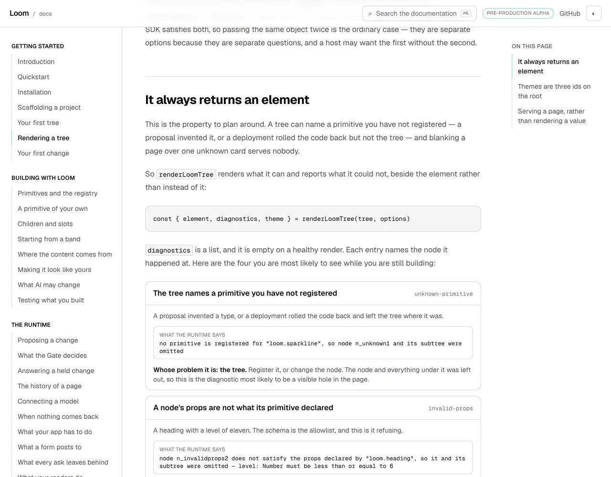
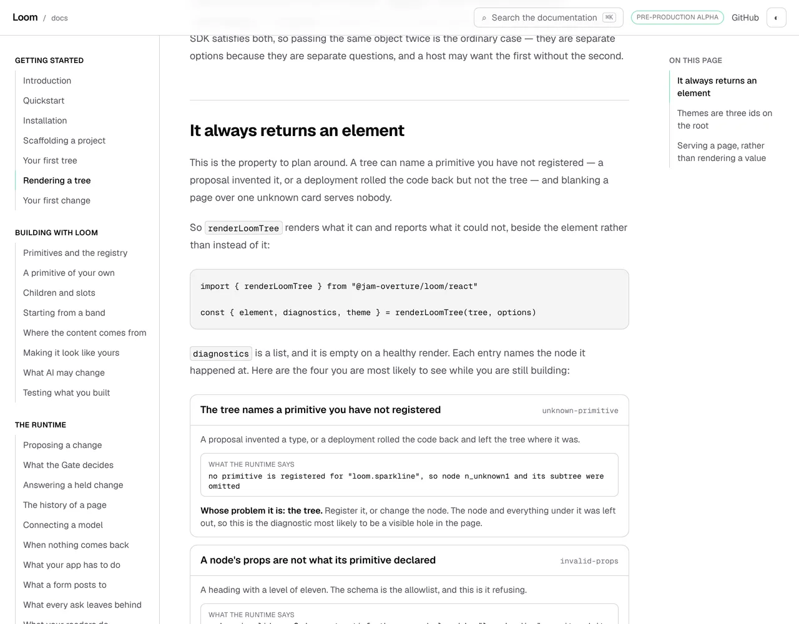
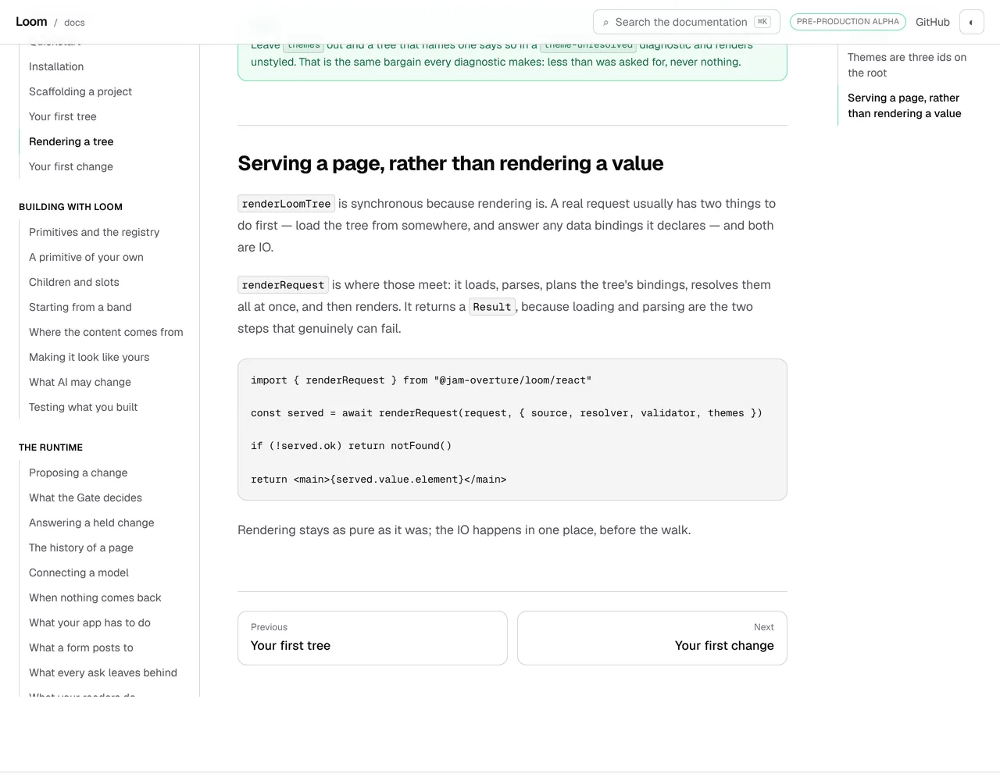
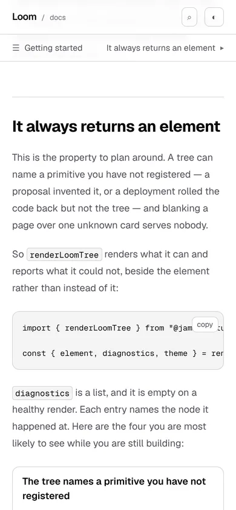

# 30 October 2026 — where the reader landed

**Routine:** `Loom docs` · **Branch:** `docs-71-where-the-reader-landed` ·
**Section:** §4c

No open pull request from this lane at the start of the run. #723 merged
overnight as `45b2a48`. Four were open — #726 (`Loom marketing`), #725, #724 and
#706 (`Loom signals`) — none of them this lane's, none touching the `(docs)`
route group.

**No maintainer comment is outstanding for this lane.** The only non-bot comment
on #723 is this lane's own, addressed *to* him, and the question it asks is
repeated under *Needs your input* below because it is still open.

Branch cut from `origin/main` at `45b2a48` (#723), after `git fetch origin main`.

## The plain version

Yesterday's unit made this true: **a name a block invites a reader to copy is
imported on the page.** It made it true *per page, in reading order*, and the
report that landed it wrote down what that assumes and did not fix:

> *a reader who lands **mid-page** — from search, or from the route's own
> `checkpointHref`, which anchors on a heading — can still meet a block whose
> import is two screens up.*

**Nobody starts at the top of a page.** This site hands out the middle of its
own pages, deliberately, in three places: the search box, whose results are
headings and whose code band exists *"so a name a reader saw in a block can be
found again"*; the contents rail on the right of every page; and the arrival
route's `checkpointHref`, which anchors each of its six steps on the heading
where that step's one promised name is first mentioned.

So on the **third stop of the arrival route**, a reader sent to *It always
returns an element* met this:

```ts
const { element, diagnostics, theme } = renderLoomTree(tree, options)
```

with `renderLoomTree`'s import twenty lines above the heading they landed on.
**Fifteen places a reader can be sent to were in that state, on eight pages.**

## The rule

**A block's doors are shown in the section the block is in.** The section is the
one `search/code.ts` indexes and the rail links to — opened by a `##` or a `###`
and by nothing else, because those are the only anchors anything on this site
hands out.

Not a new idea. *Your first tree* has repeated `sequentialIdFactory`'s import
for months, by hand, and `program.ts` wrote down why in its own docblock:

> *"`your-first-tree` imports `sequentialIdFactory` once to build a tree and
> again forty lines later to compare it with the random one, **because a reader
> who arrives at the second block should not have to scroll up to know where the
> name came from**."*

That is this rule, done as a courtesy on one page by whoever thought of it — and
the hoist-and-merge that makes it free to obey was built *for* it. The fifteen
places where nobody thought of it looked exactly as finished.

## What was in that state, measured

| page | the anchor a reader is sent to | the names |
| --- | --- | --- |
| `getting-started/rendering-a-tree` | *It always returns an element* | `renderLoomTree` |
| `building-with-loom/composition` | *Slots: the parent decides where* | `buildElement` |
| `building-with-loom/theming` | *The third answer is `undefined`…* | `ResolvedTheme`, `paletteScheme` |
| `building-with-loom/theming` | *The bar above your page* | `ResolvedTheme` |
| `building-with-loom/what-ai-may-change` | *The two lists you should not write by hand* | `gatePolicySchema` |
| `building-with-loom/testing-what-you-built` | *Does your policy hold what you meant to hold?* | `expect`, `it` |
| `building-with-loom/testing-what-you-built` | *Does your own store keep its promises?* | `memoryTreeStore` |
| `the-runtime/when-nothing-comes-back` | *Seeing it in your own app* | `modelInterpreter`, `randomIdFactory`, `systemClock` |
| `the-runtime/what-your-app-has-to-do` | *An ask names the page, and which version of it* | `randomIdFactory`, `systemClock`, `commitIntent` |

**`expect` and `it` are why the rule is about every door and not the runtime's.**
A check scoped to `@jam-overture/loom` would have called *Testing what you built*
clean, and `vitest` is the door a reader is least likely to guess.

## What shipped

Four modules, each answering one question. Three of them exist because the
question was about to be answered privately for the second or third time, which
is the move `fences/spans.ts` already made for *where is a fence*.

- **`fences/sections.ts` — which heading a block is under.** Lifted out of
  `search/code.ts`, which already had the walk and the rule that a `####` does
  not open a section. `codeSectionsIn` is now four lines over it, keeping the
  one thing it wants and the others do not: an empty block is nothing to find.
- **`fences/imports.ts` — the doors a block shows.** An import is **what it
  binds**, not what it says, and the form travels with it so a fault prints a
  line that works. `import { postgres } from "postgres"` is not a line that
  works, and a check telling somebody to write it would be sending them
  somewhere worse than where they started.
- **`fences/calls.ts` — the names a block reads, as identifiers.** This one
  found itself: a word search for `\bit\b` matched the doc comment on *A
  primitive of your own* that says *"it cannot invent `on fire`"* and demanded
  an import to serve a sentence. Comments and strings hold no identifiers, and
  neither does the key of an object literal or the part of an expression after a
  dot — the exclusion `api/mentions.ts` already makes, for `result.ok` against
  the `ok` this package exports.
- **`fences/landing.ts` — the rule**, and the sentence a reader would have hit.
  It names the **address** rather than the page, because that is what went
  wrong: the block is fine where it is, and the page read from the top is fine
  too.

**Nine blocks got an import line and no page got a word.**

## The exception was one kind too wide, and that closes yesterday's finding

Yesterday's open finding costed three shapes for `renderRequest` on *Rendering a
tree* — the route's **third stop** — because the block that calls it is a
`function-body`, and the rule excused `object-body` and `function-body` alike as
*a fragment cannot carry an import*.

**Only the first half is a fact.** `program.ts` lifts a function body's imports
out before it puts the wrapper on, and says why: *"a reader who is shown a
handler wants to know where `parseTree` came from."* **The first block of
*Rendering a tree* has opened with three imports since the page existed** —
twenty lines above the block the finding was about.

So `renderRequest` needed no new block and no new machinery, which is what both
costed shapes assumed: one line at the top of the handler it is already in, and
the context file stops lending it. `canCarryAnImport` in `fences/model.ts`
excludes `object-body` alone now, stated once because two checks ask it.

`createElement` and `LoomPrimitiveProps` on *Children and slots* **remain
lent**, for the reason that survives intact: they are called from a `tsx
object-body`, and there is no edit to that page that puts an `import` in the
middle of an object literal.

The general shape, written into the finding: **an exception stated as a list is
weaker than an exception stated as a fact.** Two kinds were written down because
they felt like the same thing, and the pipeline had disagreed with one of them,
in its own docblock, the whole time.

## The judgement this run had to make

**Whether the rule is about the runtime's doors or about every door.** Every
door. The case that settles it is `vitest` on *Testing what you built*: a reader
landing on *Does your policy hold what you meant to hold?* is shown `it(…)` and
`expect(…)` and is, on the strictest reading, somebody who has never written a
test. Scoping to `@jam-overture/loom` would have been the easier rule to defend
and would have left the most-needed door out.

The cost is stated: the rule now has an opinion about `postgres` and `zod`
blocks too, and the fault sentence for a default import is why `imports.ts`
carries the form at all.

## Decisions taken that were not specified

- **The check is a test, not a module that throws at import.** Same reasoning as
  `lent.ts`: `installing.ts` refuses to load on a fault because the Installation
  page renders it, and nothing renders a landing.
- **One fault per name per section, not per block.** The later blocks under one
  heading are the same reader in the same position, and showing the door once
  answers all of them. The count a report quotes is places a reader can be sent
  to, which is the thing being counted.
- **`arrivalAt` is exported so the route can ask about one address.** The route
  is the one caller that can name the anchor in advance, and a check written
  over it stays pointed at the promise rather than at the mechanism — the same
  reason yesterday's second test is anchored on the route.
- **`lent.ts` was moved onto the identifier reader too.** It had the same word
  search; its names are long enough that it has never been bitten, which is
  exactly the condition under which a wrong reader survives.

## Records

None added, none superseded. Nothing here touches the tree schema, the delta
model or an `Accepted` record, and nothing is escalated as `ARCHITECTURAL`.

## Cross-lane diff

**None.** Every file changed is inside `apps/loom/app/(docs)/`, plus
`FINDINGS.md`, this report and its pictures. Nothing in `src/`, nothing in
another surface's route group, and no primitive was wanted that does not exist.

## Findings

**Three filed, one closed on filing, and one earlier entry's status edited.**

- **Filed and closed on filing:** *the import for a block was somewhere above
  it, and this site hands readers the middle of its pages on purpose* — the
  defect above, with the table of fifteen.
- **Filed, open:** *a section is the unit a reader lands on, and a section can
  be twenty-nine lines long* — the stated limit, measured. Six uses satisfy the
  rule with the door in an earlier block of the same section; the furthest is 29
  source lines, about a screen. Per block was costed and rejected yesterday and
  the objection still holds; the recommendation is to revisit only with a
  measurement rather than a rule.
- **Filed, open, owned by `Loom daily build`:** *`pnpm reports:shrink` reads the
  git index, so the pictures a run has just taken are the ones it cannot see.*
  `docs/routines.md` says it re-encodes *"every raster under `reports/`"*; it
  reads `git ls-files`, so freshly captured PNGs are invisible and it prints
  *nothing to shrink*. A run that believes it carries PNGs into `reports:check`
  and goes red two commands later. Cost this run one confused cycle.
- **Edited:** the 29 October entry *three names are still lent…* is now **partly
  closed**, with a note saying why both of its costed shapes were answers to a
  question with a false premise.
- **Filed after the pull request went up, open, owned by the maintainer:** *a
  thirteenth counted reading of the mangling, and the first remedy in the chain
  that leaves a picture a picture.* Both before/after screenshots were mangled
  in both the pull request body and this lane's comment — 155 characters, inside
  the 153–163 bracket the chain has measured twelve times, and **neither picture
  rendered**. Rewritten `…/raw/<branch>/<path>` instead of
  `…/blob/<branch>/<path>?raw=true` they are 144 and 145 and both came back
  clean in one body. It narrows the lower end of the bracket to 153–155, and it
  is the first remedy on that chain that keeps an image an image: the one on
  record, a path in a code span, is no use for a screenshot. **Yesterday's #723
  comment shipped with both of its pictures broken** for the same reason.

Standing entries this run met again and did not duplicate:

- **`*.vercel.app` is denied by the environment's egress policy** (12 October,
  open). Every picture below was taken against a build in this container.
- **The composed preview URL** (16 October). The URL below is taken from the
  `vercel[bot]` comment rather than guessed from the branch name.
- **The commit author line** (23 October). Checked with `git config user.email`
  before the first commit: `Claude <noreply@anthropic.com>`, which is the
  session default and one of the two identities known to deploy.
- **Mutation testing before the first commit** (27 October, this lane's own).
  Followed: every file this unit touches was committed before the first
  mutation, and every restore was `git restore --source=HEAD -- .`. The code
  under test is `e9c9766`, the branch's first commit.
- **A screenshot taken while the merge gate is running turns the gate red**
  (29 October, this lane's own, open). Followed: every picture was taken and
  shrunk, and `FINDINGS.md` and this report were written, **before** the gate
  was started, and nothing wrote into the working tree while it ran.
- **Never let anything run after the gate on the same line**
  (`docs/routines.md`). Followed — the status was written to a file as the last
  thing on its line and read in a separate command.

## Test numbers

`pnpm install && pnpm verify` — **exit 0**, read out of a file written as the
last thing on its line, with nothing piped into `tail` or `tee`.

- framework: **241 files, 5,840 tests passed**
- application: **379 files, 6,826 tests passed**, of which **139 files and
  2,094 tests** are `(docs)`
- `findings:check`: 1,358 findings, 0 malformed
- `reports:check`: 2,018 visuals, 143.7MB, none over 1.1MB, 411 cited by no file
- `prerender:check`: **137 prerendered pages**, 1,943 text junctions, 0 run
  together; 3 metadata conventions, 0 unserved

Nothing failed, nothing was skipped, and no test was weakened.

**Forty-three tests are new** — `fences/landing.test.ts` 14,
`fences/imports.test.ts` 11 of its 17, `fences/calls.test.ts` 11,
`fences/sections.test.ts` 7. The other six in `imports.test.ts` are
`lent.test.ts`'s own, **moved unchanged** to sit with the function they are
about; `lent.test.ts` goes from 22 to 16 for that reason and for no other. Two
things in it were edited rather than moved: the local restatement of which
fence kinds cannot carry an import is now `["object-body"]`, and one `it` name
read *"resolves the three the site still lends"* where it is two now. No
existing assertion was weakened or removed.

### The search index

| | `main` (45b2a48) | this branch |
| --- | --- | --- |
| prose index, gzipped | 79,656 | **79,656** |
| prose index, raw | 254,705 | **254,705** |
| code index, gzipped | 9,759 | **9,795** (cap 12,000) |
| code index, raw | 36,890 | **37,471** (cap 60,000) |

**Not one byte of prose**, measured on both revisions in this container rather
than quoted from yesterday's report: every line this unit adds is inside a
fence, and `search/prose.ts` strips fenced code. The cost landed in the code
index — 36 gzipped bytes against a cap with 2,205 of headroom.

*(The 29 October report quotes 79,659 for the prose index. Measured here against
`main` it is 79,656. The raw figure matches that report to the byte, so the
prose itself has not moved; the three bytes are a measurement difference and not
a change.)*

### Five mutations, five killed

Each applied on its own, against the branch's committed code (`e9c9766`),
restored with `git restore --source=HEAD -- .`, with the fences suites re-run
between.

| what was put back | what failed |
| --- | --- |
| **the 29 October state of *Rendering a tree*** — `renderLoomTree`'s import taken out of the block under *It always returns an element* and left at the page top | the landing check, with the sentence a reader would have hit: *…#it-always-returns-an-element — a reader sent to "It always returns an element" reads down to the block at line 45, which calls `renderLoomTree`, and the only `import { renderLoomTree } from "@jam-overture/loom/react"` on the page is above where they landed*. `compiled.test.ts` went red beside it, because the generated program is the page's |
| **the 29 October arrangement of `renderRequest`** — the import out of the handler and back into the context file, exactly as it was | `lent.test.ts`'s first check, *shows the import for every runtime name a block invites a reader to copy*. The excuse is gone, so the `function-body` is asked for its door and does not have it. **This is the mutation that justifies the widening**, and nothing in the landing suite sees it: a name the page never imports is `lent.ts`'s question, which is the split the two modules are built on |
| **the `vitest` import put back one heading up** on *Testing what you built*, as `import { describe } from "vitest"` | the landing check, **twice** — `expect` and `it` under *Does your policy hold what you meant to hold?*. The mutation that justifies the rule being about every door rather than the runtime's: a check scoped to `@jam-overture/loom` stays green on it |
| **`calls.ts` replaced by the word search it was written to replace** | six assertions: five in `calls.test.ts`, and the landing check, which gains the false positive the module exists to stop — a demand for an import on *A primitive of your own* because a doc comment there says *"it cannot invent `on fire`"* |
| **the form dropped from a fault sentence**, so every door prints with braces | three: *writes a default import back without braces*, *writes a namespace import back with its star*, and *does not put braces round a default import* — the sentence would tell a reader to write `import { postgres } from "postgres"`, which is not a line that works |

**A sixth, and it is reported because of what it did not kill.** Narrowing
`LANDING_LEVELS` to `[2]`, so a `###` stops opening a section, failed **only**
`sections.test.ts`'s restatement of the levels — no page went red. The one `###`
landing on the site today is *The third answer is `undefined`…* on *Theming*,
and the `##` it sits under happens to contain the import too, so folding them
together hides nothing. **The `###` half of the rule is a claim about where a
reader can be sent, not a fact any page currently depends on.** It is right —
the rail and the search box both link `###` anchors — and it is held by one
assertion rather than by the site.

## The pictures

Taken with `pnpm shoot --serve apps/loom` against three builds in this
container — this branch, then `main`'s pages, then this branch again.
Both viewports measured `scrollWidth 1280 / innerWidth 1280` and `390 / 390` —
no overflow at either.

### The route's third stop, before — what a reader sent to that heading met



`built 2026-10-30T14:07:41.629Z`, from `origin/main` at `45b2a48`. The block
measured 702×53. `renderLoomTree`'s import is twenty lines above the heading, on
the other side of a horizontal rule.

### The same section, after



`built 2026-10-30T14:05:45.585Z`, from this branch. **Nothing above the block moved**:
the rail, the heading, both paragraphs and the contents list are the same
pixels, measured at the same offsets. The block is 702×95 — 42px taller, which
is the import and the blank line under it, and that is the whole diff a reader
sees.

### The handler, with the door yesterday's finding costed two ways



702×180 against 702×138 on `main`. One line, in the block that was already
there — the `function-body` fence that the exception had wrongly excused.
`renderRequest` is no longer lent by the context file.

### A door that is not the runtime's


`built 2026-10-30T14:12:31.609Z`. The block a reader is sent to by
`#does-your-own-store-keep-its-promises`. It showed `describeTreeStoreContract`'s
door and not `memoryTreeStore`'s, which was three headings up.

### The route's third stop on a phone



`348×95` inside a 390-wide page: the block scrolls, the page does not.

## The preview

*Filled in from the `vercel[bot]` comment after the pull request was opened, not
composed from the branch name.*

https://loom-git-docs-71-where-the-r-244fcc-jpizzolato36-6341s-projects.vercel.app

The three pages the unit is most about:

- https://loom-git-docs-71-where-the-r-244fcc-jpizzolato36-6341s-projects.vercel.app/docs/getting-started/rendering-a-tree#it-always-returns-an-element
- https://loom-git-docs-71-where-the-r-244fcc-jpizzolato36-6341s-projects.vercel.app/docs/building-with-loom/testing-what-you-built#does-your-own-store-keep-its-promises
- https://loom-git-docs-71-where-the-r-244fcc-jpizzolato36-6341s-projects.vercel.app/docs/the-runtime/what-your-app-has-to-do#an-ask-names-the-page-and-which-version-of-it

Every picture above was taken against a build in this container, not fetched
from the preview: `*.vercel.app` is denied by the environment's egress policy,
which is the open finding of 12 October and still true.

## Needs your input

**One question, and it is the same one the last four reports have ended with.**

**Should a browser be sent the whole site's prose?** The prose search index is at
**79,656 gzipped bytes against a cap of 80,000** — 344 bytes, about one short
paragraph. Unchanged by this branch, to the byte, because every line this unit
added is inside a fence.

**This is the fourth consecutive unit chosen to fit around that number.** The
28 October report said the third would not be affordable and the 29th said its
affordability was luck. This one is the same luck twice: the defect was real,
it was on the route's own third stop, and it happened to be made entirely of
import lines. **I have no fifth thing of this shape queued, and the first page
anybody writes crosses the cap.**

Raising it is forbidden by
[0157](../decisions/0157-the-catalogues-public-surface-is-the-list-and-the-lookup-not-every-band-by-name.md)
and by the test's own comment, which says what the firing *means*: sharding is
finished as an answer, and the question becomes whether a browser should be sent
the whole site's prose at all.

**My recommendation is unchanged: the search box should stop holding every
section it has fetched.** It already knows which page the reader is on. That is a
decision about what the search box *is*, which is why it is yours and not mine —
but it has now selected four units in a row, and the pages it is holding back are
pages a stranger would read.

Two standing questions, neither new, neither blocking: whether a list-shaped
export may be given a list-shaped presentation (22 October), and whether a
produced table on this site should be composed from the library rather than
arranged locally (#709).

The pull request is **#727**.
