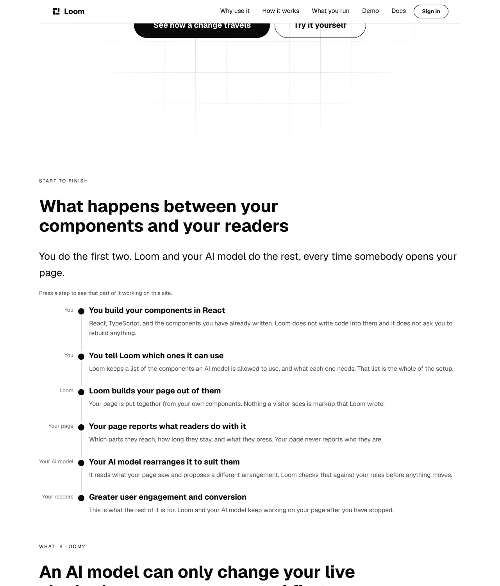
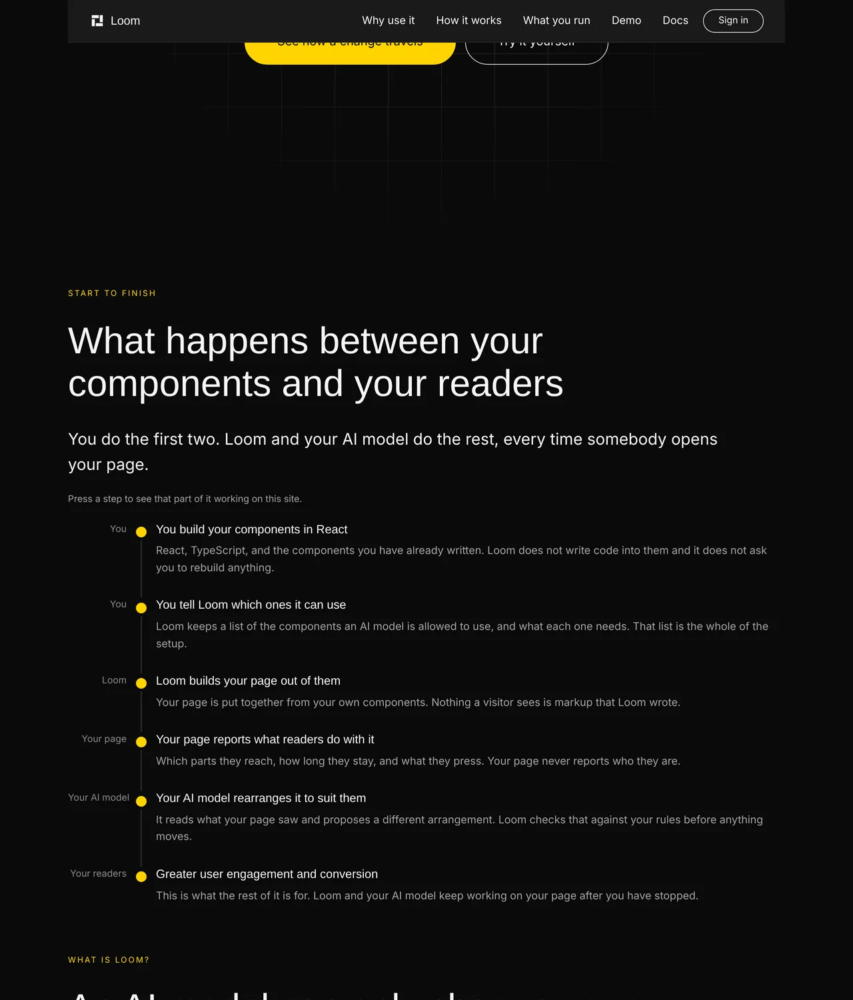
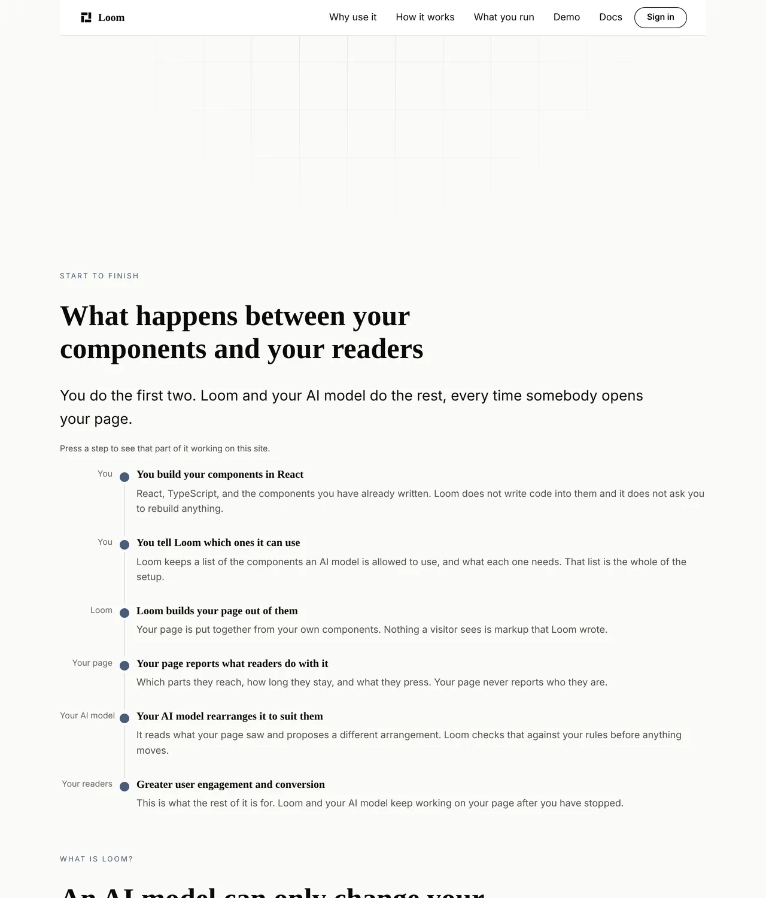
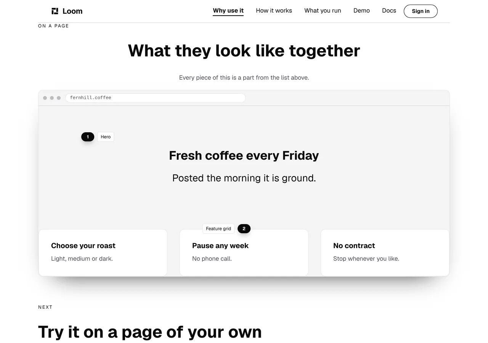
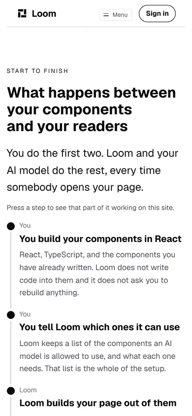

# The chain goes somewhere

**30 October 2026 · `Loom marketing` · branch `marketing-21-the-chain-goes-somewhere`**

**Preview:** the pull request carries it. Not opened from this run: `*.vercel.app`
is denied by the environment's network policy, filed on 27 September. Every
picture below is off a local production build of this commit.

The chain is the first band under the headline. It is the maintainer's own six
links, in his own order, and `docs/positioning.md` calls it *the message*. Until
today it was **six claims and six dead ends**: a visitor read it, had no reason
to believe any of it, and was given nowhere to go.

Five of the six are already demonstrated somewhere on this site. Each one was
built for its own reason, on its own page, and nothing pointed along the path.
The paths existed. Nobody could find them.

## What shipped

**Each rung is now the way to the band that shows it.**



| the rung | where pressing it goes | what is there |
| --- | --- | --- |
| You build your components in React | `/why-use-it#what-stays-yours` | *You still write your components and choose your model* |
| You tell Loom which ones it can use | `/why-use-it#what-you-build-with` | the name of every part in the starter set |
| Loom builds your page out of them | `/why-use-it#on-a-page` | a browser, with a page built out of that set inside it |
| Your page reports what readers do with it | `/what-you-run#what-we-count` | this page counting the reader who is reading it |
| Your AI model rearranges it to suit them | `/how-it-works#see-it-happen` | the demonstration |
| Greater user engagement and conversion | — | nothing, and `chain.ts` says why |

**It costs no copy**, which is most of why it is this rather than a band arguing
the same thing. The press is the argument.

Under Bold, which is the same tree with three registered ids on its root:



And Editorial:



A press of the third rung lands here, with the band at the top of the viewport
rather than three screens below it:



`#on-a-page` measures `x 100 y 48  1080x690` — the band is the thing the reader
is looking at, which is the whole point of pointing at a band rather than at a
page. That is `reaching.test.ts`' finding of 25 October applied to five more
links: it measured the same mistake at **3,622px below the fold on a phone**,
and the fix then was one link.

## The part a reviewer should read hardest: the links are invisible

**I found this by photographing it, after the tests were green.**

A `loom.milestone` carrying an `href` renders its title with
`LIBRARY_CLASS.underline`, and that class is a hover reveal —
`background-size: 0% 2px` at rest, `100% 2px` on `:hover` and
`:focus-visible`. The `<a>` also clears `text-decoration` inline. **At rest a
linked rung and an unlinked rung are the same pixels.**

On a phone that is the only state there is. [0236](../decisions/0236-a-viewport-names-a-device-and-the-pointer-is-part-of-it.md)
made the harness honest about `hover: none`, and here is what a reader with a
finger gets — five links among six rungs, and no way to tell which:



### Why it was not fixed here

`loom.milestone` takes `marker`, `title`, `body`, `state`, `href`.
`loom.milestone-list` takes `density` and `rail`. `body` is a **string rather
than a slot**, so an inline link cannot be composed into a rung either. The
composition's only lever is `href`, and `href` is the thing with no rest state.
That is `src/` and `src/` is not this lane's, so it is **filed and not fixed**.

The finding has the evidence and a recommendation. The strongest part of it is
that **the library already disagrees with itself**: `loom.card` defaults
`elevation` to `raised` when it is linked, so a linked card lifts while sitting
still. The rails have no equivalent, and `loom.feature`, `loom.listing`,
`loom.event` and `loom.feed` all share the gap.

### What was shipped instead, and what should delete it

One line of prose under the band's lead:

> Press a step to see that part of it working on this site.

It is **scaffolding and it is marked as such** in `home.ts` and held by
`chain.test.ts`. A page that has to tell a reader which parts are pressable has
already lost some of the argument it is making about being well built, and this
lane would rather the sentence came off than defended it. The finding says to
delete it when a rail primitive gains a rest state.

Two things the sentence is held to, both for reasons older than it:

- ***A step*, never *any* or *every*.** The last rung has nowhere to go and
  never will, so a universal is a promise the band breaks the one time a reader
  tests it.
- **No number.** `chain.ts` argues at length that nothing in this band may be
  counted: the page says *Four steps* further down and `/how-it-works` says
  five, and a third count on the first screen teaches a visitor that this site
  cannot count the thing it offers to count for them. A sentence saying *the
  first five* would have broken that, and was written and thrown away.

## Decisions taken that were not specified

**The sixth rung is unlinked, and the test holds it to being the last one.**
*Greater user engagement and conversion* happens on the reader's page, months
after they install anything. The only destination for it would be a claim about
somebody else's numbers, and whether this site may make one is the maintainer's.
Holding it to the **last** position is what makes the band's shape say something
true rather than look like an oversight: the work stops at the second rung, the
showing stops at the fifth, and what is left is the reason for the other five.

**Three anchors were added to `/why-use-it`, and nothing else about that page
changed.** They are `id`s on bands that already existed. `WHY_USE_IT_ANCHOR`
groups them rather than adding three loose constants beside `COUNTED_ANCHOR`,
so a later run asking *what can be linked to on that page* gets one answer.

**The href is built by `shownAt` rather than stored in `CHAIN`.** The data stays
a route and a band, both readable names, and the one spelling of this site's own
address stays `sitePath`'s. A stored absolute URL would also be wrong on its own
terms: these are stored trees as of 12 October
([0259](../decisions/0259-a-surface-the-portal-governs-renders-from-the-store-and-a-page-built-at-render-time-is-not-one.md)),
so it would freeze whichever preview deployment seeded it.

## The tests, and the one that was falsified

`chain.test.ts` goes from 11 cases to 19. The one that matters cannot be read
off the tree:

> **lands on a band of `/why-use-it` rather than on the page**

It renders each destination page to markup and looks for the `id`. An href
ending in the right fragment is satisfied by a band that **stopped declaring the
anchor**, which is a control that silently does nothing on a page that renders
perfectly with a build that is green. That is the failure `anchors.test.ts` was
written about, held for links within one page, and `reaching.test.ts` for the
one cross-page link this site had. This is the same promise made five more
times, read the same way.

**Measured rather than asserted.** With the anchor taken off the *On a page*
band and nothing else changed, the suite fails:

```
× every rung is the way to the band that shows it > lands on a band of /why-use-it rather than on the page
  → expected '<style data-precedence="loom" data-hr…' to contain 'id="on-a-page"'
```

The failure names the page and the anchor, which is what makes it actionable
rather than a puzzle. The anchor was put back and the suite is green.

The other seven: five of six rungs carry a destination and the unlinked one is
last; each rung renders the href `shownAt` says it should; no destination is an
address this application does not serve (read off `routes.ts`, which walks the
application's own directory tree, so it goes red on the branch that moves a
page rather than on a visitor); none points back at the front door; the front
door declares none of those anchors itself; and three on the scaffolding
sentence.

## Numbers

`pnpm install && pnpm verify`, exit code read out of a file written as the last
thing on its line:

```
Test Files  241 passed (241)      Tests  5840 passed (5840)    # framework
Test Files  375 passed (375)      Tests  6794 passed (6794)    # @loom/app
1356 findings, 0 malformed
2017 visuals in reports/, 143.5MB, none over 1.1MB
137 prerendered pages, 1943 text junctions, 0 run together
EXIT=0
```

The route group is **61 files and 1,681 tests**, up 8, all in `chain.test.ts`.
No new source file: the change is three anchors, a field on an existing type, a
six-line helper and one line of copy.

**The word budget**, measured with the budget's own `wordsIn`:

| | `main` | this branch | ceiling |
| --- | --- | --- | --- |
| `/` | 1,391 | **1,404** | 1,500 |
| `/why-use-it` | 710 | 710 | 1,500 |
| `/how-it-works` | 857 | 857 | 1,500 |
| `/what-you-run` | 499 | 499 | 1,500 |
| **the site, as written** | 3,457 | **3,470** | 3,900 (0.89) |

**Thirteen words, all of them the scaffolding sentence.** Nothing else on this
site gained or lost a word, because nothing else about this change is copy.
`main`'s two figures are this branch's less those thirteen, and they are the
two the report of 29 October recorded — 1,391 on the front door and 3,457 for
the site — which is the check that the only copy on this branch is the
sentence.

Nothing skipped, nothing weakened, and no ceiling moved.

## Findings

**One filed, none closed.**

- **A linked `loom.milestone` is pixel-identical to an unlinked one**, and on a
  phone it stays that way. Owned by `Loom primitives`, with the CSS, the
  `loom.card` precedent that makes it a gap rather than a convention, the four
  other rail primitives that share it, three shapes costed and a recommendation.

## Open questions

Three, all older than this work and all in the pull request comment. None of
them blocked it, which is why this is what today's run built.
